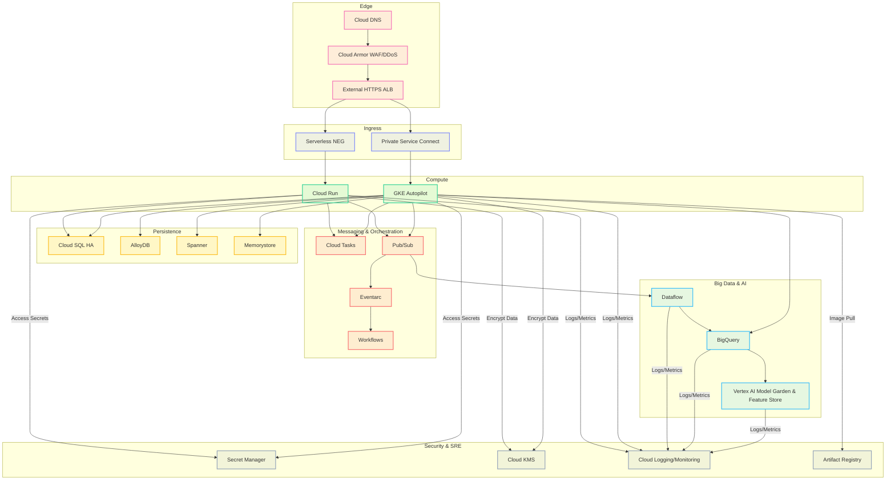

## エグゼクティブサマリー: Google Cloudのアーキテクチャに関するメンタルモデル

Google Cloud Platform (GCP) は単なるサービスの集合体ではありません。それは、Googleが数十年にわたる地球規模での運用を通じて洗練させてきた、Googleの内部インフラストラクチャが外部に公開されたものです。この基本的なメンタルモデルを理解することは、回復力があり、高性能で、コスト最適化されたエンタープライズソリューションを設計するために不可欠です。

<AudioPlayer src="/static/audio/google-cloud-platform-all-services-architecture-handbook-ja.mp3" title="この記事を聴く" voice="Google Cloud ja-JP-Neural2-B" />


<InteractiveToolCard tool="bigquery" />

## 地球規模のネットワーク: Jupiter Fabric

Google Cloudの差別化の中核にあるのは、Jupiter fabricとよく呼ばれるグローバルなプライベートネットワークです。これはパブリックインターネットではなく、専用の、高帯域幅、低遅延の国際ネットワークです。

| 機能 | 説明 | 影響 |
|:--------|:------------|:-------|
| **Jupiter Fabric** | Googleのプライベートなソフトウェア定義ネットワーク（SDN）で、すべてのデータセンターをグローバルに接続します。 | 予測可能なパフォーマンス、リージョン間トラフィックの遅延削減。 |
| **1 Pbps Bisection Bandwidth** | ネットワークの任意の2つの半分間でトラフィックを伝送する総容量。 | 最も要求の厳しいワークロードでもネットワークがボトルネックになることを排除。 |
| **Andromeda SDN** | VPC、ロードバランシング、ネットワークサービスを支えるネットワーク仮想化スタック。 | 高度なネットワーク機能、マイクロセグメンテーション、ポリシー適用を可能にします。 |
| **Premium Tier** | デフォルトのルーティング。トラフィックは最寄りのエッジPoPでGoogleのネットワークに入り、プライベートバックボーンを通過します。 | 最適なパフォーマンス、低遅延、高信頼性。ほとんどのプロダクションワークロードに推奨。 |
| **Standard Tier** | トラフィックは宛先リージョンに近い場所でGoogleのネットワークに入り、パスの大部分でパブリックインターネットを利用します。 | 遅延に敏感でないワークロード向けにコスト最適化されており、エグレス料金が低い。 |

**実用的な教訓:** プロダクションアプリケーションには常にPremium Tierをデフォルトにしてください。Standard Tierは、開発、テスト、または遅延が重要でない特定のコスト重視のバッチ処理に適しています。パフォーマンスの違いはかなり大きいです。

## リソース階層

GCPのリソース階層は、リソースを整理および管理し、ポリシーを適用し、アクセスを制御するための構造化された方法を提供します。これはガバナンスとセキュリティにとって重要なコンポーネントです。

| レベル | 説明 | 主なユースケース |
|:------|:------------|:--------------|
| **組織** | 企業に属するすべてのGoogle Cloudリソースのルートノード。 | 一元化された請求、IAM、ポリシー適用（組織ポリシー）。 |
| **フォルダ** | 組織の下にプロジェクトをグループ化します。ネスト可能。 | 部門別または環境ベースのグループ化（例: `dev`、`prod`）。 |
| **プロジェクト** | リソースを整理するための基本的な単位。すべてのリソースはプロジェクトに属します。 | 請求、API管理、リソース分離、IAM境界。 |
| **リソース** | Compute Engineインスタンス、Cloud Storageバケット、BigQueryデータセットなどの個々のサービス。 | 実際のコンピューティング、ストレージ、ネットワーキング、データ資産。 |

**IAMポリシーの継承:** 上位レベル（例: 組織、フォルダ）で設定されたIAMポリシーは、下位レベルのすべてのリソースに継承されます。これにより、きめ細かな制御とポリシー管理の簡素化が可能になります。

**組織の制約（組織ポリシー）:** これらは、管理者が組織全体でリソースをどのように構成できるかについて制限を定義できる強力なガードレールです。例としては、リソースの場所の制限、外部IPアドレスの無効化、特定のAPI使用の強制などがあります。

```bash
# Example: List organization policies for a project
gcloud org-policies list --project=your-project-id

# Example: Describe a specific organization policy
gcloud org-policies describe compute.disableExternalIpAccess --organization=your-organization-id
```

## Borgの系譜

Googleの内部クラスタ管理システムであるBorgは、Kubernetesの直接の祖先です。この系譜を理解することで、GCPのコンテナファーストの哲学と、その多くのサービスの設計原則についての洞察が得られます。

| コンセプト | Borgの影響 | GCPでの具現化 |
|:--------|:-----------------|:------------------|
| **コンテナ化** | Borgは、コンテナベースのワークロード分離とスケジューリングを大規模に開拓しました。 | Docker、Container Registry、Cloud Run、GKE。 |
| **宣言型API** | Borgは、宣言型仕様を介してワークロードを管理しました。 | Kubernetes YAML、Cloud Deployment Manager、Terraform。 |
| **自己修復システム** | Borgは、失敗したタスクを自動的に再スケジュールし、望ましい状態を維持しました。 | GKE Autopilot、マネージドインスタンスグループ、Cloud Runのオートスケーリング。 |
| **サービスディスカバリ** | Borgは内部サービスディスカバリメカニズムを提供しました。 | Cloud DNS、内部ロードバランサー、GKEサービスディスカバリ。 |
| **リソース効率** | Borgの主な目標は、クラスタ利用率を最大化することでした。 | GKE Autopilotのノード管理、サーバーレスサービス（Cloud Run、Cloud Functions）。 |

**実用的な教訓:** Google Cloudは、コンテナ化されたイミュータブルなインフラストラクチャ向けに本質的に設計されています。このパラダイムを受け入れてください。Cloud RunやGKE Autopilotのようなサービスは、単に便利であるだけでなく、Googleの数十年にわたる内部運用経験の集大成を表しています。

---

## エンドツーエンドのエンタープライズリファレンスアーキテクチャ

このアーキテクチャは、ゼロトラスト原則と多層防御を重視した、Google Cloud上での堅牢で安全かつスケーラブルなエンタープライズデプロイメントを示しています。



**ゼロトラストデータフローと多層防御:**

1.  **エッジセキュリティ (Cloud DNS, Cloud Armor):** すべての外部トラフィックはまずCloud DNSを経由し、その後Cloud ArmorによってDDoS保護とWAF機能が適用されます。これは第一線の防御であり、悪意のあるトラフィックがコンピューティングリソースに到達する前にフィルタリングします。
2.  **制御されたイングレス (External HTTPS ALB, Serverless NEG, Private Service Connect):**
    *   External HTTPS ALBはTLSを終端し、単一のエントリポイントを提供します。
    *   **Serverless NEG**はトラフィックをCloud Runにルーティングし、認証済みで承認されたリクエストのみがサーバーレス関数に到達するようにします。Cloud Run自体がサービスレベルでIAMを強制します。
    *   **Private Service Connect (PSC)**はGKE Autopilotに使用され、GKEサービスがパブリックインターネットに公開されないようにします。すべての通信は、PSCエンドポイントを介して接続する外部クライアントであっても、Googleのネットワーク内でプライベートに行われます。これにより、GKEコントロールプレーンとワークロードのパブリックIP露出が排除されます。
3.  **コンピューティング分離 (Cloud Run, GKE Autopilot):**
    *   **Cloud Run:** 強力なワークロード分離、自動スケーリング、組み込みのセキュリティ機能を提供します。各リビジョンは分離されたサンドボックスで実行されます。
    *   **GKE Autopilot:** Googleがノードのプロビジョニング、パッチ適用、スケーリングを含む基盤となるインフラストラクチャを管理し、攻撃対象領域と運用オーバーヘッドを削減します。ワークロードは分離されたPodで実行されます。GKE内のネットワークポリシーは、Pod間の通信をさらに制限します。
4.  **データ永続化セキュリティ:**
    *   **Cloud SQL HA, AlloyDB, Spanner, Memorystore:** すべてのデータストアはマネージドサービスであり、デフォルトで保存時および転送時の暗号化を提供します。アクセスはIAMとプライベートIP接続（VPC Service Controlsでさらにアクセスを制限可能）を介して制御されます。高可用性（HA）構成により、回復力が確保されます。
5.  **メッセージングとオーケストレーションセキュリティ:**
    *   **Cloud Tasks, Pub/Sub, Eventarc, Workflows:** これらのサービスは、非同期通信とワークフローオーケストレーションを容易にします。アクセスはIAMを介して制御されます。Pub/SubトピックはVPC Service Controlsで保護できます。
6.  **ビッグデータとAIセキュリティ:**
    *   **Dataflow, BigQuery, Vertex AI:** これらのサービスは、大規模なデータ処理と機械学習を処理します。データは暗号化され、アクセスはIAMを介して厳密に制御されます。BigQueryは列レベルのセキュリティとデータマスキングを提供します。Vertex AIは、安全なモデルデプロイとデータアクセスを保証します。
7.  **一元化されたセキュリティとSRE (Secret Manager, KMS, Cloud Logging/Monitoring, Artifact Registry):**
    *   **Secret Manager:** APIキー、データベース認証情報、その他の機密データを一元的に暗号化して保存します。アプリケーションは実行時にシークレットを取得し、ハードコーディングを回避します。
    *   **Cloud KMS:** サービス全体のデータ暗号化のための暗号化キーを管理します。キー管理の職務分離を保証します。
    *   **Cloud Logging/Monitoring:** 包括的な可観測性、監査、アラートを提供します。すべてのサービスインタラクションがログに記録され、異常な動作の検出を可能にします。
    *   **Artifact Registry:** コンテナイメージやその他のビルド成果物を安全に保存します。脆弱性スキャンを強制し、信頼できるイメージのみがデプロイされるようにします。

このアーキテクチャは、ネットワーク境界内であっても暗黙の信頼を仮定しないことで、ゼロトラストを具現化しています。すべてのインタラクションには明示的な承認が必要であり、すべてのレイヤーが潜在的な脅威に対する防御を提供します。

## ドメイン1: コンピューティングとサーバーレスエンジン

このドメインでは、Google Cloudの主要なコンピューティングサービスについて説明します。これには、完全に管理されたサーバーレスプラットフォームから、高度にカスタマイズ可能な仮想マシンやコンテナオーケストレーションまでが含まれます。実用的な適用、トレードオフの理解、およびプロダクショングレードのワークロードのための高度な機能の活用に焦点を当てています。

### Cloud Run

Cloud Runは、コンテナ化されたアプリケーションをデプロイするための完全に管理されたコンピューティングプラットフォームです。インフラストラクチャ管理を抽象化し、開発者がコードに集中できるようにします。

*   **コンテナランタイム**: Cloud RunはOCI準拠のコンテナイメージを実行します。各インスタンスに堅牢で安全なサンドボックス環境を提供します。
*   **インスタンスあたりの同時実行数**: 単一のCloud Runインスタンスは、複数の同時リクエストを処理できます。デフォルトは80で、最大1000まで設定可能です。同時実行数を増やすとリソース利用率が向上しますが、アプリケーションがスレッドセーフで非ブロッキングである必要があります。
*   **スケール・トゥ・ゼロ**: 主要なサーバーレス機能であるCloud Runは、トラフィックがない場合に自動的にゼロインスタンスにスケールダウンし、アイドルコストを排除します。
*   **最小インスタンス数**: 重要なアプリケーションのコールドスタート遅延を減らすために、`min-instances`を設定して、指定された数のインスタンスをウォーム状態に保ち、トラフィックを処理できるようにすることができます。これにより、これらのインスタンスに対して継続的な課金が発生します。
*   **直接VPCエグレス**: 仮想プライベートクラウド（VPC）ネットワーク内のリソース（例: Cloud SQL、Memorystore、内部API）との安全でプライベートな通信のために、Cloud Runは直接VPCエグレス用に構成できます。これにより、すべての送信トラフィックが指定されたVPCコネクタを介してルーティングされます。
*   **GPUサポート**: Cloud Runは現在、AI/ML推論などの特殊な処理を必要とするワークロード向けにGPUアクセラレーションをサポートしています。これは`--cpu`および`--gpu`フラグを介して構成されます。
*   **Cloud Run Jobs**: Cloud Run内の個別のサービスで、HTTP以外の、短命または長時間実行されるバッチジョブを実行します。ジョブは手動で、スケジュールに基づいて、またはEventarcを介してトリガーできます。並列処理と再試行をサポートします。

### GKE (Google Kubernetes Engine)

GKEはGoogle CloudのマネージドKubernetesサービスであり、コンテナ化されたアプリケーションのデプロイ、管理、スケーリングのための堅牢なプラットフォームを提供します。

*   **Autopilot vs Standard**:
 | 機能 | GKE Standard | GKE Autopilot |
 | :------ | :----------- | :------------ |
 | ノード管理 | ユーザー管理 | Google管理 |
 | 料金 | VM + GKE料金 | Podベース |
 | カスタマイズ | 高い（ノードプール、OS） | 制限あり（事前定義プロファイル） |
 | セキュリティ | 共有責任 | 強化（強化されたノード） |
 | スケーリング | 手動/CA | 自動（Pod駆動） |
 | ユースケース | 最大限の制御、カスタムOS | ハンズオフ、コスト最適化 |
    *   **トレードオフ**: Autopilotは、ノード、スケーリング、パッチ適用を管理することで、運用を大幅に簡素化します。ノードレベルのカスタマイズが重要でないほとんどのワークロードに最適です。Standardは、ノードタイプ、オペレーティングシステム、ネットワーキングに対するきめ細かな制御を提供し、高度に専門化されたワークロードやレガシーワークロードに適しています。
    *   **セキュリティ体制**: Autopilotは、GoogleがノードOSとランタイムセキュリティを管理することで、デフォルトで強化されたセキュリティ体制を提供します。Standardは、ユーザーがノードのセキュリティ更新と構成を管理する必要があります。
    *   **ノード自動プロビジョニング**: GKE Standardでは、この機能は保留中のPodリソース要求に基づいて新しいノードプールを動的に作成し、リソース割り当てを最適化し、手動介入を削減します。

*   **マルチクラスタイングレス**: 単一のグローバル外部IPアドレスを使用して、複数のGKEクラスタ（異なるリージョンにある可能性もある）にデプロイされたアプリケーションにトラフィックをルーティングできます。これにより、地理的に分散されたサービスに対して、グローバルロードバランシング、フェイルオーバー、および簡素化されたDNS管理が提供されます。
*   **Gateway API**: Kubernetesイングレスの次世代APIであり、従来のIngress APIと比較して、ルーティング、トラフィック管理、ポリシー適用を構成するためのより表現力豊かで拡張可能な方法を提供します。`GatewayClass`、`Gateway`、`HTTPRoute`、`TCPRoute`などの概念を導入しています。

### Compute Engine

Compute Engineは、さまざまなマシンタイプ、ストレージオプション、および料金モデルを備えた高度にカスタマイズ可能な仮想マシン（VM）を提供します。

*   **C3/N4マシンファミリー**:
    *   **C3**: ハイパフォーマンスコンピューティング（HPC）、データ分析、要求の厳しいエンタープライズワークロード向けに最適化されています。第4世代Intel Xeon Scalableプロセッサ（Sapphire Rapids）とDDR5メモリを搭載しています。高いコア数とメモリ比率を提供します。
    *   **N4**: N2の後継となる汎用マシンファミリー。幅広いワークロードに対してパフォーマンスとコスト効率のバランスを提供します。
*   **Hyperdisk**: Compute Engine向けのGoogle Cloudの次世代ブロックストレージであり、Persistent Diskよりも大幅に高いパフォーマンスと柔軟性を提供します。
    *   **Hyperdisk Balanced**: 優れたパフォーマンス特性を持つ汎用で費用対効果の高いブロックストレージ。
    *   **Hyperdisk Extreme**: 超高IOPSとスループットを必要とする最も要求の厳しいトランザクションワークロード（例: 大規模データベース）向けに設計されています。
    *   **Hyperdisk Throughput**: シーケンシャルI/Oパフォーマンスが重要なスループット集約型ワークロード（例: データ分析、ストリーミング）向けに最適化されています。
*   **Spot VM**: リソースが他の場所で必要になった場合にCompute Engineによってプリエンプトされる可能性がある、非常に費用対効果の高いVMです。中断が許容されるフォールトトレラントな、ステートレスな、またはバッチワークロードに最適です。オンデマンド価格から最大91%の大幅なコスト削減が可能です。
*   **ライブマイグレーション**: Compute Engineの機能で、ダウンタイムなしでVMをあるホストマシンから別のホストマシンに移行できます。これはホストのメンテナンス、パッチ適用、アップグレードに不可欠であり、重要なアプリケーションの高可用性を保証します。

### Cloud Functions (第2世代)

Cloud Functions 第2世代はCloud Run上に構築されており、その基盤となるインフラストラクチャと機能を継承しています。

*   **Cloud Run基盤**: Cloud Runを活用することで、第2世代関数は、第1世代の制限に対処する、より長いリクエストタイムアウト、高い同時実行性、および直接VPCエグレス機能を提供します。
*   **Eventarcトリガー**: Cloud Functionsは主にイベント駆動型です。Eventarcは、100を超えるGoogle Cloudソース（例: Cloud Storage、Pub/Sub、Firestore）からのイベントをCloud Functionsにルーティングするための統一されたメカニズムを提供し、堅牢なイベント駆動型アーキテクチャを可能にします。
*   **タイムアウト**: 第2世代関数は、HTTP関数で最大60分、イベント駆動型関数で最大9時間という大幅に長いタイムアウトをサポートしており、より複雑で長時間実行されるタスクに対応できます。
*   **同時実行性**: Cloud Runと同様に、第2世代関数はインスタンスあたり複数の同時リクエストを処理でき、リソース利用率を向上させ、コールドスタートを削減します。

### Cloud Batch

Cloud Batchは、高スループットのバッチコンピューティングのための完全に管理されたサービスです。大規模な並列およびシーケンシャルバッチジョブの実行を簡素化します。

*   **高スループットバッチコンピューティング**: 科学シミュレーション、金融モデリング、メディアトランスコーディングなど、大規模なデータセットの処理や多数の独立したタスクの実行を必要とするワークロード向けに設計されています。
*   **MPI (Message Passing Interface)**: Cloud Batchは、密結合された並列ワークロード向けにMPIをサポートしており、ジョブ内の異なるVMで実行されているタスク間の通信を可能にします。
*   **アレイジョブ**: 単一のジョブ定義で数千の同一タスクを起動できる強力な機能で、それぞれが異なる入力またはデータセットの一部を処理します。これは、embarrassingly parallelなワークロードに効率的です。
*   **Spot VMフォールトトレランス**: Cloud Batchは、大幅なコスト削減のためにSpot VMを活用できます。自動再試行やチェックポイントなどのプリエンプションを処理するための組み込みメカニズムが含まれており、多くのバッチワークロードでSpot VMを実用的にします。

### 簡潔な比較表

| サービス | 主要なアーキタイプ | 最適な場合 | 避けるべき場合 |
| :------ | :---------------- | :-------- | :--------- |
| Cloud Run | サーバーレスコンテナ | HTTP/イベント駆動型マイクロサービス、API | 長時間実行されるステートフルなアプリ、極端なGPU要件 |
| GKE | コンテナオーケストレーション | 複雑なマイクロサービス、カスタム制御、ハイブリッド | シンプルなアプリ、最小限の運用チーム |
| Compute Engine | IaaS VM | レガシーアプリ、カスタムOS、特定のハードウェア | サーバーレスが理想的、高い運用オーバーヘッド |
| Cloud Functions | サーバーレスFaaS | イベント駆動型、短命、ステートレス関数 | 長時間実行されるプロセス、複雑な状態 |
| Cloud Batch | バッチ処理 | HPC、大規模データ処理、アレイジョブ | リアルタイム、インタラクティブ、低遅延 |

### プロダクション `gcloud` CLIレシピ

#### Cloud Runサービスデプロイ

```bash
# Deploy a Cloud Run service with specific resource limits, min/max instances, and VPC egress
gcloud run deploy my-service \
  --image gcr.io/my-project/my-app:v1.0.0 \
  --platform managed \
  --region us-central1 \
  --project my-project-id \
  --service-account my-service-account@my-project-id.iam.gserviceaccount.com \
  --cpu 2 \
  --memory 2Gi \
  --min-instances 1 \
  --max-instances 10 \
  --concurrency 80 \
  --timeout 300s \
  --vpc-egress all \
  --vpc-connector projects/my-project-id/locations/us-central1/connectors/my-vpc-connector \
  --set-env-vars ENV_VAR_KEY=ENV_VAR_VALUE \
  --no-allow-unauthenticated
```

#### Cloud Runジョブ作成

```bash
# Create a Cloud Run Job for a batch task
gcloud run jobs create my-batch-job \
  --image gcr.io/my-project/my-batch-processor:v1.0.0 \
  --region us-central1 \
  --project my-project-id \
  --service-account my-batch-sa@my-project-id.iam.gserviceaccount.com \
  --cpu 4 \
  --memory 8Gi \
  --tasks 10 \
  --parallelism 5 \
  --timeout 3600s \
  --set-env-vars INPUT_BUCKET=gs://my-input-data,OUTPUT_BUCKET=gs://my-output-data
```

#### GKE Autopilotクラスタ作成

```bash
# Create a GKE Autopilot cluster with release channel and private endpoint
gcloud container clusters create-auto my-autopilot-cluster \
  --region us-central1 \
  --project my-project-id \
  --release-channel stable \
  --network projects/my-project-id/global/networks/my-vpc \
  --subnetwork projects/my-project-id/regions/us-central1/subnetworks/my-gke-subnet \
  --enable-private-nodes \
  --enable-private-endpoint \
  --master-ipv4-cidr 172.16.0.0/28 \
  --workload-pool my-project-id.svc.id.goog \
  --enable-workload-identity
```

#### Compute Engine Spot VMインスタンス作成

```bash
# Create a Compute Engine Spot VM with Hyperdisk Balanced and a specific service account
gcloud compute instances create my-spot-vm \
  --project my-project-id \
  --zone us-central1-a \
  --machine-type n2-standard-4 \
  --provisioning-model SPOT \
  --instance-termination-action STOP \
  --boot-disk-device-name my-spot-boot-disk \
  --boot-disk-type hyperdisk-balanced \
  --boot-disk-size 50GB \
  --image-family debian-11 \
  --image-project debian-cloud \
  --network-interface network=my-vpc,subnet=my-compute-subnet \
  --service-account my-compute-sa@my-project-id.iam.gserviceaccount.com \
  --scopes=https://www.googleapis.com/auth/cloud-platform \
  --metadata startup-script='#!/bin/bash\necho "Hello from Spot VM" > /tmp/startup.txt'
```

#### Cloud Functions (第2世代) デプロイ

```bash
# Deploy a 2nd Gen Cloud Function triggered by a Pub/Sub topic
gcloud functions deploy my-pubsub-function-v2 \
  --gen2 \
  --runtime python39 \
  --region us-central1 \
  --project my-project-id \
  --source ./function-source \
  --entry-point process_message \
  --trigger-topic my-pubsub-topic \
  --service-account my-function-sa@my-project-id.iam.gserviceaccount.com \
  --memory 512MB \
  --timeout 300s \
  --concurrency 10 \
  --vpc-connector projects/my-project-id/locations/us-central1/connectors/my-vpc-connector \
  --egress-settings private-ranges-only
```

#### Cloud Batchジョブ送信

```bash
# Submit a Cloud Batch job using a JSON configuration file
# job_config.json example:
# {
#   "taskGroups": [
#     {
#       "taskSpec": {
#         "runnables": [
#           {
#             "script": {
#               "text": "echo 'Processing task ${BATCH_TASK_INDEX}' && sleep 10"
#             }
#           }
#         ],
#         "computeResource": {
#           "cpuMilli": 1000,
#           "memoryMib": 512
#         }
#       },
#       "taskCount": 5,
#       "parallelism": 2
#     }
#   ],
#   "allocationPolicy": {
#     "instances": [
#       {
#         "policy": {
#           "machineType": "e2-standard-2",
#           "provisioningModel": "SPOT"
#         }
#       }
#     ]
#   },
#   "logsPolicy": {
#     "destination": "CLOUD_LOGGING"
#   }
# }
gcloud batch jobs submit my-batch-job-from-file \
  --location us-central1 \
  --project my-project-id \
  --config job_config.json \
  --service-account my-batch-sa@my-project-id.iam.gserviceaccount.com
```

## ドメイン 2: クラウドデータベースおよびインメモリストア

### Cloud SQL

Cloud SQL は、PostgreSQL、MySQL、SQL Server 向けのフルマネージド型リレーショナルデータベースサービスである。パッチ適用、バックアップ、レプリケーションなどの運用上のオーバーヘッドを抽象化し、アプリケーション開発への集中を可能にする。

#### PostgreSQL、MySQL、SQL Server

Cloud SQL はこれらの主要なデータベースエンジンの最新メジャーバージョンをサポートしており、既存のアプリケーションやツールとの互換性を提供する。

*   **PostgreSQL**: 堅牢で機能豊富かつ拡張性に優れ、複雑なトランザクションワークロードや GIS アプリケーションで頻繁に採用される。
*   **MySQL**: 広く普及しており、Web アプリケーションにおける使いやすさとパフォーマンスで知られる。
*   **SQL Server**: 既存の Microsoft エコシステムに依存するエンタープライズ環境に不可欠であり、Always On 可用性グループ（Cloud SQL によるマネージド提供）などの機能をサポートする。

#### 高可用性（HA）リージョンフェイルオーバー

Cloud SQL HA は、同一リージョン内の異なるアベイラビリティゾーンにあるスタンバイインスタンスへの自動フェイルオーバーにより、ビジネス継続性を確保する。これは、プライマリインスタンスからスタンバイへデータを同期レプリケーションすることで実現される。プライマリインスタンスの障害（ゾーン障害やインスタンスのクラッシュなど）が発生した場合、Cloud SQL は自動的にスタンバイをプライマリへ昇格させ、ダウンタイムを最小限に抑える。

*   **メカニズム**: 新しいプライマリへ自動的に切り替わる共有 IP アドレスを使用する。
*   **RPO/RTO**: 同期レプリケーションにより目標復旧時点（RPO）はほぼゼロであり、目標復旧時間（RTO）は通常 60 秒未満である。

#### 自動メンテナンス

Cloud SQL は、OS のパッチ適用、データベースエンジンのアップデート、セキュリティ脆弱性の修正といった定常的なメンテナンスタスクを自動で処理する。本番ワークロードへの影響を最小限に抑えるため、希望する曜日と時間帯を指定してメンテナンスウィンドウを構成できる。

#### リードレプリカ

リードレプリカは、読み取り集中型のワークロードをプライマリインスタンスからオフロードし、パフォーマンスとスケーラビリティを向上させる。プライマリインスタンスの非同期コピーであり、レポート作成、分析、地理的に分散した読み取りアクセスに適している。

*   **クロスリージョンレプリカ**: 災害復旧（DR）やグローバルユーザーの読み取りレイテンシ低減のために、異なるリージョンにプロビジョニングできる。
*   **昇格**: リードレプリカをスタンドアロンのプライマリインスタンスへ昇格させることが可能であり、災害復旧やデータベース移行のシナリオで有用である。

#### プライベート IP ピアリングと Private Service Connect の比較

どちらのメカニズムも、パブリックインターネットへの露出を避けつつ Cloud SQL インスタンスへのプライベート接続を可能にする。

*   **プライベート IP ピアリング（VPC ネットワークピアリング）**:
    *   **メカニズム**: ユーザーの VPC ネットワークを、Cloud SQL インスタンスが存在する Google の内部サービスプロデューサーネットワークに直接接続する。
    *   **セットアップ**: VPC 内で Cloud SQL 用のプライベート IP 範囲を構成する必要がある。
    *   **スコープ**: ネットワーク全体のピアリングであり、VPC 内のすべてのリソースから Cloud SQL へのアクセスを許可する。
    *   **制限事項**: IP アドレス空間の管理が複雑になる場合があり、ピアリングの制限が適用される。

*   **Private Service Connect（PSC）**:
    *   **メカニズム**: VPC ネットワークピアリングを使用せず、VPC 内の内部 IP アドレスを使用してマネージドサービスへのプライベートアクセスを提供する。
    *   **セットアップ**: サービスプロデューサーのネットワーク内のサービスアタッチメントを指す転送ルールとエンドポイントを VPC 内に作成する。
    *   **スコープ**: よりきめ細かな制御が可能で、特定のサービスに対して特定のエンドポイントを割り当てられる。
    *   **利点**: IP アドレス管理を簡素化し、ピアリングの制限を回避するとともに、サービストラフィックを分離することでネットワークセキュリティを強化する。新規デプロイでは推奨される方式である。

### AlloyDB for PostgreSQL

AlloyDB は、要求の厳しいエンタープライズワークロード向けに設計されたフルマネージドの PostgreSQL 互換データベースサービスであり、標準の PostgreSQL と比較して優れたパフォーマンスと可用性を提供する。

#### コンピューティングとストレージの分離アーキテクチャ

AlloyDB は、コンピューティング（クエリ処理）とストレージ（データ永続化）を分離している。

*   **コンピューティングレイヤー**: クエリを処理する複数の独立したコンピューティングノードで構成される。これらのノードはステートレスであり、独立してスケーリングできる。
*   **ストレージレイヤー**: データをカラムナ（列指向）形式で保存する分散共有ストレージサービスである。データのレプリケーション、自己修復、継続的なバックアップを処理する。
*   **利点**: ストレージに影響を与えることなくコンピューティングリソースを迅速にスケーリングでき、その逆も可能である。また、データ損失を伴わずにコンピューティングノードが独立して障害から復旧できるため、耐障害性が向上する。

#### カラムナエンジン

AlloyDB は分析クエリ用のカラムナエンジンを組み込んでいる。標準の PostgreSQL は主に行指向（ロー指向）であるが、AlloyDB のインテリジェントなストレージレイヤーは特定のテーブルやパーティションのデータをカラムナ形式で保持できる。これにより、個別の ETL プロセスやデータウェアハウスを必要とせず、分析ワークロード（OLAP クエリなど）を大幅に高速化する。このハイブリッドトランザクション／分析処理（HTAP）機能は大きな差別化要因である。

#### トランザクションスケーリングと分析スケーリング

*   **トランザクションスケーリング**: コンピューティングノードを追加して、増加する同時実行トランザクションを処理することで実現される。共有ストレージレイヤーにより、すべてのノード間でデータ整合性が保証される。
*   **分析スケーリング**: カラムナエンジンとインテリジェントなキャッシュメカニズムにより、分析クエリのパフォーマンスが最適化される。リードレプリカを使用して分析ワークロードをオフロードすることも可能である。AlloyDB のアーキテクチャにより、単一のデータベース内で両方のタイプのワークロードを効率的にスケーリングできる。

#### pgvector によるベクトル埋め込み

AlloyDB は `pgvector` 拡張機能をサポートしており、データベース内で直接ベクトル埋め込みを効率的に保存およびクエリできる。これは、類似性検索、レコメンデーションエンジン、セマンティック検索などの AI/ML アプリケーションにおいて極めて重要である。

*   **機能**: 高次元ベクトルを保存し、さまざまな距離メトリクス（L2 距離、コサイン類似度など）をサポートするとともに、高速な最近傍探索のための最適化されたインデックスを提供する。
*   **統合**: 開発者は個別のベクトルデータベースを必要とせず、AI 搭載機能をアプリケーションに直接組み込むことができる。

### Cloud Spanner

Cloud Spanner は、高い可用性と大規模なスケーラビリティを必要とするミッションクリティカルなアプリケーション向けに構築された、グローバル分散型の強整合性リレーショナルデータベースサービスである。

#### TrueTime API

TrueTime は Spanner の基盤技術であり、不確実性の範囲が厳密に制限されたグローバルに一貫したウォールクロック時刻を提供する。

*   **メカニズム**: Google のデータセンター内の原子時計と GPS 受信機を使用して、世界中のすべての Spanner サーバー間で時刻を同期する。
*   **保証**: すべてのトランザクションに対してタイムスタンプ区間 `[earliest, latest]` を提供し、時刻 `t` より前にコミットされたすべてのトランザクションが時刻 `t` までにどこからでも参照可能であることを保証する。これにより外部整合性が実現される。
*   **影響**: グローバルな整合性のために Paxos や Raft のような分散コミットプロトコルをアプリケーション側で実装する必要がなくなり、アプリケーション開発の簡素化とパフォーマンスの向上をもたらす。

#### 外部整合性

Spanner は、直列化可能性（Serializability）よりも強力な保証である外部整合性（External Consistency）を提供する。これは、どのクライアントから観測されたトランザクションのグローバルな順序も、現実世界のウォールクロック（実時間）におけるトランザクションの順序と一致することを意味する。これにより分散トランザクションの設計が簡素化され、大陸をまたいだデータ整合性が確保される。

#### リージョンインスタンスとマルチリージョンインスタンス

*   **リージョンインスタンス**: 単一の Google Cloud リージョン内の 3 つのアベイラビリティゾーン間でデータが同期レプリケーションされる。そのリージョン内での高可用性を提供する。
*   **マルチリージョンインスタンス**: 複数のリージョン（`nam-eur-asia1` など）間でデータが同期レプリケーションされる。極めて高い可用性（99.999% の SLA）と、グローバルに分散したアプリケーション向けの低レイテンシな読み取りを提供する。整合性を保つため、書き込みは引き続きプライマリリージョンにルーティングされる。

#### きめ細かなインスタンスサイジング（処理ユニット）

Spanner インスタンスは「処理ユニット（PU）」単位でサイジングされる。各 PU は一定量の CPU、メモリ、I/O 容量を提供する。

*   **スケーリング**: PU を追加または削除することでインスタンスをスケールアップ・スケールダウンでき、パフォーマンスとコストをきめ細かく制御できる。
*   **最小構成**: Spanner インスタンスは 100 PU（0.1 ノード）から開始できる。
*   **自動スケーリング**: 完全自動ではないものの、カスタムソリューションと統合することでメトリクスに基づいて PU をスケーリングできる。

#### Spanner Graph

Spanner Graph は、Spanner の強整合性とスケーラビリティを活用しながら、Spanner データに対してグラフのようなクエリを直接実行できる機能である。独立したグラフデータベースではなく、Spanner 内でグラフデータをモデリングおよびクエリするための機能群とベストプラクティスのセットである。

*   **モデリング**: Spanner テーブル内で隣接リストモデルまたはエッジリストモデルを使用する。
*   **クエリ**: パス探索やトラバーサル（走査）クエリのために、再帰 CTE（共通テーブル式）を備えた SQL を活用する。
*   **ユースケース**: エンティティ間の関係性が重要となる不正検出、ソーシャルネットワーク、レコメンデーションエンジン、サプライチェーン分析など。

### Firestore

Firestore は、モバイル、Web、サーバー開発向けの柔軟でスケーラブルな NoSQL ドキュメントデータベースである。リアルタイム同期とオフラインサポートを提供する。

#### ネイティブモードと Datastore モード

Firestore には 2 つのモードがあり、主に API と機能セットが異なる。

*   **ネイティブモード（Firestore）**:
    *   **データモデル**: ドキュメント指向であり、ドキュメントの階層的なコレクションで構成される。
    *   **API**: リアルタイムリスナー、モバイル/Web SDK、強整合性。
    *   **ユースケース**: リアルタイム更新を必要とするモバイル/Web アプリケーション、コラボレーションアプリ。
    *   **整合性**: 読み取りと書き込みの両方で強整合性を提供する。

*   **Datastore モード（Cloud Datastore）**:
    *   **データモデル**: エンティティ指向であり、App Engine Datastore と同様にエンティティとカインド（種別）を持つ。
    *   **API**: 主にサーバーサイド SDK を使用し、デフォルトで結果整合性（祖先のクエリに対しては強整合性）。
    *   **ユースケース**: サーバーサイドアプリケーション、バックエンドサービス、大規模データストレージ。
    *   **整合性**: ほとんどのクエリで結果整合性、祖先のクエリでは強整合性。
    *   **移行**: 既存の Cloud Datastore データベースは、技術的には現在 Datastore モードの Firestore として動作している。

#### リアルタイムリスナー

Firestore のリアルタイムリスナーを使用すると、クライアントはドキュメントまたはクエリ結果セットの変更をサブスクライブできる。サーバー上でデータが変更されると、Firestore は接続されているクライアントにリアルタイムで更新をプッシュする。

*   **メカニズム**: 永続的な接続に WebSockets を使用する。
*   **利点**: 継続的なポーリングを行うことなく、高度なインタラクティブ性やコラボレーション機能を備えたアプリケーションを実現できる。
*   **オフラインサポート**: SDK がオフラインデータの永続化を自動的に処理し、接続が復旧した際に同期を行う。

#### 複合インデックス

Firestore はすべてのフィールドに対して単一フィールドインデックスを自動的に作成する。ただし、複数のフィールドを含むクエリ（例: `WHERE field1 == 'value' AND field2 > 'value'`）には複合インデックスが必要となる。

*   **定義**: Firebase コンソールまたは `firebase.indexes.json` ファイルを介して手動で定義する。
*   **最適化**: 効率的な複数フィールドクエリと並べ替えに不可欠である。複合インデックスがない場合、そのようなクエリは失敗する。
*   **コスト**: 各複合インデックスはストレージコストと書き込みコストを増加させるため、慎重に設計する必要がある。

#### 分散カウンターパターン

単一ドキュメント内のカウンターフィールドを直接インクリメントすると、高い同時実行性のシナリオで競合やパフォーマンスのボトルネックが発生する可能性がある。Firestore はこれを緩和するための分散カウンターパターンをサポートしている。

*   **シャーディングされたカウンター**: 単一のカウンターを複数の「シャード」（個別のドキュメント）に分割する。インクリメントする際は、ランダムにシャードを選択してその値を増加させる。合計カウントを取得するには、すべてのシャードの値を合算する。
*   **アトミックインクリメント**: Firestore の `FieldValue.increment()` を使用して、現在の値を最初に読み取ることなく数値フィールドをアトミックに更新し、読み取り・変更・書き込みの競合を減らす。
*   **トランザクション**: より複雑な複数ドキュメントの更新には、トランザクションを使用して原子性を確保する。

### Cloud Bigtable

Cloud Bigtable は、大規模な分析および運用ワークロード向けに設計されたフルマネージドのペタバイト規模 NoSQL データベースサービスである。時系列データ、マーケティングデータ、金融データ、IoT データに最適である。

#### LSM ツリーアーキテクチャ

Bigtable はログ構造化マージツリー（LSM-tree）アーキテクチャに基づいて構築されている。

*   **メカニズム**: 書き込みはまずインメモリバッファ（memtable）とコミットログに追加される。memtable がいっぱいになると、ディスク上の不変なソート済み文字列テーブル（SSTable）にフラッシュされる。読み取りは memtable と SSTable からデータをマージして行う。
*   **利点**: 書き込みがシーケンシャルであるため、高い書き込みスループットに最適化されている。また、範囲スキャンも効率的である。
*   **コンパクション**: バックグラウンドプロセスが SSTable を継続的にマージおよび圧縮し、パフォーマンスを維持して領域を再利用する。

#### 行キー（Row-Key）設計パターン

データは行キーによって辞書順に保存されるため、行キーの設計は Bigtable のパフォーマンスにとって極めて重要である。

*   **時系列データ**:
    *   **アンチパターン**: タイムスタンプをプレフィックスにする（例: `timestamp#device_id`）と、最新データへのアクセスが集中してホットスポットが発生する。
    *   **推奨パターン**: 逆順タイムスタンプ（例: `device_id#reverse_timestamp`）やハッシュプレフィックス（例: `hash(device_id)#timestamp`）を使用して均等に分散させる。
*   **一意の識別子**: 自然キーまたは UUID を使用する。UUID を使用する場合は、ホットスポットを避けるために連番（シーケンシャル）にならないようにする。
*   **関連データ**: 効率的な範囲スキャンが可能になるように行キーを設計して関連データをグループ化する（例: `user_id#order_id`）。
*   **ホットスポットの回避**: 少数の行キーに不釣り合いな量のトラフィックが集中する設計を避ける。

#### SSD と HDD の比較

Bigtable は 2 種類のストレージタイプを提供している。

*   **SSD ストレージ**: デフォルトであり、ほとんどのワークロードで推奨される。大幅に高いスループットと低いレイテンシを提供し、運用ワークロードや高性能な分析に最適である。
*   **HDD ストレージ**: GB あたりのコストは低いが、スループットは大幅に低く、レイテンシは高くなる。アーカイブデータや、パフォーマンスよりもコストが重視されるワークロードに適している。

#### レプリケーションとフェイルオーバー

Bigtable はマルチクラスターレプリケーションをサポートしており、異なるリージョンやゾーンにある複数のクラスター間でデータをレプリケーションできる。

*   **非同期レプリケーション**: クラスター間でデータは非同期にレプリケーションされる。
*   **高可用性**: 災害復旧（DR）を実現し、地理的に分散したユーザーに対して低レイテンシな読み取りを提供する。
*   **フェイルオーバー**: クラスター障害が発生した場合、トラフィックを正常なレプリカにリダイレクトできる。フェイルオーバーには通常、アプリケーションレベルのロジックが必要となる。
*   **整合性**: レプリカ間では結果整合性となる。

#### BigQuery との統合

Bigtable は BigQuery とスムーズに統合でき、高度な分析を実行できる。

*   **外部テーブル**: BigQuery は外部テーブルを使用して Bigtable データを直接クエリできるため、ETL プロセスが不要になる。これはアドホック分析や、Bigtable データと BigQuery 内の他のデータセットを結合する場合に有用である。
*   **データエクスポート**: より複雑な変換や長期アーカイブのために、Bigtable から Cloud Storage にデータをエクスポートし、BigQuery にロードすることもできる。

### Memorystore

Memorystore は Redis および Memcached 向けのフルマネージドサービスであり、高いスケーラビリティと可用性を備えたインメモリデータストアを提供する。

#### Memorystore for Redis Cluster

Memorystore for Redis には Basic と Standard の 2 つの階層がある。Standard 階層は高可用性とレプリケーションをサポートしている。Memorystore for Redis Cluster は、シャーディングされた Redis デプロイメント向けの専用オファリングである。

*   **シャーディング**: 複数の Redis ノード間でデータを自動的にシャーディングし、単一の Redis インスタンスの制限を超える水平スケーリングを可能にする。
*   **高可用性**: 各シャードはフェイルオーバー用にプライマリノードとレプリカノードを持つことができる。
*   **ユースケース**: 高いスループットと低いレイテンシを必要とするキャッシュ、セッション管理、リアルタイム分析、リーダーボード、メッセージキューなど。
*   **Redis 機能**: すべてのネイティブ Redis データ構造とコマンドをサポートする。

#### Memorystore for Valkey

Valkey は、Redis からフォークされたオープンソースの高性能インメモリデータストアである。Memorystore for Valkey は、Valkey インスタンス向けのマネージドサービスを提供する。

*   **互換性**: Redis との API 互換性を提供し、既存の Redis アプリケーションを容易に移行できる。
*   **機能**: キャッシュ、セッション管理、リアルタイムデータ処理など、Memorystore for Redis と同様の機能を提供する。
*   **将来性**: Valkey エコシステム内の今後のイノベーションを活用できる環境を提供する。

#### 永続化

Memorystore for Redis（Standard 階層および Cluster）は、再起動や障害時のデータ損失を防ぐための永続化オプションを提供している。

*   **RDB（Redis Database）スナップショット**: データセットのスナップショットを定期的にディスクに保存する。
*   **AOF（Append-Only File）**: すべての書き込み操作をファイルに記録し、再起動時にデータセットを再構築できるようにする。
*   **トレードオフ**: RDB は復旧が高速だが、より多くのデータが失われる可能性がある。AOF はより高い耐久性を提供するが、復旧に時間がかかる場合がある。Memorystore はこれらの構成を自動で管理する。

#### クラスタースケーリング

Memorystore for Redis Cluster では、クラスターサイズを動的にスケーリングできる。

*   **水平スケーリング**: シャードを追加または削除して、容量とスループットを増減させる。
*   **垂直スケーリング**: シャード内の個別ノードのメモリ容量を調整する。
*   **自動リシャーディング**: スケーリング操作中、Memorystore がシャード間のデータ再分散（リバランシング）を自動的に処理し、アプリケーションへの影響を最小限に抑える。

### 比較サマリー表

| データベースサービス | エンジンとモデル | スループット / スケール | 整合性モデル | 最適なユースケース |
|---|---|---|---|---|
| Cloud SQL | PostgreSQL、MySQL、SQL Server（リレーショナル） | GB/秒、TB 規模、垂直スケール | 強整合性 | OLTP、Web アプリ、エンタープライズアプリ |
| AlloyDB | PostgreSQL（リレーショナル、HTAP） | TB/秒、PB 規模、水平スケール | 強整合性 | 高性能 OLTP、HTAP、AI/ML |
| Cloud Spanner | カスタム（グローバル分散リレーショナル） | TB/秒、PB 規模、グローバル水平スケール | 外部整合性 | ミッションクリティカル、グローバル OLTP |
| Firestore | NoSQL ドキュメント | MB/秒、PB 規模、水平スケール | 強整合性（ネイティブ）、結果整合性（Datastore） | モバイル/Web アプリ、リアルタイム、IoT |
| Cloud Bigtable | NoSQL ワイドカラム | GB/秒、PB 規模、水平スケール | 結果整合性 | 時系列、IoT、アドテク、分析 |
| Memorystore | Redis、Valkey、Memcached（インメモリ KV） | GB/秒、TB 規模、水平スケール | 結果整合性 | キャッシュ、セッション管理、リアルタイム分析 |

### 本番環境向け `gcloud` CLI レシピ

#### HA、プライベート IP、バックアップを備えた Cloud SQL PostgreSQL のプロビジョニング

このコマンドは、高可用性、プライベート IP 接続、自動バックアップ、および特定のメンテナンスウィンドウを備えた Cloud SQL PostgreSQL インスタンスをプロビジョニングする。


```bash
gcloud sql instances create my-prod-pg-instance \
  --database-version=POSTGRES_14 \
  --region=us-central1 \
  --cpu=4 \
  --memory=16GB \
  --storage-size=500GB \
  --storage-type=SSD \
  --availability-type=REGIONAL \
  --enable-bin-log \
  --backup-start-time="03:00" \
  --backup-location=us-central1 \
  --database-flags="log_statement=all,max_connections=500" \
  --maintenance-window-day=SATURDAY \
  --maintenance-window-hour=02 \
  --network=projects/my-gcp-project/global/networks/my-vpc-network \
  --no-assign-ip \
  --allocated-ip-range-name=my-cloudsql-private-range \
  --root-password="<YOUR_STRONG_PASSWORD>" \
  --project=my-gcp-project
```


*   `--database-version`: PostgreSQL のバージョンを指定する。
*   `--region`: インスタンスを `us-central1` にデプロイする。
*   `--cpu`、`--memory`、`--storage-size`、`--storage-type`: インスタンスのリソースを定義する。
*   `--availability-type=REGIONAL`: リージョンフェイルオーバーを伴う高可用性（HA）を有効にする。
*   `--enable-bin-log`: ポイントインタイムリカバリおよびレプリケーションに不可欠なバイナリログを有効にする。
*   `--backup-start-time`、`--backup-location`: 自動日次バックアップを構成する。
*   `--database-flags`: PostgreSQL 固有のフラグを設定する。
*   `--maintenance-window-day`、`--maintenance-window-hour`: 希望するメンテナンスウィンドウを定義する。
*   `--network`: プライベート IP 用に指定された VPC ネットワークに接続する。
*   `--no-assign-ip`: インスタンスがプライベート IP 経由でのみアクセス可能であることを保証する。
*   `--allocated-ip-range-name`: プライベートサービスアクセス用に割り当てられた名前付き IP 範囲を指定する。この範囲は事前に VPC 内で割り当てておく必要がある。
*   `--root-password`: 初期の root ユーザーパスワードを設定する。
*   `--project`: Google Cloud プロジェクト ID を指定する。

#### HA とプライベート IP を備えた AlloyDB for PostgreSQL クラスターのプロビジョニング

このコマンドは、高可用性とプライベート IP を構成した AlloyDB クラスターとその中のプライマリインスタンスを作成する。


```bash
# Create an AlloyDB cluster
gcloud alloydb clusters create my-prod-alloydb-cluster \
  --database-version=POSTGRES_14 \
  --region=us-central1 \
  --network=projects/my-gcp-project/global/networks/my-vpc-network \
  --allocated-ip-range-name=my-alloydb-private-range \
  --project=my-gcp-project

# Create a primary instance within the cluster
gcloud alloydb instances create my-prod-alloydb-primary \
  --cluster=my-prod-alloydb-cluster \
  --instance-type=PRIMARY \
  --cpu-count=4 \
  --region=us-central1 \
  --project=my-gcp-project
```


*   `alloydb clusters create`: クラスターリソースを作成する。
*   `--database-version`: AlloyDB 用の PostgreSQL バージョンを指定する。
*   `--network`、`--allocated-ip-range-name`: プライベート IP 接続を構成する。
*   `alloydb instances create`: 指定されたクラスター内にインスタンスを作成する。
*   `--instance-type=PRIMARY`: これをプライマリインスタンスとして指定する。
*   `--cpu-count`: プライマリインスタンスの vCPU 数を指定する。ストレージは AlloyDB によって自動的に管理される。

#### Cloud Spanner マルチリージョンインスタンスのプロビジョニング

このコマンドは、指定された数の処理ユニット（PU）を持つマルチリージョンの Cloud Spanner インスタンスを作成する。


```bash
gcloud spanner instances create my-prod-spanner-global \
  --config=nam-eur-asia1 \
  --description="Production Global Spanner Instance" \
  --processing-units=1000 \
  --project=my-gcp-project
```


*   `--config=nam-eur-asia1`: 北米、ヨーロッパ、アジアにまたがるマルチリージョン構成を指定する。`regional-us-central1` などの他の構成はリージョンインスタンス用である。
*   `--processing-units=1000`: インスタンスに 1000 処理ユニット（1 ノードに相当）を割り当てる。この値を増やすことでスケールアップできる。

#### SSD ストレージとレプリケーションを備えた Cloud Bigtable インスタンスのプロビジョニング

このコマンドは、SSD ストレージを備えた Bigtable インスタンスと、レプリケーション用に異なるリージョンに配置されたクラスターを作成する。


```bash
# Create the primary Bigtable instance and cluster
gcloud bigtable instances create my-prod-bigtable \
  --display-name="Production Bigtable Instance" \
  --cluster-id=my-prod-bigtable-c1 \
  --cluster-zone=us-central1-f \
  --cluster-num-nodes=3 \
  --cluster-storage-type=SSD \
  --project=my-gcp-project

# Add a replica cluster in a different region/zone
gcloud bigtable clusters create my-prod-bigtable-c2 \
  --instance=my-prod-bigtable \
  --cluster-zone=europe-west1-b \
  --cluster-num-nodes=3 \
  --cluster-storage-type=SSD \
  --project=my-gcp-project
```


*   `bigtable instances create`: Bigtable インスタンスとその初期クラスターを作成する。
*   `--cluster-id`、`--cluster-zone`、`--cluster-num-nodes`、`--cluster-storage-type`: プライマリクラスターのプロパティを定義する。
*   `bigtable clusters create`: レプリケーション用に既存のインスタンスへ新しいクラスターを追加する。
*   `--instance`: クラスターを追加する既存のインスタンスを指定する。
*   `--cluster-zone`: レプリカクラスターを異なるゾーン/リージョンに配置する。

#### Memorystore for Redis Cluster のプロビジョニング

このコマンドは、指定されたシャード数とノード構成を持つ Memorystore for Redis Cluster を作成する。


```bash
gcloud memorystore redis clusters create my-prod-redis-cluster \
  --region=us-central1 \
  --shard-count=6 \
  --node-count-per-shard=2 \
  --node-cpu-count=2 \
  --node-memory-gb=4 \
  --network=projects/my-gcp-project/global/networks/my-vpc-network \
  --transit-encryption-mode=SERVER_AUTHENTICATION \
  --project=my-gcp-project
```


*   `memorystore redis clusters create`: Redis Cluster インスタンスを作成する。
*   `--shard-count`: クラスター内のシャード数を定義する。
*   `--node-count-per-shard`: シャードあたりのノード数（プライマリ + レプリカ）を指定する。`2` は、HA のためにシャードあたり 1 つのプライマリと 1 つのレプリカを配置することを意味する。
*   `--node-cpu-count`、`--node-memory-gb`: 各ノードのリソースを構成する。
*   `--network`: 指定された VPC ネットワークに接続する。
*   `--transit-encryption-mode=SERVER_AUTHENTICATION`: 転送中の暗号化を有効にする。
*   `--project`: Google Cloud プロジェクト ID を指定する。
## ドメイン 3: オブジェクト、ブロック、ファイルストレージ

本ドメインは、多様なアクセスパターン、パフォーマンス要件、コストプロファイルにわたるデータ管理に不可欠な、Google Cloudが提供するコアストレージサービスを網羅する。オブジェクトストレージ、ブロックストレージ、ファイルストレージの各ソリューション、およびコンテンツ配信ネットワーク（CDN）について解説する。

### Cloud Storage

Google Cloud Storage (GCS) は、高い耐久性と可用性を備えたオブジェクトストレージサービスである。多様なストレージクラス、オブジェクトのライフサイクル管理、およびデータ保護とパフォーマンスのための高度な機能を提供する。

#### ストレージクラス

GCSは、異なるアクセス頻度とコスト要件に最適化された4つの主要なストレージクラスを提供する。マルチリージョンまたはリージョンに保存されたオブジェクトに対して、すべてのクラスで同一の低レイテンシ（Time to First Byte：ミリ秒単位）を提供する。

| クラス | アクセス頻度 | 最小ストレージ期間 | 取得コスト | ユースケース |
|---|---|---|---|---|
| Standard | 高頻度 | なし | なし | アクティブデータ、Webコンテンツ、分析 |
| Nearline | 月に1回未満 | 30日 | 低 | バックアップ、ディザスタリカバリ、アクセス頻度の低いデータ |
| Coldline | 四半期に1回未満 | 90日 | 中 | アーカイブ、長期バックアップ、コンプライアンスデータ |
| Archive | 年に1回未満 | 365日 | 高 | ディープアーカイブ、規制コンプライアンス、コールドデータ |

**主な考慮事項:**
*   **ロケーションタイプ:** GCSバケットは、マルチリージョン（最高レベルの可用性、地理的冗長性）、リージョン（リージョン内での高可用性）、またはデュアルリージョン（特定のユースケース向けに、リージョンよりも高い可用性とマルチリージョンよりも低いレイテンシを実現するために2つのリージョン間でデータをレプリケーションする）として作成できる。
*   **早期削除料金:** 最小ストレージ期間に達する前にオブジェクトを削除すると、日割り計算による早期削除料金が発生する。

#### Autoclass

Autoclassは、アクセスパターンに基づいてストレージクラス間でオブジェクトを自動的に移行し、手動介入なしでコストを最適化する。オブジェクトのアクセス状況を30日間監視し、最も費用対効果の高いクラスに移動する。オブジェクトは、アクセスされた場合はStandardに、そうでない場合はNearline、Coldline、そして最終的にArchiveへと移行される。

**Autoclassの有効化:**
```bash
gcloud storage buckets update gs://your-bucket-name --autoclass-enable
```

#### オブジェクトのライフサイクル管理 (JSONポリシー)

オブジェクトのライフサイクル管理 (OLM) を使用すると、経過日数、作成日、バージョン数などの条件に基づいて、ストレージクラス間のオブジェクトの自動移行、オブジェクトの削除、または古いバージョンのオブジェクトの削除を行うルールを定義できる。ポリシーはJSON配列として定義する。

**OLMポリシーの例 (JSON):**
```json
{
  "lifecycle": {
    "rule": [
      {
        "action": {"type": "SetStorageClass", "storageClass": "NEARLINE"},
        "condition": {"age": 30}
      },
      {
        "action": {"type": "Delete"},
        "condition": {"age": 365, "isLive": true}
      },
      {
        "action": {"type": "Delete"},
        "condition": {"numNewerVersions": 3}
      }
    ]
  }
}
```
このポリシーは、30日経過後にオブジェクトをNearlineに移行し、365日経過後にライブオブジェクトを削除し、より新しいバージョンが3つある場合は古いバージョンを削除する。

**OLMポリシーの適用:**
```bash
gcloud storage buckets update gs://your-bucket-name --lifecycle-file=lifecycle-policy.json
```

#### ソフトデリート (1〜90日)

ソフトデリートは、削除されたオブジェクトを復元できる設定可能な保持期間（1〜90日）を提供する。これは、誤削除に対するセーフティネットとして機能する。ソフトデリートの期間中、オブジェクトにはアクセスできないが復元は可能である。期間経過後は完全に削除される。

**ソフトデリートの有効化:**
```bash
gcloud storage buckets update gs://your-bucket-name --soft-delete-duration=7d # 7 days retention
```

#### ターボレプリケーション

ターボレプリケーションは、新しく書き込まれたオブジェクトをデュアルリージョンまたはマルチリージョンのバケットにほぼリアルタイムでレプリケーションする。これは、通常15分以内という、リージョンをまたぐデータ冗長性のための極めて低い目標復旧時点 (RPO) を必要とするユースケースに不可欠である。特定のコンプライアンスや事業継続性の要件に対応するためのアドオン機能である。

**ターボレプリケーションの有効化 (デュアルリージョンの例):**
```bash
# Turbo Replication is configured at bucket creation or update.
# It requires the bucket to be dual-region or multi-region.
# Example: Create a dual-region bucket with Turbo Replication enabled
gcloud storage buckets create gs://your-turbo-bucket --location=nam4 --enable-turbo-replication
```

#### 均一なバケットレベルのアクセス (UBLA)

均一なバケットレベルのアクセス (UBLA) は、バケット内のすべてのオブジェクトがバケットのIAMポリシーを継承することを強制することでアクセス制御を簡素化する。これによりオブジェクトACLが無効化され、一貫性のある監査可能な権限モデルが保証される。きめ細かく、競合する可能性のあるオブジェクトレベルのACLを防ぐための、多くのエンタープライズデプロイメントにおけるベストプラクティスである。

**UBLAの有効化:**
```bash
gcloud storage buckets update gs://your-bucket-name --uniform-bucket-level-access
```

### Persistent DiskとHyperdisk

Google Cloudは、Compute Engineインスタンス向けのブロックストレージソリューションを提供し、耐久性とパフォーマンスに優れたストレージを実現する。

#### Persistent Disk (PD)

Persistent Diskは、ネットワークアタッチト型のブロックストレージデバイスである。VMインスタンスから分離されているため、デタッチして他のインスタンスに再アタッチすることが可能である。

*   **標準Persistent Disk:** 大規模でシーケンシャルな読み取り/書き込みにおいて費用対効果が高い。ブートディスク、開発/テスト、および汎用ワークロードに適している。
*   **バランス型Persistent Disk:** ほとんどのワークロードに対してデフォルトで推奨される。パフォーマンスとコストのバランスに優れ、データベース、分析、エンタープライズアプリケーションに適している。
*   **SSD Persistent Disk:** トランザクションデータベース、高IOPSアプリケーション、およびレイテンシに敏感なワークロード向けの高性能オプションである。
*   **エクストリームPersistent Disk:** 最高性能のPDであり、大規模データベース（SAP HANA、Oracleなど）などの非常に要求の厳しいワークロード向けに設計されている。特定のマシンタイプを必要とし、プロビジョニングされたIOPS/スループットを提供する。

**リージョンPersistent Disk:** リージョン内の2つのゾーン間でデータの同期レプリケーションを提供する。これにより、ゾーン障害が発生した場合にCompute Engineインスタンスを別のゾーンへ自動フェイルオーバーでき、クリティカルなアプリケーションのRTOが大幅に改善される。

#### Hyperdisk

Hyperdiskは、極めて高いパフォーマンスとスケーラビリティを実現するために設計された次世代のブロックストレージサービスである。ディスクサイズからIOPSとスループットを分離し、独立したスケーリングを可能にする。

*   **Hyperdisk Extreme:** Google Cloudで利用可能な最高のIOPSとスループット（ディスクあたり最大1,000,000 IOPSおよび4,800 MB/sのスループット）を提供する。最も要求の厳しいエンタープライズアプリケーションやデータベースに最適である。
*   **Hyperdisk Throughput:** データ分析、データウェアハウス、メディア処理など、スループット集約型のワークロードに最適化されている。Hyperdisk Extremeよりも低コストで高いスループットを提供する。

#### スナップショットスケジュール

スナップショットスケジュールは、Persistent Diskのスナップショット作成を自動化し、ディザスタリカバリやデータ保護のためのポイントインタイムバックアップを提供する。スナップショットは増分バックアップであり、変更されたブロックのみを保存するため、ストレージコストを削減できる。

**スナップショットスケジュールの作成:**
```bash
gcloud compute resource-policies create snapshot-schedule my-daily-snapshot-schedule \
    --region=us-central1 \
    --start-time=03:00 \
    --daily-schedule \
    --max-retention-days=7 \
    --storage-location=us-central1
```

**ディスクへのスナップショットスケジュールの適用:**
```bash
gcloud compute disks add-resource-policies my-disk-name \
    --resource-policies=my-daily-snapshot-schedule \
    --zone=us-central1-a
```

### Filestore

Filestoreは、共有ファイルシステムインターフェース (NFS) を必要とするアプリケーション向けの、フルマネージドの高性能ファイルストレージサービスである。

#### BasicティアとEnterpriseティアの比較

| 機能 | Basicティア | Enterpriseティア |
|---|---|---|
| ユースケース | GKE、基本的なファイル共有、開発/テスト | ミッションクリティカルなアプリ、GKE、SAP、データベース |
| プロトコル | NFSv3 | NFSv3, NFSv4.1 |
| 可用性 | ゾーン | リージョン (マルチゾーン) |
| 耐久性 | ゾーン | リージョン (マルチゾーン) |
| パフォーマンス | Standard、Premium、High Scale | High Scale |
| スナップショット | あり | あり |
| レプリケーション | なし | あり (リージョン) |
| 最大容量 | 256 TB | 100 TB (インスタンスあたり) |

**GKE向けの大規模なNFS (High-Scale NFS):** Filestore Enterpriseは、永続的で共有可能なストレージを必要とするGKEワークロードに特に適している。そのリージョンレベルの可用性と高性能な特性により、GKEクラスター内の複数のゾーンにまたがってデプロイされるステートフルアプリケーションに対して、データの耐久性と低レイテンシのアクセスが保証される。

**Filestore Enterpriseインスタンスの作成:**
```bash
gcloud filestore instances create my-enterprise-filestore \
    --zone=us-central1-a \
    --tier=ENTERPRISE \
    --file-share=name=my-share,capacity=1TB \
    --network=name=default \
    --description="Enterprise Filestore for GKE"
```

### Cloud CDNとMedia CDN

コンテンツ配信ネットワーク (CDN) は、ユーザーに近い場所でコンテンツをキャッシュし、レイテンシとオリジンサーバーの負荷を軽減することで、Webコンテンツとメディアを効率的に配信するために不可欠である。

#### Cloud CDN

Cloud CDNはHTTP(S) 負荷分散と連携し、Googleのグローバルエッジネットワークでコンテンツをキャッシュする。

*   **QUIC (HTTP/3):** Cloud CDNは、UDP上の多重化トランスポートプロトコルであるQUICをサポートしており、特に不安定なネットワークにおいてレイテンシを削減しパフォーマンスを向上させる。
*   **エッジキャッシュ:** コンテンツはグローバルにあるGoogleのPoint of Presence (PoP) にキャッシュされ、利用可能な最も近いキャッシュからリクエストが処理される。
*   **キャッシュキー:** Cloud CDNがキャッシュ可能な一意のコンテンツを識別する方法を定義する。デフォルトでは完全なリクエストURLが使用される。カスタムキャッシュキーを使用すると、クエリパラメータ、HTTPヘッダー、またはCookieを無視してキャッシュヒット率を向上させることができる。
*   **CDNキャッシュ無効化のベストプラクティス:**
    *   **Cache-Controlヘッダー:** オリジンでのキャッシュ動作を制御するには、`Cache-Control` HTTPヘッダー（`max-age`、`s-maxage`、`no-cache`、`no-store`など）を使用する。
    *   **バージョニング:** コンテンツのハッシュまたはバージョン番号をURLに追加し（例: `image.jpg?v=12345`）、明示的な無効化を行わずに新しいコンテンツが確実に取得されるようにする。
    *   **明示的な無効化:** 緊急の更新や機密データの偶発的なキャッシュの場合は、`gcloud compute url-maps invalidate-cdn-cache`を使用して特定のURLまたはプレフィックスを明示的に無効化する。これにはコストがかかり、オリジンに負荷がかかる可能性があるため、慎重に使用する必要がある。

**Cloud CDNキャッシュの無効化:**
```bash
gcloud compute url-maps invalidate-cdn-cache my-url-map \
    --path="/images/*" # Invalidate all objects under /images/
```

#### Media CDN

Media CDNは、大規模な動画ストリーミングとメディア配信に最適化された特化型CDNである。Cloud CDNと比較して、より高いスループット、より低いレイテンシ、およびメディアワークロード向けに調整された高度な機能を提供する。

*   **メディア特化型:** 大容量ファイル配信、ライブストリーミング、およびビデオオンデマンド (VOD) に最適化されている。
*   **高度なキャッシュ:** メディアアセット向けのより深いキャッシュ階層とインテリジェントなキャッシュ配置。
*   **オリジンシールド:** リクエストを統合することで、トラフィックスパイクからオリジンサーバーを保護する。
*   **リアルタイムのオブザーバビリティ:** メディア配信パフォーマンスの詳細な指標とログ。

### 比較一覧表

| ストレージサービス | プロトコル / インターフェース | スループットとレイテンシ | 耐久性 SLA | コストプロファイル |
|---|---|---|---|---|
| Cloud Storage | HTTP(S) REST API | ミリ秒 (TTFB) | 99.999999999% | クラス、オペレーション、下り（外向き）通信による階層別 |
| Persistent Disk | ブロック (SCSI/NVMe) | タイプにより異なる (MB/s, IOPS) | 99.999% | GB単価、プロビジョニングされたIOPS/スループット |
| Hyperdisk | ブロック (SCSI/NVMe) | 高 (最大100万IOPS, 4.8 GB/s) | 99.999% | GB単価、プロビジョニングされたIOPS/スループット |
| Filestore | NFSv3, NFSv4.1 | 高 (MB/s, IOPS) | 99.9% (Basic), 99.99% (Enterprise) | GB単価、パフォーマンスティア別 |
| Cloud CDN | HTTP(S) | 低レイテンシ (エッジキャッシュ) | 該当なし (キャッシュサービス) | 下り通信、キャッシュフィル、キャッシュ無効化 |
| Media CDN | HTTP(S) | 非常に低いレイテンシ (メディア最適化) | 該当なし (キャッシュサービス) | 下り通信、キャッシュフィル、高度な機能 |

### 本番環境向け `gcloud` CLI レシピ

#### 均一なバケットレベルのアクセス、保持ポリシー、およびライフサイクルルールの設定を伴うバケット作成

このレシピでは、セキュリティ、データ保持、コスト最適化のベストプラクティスを適用したGCSバケットの作成手順を示す。

1.  **ライフサイクルポリシーの定義 (lifecycle-policy.json):**
    このポリシーは、30日後にオブジェクトをNearlineに移行し、365日後に削除する。また、7日経過した非現行バージョンのオブジェクトも削除する。

    ```json
    {
      "lifecycle": {
        "rule": [
          {
            "action": {"type": "SetStorageClass", "storageClass": "NEARLINE"},
            "condition": {"age": 30, "isLive": true}
          },
          {
            "action": {"type": "Delete"},
            "condition": {"age": 365, "isLive": true}
          },
          {
            "action": {"type": "Delete"},
            "condition": {"numNewerVersions": 1, "isLive": false, "age": 7}
          }
        ]
      }
    }
    ```

2.  **均一なバケットレベルのアクセス、バージョニング、ソフトデリートを有効にしたバケットの作成:**
    *   `--uniform-bucket-level-access`: IAMのみの権限を強制する。
    *   `--retention-period=365d`: デフォルトのオブジェクト保持期間を365日に設定する。この期間が経過するまで、オブジェクトの削除や上書きはできない。
    *   `--enable-soft-delete`: バケットのソフトデリートを有効にする。
    *   `--soft-delete-duration=7d`: ソフトデリートの保持期間を7日に設定する。
    *   `--versioning`: 偶発的な上書きから保護するために、オブジェクトのバージョニングを有効にする。
    *   `--default-storage-class=STANDARD`: 新しいオブジェクトのデフォルトストレージクラスを設定する。
    *   `--location=US-CENTRAL1`: リージョンのロケーションを指定する。

    ```bash
    gcloud storage buckets create gs://your-production-data-bucket-001 \
        --uniform-bucket-level-access \
        --retention-period=365d \
        --enable-soft-delete \
        --soft-delete-duration=7d \
        --versioning \
        --default-storage-class=STANDARD \
        --location=US-CENTRAL1 \
        --project=your-gcp-project-id
    ```

3.  **ライフサイクルポリシーの適用:**

    ```bash
    gcloud storage buckets update gs://your-production-data-bucket-001 \
        --lifecycle-file=lifecycle-policy.json \
        --project=your-gcp-project-id
    ```

4.  **バケット設定の確認:**

    ```bash
    gcloud storage buckets describe gs://your-production-data-bucket-001 \
        --project=your-gcp-project-id
    ```
    設定が反映されていることを確認するには、出力から `uniformBucketLevelAccess`、`retentionPolicy`、`softDeletePolicy`、`versioning`、`defaultEventBasedHold`、および `lifecycle` の項目を確認する。
## ドメイン 4: エンタープライズネットワーキング、ゼロトラスト、ハイブリッド接続

Google Cloud におけるエンタープライズネットワーキングには、堅牢で安全かつスケーラブルなアーキテクチャが求められる。本セクションでは、セキュリティとハイブリッド接続に重点を置きながら、主要コンポーネント、その相互依存関係、および本番環境でのデプロイにおけるベストプラクティスを詳述する。

### Virtual Private Cloud（VPC）

VPC は Google Cloud におけるネットワーキングの基盤であり、リソースに対して論理的に分離されたネットワークを提供する。

#### カスタムサブネット化

カスタムモードの VPC ネットワークは、IP アドレス範囲をきめ細かく制御できるため、正確なセグメンテーションと IP アドレス空間の管理が可能である。これは、既存の IP アドレス体系を持つ大企業や、厳格なコンプライアンス要件を満たす必要がある環境において極めて重要である。

*   **ベストプラクティス**: サブネットには重複しない CIDR ブロックを割り当て、将来の拡張を見越した設計を行う。
*   **推奨事項**: RFC 1918 プライベート IP 範囲（`10.0.0.0/8`、`172.16.0.0/12`、`192.168.0.0/16`）を使用する。

#### 限定公開の Google アクセス（PGA）

PGA を有効にすると、内部 IP アドレスのみを持つ VM がインターネットを経由せずに Google API やサービス（Cloud Storage、BigQuery など）へ到達できる。これにより、セキュリティが向上し、下り（外向き）通信のコストを削減できる。

*   **構成**: サブネット単位で有効化する。
*   **要件**: VM に内部 IP アドレスが割り当てられている必要がある。
*   **注記**: `private.googleapis.com` または `restricted.googleapis.com` エンドポイントを使用するサービスの場合、DNS 名前解決の構成（Cloud DNS 限定公開ゾーンやオンプレミス DNS フォワーディングなど）が必要である。

#### 共有 VPC

共有 VPC（XPN）を使用すると、組織内の複数のプロジェクトを共通のホストプロジェクトの VPC ネットワークに接続できる。これにより、ネットワーク管理が一元化され、接続性が簡素化されるとともに、一貫したネットワークポリシーの適用が可能となる。

*   **ホストプロジェクト**: 共有 VPC ネットワークとそのサブネットを保持する。
*   **サービスプロジェクト**: ホストプロジェクトのネットワークにアタッチされ、VM や GKE クラスタなどのリソースで共有サブネットを利用できる。
*   **メリット**: IP 管理の一元化、一貫したファイアウォールルール、プロジェクト間通信の簡素化。
*   **考慮事項**: 共有ネットワークリソースへのアクセスを適切に管理するため、IAM ロールの設計が極めて重要となる。

#### VPC ネットワーク ピアリングの制限

VPC ネットワーク ピアリングは 2 つの VPC ネットワークを接続し、各ネットワーク内のリソースが内部 IP アドレスを使用して通信できるようにする機能である。強力である一方、以下のような制限が存在する。

*   **推移性**: ピアリングは非推移的である。VPC A が B とピアリングし、B が C とピアリングしている場合でも、A はピアリング経由で C と直接通信することはできない。
*   **上限**: 1 つの VPC ネットワークがピアリングできる他の VPC ネットワーク数は最大 25 個である。大規模で複雑な環境では、これがボトルネックになる可能性がある。
*   **IP の重複**: ピアリングするネットワーク間で IP アドレス範囲が重複していてはならない。

### Cloud NAT

Cloud NAT を使用すると、外部 IP アドレスを持たないインスタンスからインターネットへのアウトバウンド接続を開始できる。マネージドサービスであるため、手動で NAT ゲートウェイを構成・管理する必要がない。

#### ゲートウェイのサイジング

Cloud NAT はトラフィックに応じて自動的にスケーリングするが、NAT IP アドレスの最小数と VM あたりの最小ポート割り当て数は事前に構成する。

*   **最小 NAT IP アドレス数**: 1〜2 個から開始し、同時接続数と下り（外向き）帯域幅に応じてスケールアップする。
*   **VM あたりの最小ポート数**: デフォルトは 64 である。VM が多数の同時アウトバウンド接続（データベース接続や API コールなど）を行う場合は値を増やす。各接続が 1 つのポートを消費する。
*   **推奨事項**: `nat_allocatable_ports_utilization` および `nat_active_connections` メトリクスをモニタリングし、ポート割り当てを最適化する。

#### ポート割り当て

Cloud NAT は送信元ネットワークアドレス変換（SNAT）およびポートアドレス変換（PAT）を使用する。VM からの各アウトバウンド接続は、NAT ゲートウェイ上の送信元ポートを消費する。

*   **エンドポイント非依存マッピング**: デフォルトでは、Cloud NAT はエンドポイント非依存マッピングを使用する。内部の（送信元 IP、送信元ポート）が同じである限り、異なる外部宛先への接続に対しても NAT ゲートウェイ上の単一の（送信元 IP、送信元ポート）タプルが再利用される。効率的である反面、一部のプロトコルではセキュリティ上の懸念となる場合がある。
*   **エンドポイント依存マッピング**: より厳格なセキュリティ要件に対応するために構成可能であり、一意の宛先ごとに新しい（送信元 IP、送信元ポート）が使用される。ただし、ポートの消費速度は速くなる。

#### パブリック NAT とプライベート NAT

*   **パブリック NAT**: 標準の Cloud NAT であり、パブリック IP を持たない VM にインターネットへのアウトバウンド接続を提供する。パブリック NAT IP アドレスを使用する。
*   **プライベート NAT**: パブリック IP の使用やインターネットの経由なしに、ある VPC ネットワーク内の VM がプライベート NAT ゲートウェイを介して別の VPC ネットワーク（またはオンプレミス）内の VM に接続できるようにする。通常、複雑なルーティングシナリオにおいて Private Service Connect や VPN / Interconnect と組み合わせて使用される。

### Private Service Connect（PSC）

PSC を利用すると、VPC ピアリングの制限を回避して VPC ネットワーク間でサービスをプライベートに利用できるため、ネットワークアーキテクチャを大幅に簡素化できる。

#### エンドポイント

*   **コンシューマーエンドポイント**: サービスの内部 IP アドレスとして機能する、コンシューマー VPC 内の転送ルールである。この IP 宛てのトラフィックはサービスプロデューサーにルーティングされる。
*   **メリット**: IP アドレスの重複回避が不要であり、推移的ルーティングの問題も発生しない。また、きめ細かいアクセス制御によりセキュリティが向上する。

#### サービスアタッチメント

*   **プロデューサーサービスアタッチメント**: サービスプロデューサーによって作成され、自社のサービス（ロードバランサなど）をコンシューマーに公開する。
*   **URL**: サービスアタッチメントの一意の URI がコンシューマーと共有される。
*   **承認**: プロデューサーはコンシューマーからの接続を承認または拒否できる。

#### VPC ピアリング制限の回避

PSC は、特にサービス利用のユースケースにおいて VPC ピアリングの代替として機能する。N 個の VPC を中央のサービス VPC とピアリングする代わりに、各コンシューマー VPC がサービスプロデューサーのサービスアタッチメントに対して PSC エンドポイントを確立できるため、25 個のピアリング上限や推移的ルーティングの複雑さを回避できる。

### Cloud Interconnect（Dedicated / Partner）と Cloud VPN（BGP Cloud Router を用いた HA VPN）の比較

これらのサービスは、オンプレミスネットワークと Google Cloud 間のハイブリッド接続を提供する。

| 機能 | Cloud Interconnect（Dedicated） | Cloud Interconnect（Partner） | Cloud VPN（HA VPN） |
| :------------------ | :---------------------------------- | :-------------------------------- | :--------------------------------- |
| **接続方式** | 物理光ファイバーによる直接接続 | パートナーネットワーク経由 | パブリックインターネット経由の IPsec VPN |
| **帯域幅** | 10 Gbps、100 Gbps（複数回線構成可） | 50 Mbps 〜 10 Gbps | トンネルあたり最大 3.2 Gbps（ゲートウェイあたり最大 4 トンネル） |
| **レイテンシ** | 低遅延かつ安定 | 低遅延かつ安定（パートナーに依存） | 変動あり、比較的高い |
| **SLA** | 99.99%（2 ロケーション以上で 2 回線以上） | 99.9%（2 ロケーション以上で 2 回線以上） | 99.99%（2 インターフェース以上で 2 トンネル以上） |
| **コスト** | ポート料金 + 下り（外向き）通信料 | パートナー料金 + 下り（外向き）通信料 | VPN ゲートウェイ料金 + 下り（外向き）通信料 |
| **セットアップ期間** | 数週間 〜 数か月 | 数日 〜 数週間 | 数分 〜 数時間 |
| **暗号化** | 標準では暗号化なし（レイヤ 2） | 標準では暗号化なし（レイヤ 2） | IPsec による暗号化（レイヤ 3） |
| **ユースケース** | 高スループット、低遅延、ミッションクリティカルな業務 | 中〜高スループット、迅速な導入 | コスト効率重視、迅速な構築、暗号化通信 |
| **ルーティング** | Cloud Router を用いた BGP | Cloud Router を用いた BGP | Cloud Router を用いた BGP |

*   **Cloud Router**: Cloud Interconnect と HA VPN の双方において、動的ルーティング（BGP）を実現するために不可欠である。Google Cloud のサブネットをオンプレミスネットワークにアドバタイズし、オンプレミス側のルートを学習する。
*   **HA VPN**: 99.99% の可用性を達成するには、単一の Google Cloud VPN ゲートウェイから 2 つの異なるピアゲートウェイインターフェース（または 2 つの異なるピアゲートウェイ）へ 2 本の VPN トンネルを張る必要がある。各トンネルは一意の外部 IP アドレスを使用する。

### Cloud Armor

Cloud Armor は、Google Cloud ロードバランサと統合された DDoS 防御および WAF サービスである。

*   **エンタープライズ WAF**: OWASP Top 10 などの一般的なウェブの脆弱性から保護するための事前構成済みルールおよびカスタム WAF ルールを提供する。
*   **Adaptive Protection**: 機械学習を用いて L7 DDoS 攻撃やその他の異常なトラフィックパターンを自動的に検知・緩和する。観測されたトラフィックに基づき、推奨ルールを生成する機能を備える。
*   **レート制限**: 特定の IP アドレスや地域からのリクエスト数を制限するルールを構成でき、不正利用やリソースの枯渇を防止する。
*   **ボット管理**: reCAPTCHA Enterprise との統合や各種シグナルを活用し、悪意のあるボットトラフィックを識別して緩和する。
*   **CVE ルールセット**: 一般的なウェブアプリケーションの既知の脆弱性（CVE）から保護するため、定期的に更新されるルールを提供する。
*   **ポリシー適用範囲**: 外部 HTTP(S) ロードバランサ、SSL プロキシ ロードバランサ、TCP プロキシ ロードバランサに適用される。

### Cloud DNS

Cloud DNS は、高パフォーマンスなグローバル DNS サービスである。

*   **公開ゾーン**: パブリックドメイン名（例: `locionic.com`）をホストし、Google のグローバル DNS インフラストラクチャによって管理される。
*   **限定公開ゾーン**: VPC ネットワーク内のリソースに対して DNS 名前解決を提供する。内部サービスディスカバリや限定公開の Google アクセスにおいて不可欠である。
*   **ピアリングゾーン**: ある VPC ネットワークの限定公開ゾーンから、別の VPC ネットワークの限定公開ゾーン内の名前を解決できるようにする。複数の VPC 間で共有サービスを利用する際に有用である。
*   **転送ゾーン**: 特定のドメインに対するクエリを代替 DNS サーバー（オンプレミスの DNS サーバーなど）に転送するよう Cloud DNS を構成する。ハイブリッド環境において必須の機能である。

### 簡易比較表

| ネットワーキングコンポーネント | スコープ | プロトコル / レイヤ | スループット | 主な注意点 |
| :------------------- | :---- | :--------------- | :--------- | :--------- |
| VPC | グローバル / リージョン | IP（L3） | 高 | ピアリングは非推移的 |
| Cloud NAT | リージョン | TCP / UDP（L4） | 自動スケーリング | ポート枯渇 |
| PSC | グローバル / リージョン | IP（L3） | 高 | プロデューサーの承認が必要 |
| Cloud Interconnect | グローバル | Ethernet（L2） | 10 / 100 Gbps | セットアップに長期間を要する |
| HA VPN | グローバル | IPsec（L3） | 3.2 Gbps / トンネル | インターネット品質への依存 |
| Cloud Armor | グローバル | HTTP/S（L7） | 高 | ロードバランサとの併用が必須 |
| Cloud DNS | グローバル | DNS（L7） | 高 | キャッシュ TTL の影響 |

### 本番環境向け `gcloud` CLI レシピ

#### VPC ネットワークの作成

特定のサブネットを持つカスタムモードの VPC ネットワークを作成する。


```bash
gcloud compute networks create production-vpc \
    --subnet-mode=custom \
    --mtu=1460 \
    --description="Production VPC for critical workloads"

gcloud compute networks subnets create production-subnet-us-east1 \
    --network=production-vpc \
    --range=10.10.0.0/20 \
    --region=us-east1 \
    --enable-private-ip-google-access \
    --description="Primary subnet in us-east1 for production VMs"
```


#### Cloud Router の構成

HA VPN または Cloud Interconnect での動的ルーティング用に Cloud Router を作成する。


```bash
gcloud compute routers create production-cloud-router-us-east1 \
    --region=us-east1 \
    --network=production-vpc \
    --asn=64512 \
    --description="Cloud Router for hybrid connectivity in us-east1"
```


#### HA VPN ゲートウェイとトンネルの作成

HA VPN ゲートウェイと、オンプレミスの VPN デバイスへ接続する 2 本のトンネルを作成する。`PEER_IP_0` と `PEER_IP_1` は、オンプレミス側 VPN デバイスの外部 IP アドレスに置き換える。


```bash
# Create HA VPN Gateway
gcloud compute vpn-gateways create production-ha-vpn-gw-us-east1 \
    --network=production-vpc \
    --region=us-east1 \
    --description="HA VPN Gateway for production VPC"

# Create VPN Tunnel 0
gcloud compute vpn-tunnels create production-vpn-tunnel-0 \
    --peer-external-gateway-interface=0 \
    --region=us-east1 \
    --ike-version=2 \
    --shared-secret=YOUR_SHARED_SECRET_0 \
    --router=production-cloud-router-us-east1 \
    --vpn-gateway=production-ha-vpn-gw-us-east1 \
    --interface=0 \
    --peer-external-gateway=production-onprem-gw \
    --external-traffic-selectors=0.0.0.0/0 \
    --local-traffic-selectors=0.0.0.0/0 \
    --description="VPN Tunnel 0 to on-premise network"

# Create VPN Tunnel 1
gcloud compute vpn-tunnels create production-vpn-tunnel-1 \
    --peer-external-gateway-interface=1 \
    --region=us-east1 \
    --ike-version=2 \
    --shared-secret=YOUR_SHARED_SECRET_1 \
    --router=production-cloud-router-us-east1 \
    --vpn-gateway=production-ha-vpn-gw-us-east1 \
    --interface=1 \
    --peer-external-gateway=production-onprem-gw \
    --external-traffic-selectors=0.0.0.0/0 \
    --local-traffic-selectors=0.0.0.0/0 \
    --description="VPN Tunnel 1 to on-premise network"

# Create BGP interfaces and peers on Cloud Router for Tunnel 0
gcloud compute routers add-interface production-cloud-router-us-east1 \
    --interface-name=tunnel-0-bgi \
    --ip-address=169.254.1.1 \
    --mask-length=30 \
    --vpn-tunnel=production-vpn-tunnel-0 \
    --region=us-east1

gcloud compute routers add-bgp-peer production-cloud-router-us-east1 \
    --peer-name=onprem-peer-0 \
    --interface=tunnel-0-bgi \
    --peer-asn=65501 \
    --peer-ip-address=169.254.1.2 \
    --region=us-east1 \
    --advertisement-mode=DEFAULT_ROUTE_AND_SUBTYPES \
    --advertisement-groups=ALL_SUBNETS \
    --advertisement-ranges=10.10.0.0/20

# Create BGP interfaces and peers on Cloud Router for Tunnel 1
gcloud compute routers add-interface production-cloud-router-us-east1 \
    --interface-name=tunnel-1-bgi \
    --ip-address=169.254.2.1 \
    --mask-length=30 \
    --vpn-tunnel=production-vpn-tunnel-1 \
    --region=us-east1

gcloud compute routers add-bgp-peer production-cloud-router-us-east1 \
    --peer-name=onprem-peer-1 \
    --interface=tunnel-1-bgi \
    --peer-asn=65501 \
    --peer-ip-address=169.254.2.2 \
    --region=us-east1 \
    --advertisement-mode=DEFAULT_ROUTE_AND_SUBTYPES \
    --advertisement-groups=ALL_SUBNETS \
    --advertisement-ranges=10.10.0.0/20
```


#### Cloud Armor セキュリティポリシーの作成

外部 HTTP(S) ロードバランサを保護するための Cloud Armor セキュリティポリシーを作成する。


```bash
# Create a new Cloud Armor security policy
gcloud compute security-policies create production-waf-policy \
    --description="WAF policy for production web applications"

# Add a rule to block common SQL injection attacks
gcloud compute security-policies rules create 1000 \
    --security-policy=production-waf-policy \
    --expression="evaluatePreconfiguredExpr('sqli-canary')" \
    --action=deny \
    --description="Block SQL Injection attempts"

# Add a rule to block XSS attacks
gcloud compute security-policies rules create 1010 \
    --security-policy=production-waf-policy \
    --expression="evaluatePreconfiguredExpr('xss-canary')" \
    --action=deny \
    --description="Block Cross-Site Scripting attempts"

# Add a rule to allow traffic from specific IP ranges (e.g., internal networks)
gcloud compute security-policies rules create 10 \
    --security-policy=production-waf-policy \
    --expression="origin.ip in ['203.0.113.0/24', '198.51.100.0/24']" \
    --action=allow \
    --description="Allow trusted internal IP ranges"

# Add a default rule to allow all other traffic (must be lowest priority)
gcloud compute security-policies rules create 2147483647 \
    --security-policy=production-waf-policy \
    --expression="true" \
    --action=allow \
    --description="Default allow rule"

# Associate the security policy with an external HTTP(S) Load Balancer backend service
gcloud compute backend-services update production-web-backend-service \
    --security-policy=production-waf-policy \
    --global # Use --region if regional backend service
```
## ドメイン 5: 非同期メッセージング、イベント処理、ワークフロー

非同期パターンは、回復性、スケーラビリティ、疎結合なマイクロサービスアーキテクチャを構築するための基本です。Google Cloud は、メッセージパッシング、イベント駆動型インタラクション、ワークフローオーケストレーションを容易にする堅牢なサービススイートを提供しています。

### Cloud Pub/Sub

Cloud Pub/Sub は、グローバルに管理され、高いスケーラビリティと耐久性を持つメッセージングサービスです。独立したアプリケーション間で非同期の多対多メッセージングを提供します。

*   **グローバルトピック**: Pub/Sub トピックはグローバルリソースであり、パブリッシャーとサブスクライバーが異なるリージョンに存在しても、メッセージは Google のバックボーンネットワークを介して効率的にルーティングされます。これにより、リージョン間の通信と災害復旧戦略が簡素化されます。
*   **プルサブスクリプションとプッシュサブスクリプション**:
    *   **プルサブスクリプション**: サブスクライバーが Pub/Sub から明示的にメッセージを要求します。このモデルは、メッセージ処理レートを制御し、水平にスケールできるアプリケーションに適しています。サブスクライバーがメッセージの確認応答を管理する必要があります。
    *   **プッシュサブスクリプション**: Pub/Sub が、事前に設定された HTTP/S エンドポイント（例: Cloud Run、App Engine、GKE）にメッセージを積極的に配信します。これにより、サブスクライバーのメッセージ配信ロジックがオフロードされますが、エンドポイントが公開されており、HTTP ステータスコードを介してメッセージの確認応答を処理できる必要があります。
*   **デッドレターキュー (DLQ)**: DLQ は、メッセージ処理の失敗を処理するために不可欠です。設定された配信試行回数後に処理に失敗したメッセージは、指定された DLQ トピックに自動的に転送されます。これにより、ポイズンピルがメッセージ処理をブロックするのを防ぎ、帯域外分析と再処理を可能にします。
    ```bash
    # Create a main topic
    gcloud pubsub topics create projects/your-gcp-project/topics/my-main-topic

    # Create a DLQ topic
    gcloud pubsub topics create projects/your-gcp-project/topics/my-dlq-topic

    # Create a subscription with a DLQ policy
    gcloud pubsub subscriptions create projects/your-gcp-project/subscriptions/my-subscription \
        --topic=projects/your-gcp-project/topics/my-main-topic \
        --ack-deadline=30s \
        --message-retention-duration=7d \
        --dead-letter-topic=projects/your-gcp-project/topics/my-dlq-topic \
        --max-delivery-attempts=5
    ```
*   **メッセージ順序付けキー**: Pub/Sub は、同じ順序付けキーで公開されたメッセージについて、単一のパブリッシャー内でのメッセージ順序を保証します。これは、イベントの順序が最優先されるユースケース（例: 金融取引、状態変更）にとって重要です。パブリッシャーは明示的に `ordering_key` 属性を設定する必要があります。
*   **スキーマレジストリ (Avro/Protobuf)**: Pub/Sub のスキーマレジストリは、トピックのメッセージスキーマ（Avro または Protobuf）を定義および適用することを可能にします。これにより、データの一貫性が確保され、シリアル化/逆シリアル化が簡素化され、スキーマ進化の管理が可能になります。
    ```bash
    # Create a schema definition
    gcloud pubsub schemas create my-avro-schema \
        --type=AVRO \
        --definition='{"type":"record","name":"MyEvent","fields":[{"name":"id","type":"string"},{"name":"timestamp","type":"long"}]}'

    # Create a topic with the schema
    gcloud pubsub topics create projects/your-gcp-project/topics/my-schema-topic \
        --schema=projects/your-gcp-project/schemas/my-avro-schema \
        --message-encoding=JSON # or BINARY for Avro/Protobuf
    ```
*   **Pub/Sub Lite**: 標準の Pub/Sub のゾーンベースで低コスト、高スループットの代替サービスです。厳密なゾーン分離と予測可能なパフォーマンスを大規模に必要とする特定のユースケース（データストリーミングや分析パイプラインなど）向けに設計されています。パーティション化されたトピックと明示的な容量プロビジョニングを提供します。

### Cloud Tasks

Cloud Tasks は、完全に管理された非同期タスク実行サービスです。タスクをキューに入れて後で実行することができ、堅牢な再試行メカニズム、レート制限、重複排除を提供します。

*   **HTTP ターゲットキュー**: タスクは、指定された HTTP/S エンドポイント（例: Cloud Run、App Engine、GKE）への HTTP リクエストとして配信されます。ターゲットエンドポイントはタスクを処理し、成功または失敗を示す HTTP ステータスコードで応答します。
*   **レート制限 (`max-dispatches-per-second`)**: Cloud Tasks キューは、ターゲットサービスへのタスクのディスパッチレートを制御するためのレート制限を設定でき、過負荷を防ぎます。
    ```bash
    # Create a queue with rate limits
    gcloud tasks queues create my-http-queue \
        --max-dispatches-per-second=10 \
        --max-concurrent-dispatches=5 \
        --location=us-central1
    ```
*   **指数バックオフ再試行**: Cloud Tasks は、設定可能な指数バックオフで失敗したタスクを自動的に再試行し、最終的な配信と処理を保証します。`max-attempts`、`min-backoff`、`max-backoff`、および `max-doublings` を定義できます。
    ```bash
    # Update a queue with retry parameters
    gcloud tasks queues update my-http-queue \
        --max-attempts=10 \
        --min-backoff=5s \
        --max-backoff=1h \
        --max-doublings=5 \
        --location=us-central1
    ```
*   **タスクの重複排除**: Cloud Tasks は、ユーザーが提供する `task_id` を使用したタスクの重複排除をサポートしています。同じ ID のタスクが 24 時間以内にキューに入れられた場合、それは無視され、重複処理が防止されます。

### Eventarc

Eventarc は、さまざまなソースからのイベントを Cloud Run、Cloud Functions、または GKE の宛先にルーティングすることで、サービスを接続する統一された方法を提供します。基盤となるトランスポート層として Pub/Sub を利用しています。

*   **監査ログイベントルーティング**: Eventarc は、Google Cloud 監査ログに基づいてサービスをトリガーでき、GCP サービス全体での管理アクティビティ、データアクセスイベント、またはシステムイベントへの反応を可能にします。
    ```bash
    # Create an Eventarc trigger for Audit Log events (e.g., GCS object creation)
    gcloud eventarc triggers create gcs-audit-trigger \
        --destination-run-service=my-event-processor \
        --destination-run-region=us-central1 \
        --event-filters="type=google.cloud.audit.v1.log.write" \
        --event-filters="serviceName=storage.googleapis.com" \
        --event-filters="methodName=storage.objects.create" \
        --location=us-central1
    ```
*   **Pub/Sub イベントルーティング**: Eventarc は、Pub/Sub トピックに公開されたメッセージを宛先サービスにルーティングでき、標準化されたイベントメカニズムを提供します。
    ```bash
    # Create an Eventarc trigger for Pub/Sub topic messages
    gcloud eventarc triggers create pubsub-event-trigger \
        --destination-run-service=my-pubsub-consumer \
        --destination-run-region=us-central1 \
        --matching-criteria="type=google.cloud.pubsub.topic.v1.messagePublished" \
        --matching-criteria="topic=my-event-topic" \
        --location=us-central1
    ```
*   **Cloud Run トリガー**: Cloud Run は Eventarc トリガーの主要な宛先であり、サーバーレスサービスがインフラストラクチャを管理することなくイベントに反応することを可能にします。

### Cloud Workflows

Cloud Workflows は、Google Cloud サービスと外部 API を組み合わせることができる、YAML または JSON で定義された一連のステップを実行する完全に管理されたオーケストレーションサービスです。

*   **YAML/JSON ワークフロー定義**: ワークフローは宣言的に定義され、ステップ、条件、ループ、エラー処理が指定されます。これにより、ビジネスプロセスの明確で監査可能、バージョン管理可能な定義が提供されます。
*   **エラー処理**: ワークフローは、`try/except` ブロック、再試行、カスタムエラー応答を含む堅牢なエラー処理をサポートしており、回復力のあるプロセス実行を可能にします。
*   **並列ステップ**: ワークフローはステップを並列で実行でき、独立したタスクの全体的な実行時間を大幅に短縮します。
*   **API コネクタ**: ワークフローは、多くの Google Cloud サービス（例: Cloud Functions、Pub/Sub、Cloud Storage）用の組み込みコネクタを提供し、任意の外部 HTTP API を呼び出すことができ、複雑な統合を可能にします。

### Cloud Scheduler

Cloud Scheduler は、完全に管理された cron ジョブサービスです。バッチ処理、ビッグデータジョブ、クラウドインフラストラクチャ操作など、ほぼすべてのジョブをスケジュールできます。

*   **Cron ジョブ**: ジョブは標準の Unix cron 構文を使用して定義され、柔軟なスケジュールオプション（例: 毎時、毎日深夜、毎週月曜日）を提供します。
*   **OIDC/OAuth 認証ヘッダー**: Cloud Scheduler は、送信する HTTP リクエストに OIDC または OAuth トークンを含めることができ、認証されたアクセスを必要とするターゲットサービス（例: Cloud Run、Cloud Functions）への安全な認証を可能にします。
    ```bash
    # Create a Cloud Scheduler job to hit a Cloud Run service with OIDC authentication
    gcloud scheduler jobs create http my-scheduled-job \
        --schedule="0 0 * * *" \
        --uri="https://my-cloud-run-service-xyz.run.app/process" \
        --http-method=GET \
        --oidc-service-account-email=my-scheduler-sa@your-gcp-project.iam.gserviceaccount.com \
        --oidc-token-audience="https://my-cloud-run-service-xyz.run.app" \
        --location=us-central1
    ```

### 簡易比較

*   **Cloud Pub/Sub**:
    *   **配信セマンティクス**: 少なくとも1回
    *   **保持期間**: 7日間（標準）、最大31日間（延長）
    *   **順序保証**: パブリッシャーごと、順序付けキーごと
    *   **最適なシナリオ**: 高スループット、グローバルなイベント取り込みと配信、疎結合なマイクロサービス通信。
*   **Cloud Tasks**:
    *   **配信セマンティクス**: 少なくとも1回（再試行あり）
    *   **保持期間**: 最大30日間（キュー内のタスクの場合）
    *   **順序保証**: ベストエフォート（キュー内では FIFO、ただしすべてのタスクで厳密ではない）
    *   **最適なシナリオ**: 非同期バックグラウンドジョブ実行、レート制限された処理、遅延実行。
*   **Eventarc**:
    *   **配信セマンティクス**: 少なくとも1回（Pub/Sub 経由）
    *   **保持期間**: 該当なし（イベントは即座にルーティングされる）
    *   **順序保証**: ベストエフォート（Pub/Sub イベントの場合、Pub/Sub から継承）
    *   **最適なシナリオ**: イベント駆動型アーキテクチャ、GCP サービスイベントへの反応、イベントによるサービス接続。
*   **Cloud Workflows**:
    *   **配信セマンティクス**: 厳密に1回（ワークフローステップの場合）
    *   **保持期間**: 最大30日間（ワークフロー実行履歴の場合）
    *   **順序保証**: ステップの厳密な順次実行（並列化されていない限り）
    *   **最適なシナリオ**: 複雑なビジネスプロセスのオーケストレーション、長時間実行される操作、API 統合。
*   **Cloud Scheduler**:
    *   **配信セマンティクス**: 少なくとも1回（ジョブ実行の場合）
    *   **保持期間**: 該当なし（実行をスケジュールするだけで、データを保持しない）
    *   **順序保証**: 該当なし（独立したジョブをスケジュールする）
    *   **最適なシナリオ**: 定期的なタスク、cron ジョブ、スケジュールされたバッチ処理。

## ドメイン 6: 最新のデータ分析、ストリーミング、レイクハウス

Google Cloud Platform (GCP) における最新のデータ分析は、リアルタイムストリーミングからペタバイト規模のバッチ処理、インタラクティブな BI まで、多様なデータワークロードを処理するように設計された、高度にスケーラブルなマネージドサービススイートによって特徴付けられます。アーキテクチャの哲学は、コンピューティングとストレージの分離を中心に据え、独立したスケーリングとコスト最適化を可能にします。

### BigQuery

BigQuery は、Google Cloud の完全に管理されたサーバーレスで、高度にスケーラブルなエンタープライズデータウェアハウスです。SQL を使用したペタバイト規模の分析に優れています。

#### アーキテクチャ

BigQuery のアーキテクチャは、基本的に分離されており、2 つの主要なコンポーネントで構成されています。

*   **Capacitor ストレージエンジン:** この独自のカラム型ストレージ形式は、分析クエリ用に最適化されています。データは自動的に圧縮、暗号化、複数のアベイラビリティゾーンにレプリケートされ、高い耐久性と可用性を実現します。明示的なユーザー介入なしに、階層型ストレージ（アクティブ、長期）を含む自動データライフサイクル管理をサポートします。
*   **Dremel コンピューティングエンジン:** Dremel は、Google の超並列処理 (MPP) クエリエンジンです。ツリーベースのアーキテクチャを利用して、クエリを数千のサーバーに分散させ、データを並列で処理します。このアーキテクチャにより、BigQuery は数秒から数分でテラバイトからペタバイトのデータをスキャンできます。

#### パーティショニングとクラスタリング

これらの手法は、スキャンされるデータ量を制限することで、クエリのパフォーマンスを最適化し、コストを削減します。

*   **パーティショニング:** 指定された列に基づいてテーブルをセグメント（パーティション）に分割します。パーティション列でフィルタリングするクエリは、関連するパーティションのみをスキャンします。
    *   **日付/タイムスタンプパーティショニング:** 時系列データで最も一般的です。BigQuery は、`DATE` または `TIMESTAMP` 列に基づいてパーティションを自動的に管理します。
    *   **整数範囲パーティショニング:** 整数値の範囲に基づいてパーティションを分割します。ID やその他の数値シーケンスに役立ちます。
*   **クラスタリング:** 1 つ以上の指定された列に基づいて、パーティション内（またはパーティション化されていない場合はテーブル全体）のデータをソートします。クラスタリングされた列でフィルタリングまたは集計するクエリは、データスキャンの削減と集計の高速化の恩恵を受けます。クラスタリングはパーティショニングの*後*に適用されます。

| 機能 | パーティショニング | クラスタリング |
| :-------------- | :----------------------------------------------- | :------------------------------------------------- |
| 粒度 | テーブルセグメント | パーティション内（またはテーブル内）のデータ |
| 列の型 | `DATE`, `TIMESTAMP`, `DATETIME`, `INTEGER` | 順序付け可能な任意の型 |
| 主な利点 | パーティションをフィルタリングすることでスキャンされるデータを削減 | パーティション内でスキャン/処理されるデータを削減 |
| コストへの影響 | スキャンされるバイトの大幅な削減 | スキャンされるバイトの適度な削減、集計の高速化 |
| 処理順序 | 最初に適用 | 2番目に適用（パーティション内） |

#### BI Engine

BigQuery BI Engine は、Looker Studio、Looker、カスタムアプリケーションなどの BI ツールからのクエリを含む SQL クエリを高速化するインメモリ分析サービスです。頻繁にアクセスされるデータをカラム型インメモリ形式でキャッシュすることで、ダッシュボードやインタラクティブなレポートに対して秒以下のクエリ応答時間を提供します。BI Engine は BigQuery と透過的に統合されています。

#### Storage Write API

BigQuery Storage Write API は、BigQuery にデータを取り込むための統合 API です。強力なトランザクション保証を備えたストリーミング書き込みとバッチ書き込みの両方をサポートしています。主な機能は次のとおりです。

*   **厳密に1回の配信:** 再試行や障害が発生した場合でも、データが厳密に1回書き込まれることを保証します。
*   **ストリームオフセット:** 特定の時点から書き込みを再開できます。
*   **スキーマ進化:** 新しい列の追加や列モードの緩和をサポートします。
*   **マネージドストリーム:** ストリーム管理とコミットロジックを処理します。

この API は、ほとんどのユースケースで古いストリーミング挿入 API に代わる、BigQuery への大量、低遅延のデータ取り込みに推奨される方法です。

#### スロット予約 (Standard/Enterprise/Enterprise Plus Edition) とオンデマンド

BigQuery のコンピューティング容量は「スロット」で測定されます。

*   **オンデマンド料金:** クエリによって処理されたデータ量に対して料金を支払います。BigQuery は必要に応じてスロットを自動的に割り当てますが、パフォーマンスはシステム負荷によって変動する可能性があります。これはデフォルトで最もシンプルなモデルです。
*   **定額料金 (スロット予約):** 専用スロットを固定料金で購入し、予測可能なパフォーマンスとコストを提供します。これは、安定した大量のワークロードに最適です。
    *   **Standard Edition:** ベースラインの定額料金プラン。
    *   **Enterprise Edition:** 高度な機能、より高い同時実行制限、より高度なワークロード管理が含まれます。
    *   **Enterprise Plus Edition:** 高度なセキュリティ、コンプライアンス、データガバナンス機能、多くの場合、クロスリージョンレプリケーションと災害復旧機能を含む最上位のプラン。

| 機能 | オンデマンド | 定額料金 (予約) |
| :---------------- | :--------------------------------------- | :----------------------------------------------- |
| コストモデル | スキャンされた TB ごと | 専用スロットの月額/年額固定費用 |
| パフォーマンス | 可変、システム負荷に依存 | 予測可能、専用容量 |
| ワークロードの種類 | スパイク的、予測不能、探索的 | 安定、大量、本番 ETL/BI |
| コスト予測可能性 | 低い | 高い |
| エディション | 該当なし | Standard, Enterprise, Enterprise Plus |

### Cloud Dataflow

Cloud Dataflow は、Apache Beam パイプラインを実行するための完全に管理されたサービスです。バッチデータ処理とストリーミングデータ処理の両方に統一されたプログラミングモデルを提供します。

#### Apache Beam エンジン

Apache Beam は、データ処理パイプラインを定義および実行するためのオープンソースの統一プログラミングモデルです。分散処理の複雑さを抽象化し、開発者がデータ変換ロジックに集中できるようにします。Dataflow は、Beam パイプラインを実行するための Google Cloud のマネージドサービスです。

#### 統一されたバッチとストリーミング

Beam の核となる強みは、その統一モデルです。同じパイプラインコードをバッチモードとストリーミングモードの両方で実行できるため、開発とメンテナンスが簡素化されます。これは、「ウィンドウ処理」（時間に基づいてデータをグループ化する）や「トリガー」（結果をいつ出力するかを決定する）などの概念を通じて実現されます。

#### 厳密に1回の処理

Dataflow は、ストリーミングパイプラインの厳密に1回の処理を含む、強力なデータ処理保証を提供します。これは、障害や再試行が発生した場合でも、各データ要素が正確に1回処理され、出力に反映されることを意味し、金融取引や重要なメトリックにとって不可欠です。これは、チェックポイント処理、永続的な状態、堅牢なフォールトトレランスメカニズムによって実現されます。

#### 自動スケーリングワーカープール

Dataflow は、パイプラインのワークロード要件に基づいて、ワーカーインスタンス（VM）の数を自動的にスケーリングします。これにより、手動介入なしに最適なリソース利用とパフォーマンスが保証されます。ピーク時にはスケールアップし、アイドル時にはスケールダウンできるため、コストを最適化できます。

#### ストリーミングエンジン

ストリーミングエンジンは、パイプライン実行の一部をワーカー VM からマネージドサービスにオフロードする Dataflow の機能です。これにより、パフォーマンスが向上し、ワーカーのリソース消費が削減され、特に高スループットのストリーミングパイプラインの場合、自動スケーリングが高速化され、状態管理がより効率的になります。

### Dataproc

Dataproc は、Apache Spark、Apache Hadoop、Apache Flink、およびその他のオープンソースデータ処理フレームワークを実行するための、完全に管理された、高度にスケーラブルなサービスです。これらのクラスターのデプロイと管理を簡素化します。

#### Compute Engine 上の Dataproc と Spark 用 Dataproc Serverless

*   **Compute Engine 上の Dataproc:** これは従来の Dataproc オファリングで、Compute Engine VM のクラスターをプロビジョニングおよび管理します。クラスター構成、マシンタイプ、ソフトウェアバージョンを完全に制御できます。長時間実行されるクラスター、カスタム構成、または特定のハードウェア（例: GPU）が必要な場合に適しています。
*   **Spark 用 Dataproc Serverless:** このオファリングでは、クラスターをプロビジョニングまたは管理することなく Spark ワークロードを実行できます。Spark ジョブを送信すると、Dataproc Serverless が必要なコンピューティングリソースを自動的にプロビジョニングし、ジョブを実行し、スケールダウンします。一時的、バースト的、または予測不能な Spark ワークロードに最適で、真の「従量課金制」サーバーレスエクスペリエンスを提供します。

#### エフェメラルクラスター

Compute Engine 上の Dataproc の一般的なパターンは、エフェメラルクラスターを使用することです。これらのクラスターは、特定のジョブまたは一連のジョブのためにオンデマンドで作成され、作業が完了すると終了します。これにより、コンピューティングリソースがアクティブに使用されている場合にのみ料金を支払うことでコストを最適化します。Dataproc Serverless は、このエフェメラルモデルを本質的に具現化しています。

### Dataplex

Dataplex は、組織が分散データを大規模に管理、監視、統制するのに役立つインテリジェントなデータファブリックです。データレイク、データウェアハウス、データマートにわたるデータを統合し、データ管理のための単一の管理画面を提供します。

#### データガバナンス

Dataplex は、以下を含む集中型データガバナンス機能を提供します。

*   **メタデータ管理:** 技術的およびビジネスメタデータの自動検出とカタログ化。
*   **データ品質:** データ品質ルールの定義、監視、適用。
*   **データセキュリティ:** IAM およびデータ損失防止 (DLP) との統合によるアクセス制御と機密データ保護。
*   **データリネージ:** データ変換と起源の追跡。

#### データメッシュアーキテクチャ

Dataplex は、データメッシュアーキテクチャを実装するための基盤となるコンポーネントです。これにより、組織はデータを製品として扱い、ドメインチームがデータを所有および提供できるようにしながら、ドメイン全体での検出、ガバナンス、相互運用性のための集中プラットフォームを提供できます。Dataplex ゾーン（raw、curated、trusted）は、このドメイン指向の組織を促進します。

#### 自動データ検出

Dataplex は、さまざまなソース（BigQuery、Cloud Storage、Cloud SQL など）にわたるデータアセットを自動的に検出し、カタログ化します。スキーマを推論し、データ型を分類し、メタデータを抽出することで、データコンシューマーがデータを簡単に発見し、理解できるようにします。

#### データ品質タスクのスケジュール設定

Dataplex を使用すると、ユーザーはデータ品質ルール（例: 一意性、完全性、有効性）を定義し、その実行をスケジュールできます。時間の経過とともにデータ品質を監視し、逸脱を警告し、データヘルスを追跡するためのダッシュボードを提供することで、分析と ML のデータ信頼性を確保します。

### Looker

Looker は、Google Cloud が買収した最新のビジネスインテリジェンス (BI) およびデータ分析プラットフォームです。強力なセマンティックモデリングレイヤーと、データ探索および視覚化のための直感的なインターフェースを提供します。

#### Looker Core

Looker Core は、以下の機能を含む主要な Looker プラットフォームを指します。

*   **LookML (Looker Modeling Language):** データモデルを定義するために使用される独自の SQL ベース言語。LookML は基盤となるデータベーススキーマを抽象化し、ビジネスユーザー向けに一貫性のある統制されたデータビューを作成します。ディメンション、メジャー、リレーションシップ、派生テーブルを定義します。
*   **IDE (統合開発環境):** LookML モデルを開発および管理するための Web ベースの環境。
*   **Explore インターフェース:** ビジネスユーザーが SQL を記述することなくデータを探索し、アドホッククエリを構築し、視覚化を作成するための直感的でドラッグアンドドロップ可能なインターフェース。
*   **ダッシュボードとレポート:** インタラクティブなダッシュボードとスケジュールされたレポートを作成するためのツール。
*   **Looker API:** プログラムによるアクセスと他のアプリケーションとの統合のための堅牢な API。

#### Looker Studio (旧 Google Data Studio)

Looker Studio は、無料の Web ベースのデータ視覚化およびダッシュボード作成ツールです。ユーザーは、さまざまなデータソース（BigQuery、Google Analytics、Sheets など）に接続し、インタラクティブなレポートやダッシュボードを作成できます。Looker Core のセマンティックモデリングほど強力ではありませんが、迅速な視覚化とインサイトの共有に優れています。

#### LookML セマンティックデータモデリング

LookML は、Looker の価値提案の要です。ビジネスロジックと定義の「単一の信頼できる情報源」を作成します。LookML でメトリック、ディメンション、リレーションシップを一度定義することで、すべてのレポートとダッシュボードで一貫性が確保されます。このセマンティックレイヤーは、生のデータベースとエンドユーザーの間に位置し、SQL の複雑さを抽象化し、データガバナンスを維持しながらビジネスユーザー向けのセルフサービス分析を可能にします。

### 簡易比較表

| 分析サービス | 基盤となるエンジン | 処理パラダイム | レイテンシ / SLA | 最適なワークロード |
| :---------------- | :---------------------- | :---------------------- | :------------------------------------------ | :------------------------------------------------ |
| BigQuery | Dremel (コンピューティング), Capacitor (ストレージ) | SQL クエリエンジン | 数秒から数分 (TB/PB 規模) | ペタバイト規模のデータウェアハウジング、アドホック分析 |
| Cloud Dataflow | Apache Beam | バッチ & ストリーミング ETL | ミリ秒 (ストリーミング), 数分から数時間 (バッチ) | リアルタイム分析、複雑な ETL/ELT、ストリーム処理 |
| Dataproc | Spark, Hadoop, Flink | バッチ & ストリーミング ETL | 数分から数時間 (バッチ), 数秒 (ストリーミング) | カスタム Spark/Hadoop ワークロード、ML、データサイエンス |
| Dataplex | 該当なし (オーケストレーション) | データガバナンス、カタログ | 該当なし | データメッシュ、統合データ管理、データ品質 |
| Looker | LookML (セマンティックレイヤー) | BI、データ探索 | 秒以下 (BI Engine), 数秒 (BigQuery) | セルフサービス BI、統制されたデータ探索、ダッシュボード |

### 本番環境の `gcloud` と `bq` CLI レシピ

#### BigQuery テーブルのパーティショニングとクラスタリング

**1. 日付パーティションテーブルの作成:**

```bash
bq mk \
  --table \
  --time_partitioning_field=event_timestamp \
  --time_partitioning_type=DAY \
  --time_partitioning_expiration=7776000 \
  --description "Daily partitioned events table, 90-day expiration" \
  my_project_id:my_dataset.events_daily_partitioned \
  schema.json
```

*   `--time_partitioning_field`: パーティショニングの `TIMESTAMP` または `DATE` 列を指定します。
*   `--time_partitioning_type`: パーティションの粒度（`DAY`、`HOUR`、`MONTH`、`YEAR`）を定義します。
*   `--time_partitioning_expiration`: デフォルトのパーティション有効期限を秒単位で設定します（90 日 = 7776000 秒）。

**2. 整数パーティションテーブルの作成:**

```bash
bq mk \
  --table \
  --range_partitioning_field=user_id \
  --range_partitioning_range_start=0 \
  --range_partitioning_range_end=1000000 \
  --range_partitioning_range_interval=10000 \
  --description "Integer partitioned users table" \
  my_project_id:my_dataset.users_integer_partitioned \
  user_schema.json
```

*   `--range_partitioning_field`: パーティショニングの `INTEGER` 列を指定します。
*   `--range_partitioning_range_start`、`--range_partitioning_range_end`、`--range_partitioning_range_interval`: 整数範囲を定義します。

**3. クラスタリングされたテーブルの作成（パーティショニングあり）:**

```bash
bq mk \
  --table \
  --time_partitioning_field=event_timestamp \
  --time_partitioning_type=DAY \
  --clustering_fields=user_id,event_type \
  --description "Daily partitioned and clustered events table" \
  my_project_id:my_dataset.events_clustered \
  event_schema.json
```

*   `--clustering_fields`: クラスタリングする 1 つ以上の列を指定します。クエリ最適化のために順序が重要です。

**4. テーブルを更新してクラスタリングを追加（既存のテーブル）:**

```bash
bq update \
  --clustering_fields=product_id,category \
  my_project_id:my_dataset.sales_data
```

*   注: 既存のテーブルにクラスタリングを追加すると、テーブルデータが書き換えられます。

#### BigQuery スロット管理（予約）

**1. 予約の作成:**

```bash
bq mk --reservation \
  --project_id=my_project_id \
  --location=us-central1 \
  --slots=500 \
  --ignore_idle_slots \
  my_reservation_name
```

*   `--slots`: 予約する専用スロットの数。
*   `--ignore_idle_slots`: アイドル状態のスロットが自動的に解放されるのを防ぎます。

**2. 割り当ての作成（プロジェクト/フォルダ/組織への予約の割り当て）:**

```bash
bq mk --assignment \
  --project_id=my_project_id \
  --location=us-central1 \
  --job_type=QUERY \
  --assignee_id=projects/my_project_id \
  --reservation_id=my_reservation_name \
  my_assignment_name
```

*   `--job_type`: 割り当てるジョブの種類（`QUERY`、`LOAD`、`EXTRACT`、`BI_ENGINE`）。
*   `--assignee_id`: 予約を割り当てるリソース（プロジェクト、フォルダ、組織）。
*   `--reservation_id`: 割り当てる予約の名前。

**3. 予約のリスト表示:**

```bash
bq ls --reservation --project_id=my_project_id --location=us-central1
```

**4. 割り当てのリスト表示:**

```bash
bq ls --assignment --project_id=my_project_id --location=us-central1
```

**5. 予約の削除:**

```bash
bq rm --reservation --project_id=my_project_id --location=us-central1 my_reservation_name
```

**6. 割り当ての削除:**

```bash
bq rm --assignment --project_id=my_project_id --location=us-central1 my_assignment_name
```

## ドメイン 7: 人工知能（AI）、生成 AI、および MLOps

Google Cloud の AI/ML 製品群（特に Vertex AI）は、データの取り込みと準備からモデルの開発、デプロイ、モニタリングに至るまで、機械学習ライフサイクル全体を網羅する統合プラットフォームを提供する。本ドメインでは、MLOps の原則を重視しつつ、本番環境グレードの AI ソリューション構築にこれらの機能を活用する方法に焦点を当てる。

### Vertex AI プラットフォーム

Vertex AI は Google Cloud の ML サービスを単一のプラットフォームに統合し、ML モデルの開発とデプロイを効率化する。データサイエンティストや ML エンジニア向けに包括的なツールスイートを提供する。

#### Model Garden

Vertex AI Model Garden は、Google のファーストパーティ製モデルやオープンソースの選択肢を含む、事前学習済みモデル、基盤モデル、およびソリューションを厳選したコレクションである。さまざまな AI タスクの出発点として機能し、迅速なプロトタイピングとデプロイを可能にする。

*   **基盤モデル（Foundation Models）**: 最新の大規模言語モデル（LLM）およびマルチモーダルモデルへのアクセスを提供する。
    *   **Gemini 2.5 Pro**: 幅広いマルチモーダルタスクに対応する Google の最上位モデルであり、高度な推論、コーディング、理解力を備える。高い精度とニュアンスの理解が求められる複雑なアプリケーションに適している。
    *   **Gemini 2.5 Flash**: より軽量・高速でコスト効率に優れた Gemini のバリエーションであり、速度と効率が重視される高トラフィック・低レイテンシのユースケースに最適化されている。チャットボット、要約、迅速なコンテンツ生成に最適である。
*   **教師ありファインチューニング（SFT: Supervised Fine-tuning）**: ラベル付きサンプルデータを使用して、基盤モデルを特定のダウンストリームタスクやデータセットに適応させる手法である。特定のアプリケーションにおけるパフォーマンスを向上させるため、タスク固有の小規模なデータセットでモデルをトレーニングする。
    *   **プロセス**:
        1.  高品質でタスク固有のデータセット（質問と回答のペア、テキストと要約のペアなど）を準備する。
        2.  基盤モデル（例: `gemini-1.5-pro-001`）を選択する。
        3.  ファインチューニングのパラメータ（学習率、エポック数、バッチサイズ）を構成する。
        4.  Vertex AI 上でモデルをトレーニングする。
        5.  ファインチューニングされたモデルのパフォーマンスを評価する。
    *   **メリット**: 精度の向上、ハルシネーションの低減、ドメイン固有の言語やスタイルへの適合性の向上。
*   **モデル蒸留（Model Distillation）**: より大規模で複雑な「教師（Teacher）」モデルの振る舞いを模倣する、より小規模で高速な「生徒（Student）」モデルを作成する手法である。リソースが制限された環境へのモデルデプロイや、推論のレイテンシとコストの削減において極めて有効である。
    *   **プロセス**:
        1.  大規模で高性能な教師モデルをトレーニングする。
        2.  正解ラベルに加えて教師モデルの予測結果（ソフトターゲット）を追加の教師データとして用い、より小規模な生徒モデルをトレーニングする。
        3.  生徒モデルは教師モデルの知識から汎化能力を学習する。
    *   **メリット**: モデルサイズの縮小、推論の高速化、計算コストの削減、エッジ環境へのデプロイ適性の向上。

#### Vertex AI Endpoints

Vertex AI Endpoints は、ML モデルのデプロイとサービングを行うマネージドサービスである。インフラストラクチャ管理の複雑さを抽象化し、エンジニアがモデルのパフォーマンスに集中できるようにする。

*   **カスタムモデルのサービング**: Vertex AI 外部でトレーニングされたモデルやカスタムフレームワークを使用したモデルをデプロイする。これには、モデルアーティファクトとカスタム予測ルーチンのパッケージ化が含まれる。
    *   **コンテナ化**: 特定の依存関係や実行環境に対応するため、モデルは通常カスタム Docker コンテナ内でサービングされる。
    *   **予測ルーチン**: 推論リクエストを処理するための `predict()` メソッドと `load()` メソッドを定義した Python スクリプト（`predictor.py`）。
*   **オートスケーリング**: トラフィック負荷に基づいてサービングレプリカ数を動的に調整する。
    *   **`min_replicas`**: 常時稼働するサービングインスタンスの最小数。ベースラインの可用性を確保し、コールドスタートによるレイテンシを低減する。
    *   **`max_replicas`**: 許可されるサービングインスタンスの最大数。過剰なプロビジョニングを防ぎ、コストを制御する。
    *   **スケーリング指標**: CPU 使用率、GPU 使用率、またはカスタム指標に基づいて構成可能である。
*   **GPU/TPU アクセラレータのマッピング**: 高性能な推論を実現するため、特定のハードウェアアクセラレータをエンドポイントに割り当てる。
    *   **GPU**: ディープラーニングモデルに最適であり、並列処理機能を提供する。
        *   `NVIDIA_TESLA_T4`、`NVIDIA_TESLA_V100`、`NVIDIA_TESLA_A100`。
    *   **TPU**: ML ワークロード向けに Google が独自設計した ASIC であり、特定のモデルアーキテクチャの大規模トレーニングおよび推論に特に効果的である。
        *   `TPU_V2`、`TPU_V3`、`TPU_V4`。
    *   **構成**: エンドポイントのデプロイ時に指定する。


```bash
# Deploy a custom model to a Vertex AI Endpoint with autoscaling and GPU
MODEL_ID="your-model-id" # Replace with your model ID
ENDPOINT_NAME="my-gpu-endpoint"
PROJECT_ID="your-gcp-project-id"
REGION="us-central1"
MODEL_DISPLAY_NAME="MyCustomModel"
MACHINE_TYPE="n1-standard-4"
ACCELERATOR_TYPE="NVIDIA_TESLA_T4"
ACCELERATOR_COUNT=1
MIN_REPLICAS=1
MAX_REPLICAS=3

gcloud ai endpoints create ${ENDPOINT_NAME} \
    --project=${PROJECT_ID} \
    --region=${REGION} \
    --display-name=${ENDPOINT_NAME}

gcloud ai endpoints deploy-model ${ENDPOINT_NAME} \
    --project=${PROJECT_ID} \
    --region=${REGION} \
    --model=${MODEL_ID} \
    --display-name=${MODEL_DISPLAY_NAME} \
    --machine-type=${MACHINE_TYPE} \
    --accelerator-type=${ACCELERATOR_TYPE} \
    --accelerator-count=${ACCELERATOR_COUNT} \
    --min-replica-count=${MIN_REPLICAS} \
    --max-replica-count=${MAX_REPLICAS} \
    --traffic-split=0 # Deploy with 0% traffic initially
```


### Vertex Vector Search

Vertex Vector Search（旧 Matching Engine）は、近似最近傍（ANN: Approximate Nearest Neighbor）探索のためのスケーラブルで低レイテンシなサービスである。レコメンデーションシステム、セマンティック検索、異常検知の基盤となる。

*   **ScaNN アルゴリズム**: 大規模な高次元ベクトル検索に最適化された Google の ScaNN（Scalable Nearest Neighbors）アルゴリズムを採用している。ScaNN は優れた効率性と再現率（Recall）で知られている。
*   **近似最近傍探索（ANN）**: 厳密な最近傍を探索する（大規模データセットでは計算コストが非常に高い）代わりに、指定された許容誤差内でクエリベクトルに「十分に近接した」ベクトルを検索する。このトレードオフにより、数十億規模のベクトルに対するリアルタイム検索が可能になる。
*   **数十億規模のベクトルインデックス作成**: 低レイテンシを維持したまま、数十億規模のベクトルのインデックス作成と検索を実行できる。
    *   **インデックス作成**: ベクトルを Cloud Storage バケットにアップロードすると、Vertex Vector Search がインデックスを構築する。
    *   **クエリ実行**: クライアントアプリケーションがデプロイ済みのインデックスエンドポイントにクエリベクトルを送信し、最近傍の ID とその距離のリストを受け取る。
    *   **ユースケース**:
        *   **セマンティック検索**: クエリと意味的に類似したドキュメントや画像を検索する。
        *   **レコメンデーションシステム**: ユーザーが操作したアイテムと類似したアイテムを推奨する。
        *   **異常検知**: 大多数のデータポイントから大きく離れた外れ値を特定する。


```python
# Vertex AI SDK for Vector Search index creation and deployment
from google.cloud import aiplatform

PROJECT_ID = "your-gcp-project-id"
REGION = "us-central1"
INDEX_DISPLAY_NAME = "my-vector-index"
GCS_INPUT_URI = "gs://your-bucket/vectors/" # Path to your vector files (JSONL format)
EMBEDDING_DIMENSIONS = 768 # e.g., for BERT embeddings
APPROX_NEIGHBORS_COUNT = 10 # Number of neighbors to return

aiplatform.init(project=PROJECT_ID, location=REGION)

# Create an index
my_index = aiplatform.MatchingEngineIndex.create_tree_ah_index(
    display_name=INDEX_DISPLAY_NAME,
    contents_delta_uri=GCS_INPUT_URI,
    dimensions=EMBEDDING_DIMENSIONS,
    approximate_neighbors_count=APPROX_NEIGHBORS_COUNT,
    distance_measure_type="DOT_PRODUCT_DISTANCE", # or "COSINE_DISTANCE", "L2_DISTANCE"
    feature_norm_type="NONE", # or "UNIT_L2_NORM"
    leaf_node_embedding_count=500,
    leaf_nodes_to_search_percent=7,
    description="Index for semantic search of product embeddings."
)

# Deploy the index to an endpoint
my_index_endpoint = my_index.deploy_to_endpoint(
    display_name=f"{INDEX_DISPLAY_NAME}-endpoint",
    machine_type="e2-standard-16",
    min_replica_count=1,
    max_replica_count=2
)

print(f"Index deployed to endpoint: {my_index_endpoint.resource_name}")

# Example of querying (after deployment)
# query_vector = [0.1, 0.2, ..., 0.9] # Your embedding vector
# response = my_index_endpoint.find_neighbors(
#     deployed_index_id=my_index_endpoint.deployed_indexes[0].id,
#     queries=[query_vector],
#     num_neighbors=5
# )
# print(response)
```


### Vertex Feature Store

Vertex Feature Store は、ML 特徴量の管理、サービング、共有を行う一元化されたリポジトリである。オンライン推論における特徴量の一貫性、再利用性、および低レイテンシなサービングに関する課題を解決する。

*   **オンライン低レイテンシサービング**: リアルタイム推論向けに特徴量を取得するための高可用性・低レイテンシな API を提供する。不正検知、パーソナライズされたレコメンデーション、リアルタイム入札（RTB）などのアプリケーションに不可欠である。
    *   **データソース**: BigQuery、Cloud Storage、ストリーミングデータなど、多様なソースから特徴量を取り込むことができる。
    *   **サービング**: 高速なルックアップに最適化された gRPC または REST API を介して特徴量を提供する。
*   **オフラインバッチトレーニング用特徴量管理**: モデルトレーニング用の一貫した特徴量の生成と取得を可能にする。
    *   **ポイントインタイムの整合性（Point-in-Time Correctness）**: トレーニングに使用される特徴量が特定の過去時点におけるデータの状態を正確に反映するように保証し、データリークを防止してモデルの堅牢性を高める。
    *   **特徴量定義**: データ型、変換ロジック、ソースを含む特徴量の一元的な定義。
    *   **ユースケース**:
        *   **不正検知**: 「過去 5 分間のトランザクション数」などのリアルタイム特徴量。
        *   **レコメンデーションエンジン**: ユーザーとアイテムのインタラクション特徴量、アイテム属性。
        *   **信用スコアリング**: 過去の財務データ、行動パターン。


```bash
# Create a Featurestore
FEATURESTORE_ID="my_featurestore"
PROJECT_ID="your-gcp-project-id"
REGION="us-central1"

gcloud ai featurestores create ${FEATURESTORE_ID} \
    --project=${PROJECT_ID} \
    --region=${REGION} \
    --online-serving-config=fixed-node-count=1 # Or auto-scaling

# Create an EntityType
ENTITY_TYPE_ID="user"
gcloud ai featurestores entity-types create ${ENTITY_TYPE_ID} \
    --featurestore=${FEATURESTORE_ID} \
    --project=${PROJECT_ID} \
    --region=${REGION}

# Create a Feature
FEATURE_ID="last_login_timestamp"
VALUE_TYPE="INT64" # Or STRING, BOOL, DOUBLE, BYTES
gcloud ai featurestores features create ${FEATURE_ID} \
    --entity-type=${ENTITY_TYPE_ID} \
    --featurestore=${FEATURESTORE_ID} \
    --project=${PROJECT_ID} \
    --region=${REGION} \
    --value-type=${VALUE_TYPE}

# Ingest data (example using BigQuery source)
# This is typically done via a batch job or streaming ingestion.
# For batch, you'd define a BigQuery source and import.
# Example:
# gcloud ai featurestores features batch-import \
#     --featurestore=${FEATURESTORE_ID} \
#     --entity-type=${ENTITY_TYPE_ID} \
#     --bigquery-source=bq://your-project.your_dataset.your_table \
#     --feature-configs=feature_id=last_login_timestamp,source_field=login_time_col \
#     --entity-id-field=user_id_col \
#     --project=${PROJECT_ID} \
#     --region=${REGION}
```


### 特化型 AI API（Specialized AI APIs）

Google Cloud は、一般的なタスク向けの事前学習済み特化型 AI API スイートを提供しており、開発者は高度な ML の専門知識がなくても先進的な AI 機能をアプリケーションに統合できる。

*   **Document AI**: 非構造化ドキュメントから構造化データを抽出する。
    *   **Form Parser**: 任意のフォームからキーと値のペアやテーブルデータを抽出する。紙のフォーム、申請書、アンケートのデジタル化に最適である。
    *   **Invoice Parser**: 請求書から特定のフィールド（請求書番号、合計金額、明細項目など）を抽出する特化型プロセッサ。財務ドキュメント処理において高い精度を発揮する。
    *   **カスタムプロセッサ**: 独自のドキュメント形式に対応したカスタムドキュメントパーサーをトレーニングできる。
*   **Speech-to-Text v2**: 音声を高精度にテキストへ変換する。
    *   **拡張モデル**: 通話、動画、医療音声など、さまざまな音声タイプに対する認識精度が向上している。
    *   **話者分離（Speaker Diarization）**: 音声ストリーム内の異なる話者を識別する。
    *   **自動言語検出**: 話されている言語を自動的に検出する。
    *   **リアルタイムストリーミング**: ライブ音声に対する低レイテンシな文字起こしを実現する。
*   **Text-to-Speech（Neural2/Journey）**: テキストから自然な音声を合成する。
    *   **Neural2 ボイス**: ディープニューラルネットワークによって生成される高品質で人間らしい音声。
    *   **Journey ボイス**: より豊かで表現力に富んだ音声であり、感情の幅やイントネーションの自然さがさらに向上している。
    *   **カスタムボイス**: ブランドの一貫性を保つため、独自の音声録音データを使用してカスタム音声モデルをトレーニングできる。
    *   **SSML サポート**: 音声特性（ピッチ、速度、ポーズなど）のきめ細かな制御を可能にする。
*   **Vision API**: 画像を分析し、インサイトを抽出する。
    *   **オブジェクト検出**: 画像内の複数のオブジェクトを識別し、位置を特定する。
    *   **ラベル検出**: コンテンツに基づいて画像を分類する。
    *   **光学文字認識（OCR）**: 画像からテキストを抽出する。
    *   **顔検出**: 人間の顔とその属性（感情、顔のパーツの位置など）を検出する。
    *   **SafeSearch 検出**: 不適切なコンテンツを検出する。


```bash
# Example: Using gcloud CLI for Document AI Invoice Parser
# Ensure you have a processor created and enabled.
# PROCESSOR_ID="your-processor-id"
# LOCATION="us" # Or eu, global
# INPUT_URI="gs://your-bucket/invoice.pdf"
# OUTPUT_URI="gs://your-bucket/processed_invoices/"

# gcloud docai processors process ${PROCESSOR_ID} \
#     --location=${LOCATION} \
#     --document-uri=${INPUT_URI} \
#     --output-uri=${OUTPUT_URI}
```


### 機能比較表

| AI 機能 | サービス / フレームワーク | リアルタイムレイテンシ | トレーニング要件 | 主なビジネスユースケース |
| :------------ | :------------------ | :---------------- | :----------------- | :------------------------ |
| 基盤モデル | Vertex AI Model Garden | 低（Flash） / 中（Pro） | ファインチューニング（SFT） | コンテンツ生成、要約、チャットボット |
| カスタムモデルサービング | Vertex AI Endpoints | 低 | モデルトレーニング | カスタム ML モデルのデプロイ、リアルタイム推論 |
| ベクトル検索 | Vertex Vector Search | 極低 | エンベディング生成 | セマンティック検索、レコメンデーション、異常検知 |
| 特徴量管理 | Vertex Feature Store | 極低（オンライン） | 特徴量定義 | ML モデルへの一貫した特徴量サービング |
| ドキュメント処理 | Document AI | 中 | 事前学習済み / カスタム | 請求書解析、フォーム抽出、契約書分析 |
| 音声テキスト変換 | Speech-to-Text v2 | 極低（ストリーミング） | 事前学習済み | 音声アシスタント、コールセンター分析、文字起こし |
| テキスト音声変換 | Text-to-Speech（Neural2/Journey） | 極低 | 事前学習済み / カスタム | ナレーション、IVR システム、アクセシビリティ向上 |
| 画像分析 | Vision AI | 低 | 事前学習済み | オブジェクト検出、コンテンツモデレーション、OCR |
## ドメイン 8: セキュリティ、ID、ゼロトラスト ガバナンス

クラウド環境においては、効果的なセキュリティ、ID管理、およびゼロトラスト ガバナンスが不可欠である。本ドメインでは、堅牢なセキュリティ体制の構築、最小権限の原則の適用、および機密データの管理を実現するための Google Cloud の主要サービスとアーキテクチャ パターンを扱う。

### Cloud IAM: 最小権限の原則

Cloud Identity and Access Management（IAM）は、「誰が」「どのリソースに対して」「どのようなアクセス権を持つか」を定義する基盤サービスである。最小権限の原則を遵守することが極めて重要であり、ユーザーやサービス アカウントが意図された機能を実行するために必要な権限のみを付与し、それ以上の権限は付与しないようにする。

#### 事前定義ロールとカスタムロール

*   **事前定義ロール（Predefined Roles）**: 一般的なユースケース向けに厳選された権限セットを提供する Google 管理のロール（例: `roles/compute.admin`、`roles/storage.objectViewer`）。ほとんどのシナリオに適しているが、慎重に選択しないと過剰な権限を付与する可能性がある。
*   **カスタムロール（Custom Roles）**: 権限をきめ細かく制御できるユーザー定義のロール。事前定義ロールでは権限が過剰になる場合や、特定の権限の組み合わせが必要な場合に不可欠である。カスタムロールはプロジェクトレベルまたは組織レベルで定義する。

    

```yaml
    # Example custom role definition (YAML for gcloud)
    title: "Project Storage Object Reader"
    description: "Grants read access to storage objects within a project."
    stage: "GA"
    includedPermissions:
    - "storage.objects.get"
    - "storage.objects.list"
    ```


    カスタムロールを作成するコマンドは以下の通りである。
    

```bash
    gcloud iam roles create projectStorageObjectReader \
        --project=your-gcp-project-id \
        --file=./custom-role.yaml
    ```


#### 条件付きバインディング（Conditional Bindings）

IAM の条件（IAM Conditions）を使用すると、時間、リソースタグ、API 引数などの属性に基づいて条件付きでロールを付与できる。これにより、単なるロールの割り当てを超えたきめ細かなアクセス制御が可能になる。

*   **時間ベースの条件**: 特定のプロジェクト期間や営業時間中など、一時的なアクセス権を付与する。
*   **リソースベースの条件**: 特定のタグや名前を持つリソースへのアクセスを制限する。
*   **リクエストベースの条件**: 送信元 IP アドレスなどの API リクエスト属性に基づいてアクセスを制御する。

    

```bash
    # Example: Grant storage.objectViewer role only during business hours (UTC)
    gcloud projects add-iam-policy-binding your-gcp-project-id \
        --member='user:alice@example.com' \
        --role='roles/storage.objectViewer' \
        --condition='expression=request.time.getHours() >= 9 && request.time.getHours() under 17 && request.time.getDayOfWeek() >= 1 && request.time.getDayOfWeek() <= 5,title=business_hours_access,description=Access during business hours'
    ```


#### IAM Recommender

IAM Recommender は IAM ポリシーと使用パターンを分析し、より安全で最小権限の原則に沿ったロールの割り当てを提案する。具体的には以下を特定する。

*   **過剰にプロビジョニングされたロール**: 実際に使用されている以上の権限を付与しているロール。
*   **未使用のロール**: 付与されているものの、一度も行使されていないロール。

Recommender のインサイトを定期的に確認して対応することは、強固なセキュリティ体制を維持するための重要な運用プラクティスである。

### ワークロード ID 連携（Workload Identity Federation）

ワークロード ID 連携は、外部 ID（GitHub Actions、AWS、Azure、オンプレミスの ID プロバイダなど）に対する有効期間の長いサービス アカウント キーの必要性を排除する。代わりに、外部 ID は有効期間の短い認証情報を利用して Google Cloud のサービス アカウントの権限を直接借用（インパーソネート）できる。これにより、キーの漏洩に伴うリスクが大幅に軽減される。

#### コアコンセプト

*   **Workload Identity プール**: Google Cloud で認証できる外部 ID のコレクション。
*   **Workload Identity プロバイダ**: Google Cloud が外部 ID プロバイダをどのように信頼するかを設定する（例: GitHub Actions 用の OIDC、Okta 用の SAML）。
*   **サービス アカウントの権限借用**: 外部 ID が連携認証情報を有効期間の短い Google Cloud アクセス トークンと交換し、Google Cloud サービス アカウントとして動作できるようにする。

#### GitHub Actions の例

1.  **Workload Identity プールの作成**:


```bash
gcloud iam workload-identity-pools create github-actions-pool \
    --project=your-gcp-project-id \
    --location=global \
    --display-name="GitHub Actions Workload Identity Pool"
```


2.  **GitHub Actions 用 OIDC プロバイダの作成**:


```bash
gcloud iam workload-identity-pools providers create-oidc github-actions-provider \
    --project=your-gcp-project-id \
    --location=global \
    --workload-identity-pool=github-actions-pool \
    --display-name="GitHub Actions OIDC Provider" \
    --attribute-mapping="google.subject=assertion.sub,attribute.actor=assertion.actor,attribute.repository=assertion.repository" \
    --issuer-uri="https://token.actions.githubusercontent.com"
```


3.  **サービス アカウント トークン作成者ロールの付与**:
    対象のサービス アカウントに対する `roles/iam.workloadIdentityUser` ロールを連携 ID に付与する。これにより、GitHub Actions がサービス アカウントの権限を借用できるようになる。


```bash
# Get the provider resource name
PROVIDER_ID=$(gcloud iam workload-identity-pools providers describe github-actions-provider \
    --project=your-gcp-project-id \
    --location=global \
    --workload-identity-pool=github-actions-pool \
    --format="value(name)")

# Grant the role to a specific GitHub repository's main branch
gcloud iam service-accounts add-iam-policy-binding your-service-account@your-gcp-project-id.iam.gserviceaccount.com \
    --project=your-gcp-project-id \
    --role="roles/iam.workloadIdentityUser" \
    --member="principalSet://iam.googleapis.com/${PROVIDER_ID}/attribute.repository/octo-org/octo-repo" \
    --condition="expression=attribute.ref == 'refs/heads/main',title=main_branch_access,description=Allow access only from main branch"
```


4.  **GitHub Actions ワークフローの設定**:


```yaml
# .github/workflows/deploy.yaml
name: Deploy to GKE
on:
  push:
    branches:
      - main
jobs:
  deploy:
    runs-on: ubuntu-latest
    permissions:
      contents: 'read'
      id-token: 'write' # This is important for OIDC
    steps:
      - name: Checkout
        uses: actions/checkout@v4

      - id: 'auth'
        uses: 'google-github-actions/auth@v2'
        with:
          workload_identity_provider: 'projects/your-gcp-project-id/locations/global/workloadIdentityPools/github-actions-pool/providers/github-actions-provider'
          service_account: 'your-service-account@your-gcp-project-id.iam.gserviceaccount.com'

      - name: 'Use gcloud CLI'
        run: 'gcloud compute instances list --project your-gcp-project-id'
```


#### AWS および Azure との統合

AWS および Azure にも同様のパターンが適用される。

*   **AWS**: AWS OIDC エンドポイントを信頼する OIDC プロバイダを Google Cloud に作成する。AWS ID（IAM ロールなど）が Google Cloud サービス アカウントの権限を借用する。
*   **Azure**: Azure AD OIDC エンドポイントを信頼する OIDC プロバイダを Google Cloud に作成する。Azure AD アプリケーションまたはサービス プリンシパルが Google Cloud サービス アカウントの権限を借用する。

### Secret Manager

Secret Manager は、API キー、パスワード、証明書、その他の機密データなどのシークレットを保存、管理、アクセスするためのフルマネージド サービスである。セキュリティと運用効率を高めるための堅牢な機能を提供する。

#### 自動レプリケーション

シークレットはプロジェクト内の複数のリージョンに自動的にレプリケートされ、高可用性とディザスタ リカバリを保証する。以下のいずれかを選択できる。

*   **自動レプリケーション**: Google が適切なリージョンへのレプリケーションを管理する。
*   **ユーザー管理のレプリケーション**: レプリケーション先のリージョンを明示的に指定する。データ所在地（データ レジデンシー）の要件がある場合に有用である。

    

```bash
    # Create a secret with automatic replication
    gcloud secrets create my-api-key \
        --project=your-gcp-project-id \
        --replication-policy="automatic" \
        --data-file=./api-key.txt

    # Create a secret with user-managed replication
    gcloud secrets create my-regional-secret \
        --project=your-gcp-project-id \
        --replication-policy="user-managed" \
        --locations="us-central1,europe-west1" \
        --data-file=./regional-secret.txt
    ```


#### バージョニング

シークレットを更新するたびに新しいバージョンが作成される。これにより以下が可能になる。

*   **ロールバック**: 新しいシークレットで問題が発生した場合に、以前正常に動作していたバージョンに容易に戻すことができる。
*   **監査**: シークレットに対する変更履歴を経時的に追跡できる。
*   **無停止アップデート**: 新しいバージョンをデプロイしてテストしている間も、アプリケーションは現在のバージョンを引き続き使用できる。

    

```bash
    # Add a new version to an existing secret
    gcloud secrets versions add my-api-key \
        --project=your-gcp-project-id \
        --data-file=./new-api-key.txt
    ```


#### ローテーション スケジュール

Secret Manager は、Cloud Functions を呼び出すことで、定義されたスケジュールに従ってシークレットを自動的にローテーションできる。これは、漏洩したシークレットの影響を軽減し、セキュリティのベスト プラクティスを適用する上で極めて重要である。

*   **Cloud Functions**: ローテーション関数は、新しいシークレットの生成、外部システム（データベースのパスワードなど）の更新、および Secret Manager への新しいシークレット バージョンの追加を担う。
*   **Pub/Sub トピック**: Secret Manager がローテーション イベントを Pub/Sub トピックにパブリッシュし、それによって Cloud Functions がトリガーされる。

    

```bash
    # Example: Configure a secret to rotate every 30 days
    gcloud secrets update my-db-password \
        --project=your-gcp-project-id \
        --rotation-period="2592000s" \
        --rotation-topic="projects/your-gcp-project-id/topics/secret-rotation-topic"
    ```


#### Cloud Run との自動統合

Cloud Run サービスは、シークレットを取得するための明示的なコードを記述することなく、Secret Manager から直接シークレットにアクセスできる。これは、シークレットをボリュームとしてマウントするか、環境変数として注入することで実現される。

*   **環境変数**:
    

```bash
    gcloud run deploy my-service \
        --project=your-gcp-project-id \
        --image=gcr.io/cloudrun/hello \
        --set-env-vars=API_KEY=SECRET_MANAGER_SECRET_VERSION=my-api-key:latest
    ```


*   **ボリューム マウント**:
    

```bash
    gcloud run deploy my-service \
        --project=your-gcp-project-id \
        --image=gcr.io/cloudrun/hello \
        --set-secrets=/etc/secrets/api-key=my-api-key:latest
    ```


### Cloud KMS

Cloud Key Management Service（KMS）は、クラウド サービスやアプリケーションの暗号鍵を管理できるクラウドホスト型の鍵管理サービスである。さまざまな鍵のタイプと保護レベルをサポートしている。

#### Cloud HSM

Cloud Hardware Security Module（HSM）は、FIPS 140-2 レベル 3 の検証を受けたフルマネージドのハードウェア セキュリティ モジュール サービスである。暗号化操作は HSM 内で実行され、鍵がハードウェアの外部に出ることはないため、最高レベルの鍵保護を提供する。

*   **ユースケース**: 法令・規制遵守（PCI DSS、HIPAA など）、機密性の高いデータの暗号化、デジタル署名。
*   **キーリング**: 鍵の論理的なグループ。
*   **鍵**: 対称鍵または非対称鍵を選択でき、さまざまな用途（暗号化/復号、署名）に対応している。

    

```bash
    # Create a key ring
    gcloud kms keyrings create my-hsm-keyring \
        --project=your-gcp-project-id \
        --location=us-central1

    # Create an HSM key for encryption/decryption
    gcloud kms keys create my-hsm-key \
        --project=your-gcp-project-id \
        --location=us-central1 \
        --keyring=my-hsm-keyring \
        --purpose=encryption \
        --default-algorithm=google-symmetric-encryption \
        --protection-level=hsm
    ```


#### 顧客管理の暗号鍵（CMEK）

CMEK を使用すると、Cloud KMS で管理されている独自の暗号鍵を使用して、各種 Google Cloud サービス（Cloud Storage、Compute Engine、BigQuery、Cloud SQL など）の保存データを暗号化できる。Google Cloud はデフォルトで Google 管理の暗号鍵を使用して保存データを暗号化するが、CMEK を利用することで制御のレイヤーをさらに追加できる。

*   **制御**: ローテーション、無効化、破棄などの鍵のライフサイクルをユーザー自身で制御できる。
*   **コンプライアンス**: 特定の規制要件やコンプライアンス要件への準拠を支援する。

    

```bash
    # Enable CMEK for a Cloud Storage bucket
    gcloud storage buckets update gs://your-bucket-name \
        --default-kms-key=projects/your-gcp-project-id/locations/us-central1/keyRings/my-hsm-keyring/cryptoKeys/my-hsm-key
    ```


#### エンベロープ暗号化（Envelope Encryption）

エンベロープ暗号化は、データ暗号化鍵（DEK）でデータを暗号化し、その DEK 自体を鍵暗号化鍵（KEK）で暗号化する手法である。KEK は通常、KMS に保存される。

*   **メリット**:
    *   **パフォーマンス**: DEK には通常、対称鍵が使用されるため、大容量データの暗号化を高速に処理できる。
    *   **セキュリティ**: DEK を保護する KEK を、高度なセキュリティを備えた KMS または HSM に保存できる。
    *   **スケーラビリティ**: DEK をローカルで生成および管理できるため、暗号化操作のたびに KMS を呼び出す回数を削減できる。

*   **プロセス**:
    1.  ローカルで DEK を生成する。
    2.  DEK を使用してデータを暗号化する。
    3.  Cloud KMS の KEK を使用して DEK を暗号化する。
    4.  暗号化されたデータと暗号化された DEK を保存する。
    5.  復号するには、暗号化された DEK を取得し、Cloud KMS の KEK で復号した上で、復号された DEK を使用してデータを復号する。

### Security Command Center（SCC）

Security Command Center（SCC）は、Google Cloud の一元的な脆弱性および脅威レポート サービスである。セキュリティ チームが Google Cloud アセット全体の脅威を防止、検出、対応するのを支援する。

#### Premium / Enterprise ティア

SCC Standard ティアは基本的なアセット インベントリとセキュリティ ヘルス チェックを提供するが、Premium および Enterprise ティアでは高度な機能が提供される。

*   **ポスチャ管理（Posture Management）**: ベンチマーク（CIS Google Cloud Foundations Benchmark など）に対するセキュリティ構成の継続的なモニタリング。
*   **脅威の検出（Threat Detection）**: 機械学習、脅威インテリジェンス、異常検出を使用してアクティブな脅威を特定する（`Event Threat Detection`、`Container Threat Detection` など）。
*   **脆弱性管理**: `Container Analysis` や `Web Security Scanner` などのサービスと統合して脆弱性を特定する。
*   **コンプライアンス モニタリング**: 検出結果をコンプライアンス基準にマッピングする。
*   **攻撃パス シミュレーション**: （Enterprise）重要なアセットへの潜在的な攻撃パスを特定する。
*   **Security Health Analytics**: 構成ミスやポリシー違反を検出する。

#### ポスチャ管理

SCC は、セキュリティのベスト プラクティスやポリシーに照らし合わせて Google Cloud 環境を継続的に評価する。構成ミス、ポリシー違反、望ましいセキュリティ ポスチャからの逸脱を特定する。

*   **カスタム Security Health Analytics（SHA）モジュール**: 組織に関連する特定の構成ミスを検出するためのカスタム ルールを定義する。
*   **ポリシーの適用**: Cloud IAM および組織のポリシーと統合してセキュリティ制御を強制する。

#### 脅威の検出

SCC の脅威検出機能は、さまざまなソースと手法を活用する。

*   **Event Threat Detection（ETD）**: Cloud Logging ストリームを分析し、侵害の痕跡（IOC）や不審なアクティビティ（ブルートフォース攻撃、暗号資産のマイニング、データ流出など）を検出する。
*   **Container Threat Detection（CTD）**: リバースシェル、権限昇格、コンテナ内での悪意のあるバイナリの実行など、GKE クラスターにおけるランタイムの脅威を監視する。eBPF を使用してコンテナのシステムコールを監視する。
*   **Virtual Machine Threat Detection（VMTD）**: ルートキットのインストールやカーネルレベルの攻撃など、Compute Engine VM 内の脅威を検出する。

#### Container Threat Detection

CTD は GKE ワークロードを保護するための重要なコンポーネントである。コンテナのランタイム動作に対する深い可視性を提供し、静的解析やアドミッション コントロールをすり抜ける可能性のある脅威を検出する。

*   **ランタイム モニタリング**: コンテナのプロセス、ファイルシステムへのアクセス、ネットワーク接続、システムコールを監視する。
*   **脅威シグネチャ**: 継続的に更新されるシグネチャ セットを使用して、既知の攻撃パターンを特定する。
*   **異常検出**: ベースラインとなるコンテナ アクティビティから逸脱した異常な動作にフラグを立てる。

### Binary Authorization

Binary Authorization は、信頼されたイメージのみが GKE クラスターまたは Cloud Run サービスにデプロイされることを保証するデプロイ時のセキュリティ制御である。デプロイ前に信頼された機関によってイメージが署名されていることを要求するポリシーを適用する。

#### 証明機関（Attestation Authorities）

証明機関（または「アテスタ」）は、コンテナ イメージに暗号署名するために使用される Cloud KMS キーペアである。イメージをデプロイする前に、設定された証明機関からの有効な証明（アテステーション）が必要となる。

*   **ポリシー**: イメージをデプロイ可能と見なすために、どのアテスタが署名する必要があるかを定義する。
*   **信頼チェーン**: イメージ ビルダーやスキャナからデプロイ環境までの信頼チェーンを確立する。

    

```bash
    # Create a KMS key ring for attestor
    gcloud kms keyrings create my-attestor-keyring \
        --project=your-gcp-project-id \
        --location=global

    # Create a KMS key for signing
    gcloud kms keys create my-attestor-key \
        --project=your-gcp-project-id \
        --location=global \
        --keyring=my-attestor-keyring \
        --purpose=asymmetric-signing \
        --default-algorithm=ec-sign-p256-sha256

    # Create an attestor
    gcloud container binauthz attestors create my-attestor \
        --project=your-gcp-project-id \
        --description="Attestor for CI/CD pipeline" \
        --kms-key-project=your-gcp-project-id \
        --kms-key-location=global \
        --kms-keyring=my-attestor-keyring \
        --kms-key=my-attestor-key \
        --kms-key-version=1
    ```


#### Cosign / Sigstore による署名

Sigstore プロジェクトの一部である Cosign は、OCI レジストリを使用してコンテナ イメージに署名および検証を行うシンプルな方法を提供する。Binary Authorization とスムーズに統合できる。

*   **ワークフロー**:
    1.  コンテナ イメージをビルドする。
    2.  イメージの脆弱性をスキャンする。
    3.  スキャンに合格した場合、Cloud KMS で管理されている鍵またはローカルの鍵を使用して `cosign sign` でイメージに署名する。
    4.  署名と証明は、イメージとともに OCI レジストリに保存される。
    5.  Binary Authorization ポリシーが、設定されたアテスタに対して署名を検証する。

    

```bash
    # Example: Sign an image with Cosign using a KMS key
    # Ensure you have gcloud configured for KMS and cosign installed
    export COSIGN_KMS_KEY="gcpkms://projects/your-gcp-project-id/locations/global/keyRings/my-attestor-keyring/cryptoKeys/my-attestor-key/versions/1"
    cosign sign --key "${COSIGN_KMS_KEY}" gcr.io/your-gcp-project-id/my-app:latest
    ```


#### GKE アドミッション Webhook による強制適用

Binary Authorization は、GKE クラスターにアドミッション Webhook をデプロイすることで機能する。デプロイ リクエストが行われると、Webhook がそれをインターセプトし、Binary Authorization ポリシーに照らしてイメージをチェックし、デプロイを許可または拒否する。

*   **ポリシー モード**:
    *   **Enforce（強制）**: 未署名またはポリシーに準拠していないイメージのデプロイをブロックする。
    *   **Dry Run（ドライラン）**: デプロイをブロックせずにポリシー違反をログに記録する。テストに有用である。

*   **設定**: Binary Authorization ポリシーはプロジェクトレベルで設定され、Binary Authorization が有効になっているそのプロジェクト内のすべての GKE クラスターに適用される。

### 比較表

| セキュリティ コンポーネント | 保護領域 | スコープ | 適用メカニズム | 障害モード |
|:-------------------|:------------------|:------|:----------------------|:-------------|
| Cloud IAM | アクセス制御 | リソース、プロジェクト、組織 | ポリシー バインディング | 過剰な権限付与、不正アクセス |
| ワークロード ID 連携 | ID と認証 | 外部 ID | OIDC/SAML 信頼、SA 権限借用 | 信頼されていない ID による権限借用 |
| Secret Manager | データの機密性 | シークレット | 暗号化、アクセス制御、ローテーション | シークレットの漏洩、不正アクセス |
| Cloud KMS | 暗号鍵 | 鍵、保存データ | 鍵のライフサイクル、HSM、CMEK | 鍵の漏洩、データ露出 |
| Security Command Center | 脅威と脆弱性 | アセット、構成 | 検出、レポート、ポスチャ管理 | 未検出の脅威、構成ミス |
| Binary Authorization | ソフトウェア サプライチェーン | コンテナ イメージ | アドミッション Webhook、証明 | 信頼されていないイメージのデプロイ |

### 本番環境向け `gcloud` CLI レシピ

#### ワークロード ID 連携プールの作成

このレシピでは、GitHub Actions 用の Workload Identity プールと OIDC プロバイダを作成し、特定の GitHub リポジトリの main ブランチにサービス アカウントの権限を借用する機能を付与する。


```bash
# --- Variables ---
GCP_PROJECT_ID="your-production-project-id"
WIF_POOL_ID="github-actions-prod-pool"
WIF_PROVIDER_ID="github-actions-prod-provider"
SERVICE_ACCOUNT_EMAIL="ci-cd-sa@${GCP_PROJECT_ID}.iam.gserviceaccount.com"
GITHUB_ORG="your-github-org"
GITHUB_REPO="your-production-repo"

# 1. Create the Workload Identity Pool
echo "Creating Workload Identity Pool: ${WIF_POOL_ID}..."
gcloud iam workload-identity-pools create "${WIF_POOL_ID}" \
    --project="${GCP_PROJECT_ID}" \
    --location=global \
    --display-name="Production GitHub Actions Pool" \
    --description="Pool for production GitHub Actions to access GCP resources." \
    --format="value(name)"

# 2. Create the OIDC Provider for GitHub Actions
echo "Creating OIDC Provider: ${WIF_PROVIDER_ID}..."
gcloud iam workload-identity-pools providers create-oidc "${WIF_PROVIDER_ID}" \
    --project="${GCP_PROJECT_ID}" \
    --location=global \
    --workload-identity-pool="${WIF_POOL_ID}" \
    --display-name="GitHub Actions OIDC Provider" \
    --description="OIDC provider for GitHub Actions from ${GITHUB_ORG}/${GITHUB_REPO}." \
    --attribute-mapping="google.subject=assertion.sub,attribute.actor=assertion.actor,attribute.repository=assertion.repository,attribute.ref=assertion.ref" \
    --issuer-uri="https://token.actions.githubusercontent.com" \
    --format="value(name)"

# 3. Get the full resource name of the provider
WIF_PROVIDER_RESOURCE_NAME=$(gcloud iam workload-identity-pools providers describe "${WIF_PROVIDER_ID}" \
    --project="${GCP_PROJECT_ID}" \
    --location=global \
    --workload-identity-pool="${WIF_POOL_ID}" \
    --format="value(name)")

# 4. Grant the service account token creator role to the GitHub identity
#    This allows the GitHub Action to impersonate the service account.
#    Condition ensures only 'main' branch of the specific repo can impersonate.
echo "Granting roles/iam.workloadIdentityUser to ${SERVICE_ACCOUNT_EMAIL}..."
gcloud iam service-accounts add-iam-policy-binding "${SERVICE_ACCOUNT_EMAIL}" \
    --project="${GCP_PROJECT_ID}" \
    --role="roles/iam.workloadIdentityUser" \
    --member="principalSet://iam.googleapis.com/${WIF_PROVIDER_RESOURCE_NAME}/attribute.repository/${GITHUB_ORG}/${GITHUB_REPO}" \
    --condition="expression=attribute.ref == 'refs/heads/main',title=main_branch_access,description=Allow access only from main branch of ${GITHUB_ORG}/${GITHUB_REPO}" \
    --format="json"

echo "Workload Identity Federation setup complete for ${GITHUB_ORG}/${GITHUB_REPO}."
echo "Service Account: ${SERVICE_ACCOUNT_EMAIL}"
echo "WIF Pool: ${WIF_POOL_ID}"
echo "WIF Provider: ${WIF_PROVIDER_ID}"
```


#### IAM アクセス権を持つ Secret Manager の構成

このレシピでは、シークレットを作成し、バージョンを追加した上で、特定のサービス アカウントにそのシークレットへの読み取りアクセス権を付与する。


```bash
# --- Variables ---
GCP_PROJECT_ID="your-production-project-id"
SECRET_ID="my-prod-db-password"
SECRET_VALUE_FILE="./prod-db-password.txt" # Ensure this file exists with the secret content
SERVICE_ACCOUNT_EMAIL="db-access-sa@${GCP_PROJECT_ID}.iam.gserviceaccount.com"

# 1. Create the secret with automatic replication
echo "Creating secret: ${SECRET_ID}..."
gcloud secrets create "${SECRET_ID}" \
    --project="${GCP_PROJECT_ID}" \
    --replication-policy="automatic" \
    --labels="env=prod,app=database" \
    --data-file="${SECRET_VALUE_FILE}" \
    --format="value(name)"

# 2. Add a new version to the secret (if needed, or for initial content)
#    Note: The 'create' command above already adds the first version.
#    This step is for subsequent updates.
# echo "Adding a new version to secret: ${SECRET_ID}..."
# gcloud secrets versions add "${SECRET_ID}" \
#     --project="${GCP_PROJECT_ID}" \
#     --data-file="./new-prod-db-password.txt" \
#     --format="value(name)"

# 3. Grant Secret Manager Secret Accessor role to the service account
echo "Granting roles/secretmanager.secretAccessor to ${SERVICE_ACCOUNT_EMAIL} for secret ${SECRET_ID}..."
gcloud secrets add-iam-policy-binding "${SECRET_ID}" \
    --project="${GCP_PROJECT_ID}" \
    --member="serviceAccount:${SERVICE_ACCOUNT_EMAIL}" \
    --role="roles/secretmanager.secretAccessor" \
    --format="json"

echo "Secret Manager setup complete for secret: ${SECRET_ID}."
echo "Service Account ${SERVICE_ACCOUNT_EMAIL} now has access."
```
## ドメイン 9: エンタープライズ可観測性（Observability）とサイト信頼性エンジニアリング（Site Reliability Engineering）

Google Cloud におけるエンタープライズ可観測性は、ロギング、メトリクス、トレーシング、プロファイリングを網羅する全体的な戦略を必要とします。このドメインでは、深い可視性を実現し、コストを最適化し、堅牢な SRE プラクティスを確保するための実証済みの手法を概説します。

### Cloud Logging

Cloud Logging は、ログの収集、保存、分析のための基盤となるサービスです。効果的なログ管理は、デバッグ、監査、セキュリティにとって不可欠です。

#### ログルーターシンク

ログシンクは、Cloud Logging によって取り込まれたログの宛先を定義します。これにより、ログをさまざまな Google Cloud サービスにルーティングして、保存、分析、またはエクスポートすることができます。

| シンクタイプ | 宛先 | ユースケース | コストへの影響 |
|:----------|:------------|:---------|:------------|
| BigQuery | データセット | リアルタイム分析、SQL クエリ | 構造化ログに費用対効果が高い |
| Cloud Storage | バケット | 長期アーカイブ、コンプライアンス、バッチ処理 | 生ログストレージのコストが最も低い |
| Pub/Sub | トピック | 外部システムへのリアルタイムストリーミング | カスタム処理を可能にする |
| Cloud Logging | バケット | Logging 内の集中ログストレージ | デフォルト、長期保存にはコストが高い |

#### コスト最適化のための除外フィルタ

大量のデバッグログや詳細ログは、Cloud Logging のコストを大幅に膨らませる可能性があります。除外フィルタは、これらのログが取り込まれて保存されるのを防ぎ、大幅な節約につながります。

**戦略:** 運用上の価値が最小限であるにもかかわらず、大量に生成されるログエントリを特定します。これらのログを取り込み*前*に破棄するために、シンクレベルで除外フィルタを作成します。

**例:** 特定のサービスからの詳細な HTTP アクセスログを除外する。

```gcloud
gcloud logging sinks create my-exclusion-sink \
  logging.googleapis.com/projects/my-project/locations/global/buckets/my-exclusion-bucket \
  --log-filter='NOT (resource.type="cloud_run_revision" AND jsonPayload.httpRequest.requestUrl=~"/healthz")' \
  --description="Excludes health check logs from Cloud Run" \
  --exclusion-filters='name="exclude-health-checks",filter="resource.type=\"cloud_run_revision\" AND jsonPayload.httpRequest.requestUrl=~\"/healthz\""' \
  --project=my-project
```

**注:** `--exclusion-filters` フラグは非常に重要です。その中の `filter` は、*除外する*ログを指定します。

#### コスト削減のための BigQuery/GCS へのルーティング

ログを BigQuery または Cloud Storage にルーティングすることで、Cloud Logging のデフォルトバケットに長期間保持する場合と比較して、ロギングコストを最大 90% 削減できます。

**構造化ログ用の BigQuery:** 一貫したスキーマを持つログに最適で、強力な SQL ベースの分析を可能にします。

```gcloud
gcloud logging sinks create bq-app-logs-sink \
  bigquery.googleapis.com/projects/my-project/datasets/app_logs_dataset \
  --log-filter='resource.type="cloud_run_revision" OR resource.type="gce_instance"' \
  --description="Routes application logs to BigQuery for analytics" \
  --project=my-project
```

**アーカイブ用の Cloud Storage:** 生ログのアーカイブ、コンプライアンス、およびログへのアクセスが infrequent であるかバッチで処理されるシナリオに最適です。

```gcloud
gcloud logging sinks create gcs-audit-logs-sink \
  storage.googleapis.com/my-audit-logs-bucket \
  --log-filter='logName:"cloudaudit.googleapis.com"' \
  --description="Archives all audit logs to Cloud Storage" \
  --project=my-project
```

#### ログベースのメトリクス

ログベースのメトリクスを使用すると、ログコンテンツに基づいてカスタムメトリクスを定義できます。これらは、ログにのみ表示される特定のイベント、エラー率、またはビジネス上重要なアクションを監視する上で非常に貴重です。

**カウンタメトリクス:** 特定のログエントリの発生回数をカウントします。
**分布メトリクス:** ログエントリから数値データを抽出し、その分布を追跡します。

**例:** 特定のサービスのエラー（"ERROR"）レベルのログをカウントする。

```gcloud
gcloud logging metrics create error-log-count \
  --description="Counts ERROR severity logs for my-service" \
  --log-filter='resource.type="cloud_run_revision" AND resource.labels.service_name="my-service" AND severity="ERROR"' \
  --metric-kind=DELTA \
  --value-extractor=NONE \
  --project=my-project
```

これらのメトリクスは、Cloud Monitoring でダッシュボードやアラートに使用できます。

### Cloud Monitoring

Cloud Monitoring は、アプリケーションとインフラストラクチャのパフォーマンス、稼働時間、健全性に関する包括的な可視性を提供します。

#### Metrics Explorer

Metrics Explorer は、時系列データを視覚化するための主要なインターフェースです。メトリクスのアドホックなクエリ、集計、フィルタリングを可能にします。

**主な機能:**
*   **リソースタイプとメトリクスの選択:** 分析する特定のリソースとメトリクスを選択します。
*   **集計:** 時系列データに対して `mean`、`sum`、`max`、`min`、`count` などの関数を適用します。
*   **グループ化:** ラベル（例: `instance_id`、`region`、`service_name`）でデータをセグメント化します。
*   **フィルタ:** ラベル値に基づいてデータを絞り込みます。

#### Monitoring Query Language (MQL)

MQL は、メトリクスデータのクエリ、集計、変換のための強力で表現力豊かな言語です。複雑な分析や高度なアラート条件に不可欠です。

**例:** Cloud Run サービスの 99 パーセンタイルレイテンシを、リビジョンごとにグループ化して計算する。

```mql
fetch cloud_run_revision
| metric 'run.googleapis.com/request_latencies'
| filter resource.labels.service_name == 'my-service'
| group_by [resource.labels.revision_name],
    [value_request_latencies_99_percentile: percentile(value.request_latencies, 99)]
| every 1m
```

#### アラートポリシー

アラートポリシーは、特定のメトリクスしきい値を超えた場合、ログパターンが出現した場合、または稼働時間チェックが失敗した場合に、関係者に通知します。

**コンポーネント:**
*   **条件:** アラートをトリガーするためのメトリクス、しきい値、期間を定義します。MQL は複雑な条件に使用できます。
*   **通知チャネル:** メール、SMS、PagerDuty、Slack、Pub/Sub、Webhook。
*   **ドキュメント:** 対応者向けのコンテキスト情報。

**例:** GCE インスタンスの CPU 使用率が 5 分間 80% を超えた場合にアラートを出す。

```gcloud
gcloud monitoring policies create \
  --display-name="High CPU Utilization on GCE" \
  --description="Alerts when GCE instance CPU utilization exceeds 80% for 5 minutes." \
  --resource-type="gce_instance" \
  --metric="compute.googleapis.com/instance/cpu/utilization" \
  --threshold-value=0.8 \
  --comparison-operator="COMPARISON_GT" \
  --duration="300s" \
  --aggregation-cross-series-reducer="REDUCE_MEAN" \
  --aggregation-alignment-period="60s" \
  --notification-channels="projects/my-project/notificationChannels/1234567890" \
  --combiner="OR" \
  --project=my-project
```

#### 稼働時間チェック

稼働時間チェックは、ウェブアプリケーション、API、およびその他のインターネットアクセス可能なリソースの可用性を監視します。外部からの到達可能性に関する重要な洞察を提供します。

**タイプ:** HTTP、HTTPS、TCP、SSL。
**機能:** グローバル分散、カスタムヘッダー、コンテンツマッチング、アラート統合。

```gcloud
gcloud monitoring uptime-checks create http \
  --display-name="My Service Health Check" \
  --resource-type="uptime_url" \
  --host="api.locionic.com" \
  --port=443 \
  --path="/healthz" \
  --period="60s" \
  --timeout="10s" \
  --validate-ssl \
  --content-matchers='content="OK",matcher=CONTAINS' \
  --notification-channels="projects/my-project/notificationChannels/1234567890" \
  --project=my-project
```

### Cloud Trace、Cloud Profiler、Error Reporting

これらの専門ツールは、アプリケーションのパフォーマンス、リソース消費、エラーパターンに関するより深い洞察を提供します。

#### Cloud Trace

Cloud Trace は、アプリケーション全体の要求のレイテンシデータを収集し、視覚化します。分散システムにおけるパフォーマンスのボトルネックを特定するのに役立ちます。

**主な機能:**
*   **分散トレーシング:** マイクロサービス間の要求を追跡します。
*   **レイテンシ分析:** 要求パスとコンポーネントのレイテンシを視覚化します。
*   **統合:** 多くの Google Cloud サービス（例: App Engine、Cloud Functions、Cloud Run）の自動インスツルメンテーション。OpenTelemetry または Cloud Trace SDK を介した手動インスツルメンテーション。

#### Cloud Profiler

Cloud Profiler は、アプリケーションから CPU、ヒープ、その他のリソース消費プロファイルを継続的に収集します。これにより、コードの最もリソースを大量に消費する部分を特定できます。

**主な機能:**
*   **継続的なプロファイリング:** 低オーバーヘッドで常時稼働のプロファイリング。
*   **複数のプロファイルタイプ:** CPU 時間、ヒープ使用量、割り当てられたスペース、競合、ウォールタイム。
*   **フレームグラフとコールツリー:** コード実行パスとリソース消費を視覚化します。
*   **言語サポート:** Go、Java、Node.js、Python、Ruby、.NET。

#### Error Reporting

Error Reporting は、アプリケーションのエラーを集計および分析し、エラーの傾向と発生状況を一元的に表示します。

**主な機能:**
*   **自動グループ化:** ノイズを減らすために類似のエラーをグループ化します。
*   **コンテキスト情報:** スタックトレース、HTTP 要求の詳細、ユーザー情報を提供します。
*   **アラート:** 新しいエラー率または増加するエラー率に関する通知のために Cloud Monitoring と統合します。
*   **統合:** App Engine、Cloud Functions、Cloud Run からエラーを自動的に収集し、クライアントライブラリを介してカスタムアプリケーションと統合できます。

### コンパクトな比較表

| 可観測性ツール | テレメトリタイプ | 保持期間 | クエリエンジン | 主なユースケース |
|:-------------------|:---------------|:-----------------|:-------------|:-----------------|
| Cloud Logging | ログ | 設定可能 (デフォルト 30 日) | 高度なフィルタ、ログエクスプローラ | デバッグ、監査、セキュリティ |
| Cloud Monitoring | メトリクス | 6 週間 (生)、25 ヶ月 (集計) | MQL、Metrics Explorer | パフォーマンス、健全性、アラート |
| Cloud Trace | トレース | 30 日 | Trace Explorer | レイテンシ、分散パフォーマンス |
| Cloud Profiler | プロファイル | 30 日 | Profile Explorer | リソース最適化、コードのホットスポット |
| Error Reporting | エラー | 30 日 | Error Explorer | エラー集計、傾向分析 |

### 本番環境 `gcloud` CLI レシピ

#### ログ除外シンクの作成

この例では、すべてのログを Cloud Storage バケットにルーティングするグローバルログシンクを作成しますが、Cloud Run サービスからの特定の詳細ログは*除外*します。

```bash
## 1. Define variables
PROJECT_ID="my-production-project-12345"
GCS_BUCKET_NAME="my-prod-log-archive-bucket"
SINK_NAME="prod-gcs-log-archive-with-exclusions"
EXCLUSION_FILTER_NAME="exclude-cloud-run-health-checks"
EXCLUSION_FILTER_EXPRESSION='resource.type="cloud_run_revision" AND jsonPayload.httpRequest.requestUrl=~"/healthz" AND severity="DEBUG"'

## 2. Create the Cloud Storage bucket (if it doesn't exist)
##    Ensure appropriate lifecycle policies are set on the bucket for cost management.
gsutil mb -p "${PROJECT_ID}" "gs://${GCS_BUCKET_NAME}"

## 3. Create the log sink with an exclusion filter
gcloud logging sinks create "${SINK_NAME}" \
  "storage.googleapis.com/${GCS_BUCKET_NAME}" \
  --log-filter='NOT (resource.type="cloud_run_revision" AND jsonPayload.httpRequest.requestUrl=~"/healthz" AND severity="DEBUG")' \
  --description="Archives all logs to GCS, excluding Cloud Run health checks and DEBUG logs." \
  --exclusion-filters="name=${EXCLUSION_FILTER_NAME},filter=${EXCLUSION_FILTER_EXPRESSION}" \
  --project="${PROJECT_ID}"

## 4. Grant Logging Writer permission to the sink's service account on the GCS bucket
##    Get the writer identity from the created sink
WRITER_IDENTITY=$(gcloud logging sinks describe "${SINK_NAME}" --format="value(writerIdentity)" --project="${PROJECT_ID}")

##    Grant the permission
gsutil iam ch "user:${WRITER_IDENTITY}:objectCreator" "gs://${GCS_BUCKET_NAME}"

echo "Log sink '${SINK_NAME}' created successfully with exclusion filter."
echo "Ensure the GCS bucket '${GCS_BUCKET_NAME}' has appropriate lifecycle policies."
```

#### 高エラー率のアラートポリシーの作成（ログベースのメトリクス）

この例では、アプリケーションエラーのログベースのメトリクスを作成し、エラー率がしきい値を超えた場合にトリガーされるアラートポリシーを作成します。

```bash
## 1. Define variables
PROJECT_ID="my-production-project-12345"
METRIC_NAME="app-error-rate"
METRIC_DESCRIPTION="Counts application errors (severity ERROR or CRITICAL) for my-service."
METRIC_FILTER='resource.type="cloud_run_revision" AND resource.labels.service_name="my-service" AND (severity="ERROR" OR severity="CRITICAL")'
ALERT_POLICY_NAME="High Application Error Rate"
ALERT_DESCRIPTION="Alerts when the application error rate for my-service exceeds 5 errors per minute."
NOTIFICATION_CHANNEL_ID="projects/${PROJECT_ID}/notificationChannels/1234567890" # Replace with your actual channel ID

## 2. Create the log-based counter metric
gcloud logging metrics create "${METRIC_NAME}" \
  --description="${METRIC_DESCRIPTION}" \
  --log-filter="${METRIC_FILTER}" \
  --metric-kind=DELTA \
  --value-extractor=NONE \
  --project="${PROJECT_ID}"

## 3. Create the alerting policy
##    Note: The condition uses the custom log-based metric.
gcloud monitoring policies create \
  --display-name="${ALERT_POLICY_NAME}" \
  --description="${ALERT_DESCRIPTION}" \
  --resource-type="global" \
  --metric="logging.googleapis.com/user/${METRIC_NAME}" \
  --threshold-value=5 \
  --comparison-operator="COMPARISON_GT" \
  --duration="60s" \
  --aggregation-cross-series-reducer="REDUCE_SUM" \
  --aggregation-alignment-period="60s" \
  --notification-channels="${NOTIFICATION_CHANNEL_ID}" \
  --combiner="OR" \
  --project="${PROJECT_ID}"

echo "Log-based metric '${METRIC_NAME}' and alerting policy '${ALERT_POLICY_NAME}' created successfully."
echo "Ensure notification channel '${NOTIFICATION_CHANNEL_ID}' is valid."
```

## ドメイン 10: CI/CD と開発者向けデリバリー

迅速かつ信頼性の高いソフトウェアデプロイメントには、効果的な CI/CD と合理化された開発者向けデリバリーが不可欠である。Google Cloud は、ソフトウェアリリースライフサイクル全体を自動化、保護、高速化するために設計された統合サービス群を提供している。

### Cloud Build

Cloud Build は、Google Cloud インフラストラクチャ上でビルドを実行するフルマネージド型の CI/CD プラットフォームである。幅広いソースコードリポジトリ、ビルドステップ、デプロイメントターゲットをサポートしている。

#### プライベートワーカープール

機密性の高いワークロードや、カスタムネットワーク構成（プライベート GKE クラスタへのアクセス、VPN 経由でのオンプレミスリソースへのアクセスなど）を必要とするビルドには、Cloud Build のプライベートワーカープールが不可欠である。これにより、VPC ネットワーク内に専用の分離されたビルド環境が提供される。

| 機能 | 説明 | メリット |
|:--------|:------------|:--------|
| VPC 統合 | VPC に直接接続 | プライベートリソースへのセキュアなアクセス |
| カスタムマシンタイプ | ワーカーの CPU とメモリを指定 | ビルドのパフォーマンスとコストを最適化 |
| IP ホワイトリスト登録 | 下り（外向き）IP アドレスを制御 | セキュリティの強化、ファイアウォールコンプライアンスの遵守 |
| リージョン分離 | 特定のリージョンでワーカーを実行 | データレジデンシーの確保、レイテンシの低減 |

**構成スニペット（cloudbuild.yaml）:**


```yaml
# cloudbuild.yaml
steps:
- name: 'gcr.io/cloud-builders/docker'
  args: ['build', '-t', 'gcr.io/$PROJECT_ID/my-app:$COMMIT_SHA', '.']
options:
  workerPool: 'projects/$PROJECT_ID/locations/$REGION/workerPools/my-private-pool'
```


**プライベートワーカープールの作成:**


```bash
gcloud builds worker-pools create my-private-pool \
  --region=$REGION \
  --project=$PROJECT_ID \
  --network=projects/$PROJECT_ID/global/networks/my-vpc-network \
  --peered-network-ip-range=10.128.0.0/20 \
  --config-file=worker-pool-config.yaml # Optional: for advanced settings
```


#### ビルドトリガー

リポジトリイベント（Git プッシュ、プルリクエストなど）やスケジュールされた間隔に基づいてビルドを自動化する。トリガーは高度な構成が可能であり、ブランチ、タグ、またはファイル変更によるフィルタリングを行える。

| トリガータイプ | イベントソース | ユースケース |
|:-------------|:-------------|:---------|
| リポジトリ | GitHub、Bitbucket、Cloud Source Repositories | コード変更に対する CI |
| Pub/Sub | カスタム Pub/Sub メッセージ | イベント駆動型ビルド |
| Webhook | 汎用 HTTP POST | 外部システムとの統合 |
| 手動 | コンソール、CLI | アドホックビルド、デバッグ |

**GitHub プッシュトリガーの作成:**


```bash
gcloud builds triggers create github \
  --name=my-app-ci-trigger \
  --repo-name=my-app-repo \
  --repo-owner=my-github-org \
  --branch-pattern='^main$' \
  --build-config=cloudbuild.yaml \
  --project=$PROJECT_ID
```


#### Secret Manager からのシークレット挿入

ビルド構成内に機密情報をハードコードしてはならない。Cloud Build は Secret Manager と統合されており、ビルドステップの実行中にシークレットを環境変数として安全に挿入できる。

**シークレット挿入を含む cloudbuild.yaml:**


```yaml
# cloudbuild.yaml
steps:
- name: 'gcr.io/cloud-builders/gcloud'
  entrypoint: 'bash'
  args:
  - '-c'
 - |
    echo "Accessing secret: $$MY_API_KEY"
    # Use $$MY_API_KEY in your build logic
  secretEnv: ['MY_API_KEY']
availableSecrets:
  secretManager:
  - versionName: projects/$PROJECT_ID/secrets/my-api-key/versions/latest
    env: 'MY_API_KEY'
```


**Cloud Build サービスアカウントへの Secret Manager アクセス権の付与:**


```bash
PROJECT_NUMBER=$(gcloud projects describe $PROJECT_ID --format="value(projectNumber)")
CLOUD_BUILD_SA="${PROJECT_NUMBER}@cloudbuild.gserviceaccount.com"

gcloud secrets add-iam-policy-binding my-api-key \
  --role='roles/secretmanager.secretAccessor' \
  --member="serviceAccount:${CLOUD_BUILD_SA}" \
  --project=$PROJECT_ID
```


#### キャッシュ

Cloud Build は、過去の実行で生成されたアーティファクトを再利用してビルドを高速化するための多様なキャッシュメカニズムをサポートしている。

| キャッシュタイプ | 説明 | メリット |
|:-----------|:------------|:--------|
| Docker レイヤー | Docker イメージレイヤーをキャッシュ | イメージビルドの高速化 |
| ボリュームキャッシュ | ビルドステップ用の永続ボリューム | 依存関係（`node_modules`、`.m2` など）のキャッシュ |
| カスタムキャッシュ | アーティファクトを GCS に保存 | ビルドやプロジェクト間でのキャッシュ共有 |

**ボリュームキャッシュの例（cloudbuild.yaml）:**


```yaml
# cloudbuild.yaml
steps:
- name: 'gcr.io/cloud-builders/npm'
  args: ['install']
  volumes:
  - name: 'npm-cache'
    path: '/root/.npm'
- name: 'gcr.io/cloud-builders/npm'
  args: ['test']
  volumes:
  - name: 'npm-cache'
    path: '/root/.npm'
```


### Artifact Registry

Artifact Registry は Google Cloud 向けのユニバーサルパッケージマネージャーであり、さまざまなアーティファクト形式をサポートするとともに統合セキュリティ機能を提供する。ほとんどのユースケースにおいて、Container Registry の後継となるサービスである。

#### マルチフォーマットパッケージリポジトリ

Artifact Registry は幅広いパッケージ形式をサポートし、アーティファクトのストレージと管理を一元化する。

| 形式 | 説明 | ユースケースの例 |
|:-------|:------------|:-----------------|
| Docker | コンテナイメージ | マイクロサービス、サーバーレス関数 |
| Maven | Java アーティファクト | Java アプリケーション、ライブラリ |
| npm | Node.js パッケージ | フロントエンド、バックエンドの Node.js アプリ |
| Python | Python パッケージ | Python アプリケーション、データサイエンス |
| Go | Go モジュール | Go アプリケーション、ライブラリ |
| KFP | Kubeflow Pipelines | ML ワークフロー |

**Docker リポジトリの作成:**


```bash
gcloud artifacts repositories create my-docker-repo \
  --repository-format=docker \
  --location=$REGION \
  --description="Docker images for my application" \
  --project=$PROJECT_ID
```


**npm リポジトリの作成:**


```bash
gcloud artifacts repositories create my-npm-repo \
  --repository-format=npm \
  --location=$REGION \
  --description="npm packages for my frontend" \
  --project=$PROJECT_ID
```


#### 自動脆弱性スキャン

Artifact Registry は Container Analysis と統合されており、既知の脆弱性（CVE）がないか Docker イメージを自動的にスキャンする。これにより、CI/CD パイプライン内で重要なセキュリティ分析情報を直接取得できる。

**脆弱性スキャンの有効化（リポジトリ単位）:**

新しい Docker リポジトリでは、脆弱性スキャンがデフォルトで有効になっている。既存のリポジトリの場合は、Container Analysis API が有効になっていることを確認する。


```bash
gcloud services enable containeranalysis.googleapis.com
```


スキャン結果は、Google Cloud コンソールまたは `gcloud container images describe`（Artifact Registry にプッシュされたイメージの場合）を使用して確認できる。

#### クリーンアップポリシー

クリーンアップポリシーを定義することで、ストレージコストを管理し、リポジトリの健全性を維持する。これらのポリシーは、経過期間、バージョン数、タグパターンなどの条件に基づいて、古いアーティファクトやタグなしアーティファクトを自動的に削除する。

**クリーンアップポリシーの例（JSON）:**


```json
{
  "cleanupPolicies": [
    {
      "id": "delete-old-untagged",
      "action": "DELETE",
      "condition": {
        "tagState": "UNTAGGED",
        "olderThan": "30d"
      }
    },
    {
      "id": "keep-latest-5-tagged",
      "action": "DELETE",
      "condition": {
        "tagState": "TAGGED",
        "tagPrefixes": ["v"],
        "olderThan": "90d",
        "newerThan": "7d",
        "versionPruning": {
          "keep": 5,
          "sortOrder": "NEWEST_PACKAGES"
        }
      }
    }
  ]
}
```


**クリーンアップポリシーの適用:**


```bash
gcloud artifacts repositories update my-docker-repo \
  --location=$REGION \
  --cleanup-policy-file=cleanup-policy.json \
  --project=$PROJECT_ID
```


### Cloud Deploy

Cloud Deploy は、さまざまな Google Cloud ランタイム（GKE、Cloud Run、GCE）へのデプロイを自動化するフルマネージド型の継続的デリバリーサービスである。宣言型のデリバリーパイプライン、段階的なロールアウト、統合されたロールバック機能を提供する。

#### デリバリーパイプライン

リリースプロセスを一連のステージ（`dev`、`staging`、`prod` など）として定義する。各ステージでは異なる環境をターゲットにし、特定のデプロイメント戦略を適用できる。

**デリバリーパイプラインの例（clouddeploy.yaml）:**


```yaml
# clouddeploy.yaml
apiVersion: deploy.cloud.google.com/v1
kind: DeliveryPipeline
metadata:
  name: my-app-pipeline
description: My application delivery pipeline
serialPipeline:
  stages:
  - targetId: dev-cluster
    profiles: ["dev"]
  - targetId: staging-cluster
    profiles: ["staging"]
  - targetId: prod-cluster
    profiles: ["prod"]
    strategy:
      standard:
        postdeploy:
          actions: ["verify"] # Example: run integration tests after deployment
```


**ターゲット定義（dev-cluster.yaml）:**


```yaml
# dev-cluster.yaml
apiVersion: deploy.cloud.google.com/v1
kind: Target
metadata:
  name: dev-cluster
description: GKE development cluster
gke:
  cluster: projects/$PROJECT_ID/locations/$REGION/clusters/dev-gke-cluster
```


**パイプラインとターゲットの登録:**


```bash
gcloud deploy apply --file=clouddeploy.yaml --region=$REGION --project=$PROJECT_ID
gcloud deploy apply --file=dev-cluster.yaml --region=$REGION --project=$PROJECT_ID
gcloud deploy apply --file=staging-cluster.yaml --region=$REGION --project=$PROJECT_ID
gcloud deploy apply --file=prod-cluster.yaml --region=$REGION --project=$PROJECT_ID
```


#### 自動カナリアロールアウト

Cloud Deploy はカナリアロールアウトなどの高度なデプロイメント戦略をサポートしており、パフォーマンスを監視しながら新しいバージョンへトラフィックを段階的に移行できる。これによりリスクを最小限に抑え、問題が発生した場合でも迅速なロールバックが可能となる。

**`clouddeploy.yaml` におけるカナリア戦略:**


```yaml
# clouddeploy.yaml (excerpt for prod stage)
  - targetId: prod-cluster
    profiles: ["prod"]
    strategy:
      canary:
        canaryTargets:
        - percent: 25 # Deploy to 25% of instances/pods
          # Optional: custom verify/postdeploy actions for canary
        - percent: 75 # Deploy to 75% of instances/pods
        # Optional: postdeploy actions after full rollout
        postdeploy:
          actions: ["integration-tests"]
```


Cloud Deploy は GKE および Cloud Run と統合されており、カナリアデプロイメントにおけるトラフィック分割とリソース割り当てを管理する。

#### マルチターゲットプロモーション

単一ステージ内または複数ステージ間で、複数のターゲット（異なるリージョンやクラスタなど）にリリースをプロモートする。これは、グローバルデプロイメントやブルー/グリーン戦略において極めて重要である。

**リリースのプロモート:**


```bash
gcloud deploy releases promote my-app-release-001 \
  --delivery-pipeline=my-app-pipeline \
  --to-target=staging-cluster \
  --region=$REGION \
  --project=$PROJECT_ID
```


#### ロールバックの実行

Cloud Deploy はすべてのデプロイメントの履歴を保持している。問題が発生した場合、単一のコマンドで以前の安定したリリースに簡単にロールバックできる。

**ロールバックの開始:**


```bash
gcloud deploy releases rollback my-app-release-001 \
  --delivery-pipeline=my-app-pipeline \
  --target=prod-cluster \
  --to-release=my-app-release-000 \
  --region=$REGION \
  --project=$PROJECT_ID
```


このコマンドは、`my-app-release-000` に関連付けられたアーティファクトを `prod-cluster` ターゲットに再デプロイする。

### 簡易比較表

| デリバリーサービス | ライフサイクルステージ | 統合サーフェス | 同時実行数 / 上限 | ベストプラクティス |
|:-----------------|:----------------|:--------------------|:---------------------|:--------------|
| Cloud Build | CI | ソースリポジトリ、Pub/Sub、Webhook | 100 同時ビルド（デフォルト） | 機密ビルドにはプライベートプールを使用、依存関係をキャッシュ |
| Artifact Registry | アーティファクト管理 | Docker、Maven、npm、Python、Go | 高スループット、ペタバイト規模のストレージ | クリーンアップポリシーの実装、脆弱性スキャンの有効化 |
| Cloud Deploy | CD | GKE、Cloud Run、GCE | プロジェクトあたり 20 パイプライン（デフォルト） | 宣言型パイプラインの定義、カナリアデプロイメントの活用 |

### 本番環境向け `gcloud` CLI レシピ

#### Artifact Registry リポジトリ

**1. リモートアップストリーム（Docker Hub など）を備えた新しい Docker リポジトリを作成:**


```bash
gcloud artifacts repositories create my-proxy-repo \
  --repository-format=docker \
  --location=$REGION \
  --description="Proxy for Docker Hub images" \
  --mode=REMOTE_REPOSITORY \
  --docker-upstream-url=https://registry-1.docker.io \
  --project=$PROJECT_ID
```


**2. プロジェクト内のすべてのリポジトリを一覧表示:**


```bash
gcloud artifacts repositories list \
  --project=$PROJECT_ID \
  --format="table(name,format,location,createTime)"
```


**3. 特定のリポジトリ内のすべての Docker イメージを一覧表示:**


```bash
gcloud artifacts docker images list $REGION-docker.pkg.dev/$PROJECT_ID/my-docker-repo \
  --project=$PROJECT_ID \
  --format="table(IMAGE,TAGS,DIGEST,UPLOAD_TIME)"
```


**4. ダイジェストを指定してイメージを削除（取り消し不可）:**


```bash
gcloud artifacts docker images delete $REGION-docker.pkg.dev/$PROJECT_ID/my-docker-repo/my-app@sha256:abcdef12345... \
  --project=$PROJECT_ID \
  --delete-tags \
  --quiet
```


#### Cloud Deploy パイプライン

**1. Cloud Build アーティファクトからリリースを作成:**


```bash
gcloud deploy releases create my-app-release-$(date +%Y%m%d-%H%M%S) \
  --delivery-pipeline=my-app-pipeline \
  --images=my-app-image=$REGION-docker.pkg.dev/$PROJECT_ID/my-docker-repo/my-app:$(git rev-parse HEAD) \
  --description="Release from latest main branch commit" \
  --region=$REGION \
  --project=$PROJECT_ID
```


**2. パイプラインのすべてのリリースを一覧表示:**


```bash
gcloud deploy releases list \
  --delivery-pipeline=my-app-pipeline \
  --region=$REGION \
  --project=$PROJECT_ID \
  --format="table(name,createTime,state,targetRenders.targetId.list())"
```


**3. 特定のリースの詳細を取得:**


```bash
gcloud deploy releases describe my-app-release-001 \
  --delivery-pipeline=my-app-pipeline \
  --region=$REGION \
  --project=$PROJECT_ID
```


**4. リリースを次のステージへ進める（手動プロモーション）:**


```bash
gcloud deploy releases promote my-app-release-001 \
  --delivery-pipeline=my-app-pipeline \
  --to-target=prod-cluster \
  --region=$REGION \
  --project=$PROJECT_ID
```


**5. ロールアウトを一時停止（カナリアデプロイメント中など）:**


```bash
gcloud deploy rollouts suspend my-app-release-001-rollout-001 \
  --delivery-pipeline=my-app-pipeline \
  --release=my-app-release-001 \
  --target=prod-cluster \
  --region=$REGION \
  --project=$PROJECT_ID
```


**6. 一時停止したロールアウトを再開:**


```bash
gcloud deploy rollouts resume my-app-release-001-rollout-001 \
  --delivery-pipeline=my-app-pipeline \
  --release=my-app-release-001 \
  --target=prod-cluster \
  --region=$REGION \
  --project=$PROJECT_ID
```
## Section 11: Cost Optimization Rules

このセクションでは、Google Cloud Platform（GCP）のコスト最適化に関する7つのゴールデンルールについて詳しく説明します。深い技術的洞察、数式、監査と修正のための実用的なCLIコマンドを提供します。これらのルールは、広範な本番環境での経験から導き出されたものであり、一般的で、しばしば隠れたコストの無駄を排除することを目的としています。

## GCPコスト最適化の7つのゴールデンルール

### 1. Cloud NATのアイドル状態とデータ処理の罠

Cloud NATは、ゲートウェイの稼働時間とデータ処理の両方に対して課金されます。アイドル状態のNATゲートウェイは、最小限のトラフィックしか処理していなくても、時間単位の料金が発生します。さらに重要なのは、NATを介して処理されるすべてのデータ（インバウンドとアウトバウンド）が課金されることです。これは、インターネットアクセスを必要とするプライベートIPへのイングレス/エグレスが多いサービスにとって、かなりの隠れたコストになる可能性があります。

**コスト構造:**
*   **ゲートウェイ時間料金:** NATゲートウェイ1時間あたり$0.0014（NAT IP 1～32個の場合）。
*   **データ処理料金:** 処理されたGBあたり$0.045。

**計算式:**
`Total_NAT_Cost = (Gateway_Hours * 0.0014) + (Processed_GB * 0.045)`

**監査と修正:**
データ処理量が少ないが稼働時間が長いNATゲートウェイを特定します。NATゲートウェイの統合、または代替のエグレスパターン（例: パブリックIPへの直接インターネットアクセス、Google APIへのPrivate Google Access）の使用を検討してください。

```bash
## List all Cloud NAT gateways and their regions
gcloud compute routers nat list --format="table(name,region,router)"

## Get detailed NAT status, including processed bytes (requires parsing logs or monitoring)
## This command shows configuration, not real-time usage.
## For usage, integrate with Cloud Monitoring metrics: `nat.googleapis.com/bytes_processed`
gcloud compute routers nat describe my-nat-gateway --router=my-router --region=us-central1
```

**アイドル状態のNATの監視:**
`nat.googleapis.com/bytes_processed` のCloud Monitoringアラートを作成し、5分間の合計が24時間連続してしきい値（例: 100 KB）を下回る場合に通知するように設定します。

### 2. Cloud Loggingのデフォルトの取り込み料金

Cloud Loggingはデフォルトですべてのログを取り込み、月あたり50 GiBの無料枠があります。これを超えると、取り込みはGiBあたり$0.50で課金されます。多くのアプリケーションは、めったにレビューされない冗長なデバッグログを生成しますが、これが取り込みコストに大きく貢献します。

**コスト構造:**
*   **無料枠:** 50 GiB/月。
*   **取り込み料金:** 無料枠を超えるとGiBあたり$0.50。

**監査と修正:**
大量のログソースを特定します。不要なログを取り込み*前*に破棄するログ除外シンクを実装するか、アーカイブのために安価なストレージ（例: Cloud Storage）にルーティングします。

```bash
## List current log sinks
gcloud logging sinks list --organization=YOUR_ORG_ID --format="table(name,destination,filter)"

## Create an exclusion sink for verbose debug logs from a specific service
## This example excludes logs from 'my-service' with severity DEBUG or INFO
gcloud logging sinks create my-debug-exclusion-sink \
    logging.googleapis.com/projects/YOUR_PROJECT_ID/locations/global/buckets/_Default \
    --log-filter='resource.type="cloud_run_revision" AND resource.labels.service_name="my-service" AND (severity=DEBUG OR severity=INFO)' \
    --description="Exclude verbose debug/info logs from my-service" \
    --exclusion-name=my-service-debug-exclude \
    --exclude-filter='severity=DEBUG OR severity=INFO'

## To route logs to Cloud Storage for cheaper archival (example)
gcloud logging sinks create my-archive-sink \
    gs://my-log-archive-bucket/ \
    --log-filter='severity>=INFO' \
    --description="Archive all INFO and higher logs to GCS"
```

**ベストプラクティス:** アプリケーションレベルでログの冗長性を制御するために、構造化ロギング戦略を実装します。

### 3. クロスゾーンおよびクロスリージョンのエグレスルーティングの罠

データ転送コストは、送信元と送信先によって大きく異なります。同じリージョン内でも異なるゾーン間のエグレスは、クロスリージョンエグレスよりも安価です。インターネットエグレスが最も高価です。最適化されていないネットワークトポロジーは、かなりの、しばしば見過ごされがちなエグレス料金につながる可能性があります。

**コスト構造（例、リージョン/ティアによって異なる）:**
*   **リージョン内、クロスゾーン:** GBあたり$0.01 - $0.02。
*   **クロスリージョン:** GBあたり$0.08 - $0.12。
*   **インターネットエグレス:** GBあたり$0.12 - $0.23（ティア制）。

**監査と修正:**
VPCフローログを分析して、大量のクロスゾーン/クロスリージョントラフィックを特定します。可能であれば、ゾーンアフィニティのためにアプリケーションデプロイメントを最適化します。VPC間またはリージョン間の内部サービス間通信には、インターネットエグレスを回避するためにPrivate Service Connect (PSC) を使用します。

```bash
## Enable VPC Flow Logs for a subnet (if not already enabled)
gcloud compute networks subnets update my-subnet \
    --region=us-central1 \
    --enable-flow-logs \
    --aggregation-interval=INTERVAL_5_SEC \
    --flow-sampling=0.5 \
    --metadata-fields=SRC_IP,DEST_IP,SRC_PORT,DEST_PORT,PROTOCOL,BYTES_SENT,PACKETS_SENT,START_TIME,END_TIME,SRC_VM,DEST_VM,SRC_ZONE,DEST_ZONE,SRC_REGION,DEST_REGION

## Query Flow Logs in BigQuery (requires exporting Flow Logs to BigQuery)
## Example query to find top cross-zone traffic within a region
bq query --use_legacy_sql=false \
'SELECT
  src_zone,
  dest_zone,
  SUM(bytes_sent) AS total_bytes
FROM
  `your_project.your_flow_logs_dataset.vpc_flow_logs_table`
WHERE
  src_zone != dest_zone AND src_region = dest_region
GROUP BY
  src_zone,
  dest_zone
ORDER BY
  total_bytes DESC
LIMIT 10'
```

### 4. BigQueryのオンデマンドとエディション/スロットコミットメント

BigQueryは、分析のために主に2つの料金モデルを提供しています。オンデマンドと固定料金（エディションまたはスロットコミットメント経由）です。オンデマンドはスキャンされたTBあたり$6.25で課金され、大規模で頻繁にクエリされるデータセットでは予測不能で高価になる可能性があります。固定料金は、「スロット」（コンピューティング能力）の特定の数をコミットすることで、予測可能なコストを提供します。

**コスト構造:**
*   **オンデマンド:** スキャンされたTBあたり$6.25（最初の1 TB/月は無料）。
*   **エディション（Standard、Enterprise、Enterprise Plus）:** 固定料金のスロットコミットメントを含む、異なる機能と料金モデルを提供します。Standard Editionはスロット時間あたり$0.04から。

**計算式（オンデマンド）:**
`Total_Query_Cost = (Total_TB_Scanned - Free_Tier_TB) * 6.25`

**監査と修正:**
クエリパターンとスキャンされたデータを分析します。一貫して大量のクエリを実行する場合は、固定料金（エディションまたはスロットコミットメント）の方が費用対効果が高いことがよくあります。実行前にクエリコストを見積もるには、`bq` コマンドを使用します。

```bash
## Estimate bytes scanned for a query (DO NOT RUN THE QUERY)
bq query --dry_run --format=json 'SELECT COUNT(*) FROM `project.dataset.table` WHERE date = CURRENT_DATE()' | jq -r '.statistics.query.totalBytesProcessed'

## Get query history with bytes processed
bq ls -j --all --max_results=100 --format=json | jq -r '.[] | select(.statistics.query.totalBytesProcessed) | {query: .query, bytesProcessed: .statistics.query.totalBytesProcessed}'

## Create a BigQuery reservation (for flat-rate pricing)
## This is a simplified example; actual slot commitment requires careful planning.
gcloud bigquery reservations create my-reservation \
    --project=YOUR_PROJECT_ID \
    --location=us-central1 \
    --slot-capacity=500 \
    --edition=STANDARD # Or ENTERPRISE, ENTERPRISE_PLUS

## Assign a project to the reservation
gcloud bigquery reservations assignments create \
    --project=YOUR_PROJECT_ID \
    --location=us-central1 \
    --reservation-id=my-reservation \
    --job-type=QUERY \
    --assignee-id=projects/YOUR_PROJECT_ID
```

**最適化:** テーブルをパーティション分割およびクラスタリングして、スキャンされるデータを削減します。`SELECT` 必要な列のみを使用します。

### 5. Cloud Storageのマルチリージョンアーカイブライフサイクル自動化

Cloud Storageは、ストレージとアクセスに対して異なるコストを持つ様々なストレージクラス（Standard、Nearline、Coldline、Archive）を提供しています。マルチリージョンストレージはリージョンストレージよりも高価です。アクセス頻度の低いデータをマルチリージョンバケットのStandardまたはNearlineに保存することは、一般的なコストの罠です。

**コスト構造（例）:**
*   **マルチリージョンStandard:** GB/月あたり$0.026。
*   **マルチリージョンArchive:** GB/月あたり$0.012。
*   **リージョンArchive:** GB/月あたり$0.0025。
*   **取得/操作:** クラスによって大きく異なります。Archiveは取得コストが最も高いです。

**監査と修正:**
オブジェクトライフサイクル管理（OLM）ルールを実装して、オブジェクトをより安価なストレージクラス（例: Coldline、Archive）に自動的に移行させ、最終的には経過時間に基づいて削除します。厳密なリージョン要件があり、アクセス頻度が低いデータの場合は、リージョンArchiveストレージを検討してください。

```bash
## Create a lifecycle configuration JSON file (e.g., lifecycle.json)
## This example moves objects older than 30 days to Coldline, then 90 days to Archive, then deletes after 365 days.
cat << EOF > lifecycle.json
{
  "rule": [
    {
      "action": {"type": "SetStorageClass", "storageClass": "COLDLINE"},
      "condition": {"age": 30, "isLive": true}
    },
    {
      "action": {"type": "SetStorageClass", "storageClass": "ARCHIVE"},
      "condition": {"age": 90, "isLive": true}
    },
    {
      "action": {"type": "Delete"},
      "condition": {"age": 365, "isLive": true}
    }
  ]
}
EOF

## Apply the lifecycle configuration to a bucket
gsutil lifecycle set lifecycle.json gs://my-multi-region-bucket

## Check current lifecycle configuration
gsutil lifecycle get gs://my-multi-region-bucket
```

**推奨事項:** 特にArchiveストレージは取得コストとレイテンシが高いため、積極的なライフサイクルポリシーを適用する前に、各データセットのアクセスパターンとRTO/RPOを慎重に評価してください。

### 6. Cloud SQLの未アタッチディスクと過剰プロビジョニングされたvCPU

Cloud SQLインスタンスは、特にCPUとメモリに関して過剰にプロビジョニングされていることが多く、アイドル状態のリソースにつながります。さらに、インスタンスが削除されても、その永続ディスクが自動的に削除されない場合があり、「未アタッチディスク」としてストレージコストが発生し続けます。

**コスト構造:**
*   **vCPU:** 時間単位で課金され、マシンタイプによって異なります。
*   **メモリ:** GB時間単位で課金され、マシンタイプによって異なります。
*   **永続ディスク:** 未アタッチであってもGB月単位で課金されます。

**監査と修正:**
Cloud MonitoringでCloud SQLインスタンスのメトリクス（CPU使用率、メモリ使用率）を定期的に確認します。一貫して低い使用率を示すインスタンスは、サイズを縮小します。インスタンスとともにディスクが削除されるようにプロセスを実装します。

```bash
## List Cloud SQL instances and their machine types
gcloud sql instances list --format="table(name,databaseVersion,tier,region,state)"

## Describe an instance to see disk size
gcloud sql instances describe my-sql-instance --format="value(settings.diskSizeGb)"

## Identify unattached disks (requires custom scripting or Cloud Asset Inventory)
## There's no direct `gcloud sql` command for unattached disks.
## You'd typically list all persistent disks and cross-reference with disks attached to running instances.
## Example (conceptual, requires more robust scripting):
## gcloud compute disks list --filter="zone:(us-central1-a OR us-central1-b)" --format="json" | jq -r '.[] | select(.users | length == 0) | .name'
```

**監視:** 7日間で平均CPU使用率が10〜15%を下回るCloud SQLインスタンスに対して、Cloud Monitoringアラートを設定します。

### 7. 孤立したディスク、未アタッチの静的外部IP、アイドル状態のVMクリーンアップスクリプト

これらは、価値を提供せずにコストを発生させ続ける一般的な「ゾンビ」リソースです。

*   **孤立したディスク:** どのVMインスタンスにもアタッチされていない永続ディスク。VMの削除または再作成後に残されることが多いです。
*   **未アタッチの静的外部IP:** どのリソース（VM、ロードバランサーなど）にも割り当てられていない予約済みの静的IPアドレス。
*   **アイドル状態のVM:** 実行中だがCPU/ネットワーク使用率が非常に低い仮想マシン。これは、アクティブに使用されていないことを示します。

**コスト構造:**
*   **永続ディスク:** GB月あたり$0.04 - $0.17（タイプによって異なる）。
*   **静的外部IP:** 使用*されていない*場合、時間あたり$0.004。使用されている場合は無料。
*   **アイドル状態のVM:** VMの全コスト（vCPU、メモリ、ディスク）が時間あたり発生。

**監査と修正:**
クリーンアップスクリプトを自動化します。リソースを定期的に監査します。

```bash
## 1. Find Orphaned Disks (disks not attached to any VM)
## This command lists disks that have no 'users' field, indicating they are unattached.
gcloud compute disks list --filter="-users:*" --format="table(name,zone,sizeGb,type)"

## Delete an orphaned disk (CAUTION: Ensure it's truly orphaned and not needed)
## gcloud compute disks delete my-orphaned-disk --zone=us-central1-a

## 2. Find Unattached Static External IPs
## This command lists static external IP addresses that are not assigned to any resource.
gcloud compute addresses list --filter="status=RESERVED AND -users:*" --format="table(name,region,address,status)"

## Release an unattached static external IP (CAUTION: Ensure it's not needed)
## gcloud compute addresses delete my-unattached-ip --region=us-central1

## 3. Find Idle VMs (requires Cloud Monitoring metrics and custom scripting)
## There's no direct `gcloud` command to list idle VMs based on utilization.
## You need to query Cloud Monitoring for `compute.googleapis.com/instance/cpu/utilization`
## and `compute.googleapis.com/instance/network/received_bytes_count` for VMs.
## Example (conceptual, requires scripting with Cloud Monitoring API):
## For VMs with average CPU < 5% and network < 100KB/hr over 7 days.
## Once identified, stop or delete them:
## gcloud compute instances stop my-idle-vm --zone=us-central1-a
## gcloud compute instances delete my-idle-vm --zone=us-central1-a
```

**自動化:** これらの監査コマンドを定期的に（例: Cloud FunctionsまたはCloud Scheduler経由で）実行し、結果を報告するようにスケジュールします。重要な本番環境では、識別 -> 通知 -> 確認 -> 削除という多段階プロセスを実装します。

---
## セクション12：本番環境での落とし穴と障害モードのランブック

このセクションでは、GCPで遭遇する一般的な本番環境での落とし穴について詳しく説明し、実際のインシデントの事後分析と技術的な修正策を提供します。これらの「落とし穴」は、スケーリングの制限、設定ミス、またはサービス間の予期せぬ相互作用から生じることがよくあります。

## 実際のプロダクションインシデントの事後分析と修正5選

### 1. VPCピアリング 25ネットワーククォータの枯渇

**インシデント:** 複数のGCPプロジェクトにデプロイされた急速に成長するマイクロサービスアーキテクチャは、サービス間通信のためにVPCピアリングに大きく依存していました。プロジェクトとVPCの数が増えるにつれて、新しいピアリング接続が`QUOTA_EXCEEDED`エラー、特に「VPCネットワークピアリング接続数（ネットワークあたり）」クォータ（25）で失敗し始めました。これにより、新しいサービスデプロイが停止し、重要なプロジェクト間通信が妨げられました。

**根本原因:** ネットワークあたりのVPCピアリング接続のデフォルトクォータである25に達しました。各ピアリング接続は双方向であり、単一の接続はピアリングされた*両方の*ネットワークで1クォータユニットを消費します。N個のプロジェクトでは、フルメッシュピアリングトポロジには`N * (N-1) / 2`の接続が必要であり、これは二次関数的に増加します。

**影響:**
*   プロジェクト間アクセスを必要とする新しいサービスデプロイが失敗しました。
*   既存のサービスは、新しくデプロイされた依存関係への新しい接続を確立できませんでした。
*   ピアリング接続の管理における運用上のオーバーヘッドが大幅に増加しました。

**修正/緩和策: Private Service Connect (PSC)**

Private Service Connect (PSC) を使用すると、コンシューマはVPCピアリングなしで、プライベートIPアドレスを使用して異なるVPCネットワーク（組織間でも）のサービスにアクセスできます。コンシューマのVPCに専用のプライベートエンドポイントを提供し、プロデューサのVPCのサービスアタッチメントに接続します。

**技術的な実装:**

1.  **プロデューサ側（サービスオーナー）:**
    *   サービス用のロードバランサー（内部TCP/UDPまたは内部HTTP(S)）を作成します。
    *   ロードバランサーの転送ルールを指すサービスアタッチメントを作成します。

    ```bash
    # Create an Internal TCP/UDP Load Balancer for your service
    gcloud compute health-checks create tcp my-service-health-check --port=8080 --region=us-central1
    gcloud compute backend-services create my-service-backend --protocol=TCP --health-checks=my-service-health-check --region=us-central1
    gcloud compute backend-services add-backend my-service-backend --instance-group=my-instance-group --instance-group-zone=us-central1-a --region=us-central1
    gcloud compute forwarding-rules create my-service-forwarding-rule \
        --region=us-central1 \
        --load-balancing-scheme=INTERNAL \
        --network=producer-vpc \
        --subnet=producer-subnet \
        --address=10.10.10.10 \
        --ports=8080 \
        --backend-service=my-service-backend

    # Create a Service Attachment
    gcloud compute service-attachments create my-service-attachment \
        --region=us-central1 \
        --producer-forwarding-rule=my-service-forwarding-rule \
        --connection-preference=ACCEPT_AUTOMATIC \
        --description="PSC attachment for my-service"
    ```

2.  **コンシューマ側（クライアントプロジェクト）:**
    *   プロデューサのサービスアタッチメントURIを参照して、VPCにPrivate Service Connectエンドポイント（転送ルール）を作成します。

    ```bash
    # Create a PSC endpoint (forwarding rule) in the consumer VPC
    gcloud compute forwarding-rules create my-psc-endpoint \
        --region=us-central1 \
        --network=consumer-vpc \
        --subnet=consumer-subnet \
        --address=10.20.20.20 \
        --target-service-attachment=projects/producer-project/regions/us-central1/serviceAttachments/my-service-attachment \
        --load-balancing-scheme=INTERNAL_MANAGED \
        --ports=8080 \
        --description="PSC endpoint to my-service"
    ```

**結果:** PSCは、すべてのネットワークペア間の直接VPCピアリングの必要性を排除し、25ネットワーククォータを効果的に回避します。ネットワークの数に対して二次関数的にではなく、サービスの数に対して線形にスケーリングします。

### 2. Pub/SubサブスクライバーのAck-Deadlineカスケード障害

**インシデント:** Pub/Subを使用する重要なデータ処理パイプラインが完全に停止しました。メッセージはサブスクライバーに配信されましたが、確認応答されず、繰り返し再配信され、メッセージバックログが増加し、最終的にサブスクライバーの過負荷と障害が発生しました。システムは事実上デッドロック状態でした。

**根本原因:** サブスクライバーアプリケーションのバグにより、メッセージを受信した後、処理して確認応答を送信する*前に*、長時間実行されるCPU負荷の高い操作が発生しました。この操作は、デフォルトのPub/Sub `ack_deadline`（10秒）を時々超えました。期限が過ぎると、Pub/Subはメッセージを再配信しました。バックログが増加するにつれて、より多くのメッセージが再配信され、問題が悪化し、サブスクライバーを圧倒する正のフィードバックループが作成されました。

**影響:**
*   データ処理が停止しました。
*   大量のPub/Subバックログ。
*   サブスクライバーアプリケーションがクラッシュまたは応答不能になりました。
*   過剰なメッセージ再配信による高いPub/Subコスト。

**修正/緩和策:**

1.  **`ack_deadline`の延長（一時的/緊急）:**
    問題のあるサブスクリプションの`ack_deadline`を増やして、処理時間を長くします。これは、差し迫ったプレッシャーを軽減するための一時的な修正です。

    ```bash
    gcloud pubsub subscriptions update my-subscription \
        --ack-deadline=60 # Extend to 60 seconds
    ```

2.  **`modifyAckDeadline`の実装（プログラムによる）:**
    最も堅牢な解決策は、サブスクライバーがメッセージを処理している間に*プログラムで確認応答期限を延長する*ことです。これにより、Pub/Subに「まだ作業中なので、まだ再配信しないでください」と伝えます。

    ```python
    # Python Pub/Sub client example
    from google.cloud import pubsub_v1
    import time

    subscriber = pubsub_v1.SubscriberClient()
    subscription_path = subscriber.subscription_path("your-project-id", "my-subscription")

    def callback(message: pubsub_v1.subscriber.message.Message):
        print(f"Received message: {message.data.decode()}")
        # Simulate long-running task
        time.sleep(5) # Initial processing
        message.modify_ack_deadline(30) # Extend deadline by 30 seconds
        print("Extended ack deadline.")
        time.sleep(10) # More processing
        message.ack()
        print("Message acknowledged.")

    streaming_pull_future = subscriber.subscribe(subscription_path, callback=callback)
    print(f"Listening for messages on {subscription_path}...")
    with subscriber:
        try:
            streaming_pull_future.result()
        except KeyboardInterrupt:
            streaming_pull_future.cancel()
            streaming_pull_future.result()
    ```

3.  **デッドレターキュー（DLQ）:**
    サブスクリプションにデッドレターキューを設定します。設定された配信試行回数の後に確認応答に失敗したメッセージはDLQに移動され、無限の再試行とメインサブスクリプションの過負荷を防ぎます。

    ```bash
    gcloud pubsub subscriptions update my-subscription \
        --dead-letter-topic=projects/your-project-id/topics/my-dlq-topic \
        --max-delivery-attempts=5
    ```

**結果:** プログラムによる`modifyAckDeadline`により、メッセージが時期尚早に再配信されることがなくなります。DLQは、真に処理できないメッセージに対するセーフティネットを提供し、カスケード障害を防ぎ、手動での検査と再処理を可能にします。

### 3. バーストトラフィック下でのCloud Runコールドスタートと同時実行の不一致

**インシデント:** 低レイテンシのAPI応答用に設計されたCloud Runサービスが、突然のトラフィックバースト中に深刻なレイテンシスパイクとエラー率を経験しました。Cloud Runは自動スケーリングしましたが、バースト中の最初のリクエストはコールドインスタンスにヒットし、高レイテンシにつながりました。この問題は、デフォルトの同時実行設定によって悪化しました。

**根本原因:** Cloud Runのデフォルトの同時実行数はインスタンスあたり80リクエストです。バースト中に1000リクエストが同時に到着した場合、Cloud Runは10〜15個の新しいインスタンスを起動する可能性があります。ただし、新しいインスタンスごとにコールドスタートに時間がかかります。アプリケーションのコールドスタート時間が長い場合（たとえば、大規模なJavaアプリケーションで5〜10秒）、これらの新しいインスタンスにヒットする最初の数リクエストは高レイテンシを経験します。アプリケーション自体が真に同時実行ではない場合（たとえば、ブロッキングI/Oを使用している、または内部ボトルネックがある場合）、高い同時実行数を設定すると、単一のインスタンスでリクエストがキューに入れられ、レイテンシがさらに増加する可能性があります。

**影響:**
*   トラフィックスパイク時の高レイテンシとエラー率。
*   ユーザーエクスペリエンスの低下。
*   依存サービスがタイムアウトした場合のカスケード障害の可能性。

**修正/緩和策:**

1.  **コールドスタートの最適化:**
    *   **イメージサイズの削減:** マルチステージDockerビルド、より小さなベースイメージ（例：Alpine）、不要な依存関係の削除を使用します。
    *   **遅延読み込み:** 重要でないコンポーネントの初期化を遅延させます。
    *   **接続の事前ウォームアップ:** 起動時にデータベース接続または外部APIクライアントを初期化します。
    *   **より高速なランタイムの使用:** Go、Rust、Node.jsは、Java、Pythonよりも一般的にコールドスタートが高速です。

2.  **同時実行数の調整:**
    *   **同時実行数の削減:** アプリケーションが真に同時実行ではない、またはブロッキングI/Oがある場合、同時実行数を1に減らします。これにより、Cloud Runはより多くのインスタンスをより速く起動し、コールドスタート時のリクエストあたりのレイテンシを削減できる可能性があります。各インスタンスは一度に1つのリクエストしか処理しないためです。

    ```bash
    gcloud run services update my-service \
        --region=us-central1 \
        --concurrency=1 # Set concurrency to 1
    ```

    *   **同時実行数の増加（真に同時実行の場合）:** アプリケーションが高度に同時実行で非ブロッキングであり、コールドスタートが主な問題ではない場合、同時実行数を増やす（例：200に）ことで、必要なインスタンス数を減らし、コストを節約できる可能性があります。これには慎重なプロファイリングが必要です。

3.  **最小インスタンス数:**
    厳密なレイテンシ要件を持つ重要なサービスの場合、ウォーム状態を維持するために最小数のインスタンスをプロビジョニングします。これにはコストがかかりますが、コールドスタートは排除されます。

    ```bash
    gcloud run services update my-service \
        --region=us-central1 \
        --min-instances=2 # Keep 2 instances warm
    ```

**結果:** コールドスタートの最適化、適切な同時実行設定、および場合によっては最小インスタンス数の組み合わせにより、Cloud Runサービスは許容可能なレイテンシでバーストトラフィックを処理できます。

### 4. 長時間実行されるバッチジョブでのサービスアカウントOAuthトークンの有効期限切れ

**インシデント:** Compute Engine VM上の長時間実行されるPythonスクリプトとして実装された重要なバッチジョブが、約1時間後に断続的に失敗しました。エラーメッセージは、他のGCPサービス（例：Cloud Storage、BigQuery）にアクセスしようとしたときの認証失敗を示していました。

**根本原因:** バッチジョブは、サービスアカウントキーファイルを直接、またはVM上の`gcloud auth application-default login`を介して暗黙的に認証していました。サービスアカウントキーを使用する場合、取得されるOAuth 2.0アクセストークンはデフォルトで1時間の有効期限があります。アプリケーションはこれらのトークンを更新していなかったため、最初のトークンの有効期限が切れた後に認証失敗が発生しました。

**影響:**
*   断続的なバッチジョブの失敗。
*   データ処理の遅延。
*   手動での再起動が必要。

**修正/緩和策:**

1.  **マネージドサービスアカウント認証情報を使用する（VMに推奨）:**
    サービスアカウントキーファイルをダウンロードして管理する代わりに、サービスアカウントをCompute Engine VMインスタンスに直接割り当てます。GCPメタデータサーバーがトークンの更新を自動的に処理します。

    ```bash
    # Create a VM with a service account and appropriate scopes
    gcloud compute instances create my-batch-vm \
        --zone=us-central1-a \
        --machine-type=e2-medium \
        --image-family=debian-11 \
        --image-project=debian-cloud \
        --service-account=my-batch-sa@your-project-id.iam.gserviceaccount.com \
        --scopes=https://www.googleapis.com/auth/devstorage.read_write,https://www.googleapis.com/auth/bigquery
    ```
    VM上では、クライアントライブラリを使用するアプリケーションはこれらの認証情報を自動的に取得し、トークンの更新を処理します。

2.  **プログラムによるトークン更新（GCPコンピューティング以外の場合）:**
    バッチジョブがGCPコンピューティング以外（例：オンプレミス、別のクラウド）で実行され、サービスアカウントキーファイルを使用する場合、アプリケーションコードはトークンの更新を明示的に処理する必要があります。ほとんどのGCPクライアントライブラリは、正しく初期化されていればこれを自動的に行います。最新のクライアントライブラリを使用し、サービスアカウントキーファイルでそれらを初期化していることを確認してください。

    ```python
    # Python example using google-auth library for explicit refresh
    from google.oauth2 import service_account
    from google.auth.transport.requests import Request
    import requests

    # Path to your service account key file
    KEY_FILE = "path/to/your/service-account-key.json"
    SCOPES = ["https://www.googleapis.com/auth/cloud-platform"]

    credentials = service_account.Credentials.from_service_account_file(KEY_FILE, scopes=SCOPES)

    # The credentials object will automatically refresh tokens when needed
    # You can explicitly refresh if necessary, but client libraries usually handle this
    if not credentials.valid:
        credentials.refresh(Request())

    # Use the credentials to make authenticated requests
    # Example: Accessing Cloud Storage API
    # from google.cloud import storage
    # client = storage.Client(credentials=credentials)
    ```

**結果:** GCPコンピューティングでマネージドサービスアカウント認証情報を活用するか、クライアントライブラリがトークンの更新を処理するようにすることで、長時間実行されるジョブは手動介入なしで継続的な認証を維持できます。

### 5. AlloyDBカラムナエンジンのメモリ枯渇

**インシデント:** 分析クエリ用にカラムナエンジンで構成されたAlloyDB for PostgreSQLインスタンスが、複雑な分析ワークロードで断続的なクエリ失敗とパフォーマンス低下を経験しました。ログのエラーメッセージは、カラムナエンジン内の「メモリ不足」状態を示していました。

**根本原因:** AlloyDBのカラムナエンジンは、分析クエリに最適化されたカラムナ形式でデータを格納します。非常に効率的ですが、特に高カーディナリティ列での結合、集計、ソートなどの操作では、大量のデータ処理に十分なメモリが必要です。プロビジョニングされたインスタンスのメモリは、特定の複雑なクエリのピークメモリ要件に対して不十分であり、カラムナエンジンの内部バッファ内でメモリ枯渇を引き起こしました。これは、カラムナエンジンが独自のメモリ管理を持っているため、標準のPostgreSQLのメモリ枯渇とは異なります。

**影響:**
*   分析クエリが失敗またはタイムアウトしました。
*   レポート作成とデータ分析のパフォーマンスが低下しました。
*   データインサイトの信頼性が低下しました。

**修正/緩和策:**

1.  **カラムナエンジンのメモリ使用量を監視する:**
    AlloyDBは、カラムナエンジンに特化したメトリクスを提供します。`alloydb.googleapis.com/columnar_engine/memory/usage`と`alloydb.googleapis.com/columnar_engine/memory/total_bytes`を監視してください。

2.  **クエリの最適化:**
    *   **早期フィルタリング:** カラムナエンジンによって処理されるデータ量を減らすために、`WHERE`句をできるだけ早く適用します。
    *   **必要な列のみを選択:** 分析クエリで`SELECT *`を避けます。
    *   **パーティショニング/クラスタリング:** スキャンサイズを減らすために、テーブルが適切にパーティション化され、クラスタリングされていることを確認します。
    *   **インデックスの使用:** カラムナはスキャンに最適化されていますが、カラムナエンジンに完全にオフロードされない可能性のある結合キーまたはフィルタリング述語に適切なインデックスが存在することを確認します。

3.  **インスタンスメモリのスケールアップ:**
    最も直接的な解決策は、AlloyDBインスタンスのメモリを増やすことです。カラムナエンジンのメモリは、インスタンス全体のメモリの一部です。

    ```bash
    # Get current machine type
    gcloud alloydb instances describe my-instance --cluster=my-cluster --region=us-central1 --format="value(machineConfig.cpuCount)"

    # Update instance to a larger machine type with more memory
    # Example: From 4 vCPU, 32GB RAM to 8 vCPU, 64GB RAM
    gcloud alloydb instances update my-instance \
        --cluster=my-cluster \
        --region=us-central1 \
        --cpu-count=8 \
        --memory=64GB # Note: memory is specified in GB
    ```

4.  **カラムナエンジンの構成を確認する（高度な設定）:**
    AlloyDBはほとんどのカラムナエンジンパラメータを自動的に管理しますが、極端なケースでは、カラムナエンジンのメモリ割り当てに影響を与える可能性のある高度な構成オプションについてGoogle Cloudサポートに相談してください。

**結果:** カラムナエンジン固有のメトリクスを監視し、クエリを最適化し、インスタンスメモリを適切にスケーリングすることで、AlloyDBインスタンスはメモリ枯渇なしで複雑な分析ワークロードを確実に処理できます。
## セクション13：よくある質問と本番環境ローンチチェックリスト


## こちらもおすすめ

- [2026年におけるCloudRunとGKEの比較：コスト分析、並行処理、アーキテクチャのトレードオフ](/ja/blog/cloud-run-vs-kubernetes-cost-architecture-2026)
- [2026年におけるKubernetesコスト最適化戦略](/ja/blog/k8s-cost-optimization)
- [Kubernetes Custom Resource Definitions](/ja/blog/kubernetes-custom-resources)
- [Kubernetes OperatorsとCustom Resources: あらゆるものを自動化する](/ja/blog/kubernetes-operators)


## 知識を確認する（インタラクティブクイズ）

<Quiz questions={
  [
    {
      "question": "グローバル企業が、大陸をまたがる予測可能なネットワークパフォーマンスを必要とする、ミッションクリティカルで低レイテンシの金融取引アプリケーションをGCPにデプロイしています。彼らは本番環境のネットワークティアオプションを評価しています。どのGCPネットワークティアを選択すべきで、その理由は何ですか？",
      "options": [
        "Standard Tier。リージョン間のトラフィックに対して費用対効果が高いからです。",
        "Premium Tier。GoogleのプライベートJupiterファブリックを活用し、最適なパフォーマンスと低レイテンシを実現するからです。",
        "Standard Tier。パスの大部分でパブリックインターネットを使用するため、柔軟性が高いからです。",
        "Premium Tier。ただし、コストを最小限に抑えるために、同一リージョン内のトラフィックに限定します。"
      ],
      "correctAnswer": 1,
      "explanation": "大陸をまたがる予測可能なネットワークパフォーマンスを必要とする、ミッションクリティカルで低レイテンシのアプリケーションには、Premium Tierが正しい選択です。これは、GoogleのプライベートJupiterファブリックを介して、最も近いエッジPoPからトラフィックをルーティングし、最適なパフォーマンス、低レイテンシ、および高い信頼性を保証します。Standard Tierはコスト最適化されていますが、パスの大部分でパブリックインターネットを使用するため、レイテンシに敏感な本番ワークロードには不向きです。"
    },
    {
      "question": "大規模な組織が初めてGCP環境をセットアップしており、すべてのプロジェクトとリソースにわたって厳格なセキュリティおよびコンプライアンスポリシーを適用することを目指しています。複数の部門があり、それぞれが複数のプロジェクトを管理しています。集中型ポリシー適用とIAM管理の簡素化を実現するために、GCPリソース階層をどのように構成するのが最も効果的ですか？",
      "options": [
        "ポリシーを分離するために、部門ごとに個別のOrganizationを作成する。",
        "すべてのプロジェクトをOrganizationノードの直下に配置し、IAMポリシーを各プロジェクトに個別に適用する。",
        "単一のOrganizationの下で、部門ごとにプロジェクトをグループ化するためにFoldersを利用し、Folderレベルで組織ポリシーとIAMを適用する。",
        "課金とアクセス制御を簡素化するために、すべてのリソースを単一の大きなプロジェクト内で管理する。"
      ],
      "correctAnswer": 2,
      "explanation": "複数の部門を持つ大規模な組織で、集中型ポリシー適用とIAM管理の簡素化を実現する最も効果的な方法は、Foldersを利用することです。単一のOrganizationの下で、部門ごとにプロジェクトをグループ化することで、Folderレベルで適用されたポリシー（組織ポリシーとIAMの両方）は、それらのフォルダ内のすべてのプロジェクトとリソースに継承されます。これにより、きめ細かな制御が可能になり、ポリシー管理が簡素化され、最小権限の原則に沿うことができます。また、複数のOrganizationのオーバーヘッドや、個々のプロジェクトポリシーを管理する複雑さも回避できます。"
    }
  ]
} />


## よくある質問（FAQ）

### 1. Private Service Connect (PSC) はVPC Peeringと根本的にどう違うのか、そしていつ移行すべきか？

**Private Service Connect (PSC)** と **VPC Peering** はどちらもVPCネットワーク間のプライベート接続を可能にしますが、その根本的なアーキテクチャモデルとユースケースは大きく異なります。

*   **VPC Peering:**
    *   **モデル:** 2つのVPCネットワーク間に直接的な1対1のネットワーク接続を確立します。ルートが交換され、ピアリングされたネットワーク内のリソースは、まるで同じネットワーク内にあるかのように通信できます。
    *   **スコープ:** 主に *自身の* VPCネットワーク（例：異なる環境、事業部門）を接続したり、ネットワーク構成を可視化・制御できる信頼できるパートナーに接続したりするために設計されています。
    *   **IPアドレスの重複:** ピアリングされたネットワーク間でCIDR範囲が重複しないことが必要です。これは、大規模なマルチテナント環境やマルチパートナー環境では、運用上の大きな負担となる可能性があります。
    *   **スケーラビリティ:** ピアリングされたネットワークの数に比例してスケールします。多数のピアリングされたネットワーク間でルートやファイアウォールルールを管理するのは複雑になることがあります。
    *   **セキュリティ:** プライベートではありますが、ピアリングされたネットワーク全体のルーティングテーブルを相手側に公開します。信頼境界が広くなります。

*   **Private Service Connect (PSC):**
    *   **モデル:** *サービスプロデューサー*（Googleマネージドサービス、サードパーティSaaS、または別のVPC内の自身のサービス）によって公開されたサービスを、*サービスコンシューマー*のVPCにプライベートに利用できるようにします。コンシューマーのVPC内の転送ルールとプライベートIPアドレスを使用してサービスエンドポイントにアクセスします。
    *   **スコープ:** サービスをパブリックインターネットに公開することなく利用する場合、特に信頼できない外部サービスプロバイダーから利用する場合や、内部サービスを分離する場合に最適です。
    *   **IPアドレスの重複:** ルートを交換しないため、コンシューマーネットワークとプロデューサーネットワーク間でIPアドレス範囲が重複していても問題ありません。サービスエンドポイントは、コンシューマーVPC内のローカルIPとして表示されます。
    *   **スケーラビリティ:** サービス利用において高いスケーラビリティを発揮します。コンシューマーはプロデューサーのネットワークトポロジを知る必要がありません。プロデューサーは単一のサービスアタッチメントから多数のコンシューマーにサービスを提供できます。
    *   **セキュリティ:** 強固なネットワーク分離を提供します。コンシューマーは特定のサービスエンドポイントのみを認識し、プロデューサーのネットワーク全体を見ることはありません。明確なサービス境界を強制します。

**移行のタイミング:**
以下の状況でVPC PeeringからPSCに移行してください。
*   Googleマネージドサービス（例：Cloud SQL、Cloud Storage、GKEコントロールプレーン）をプライベートかつセキュアに利用し、パブリックインターネットへの露出を避け、エグレスコストを削減する必要がある場合。
*   SaaS製品を構築しており、複雑なピアリング関係やIPアドレス空間の競合を管理することなく、顧客にプライベート接続を提供したい場合。
*   PSCエンドポイントを提供するサードパーティSaaSプロバイダーに接続する必要がある場合。
*   現在のVPC Peering設定が、IPアドレス空間の枯渇や多数のピアリングされたネットワーク間での複雑なルーティング要件のために管理不能になっている場合。
*   ネットワークセグメント全体ではなく、特定のサービスエンドポイントへのアクセスを分離することで、より強固なセキュリティ体制が必要な場合。

### 2. 企業はCloud SQL PostgreSQLではなくAlloyDBを選ぶべきなのはどんな時か？

**AlloyDB for PostgreSQL** と **Cloud SQL for PostgreSQL** はどちらもGoogle Cloud上でマネージドなPostgreSQLサービスを提供しますが、それぞれ異なるエンタープライズワークロードと運用要件に最適化されています。

*   **Cloud SQL for PostgreSQL:**
    *   **焦点:** 汎用的なフルマネージドのリレーショナルデータベースサービス。
    *   **アーキテクチャ:** 標準のPostgreSQLをベースに、Google Cloudインフラストラクチャ上で動作。
    *   **パフォーマンス:** ほとんどのトランザクションワークロードに適していますが、パフォーマンスは基盤となるVMとストレージアーキテクチャに制約されます。読み取りのスケールにはリードレプリカが必要です。
    *   **スケーラビリティ:** 垂直スケーリング（最大64vCPU、500GB RAM）と、リードレプリカによる読み取りの水平スケーリング。ストレージは最大64TBまでスケールします。
    *   **高可用性:** スタンバイインスタンスへの自動フェイルオーバーを備えたリージョンHA。
    *   **コスト:** 一般的に、中程度のワークロードに対しては費用対効果が高い。
    *   **ユースケース:** ウェブアプリケーション、社内ツール、CRM、ERP、その他予測可能で中程度のトランザクション負荷を持つアプリケーション。

*   **AlloyDB for PostgreSQL:**
    *   **焦点:** 最高の可用性とスケーラビリティを必要とする、高性能でミッションクリティカルなエンタープライズグレードのトランザクションワークロード。
    *   **アーキテクチャ:** Googleのカスタムハードウェアとインテリジェントなストレージレイヤーを活用した、ストレージとコンピューティングが分離されたアーキテクチャを持つ、完全に互換性のあるPostgreSQLエンジン。
    *   **パフォーマンス:** 標準のPostgreSQLと比較して、トランザクションワークロードで最大4倍、分析クエリで最大100倍高速。これは、カラム型アクセラレーションとインテリジェントなキャッシングによって実現されます。
    *   **スケーラビリティ:** コンピューティングとストレージが独立してスケールします。リードプールにより、自動負荷分散で大規模な読み取りスケーリング（最大20のリードレプリカ）が可能です。
    *   **高可用性:** 自動自己修復、透過的なフェイルオーバー、データ損失ゼロの非常に回復力のあるアーキテクチャにより、99.999%の可用性SLAを実現。
    *   **コスト:** 高度な機能、パフォーマンス、可用性保証のため、コストは高くなります。
    *   **ユースケース:** 金融サービス、Eコマース、ゲーム、リアルタイム分析、大量トランザクションシステム、およびダウンタイムやパフォーマンスのボトルネックが許容できないあらゆるアプリケーション。

**AlloyDBを選ぶべき時:**
エンタープライズアプリケーションが以下を要求する場合、AlloyDBを選択してください。
*   **究極のパフォーマンス:** アプリケーションがデータベースI/OまたはCPUによってボトルネックになっており、Cloud SQLが提供できるよりも大幅に高いスループットと低いレイテンシが必要な場合。
*   **ミッションクリティカルな可用性:** ビジネスが99.999%の可用性SLAを要求し、数秒のダウンタイムでもコストがかかる場合。
*   **大規模な読み取りスケーリング:** Cloud SQLのリードレプリカの能力を超える非常に高い読み取りボリュームを持つアプリケーションがある場合。
*   **ハイブリッドトランザクション/分析処理 (HTAP):** OLTPパフォーマンスに影響を与えたり、別途データウェアハウスを必要とせずに、複雑な分析クエリをトランザクションデータベース上で直接実行する必要がある場合。
*   **将来性:** データ量やトランザクションレートの大幅な増加を予測しており、大きなアーキテクチャ変更なしにシームレスにスケールできるデータベースを求めている場合。

### 3. 予測可能なエンタープライズ分析費用において、BigQuery Editionsはオンデマンド料金とどう比較されるか？

**BigQuery Editions** と **オンデマンド料金** は、BigQueryの消費と課金モデルにおいて根本的に異なり、それぞれ異なるエンタープライズ分析費用のパターンに適しています。

*   **オンデマンド料金:**
    *   **モデル:** 従量課金制。クエリによってスキャンされたデータ量（処理されたクエリバイト）とストレージに対して課金されます。
    *   **予測可能性:** 可変ワークロードに対する予測可能性は低い。クエリパターン、データ量、ユーザーアクティビティに基づいてコストが大きく変動する可能性があります。クエリアクティビティの急増は、コストの急増に直結します。
    *   **リソース割り当て:** 共有のマルチテナントリソース。全体的なシステム負荷によってパフォーマンスが変動する可能性があります。クエリには「スロット」が動的に割り当てられます。
    *   **制御:** クエリの同時実行性や専用リソースに対する直接的な制御は限られています。
    *   **ユースケース:** アドホック分析、探索的データサイエンス、開発/テスト環境、中小規模のデータセット、または非常に予測不能で頻度の低いクエリパターンを持つワークロード。

*   **BigQuery Editions (Standard, Enterprise, Enterprise Plus):**
    *   **モデル:** 容量ベースの料金。専用の「スロット」（計算能力の単位）を固定期間（例：秒単位、分単位、時間単位、または年単位）でプロビジョニングし、その料金を支払います。ストレージは引き続き別途課金されます。
    *   **予測可能性:** 一貫した、または成長するワークロードに対して高い予測可能性。コストは、コミットされたスロット容量に基づいてほぼ固定され、処理されたクエリバイト数（割り当てられたスロット内であれば）に関係なく一定です。これにより、予算編成とコスト予測が可能になります。
    *   **リソース割り当て:** 専用の分離されたリソース。クエリは予約されたスロットで実行され、より一貫したパフォーマンスと保証された同時実行性を提供します。
    *   **制御:** スロット割り当てをきめ細かく制御でき、予約を使用して特定のプロジェクト、フォルダ、さらには個々のユーザー/ワークロードにスロットを割り当てることができます。これにより、ワークロード管理と優先順位付けが可能になります。
    *   **ユースケース:** 本番データウェアハウス、重要なビジネスインテリジェンスダッシュボード、大規模なETL/ELTパイプライン、一貫したクエリ負荷を持つアプリケーション、または予測可能なパフォーマンスとコストが最優先される環境。

**予測可能なエンタープライズ分析費用に関する比較:**

| 機能 | オンデマンド料金 | BigQuery Editions (容量ベース) |
| :------------------ | :---------------------------------------------- | :---------------------------------------------------------------- |
| **コストモデル** | クエリごとの支払い（スキャンされたバイト数）+ ストレージ | 専用スロットの固定コスト + ストレージ |
| **コスト予測可能性** | 低い。クエリアクティビティによって大きく変動 | 高い。コミットされたスロットに基づいて固定 |
| **パフォーマンス** | 可変。共有リソース、キューイングの可能性あり | 一貫性あり。専用リソース、同時実行性が保証される |
| **リソース制御** | 制限あり。動的なスロット割り当て | きめ細かい。プロジェクト/ワークロードへのスロット割り当て、ワークロード管理 |
| **理想的な用途** | アドホック、探索的、小規模/予測不能な負荷 | 本番、重要なBI、大規模ETL、一貫したワークロード |
| **コスト効率** | 低使用量、バースト的なワークロードに適している | 予測可能性が重要となる高使用量、一貫した使用量に適している |

**予測可能な費用に関する結論:**
予測可能なエンタープライズ分析費用に関しては、**BigQuery Editionsが断然優れています**。クエリコストをスキャンされたデータから切り離し、コンピューティングリソースに対して安定した固定の運用費用を提供します。これにより、企業は正確な予算を立て、予期せぬコストの急増を回避し、専用容量を予約することで重要なワークロードの一貫したパフォーマンスを確保できます。使用量が少ない場合は初期コストが高く見えるかもしれませんが、長期的な予測可能性、パフォーマンス保証、およびワークロード管理機能により、Editionsは本番グレードの分析環境にとって好ましい選択肢となります。

### 4. Cloud RunをCloud SQLにパブリックIPを公開せずに接続するための最適なアーキテクチャパターンは？

Cloud RunをCloud SQLにパブリックIPを公開せずに接続するための最適なアーキテクチャパターンは、**VPCアクセスコネクタ**と**プライベートIP Cloud SQLインスタンス**を活用することです。これにより、すべてのトラフィックがGoogleのプライベートネットワーク内に留まり、セキュリティが強化され、レイテンシが削減されます。

**アーキテクチャパターン:**

1.  **Cloud SQLプライベートIPインスタンス:**
    *   Cloud SQL for PostgreSQL、MySQL、またはSQL Serverインスタンスを、**プライベートIPを有効にし**、**パブリックIPを無効にして**プロビジョニングします。
    *   作成時に、プライベート接続用のVPCネットワークを選択する必要があります。これにより、VPCと、Cloud SQLが存在するGoogleマネージドサービスプロデューサーネットワークとの間にプライベートサービス接続が確立されます。
    *   **`gcloud sql instances create my-cloudsql-instance \
        --database-version=POSTGRES_14 \
        --region=us-central1 \
        --cpu=2 \
        --memory=8GB \
        --storage-size=100GB \
        --storage-type=SSD \
        --network=projects/YOUR_PROJECT_ID/global/networks/YOUR_VPC_NETWORK_NAME \
        --no-assign-ip \
        --database-flags=cloudsql.iam_authentication=On`**

2.  **Serverless VPC Access Connector:**
    *   Cloud SQLインスタンスのプライベートIP接続と同じ*リージョン*および*VPCネットワーク*にServerless VPC Access Connectorを作成します。
    *   このコネクタはブリッジとして機能し、サーバーレス環境（Cloud Run、Cloud Functions、App Engineスタンダードなど）がVPCネットワークにトラフィックを送信できるようにします。
    *   既存のサブネットと重複しない、VPC内の`/28` CIDR範囲が必要です。
    *   **`gcloud compute networks vpc-access connectors create my-vpc-connector \
        --region=us-central1 \
        --network=YOUR_VPC_NETWORK_NAME \
        --range=10.8.0.0/28`**

3.  **Cloud Runサービス構成:**
    *   Cloud Runサービスをデプロイまたは更新する際に、Serverless VPC Access Connectorを使用するように構成します。
    *   これにより、Cloud Runサービスからのすべてのアウトバウンドトラフィックがコネクタを介して指定されたVPCネットワークにルーティングされます。
    *   **`gcloud run deploy my-cloud-run-service \
        --image gcr.io/YOUR_PROJECT_ID/my-app-image \
        --platform managed \
        --region us-central1 \
        --vpc-connector projects/YOUR_PROJECT_ID/locations/us-central1/connectors/my-vpc-connector \
        --set-env-vars CLOUDSQL_CONNECTION_NAME=YOUR_PROJECT_ID:us-central1:my-cloudsql-instance`**
    *   Cloud Run内のアプリケーションコードは、その後、**プライベートIPアドレス**を使用してCloud SQLに接続するか、より一般的で堅牢な方法として、`CLOUDSQL_CONNECTION_NAME`環境変数を使用して**Cloud SQL Auth Proxy**（セキュアなマネージド接続に推奨）を介して接続します。Auth Proxyは、コネクタを介したセキュアなプライベート接続を自動的に処理します。

**利点:**
*   **セキュリティ強化:** Cloud SQLにパブリックIPを公開しないため、一般的な攻撃ベクトルを排除します。すべてのトラフィックはGoogleのプライベートネットワーク内に留まります。
*   **レイテンシの削減:** Cloud RunとCloud SQL間の直接的なプライベートネットワークパス。
*   **ネットワークの簡素化:** この特定の接続には、複雑なファイアウォールルールやNATゲートウェイは不要です。
*   **スケーラビリティ:** Cloud RunとCloud SQLは独立してスケールし、VPCアクセスコネクタは自動的にスケールします。

### 5. Workload Identity Federationは、サービスアカウントJSONキーのセキュリティリスクをどのように排除するか？

**Workload Identity Federation** は、外部ID（例：AWS、Azure、オンプレミスIdP、またはKubernetesサービスアカウント）が静的なキーを必要とせずにGoogle Cloudサービスアカウントを直接借用できるようにすることで、長期間有効な**サービスアカウントJSONキー**に関連するセキュリティリスクを根本的に排除します。

**サービスアカウントJSONキーの問題点:**
*   **長期間有効な認証情報:** JSONキーは静的で長期間有効な認証情報です。一度作成されると、手動でローテーションまたは削除されない限り期限切れになりません。
*   **高い侵害リスク:** JSONキーが盗まれたり、漏洩したり、誤ってソースコード管理にコミットされたりした場合、取り消されるまで関連するサービスアカウントの権限に完全にアクセスできるようになります。これは重大なセキュリティ脆弱性です。
*   **運用上のオーバーヘッド:** さまざまな環境やワークロードでJSONキーを管理、ローテーション、安全に配布することは、複雑でエラーが発生しやすい運用上の負担です。
*   **キー使用の監査証跡なし:** キー自体が侵害された場合、正当なキーの使用と悪意のある使用を区別することは困難です。

**Workload Identity Federationがこれを解決する方法:**

Workload Identity Federationは、信頼関係と短期間有効な認証情報に基づいて動作します。

1.  **外部IDプロバイダー (IdP) の信頼:** Google CloudのIAMで**Identity Provider Pool**と**Identity Provider**を構成します。これにより、Google Cloudと外部IdP（例：AWS IAM、Azure AD、Okta、Kubernetes OIDC）との間に信頼関係が確立されます。どの外部IDが信頼されるかを定義します。
    *   **`gcloud iam workload-identity-pools create my-pool \
        --location=global \
        --display-name="My Workload Identity Pool"`**
    *   **`gcloud iam workload-identity-pools providers create-oidc my-k8s-provider \
        --location=global \
        --workload-identity-pool=my-pool \
        --display-name="My Kubernetes OIDC Provider" \
        --issuer-uri="https://container.googleapis.com/v1/projects/PROJECT_ID/locations/REGION/clusters/CLUSTER_NAME"`**

2.  **サービスアカウント借用ポリシー:** 外部IDに、`roles/iam.workloadIdentityUser`ロールを使用して特定のGoogle Cloudサービスアカウントを借用する権限を付与します。これは、サービスアカウントに対するIAMポリシーバインディングを介して行われます。
    *   **`gcloud iam service-accounts add-iam-policy-binding my-service-account@PROJECT_ID.iam.gserviceaccount.com \
        --role=roles/iam.workloadIdentityUser \
        --member="principalSet://iam.googleapis.com/projects/PROJECT_NUMBER/locations/global/workloadIdentityPools/my-pool/attribute.kubernetes.io/namespace/my-namespace"`**
    *   このポリシーは、「`my-namespace`の`my-pool`からの任意のIDは、`my-service-account`を借用できる」と述べています。

3.  **短期間有効な認証情報の交換:**
    *   ワークロード（例：KubernetesのPod、AWSのEC2インスタンス）がGoogle Cloudリソースにアクセスする必要がある場合、そのワークロードは自身のネイティブな短期間有効な認証情報（例：Kubernetesサービスアカウントトークン、AWS IAMロールセッショントークン）をGoogle CloudのSecurity Token Service (STS) に提示します。
    *   STSは、構成された信頼関係に対してこれらの外部認証情報を検証します。
    *   有効な場合、STSはターゲットのGoogle Cloudサービスアカウント用の**短期間有効なGoogle Cloudアクセストークン**を発行します。このトークンは通常1時間の有効期間を持ち、自動的に更新されます。

**リスクの排除:**
*   **静的キーなし:** JSONキーファイルは作成、保存、配布されることはありません。プロセス全体が動的で短期間有効なトークンに依存しています。
*   **攻撃対象領域の削減:** 盗むべき長期間有効なシークレットはありません。短期間有効なトークンが侵害されたとしても、その有用性は有効期限によって制限されます。
*   **監査可能性の向上:** Google Cloudの監査ログには、どの外部ID（例：どのKubernetes Pod/サービスアカウント）がどのGoogle Cloudサービスアカウントを借用したかが表示され、明確な監査証跡が提供されます。
*   **管理の簡素化:** キーのローテーションと配布の運用上の負担を排除します。外部ワークロードはネイティブのIDメカニズムを使用します。
*   **最小権限:** ポリシーはきめ細かく設定でき、特定の外部IDが特定の権限を持つ特定のサービスアカウントを借用できるようにします。

要するに、Workload Identity Federationは、信頼を静的な共有シークレット（JSONキー）から動的なフェデレーションIDシステムに移行させ、現代のゼロトラストセキュリティ原則に合致しています。
## 10のエンタープライズ本番環境ローンチチェックリスト

Google Cloudにエンタープライズアプリケーションをデプロイする前に、セキュリティ、信頼性、費用対効果、および運用準備を確実にするために、厳格なチェックリストが不可欠です。

1.  **IAMとアクセス制御の強化:**
    *   **最小権限の原則:** すべてのサービスアカウントとユーザーアカウントが、必要最小限の権限のみを持つことを確認します。組み込みロールが広すぎる場合は、カスタムロールを使用します。
    *   **Workload Identity 連携:** GCPリソースにアクセスするすべての非Google Cloudワークロードに対してWorkload Identity 連携を実装し、サービスアカウントのJSONキーを排除します。
    *   **MFAの強制:** すべての管理者ユーザーおよび重要なサービスアカウントに対して多要素認証（MFA）を義務付けます。
    *   **監査ログ:** 重要なサービス（例：Cloud Storage、BigQuery、Cloud SQL）に対してデータアクセス監査ログを有効にし、ログシンクを集中SIEMまたはBigQueryに構成して分析します。
    *   **アクセス透明性:** 重要なプロジェクトに対してアクセス透明性を有効にし、Googleスタッフのアクセスを監視します。

2.  **ネットワークセキュリティとセグメンテーション:**
    *   **VPC Service Controls (VPC-SC):** 機密データとサービスを囲むVPC-SC境界を実装し、データ流出と不正アクセスを防止します。
    *   **プライベートIPとPSC:** すべての内部サービス（Cloud SQL、Memorystore、GKEコントロールプレーン）がプライベートIPおよび/またはPrivate Service Connect (PSC) を使用し、パブリックIPの露出を避けるようにします。
    *   **ファイアウォールルール:** ファイアウォールルールを見直し、必要なイングレス/エグレストラフィックのみを許可するように制限します。きめ細かな制御のためにネットワークタグを使用します。
    *   **ロードバランサーのセキュリティ:** すべての外部向けロードバランサーに対してSSLポリシー、WAF (Cloud Armor)、およびDDoS保護を構成します。
    *   **DNSセキュリティ:** 内部解決にはCloud DNSプライベートゾーンを、パブリックゾーンにはDNSSECを使用します。

3.  **データ暗号化 (CMEKと顧客管理キー):**
    *   **CMEKの強制:** 機密データを保存するすべてのサポート対象サービス（Cloud Storage、BigQuery、Cloud SQL、永続ディスク、Pub/Subなど）に対して顧客管理暗号化キー（CMEK）を有効にします。
    *   **キーのローテーション:** Cloud Key Management Service (KMS) のCMEKキーに対して自動キーローテーションポリシーを確立します。
    *   **キーアクセス制御:** きめ細かなIAMポリシーを使用してKMSキーへのアクセスを制限します。

4.  **バックアップと災害復旧 (DR):**
    *   **自動バックアップ:** すべてのステートフルサービス（Cloud SQL、GKE永続ディスク、Firestoreなど）に対して、適切な保持ポリシーで自動バックアップを構成します。
    *   **クロスリージョンレプリケーション:** 災害復旧のために、重要なデータストア（例：Cloud Storageバケット、BigQueryデータセット）に対してクロスリージョンレプリケーションを実装します。
    *   **RTO/RPOの定義:** すべての重要なアプリケーションについてリカバリ時間目標（RTO）とリカバリポイント目標（RPO）を明確に定義し、DR手順を検証します。
    *   **スナップショットポリシー:** GCEインスタンスと永続ディスクに対して自動スナップショットポリシーを実装します。

5.  **可観測性（Observability）とモニタリング:**
    *   **集中ロギング:** すべてのアプリケーションログとインフラストラクチャログをCloud Loggingにルーティングします。構造化ロギングを実装します。
    *   **メトリクスとダッシュボード:** 主要なアプリケーションおよびインフラストラクチャメトリクス（CPU、メモリ、ネットワークI/O、レイテンシ、エラー率）のCloud Monitoringダッシュボードを構成します。
    *   **アラート:** 重要なしきい値、エラー、セキュリティイベントに対して堅牢なアラートを設定します。インシデント管理システムと統合します。
    *   **トレーシングとプロファイリング:** マイクロサービスの分散トレーシングとパフォーマンス分析のためにCloud TraceとCloud Profilerを実装します。
    *   **稼働時間チェック:** すべての公開エンドポイントに対して稼働時間チェックを構成します。

6.  **コスト管理と最適化:**
    *   **リソースタグ付け:** コスト配分とチャージバックのための包括的なリソースタグ付け戦略を実装します（例：`environment`、`application`、`cost-center`）。
    *   **予算アラート:** 予測および実際の支出に対するアラート付きのCloud Billing予算を設定します。
    *   **リソースの適正化（Rightsizing）:** 実際の使用パターンに基づいて、すべてのコンピューティングリソース（GCE、GKE、Cloud Run）を見直し、適正化します。
    *   **コミットメント利用割引（CUDs）:** 安定した長期的なワークロード（GCE、Cloud SQL、BigQueryスロット）に対してCUDを評価し、購入します。
    *   **ストレージ階層化:** アクセス頻度に基づいて、Cloud Storageに適切なストレージクラス（Standard、Nearline、Coldline、Archive）を利用します。

7.  **Infrastructure as Code (IaC):**
    *   **Terraform/Pulumi:** すべてのインフラストラクチャが、バージョン管理、再現性、自動デプロイのためにIaC（Terraform、Pulumi）を使用して定義および管理されていることを確認します。
    *   **状態管理:** IaCの状態を安全に管理します（例：バージョン管理と暗号化を備えたCloud Storage）。
    *   **CI/CD統合:** IaCデプロイをCI/CDパイプラインに統合します。

8.  **セキュリティスキャンと脆弱性管理:**
    *   **コンテナスキャン:** 既知の脆弱性についてコンテナイメージをスキャンするために、Container AnalysisをCI/CDパイプラインに統合します。
    *   **Webアプリケーションスキャン:** 公開WebアプリケーションにはCloud Security Scannerを使用します。
    *   **脆弱性評価:** 定期的な脆弱性評価と侵入テストを実施します。
    *   **Security Command Center:** 継続的なセキュリティ体制管理のためにSecurity Command Centerを有効にして構成します。

9.  **コンプライアンスとガバナンス:**
    *   **ポリシーの強制:** コンプライアンス要件を強制するために組織ポリシーを実装します（例：リソースの場所の制限、パブリックIPの無効化、CMEKの強制）。
    *   **データレジデンシー:** 適切なリージョンを選択することで、データレジデンシー要件が満たされていることを確認します。
    *   **規制コンプライアンス:** アーキテクチャと制御が、関連する業界および規制コンプライアンス標準（例：HIPAA、GDPR、PCI DSS）を満たしていることを確認します。

10. **ドキュメントとランブック:**
    *   **アーキテクチャ図:** 最新のアーキテクチャ図（論理、ネットワーク、データフロー）を維持します。
    *   **運用ランブック:** 一般的な運用タスク、インシデント対応、災害復旧のための詳細なランブックを作成します。
    *   **サービスレベル目標（SLO）:** 重要なサービスとアプリケーションのSLOを定義し、文書化します。
    *   **連絡先情報:** サポートおよびエスカレーションパスの明確な連絡先情報を維持します。

## 結論：惑星規模のクラウドをマスターする

惑星規模のクラウド、特にGoogle Cloudをマスターすることは、単なるインフラストラクチャのプロビジョニングを超え、そのアーキテクチャの基本要素、セキュリティパラダイム、および運用上のベストプラクティスに対する深く実用的な理解を必要とします。このハンドブックは、長年の実戦で培われたエンタープライズ経験を、理論的な概念を超えて、具体的な本番環境レベルの実装へと導く実用的なガイダンスに凝縮することを目的としています。

このハイパースケール環境で成功するための核となる原則は次のとおりです。

*   **設計によるセキュリティ:** ゼロトラストモデルを採用し、Workload Identity 連携、VPC Service Controls、および遍在するCMEKを活用してデータとアクセスを保護します。セキュリティは後付けではなく、すべてのアーキテクチャ決定に内在するレイヤーです。
*   **サーバーレスファースト、常にマネージド:** Cloud Run、Cloud Functions、BigQuery、Cloud SQLなどのフルマネージドサービスを優先し、運用負担を軽減し、開発を加速し、効率的にスケーリングします。カスタムコンピューティングが必要な場合でも、GKEは堅牢なマネージドプラットフォームを提供します。
*   **データ中心のアーキテクチャ:** データが新しい石油であることを認識し、BigQuery、Cloud Storage、Pub/Sub、Dataflowを使用して、堅牢でスケーラブルかつ安全なデータパイプラインを設計します。膨大なデータセットから洞察を引き出す能力は、重要な差別化要因です。
*   **自動化とInfrastructure as Code:** Terraformのようなツールを使用してインフラストラクチャをコード（IaC）として扱い、単一の信頼できる情報源として、再現可能で監査可能、かつ一貫性のあるデプロイを可能にします。手動操作はアンチパターンです。
*   **ファーストクラスの可観測性:** アプリケーションの健全性、パフォーマンス、セキュリティ体制を深く可視化するために、初日から包括的なロギング、モニタリング、トレーシング、アラートを実装します。観測できなければ、管理できません。
*   **継続的なプロセスとしてのコスト最適化:** リソースタグ付け、リソースの適正化、CUD、予算アラートを通じて、クラウド支出を積極的に管理します。クラウドの弾力性は、コストの暴走を避けるために絶え間ない警戒を必要とします。

惑星規模のクラウドをマスターする旅は継続的です。Google Cloudのイノベーションのペースは絶え間なく、新しいサービスや機能が定期的に導入されています。成功するエンタープライズアーキテクトは、常に学び続け、進化するビジネスニーズとセキュリティ状況に対して新しい機能を常に評価します。ここに概説された原則と実践に従うことで、企業はGoogleのグローバルインフラストラクチャの力を真に活用する、回復力があり、安全で費用対効果の高いソリューションを自信を持って構築、デプロイ、運用できます。課題を受け入れ、正確に構築し、組織をクラウドコンピューティングの未来へと導きましょう。
