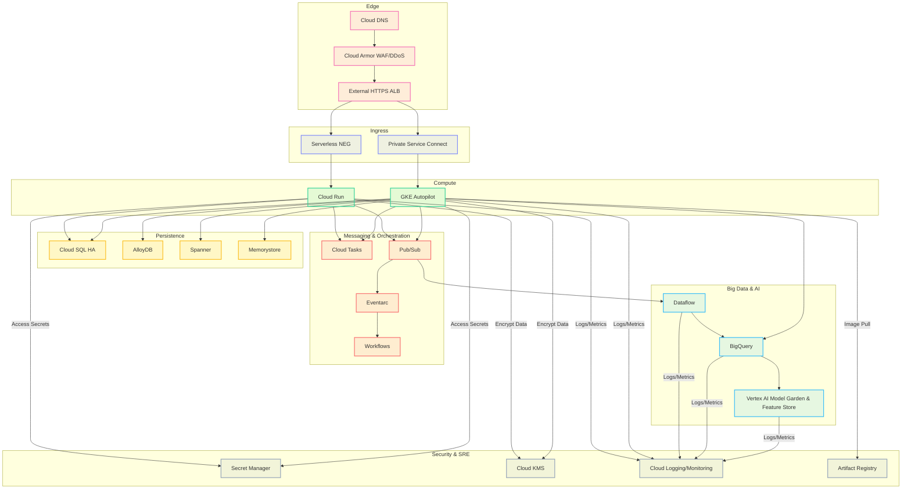

## Tổng quan điều hành: Mô hình tư duy kiến trúc Google Cloud

Google Cloud Platform (GCP) không chỉ đơn thuần là một tập hợp các dịch vụ; đó là một biểu hiện rõ ràng của cơ sở hạ tầng nội bộ của Google, được tinh chỉnh qua nhiều thập kỷ hoạt động ở quy mô toàn cầu. Việc hiểu rõ mô hình tư duy nền tảng này là rất quan trọng để thiết kế các giải pháp doanh nghiệp có khả năng phục hồi, hiệu suất cao và tối ưu chi phí.

<AudioPlayer src="/static/audio/google-cloud-platform-all-services-architecture-handbook-vi.mp3" title="Nghe bài viết này" voice="Google Cloud vi-VN-Neural2-A" />


<InteractiveToolCard tool="bigquery" />

## Mạng lưới toàn cầu: Jupiter Fabric

Điểm khác biệt cốt lõi của Google Cloud nằm ở mạng riêng toàn cầu của nó, thường được gọi là Jupiter fabric. Đây không phải là internet công cộng; đó là một mạng lưới liên lục địa chuyên dụng, băng thông cao, độ trễ thấp.

| Tính năng | Mô tả | Tác động |
|:--------|:------------|:-------|
| **Jupiter Fabric** | Mạng riêng, được định nghĩa bằng phần mềm (SDN) của Google kết nối tất cả các trung tâm dữ liệu trên toàn cầu. | Hiệu suất có thể dự đoán, giảm độ trễ cho lưu lượng truy cập giữa các khu vực. |
| **Băng thông phân chia 1 Pbps** | Tổng dung lượng của mạng để truyền lưu lượng truy cập giữa hai nửa bất kỳ của mạng. | Loại bỏ mạng như một nút thắt cổ chai ngay cả đối với các khối lượng công việc đòi hỏi khắt khe nhất. |
| **Andromeda SDN** | Ngăn xếp ảo hóa mạng cung cấp năng lượng cho VPC, cân bằng tải và các dịch vụ mạng. | Cho phép các tính năng mạng nâng cao, phân đoạn vi mô và thực thi chính sách. |
| **Premium Tier** | Định tuyến mặc định. Lưu lượng truy cập đi vào mạng của Google tại PoP biên gần nhất và đi qua xương sống riêng. | Hiệu suất tối ưu, độ trễ thấp hơn, độ tin cậy cao hơn. Khuyến nghị cho hầu hết các khối lượng công việc sản xuất. |
| **Standard Tier** | Lưu lượng truy cập đi vào mạng của Google gần hơn với khu vực đích, sử dụng internet công cộng cho một phần đáng kể của đường dẫn. | Tối ưu chi phí cho các khối lượng công việc không nhạy cảm với độ trễ, phí thoát thấp hơn. |

**Lời khuyên thực tế:** Luôn mặc định sử dụng Premium Tier cho các ứng dụng sản xuất. Standard Tier phù hợp cho phát triển, thử nghiệm hoặc xử lý hàng loạt cụ thể nhạy cảm với chi phí mà độ trễ không quan trọng. Sự khác biệt về hiệu suất là đáng kể.

## Hệ thống phân cấp tài nguyên

Hệ thống phân cấp tài nguyên của GCP cung cấp một cách có cấu trúc để tổ chức và quản lý tài nguyên, thực thi chính sách và kiểm soát quyền truy cập. Đây là một thành phần quan trọng cho quản trị và bảo mật.

| Cấp độ | Mô tả | Các trường hợp sử dụng chính |
|:------|:------------|:--------------|
| **Tổ chức** | Nút gốc cho tất cả các tài nguyên Google Cloud thuộc về một công ty. | Thanh toán tập trung, IAM, thực thi chính sách (Chính sách tổ chức). |
| **Thư mục** | Nhóm các dự án dưới một tổ chức. Có thể lồng nhau. | Nhóm theo phòng ban hoặc môi trường (ví dụ: `dev`, `prod`). |
| **Dự án** | Đơn vị cơ bản để tổ chức tài nguyên. Tất cả các tài nguyên thuộc về một dự án. | Thanh toán, quản lý API, cách ly tài nguyên, ranh giới IAM. |
| **Tài nguyên** | Các dịch vụ riêng lẻ như phiên bản Compute Engine, nhóm Cloud Storage, tập dữ liệu BigQuery. | Tài sản tính toán, lưu trữ, mạng và dữ liệu thực tế. |

**Kế thừa chính sách IAM:** Các chính sách IAM được đặt ở cấp cao hơn (ví dụ: Tổ chức, Thư mục) được kế thừa bởi tất cả các tài nguyên ở cấp thấp hơn. Điều này cho phép kiểm soát chi tiết và đơn giản hóa việc quản lý chính sách.

**Các ràng buộc tổ chức (Chính sách tổ chức):** Đây là những hàng rào bảo vệ mạnh mẽ cho phép quản trị viên xác định các hạn chế về cách tài nguyên có thể được cấu hình trên toàn tổ chức. Ví dụ bao gồm hạn chế vị trí tài nguyên, vô hiệu hóa địa chỉ IP bên ngoài hoặc thực thi việc sử dụng API cụ thể.

```bash
# Example: List organization policies for a project
gcloud org-policies list --project=your-project-id

# Example: Describe a specific organization policy
gcloud org-policies describe compute.disableExternalIpAccess --organization=your-organization-id
```

## Dòng dõi Borg

Hệ thống quản lý cụm nội bộ của Google, Borg, là tổ tiên trực tiếp của Kubernetes. Việc hiểu dòng dõi này cung cấp cái nhìn sâu sắc về triết lý ưu tiên container của GCP và các nguyên tắc thiết kế đằng sau nhiều dịch vụ của nó.

| Khái niệm | Ảnh hưởng của Borg | Biểu hiện của GCP |
|:--------|:-----------------|:------------------|
| **Container hóa** | Borg đi tiên phong trong việc cách ly và lập lịch khối lượng công việc dựa trên container ở quy mô lớn. | Docker, Container Registry, Cloud Run, GKE. |
| **API khai báo** | Borg quản lý khối lượng công việc thông qua các đặc tả khai báo. | Kubernetes YAML, Cloud Deployment Manager, Terraform. |
| **Hệ thống tự phục hồi** | Borg tự động lên lịch lại các tác vụ bị lỗi và duy trì trạng thái mong muốn. | GKE Autopilot, nhóm phiên bản được quản lý, tự động mở rộng quy mô của Cloud Run. |
| **Phát hiện dịch vụ** | Borg cung cấp các cơ chế phát hiện dịch vụ nội bộ. | Cloud DNS, bộ cân bằng tải nội bộ, phát hiện dịch vụ GKE. |
| **Hiệu quả tài nguyên** | Mục tiêu chính của Borg là tối đa hóa việc sử dụng cụm. | Quản lý nút của GKE Autopilot, các dịch vụ không máy chủ (Cloud Run, Cloud Functions). |

**Lời khuyên thực tế:** Google Cloud được thiết kế vốn dĩ cho cơ sở hạ tầng bất biến, được container hóa. Hãy nắm lấy mô hình này. Các dịch vụ như Cloud Run và GKE Autopilot không chỉ tiện lợi; chúng đại diện cho đỉnh cao của hàng thập kỷ kinh nghiệm vận hành nội bộ của Google.

---

## Kiến trúc tham chiếu doanh nghiệp đầu cuối

Kiến trúc này minh họa một triển khai doanh nghiệp mạnh mẽ, an toàn và có khả năng mở rộng trên Google Cloud, nhấn mạnh các nguyên tắc không tin cậy và phòng thủ theo chiều sâu.



**Luồng dữ liệu không tin cậy & Phòng thủ theo chiều sâu:**

1.  **Bảo mật biên (Cloud DNS, Cloud Armor):** Tất cả lưu lượng truy cập bên ngoài trước tiên được định tuyến qua Cloud DNS và sau đó được Cloud Armor xử lý để bảo vệ DDoS và khả năng WAF. Đây là tuyến phòng thủ đầu tiên, lọc lưu lượng truy cập độc hại trước khi nó đến các tài nguyên tính toán.
2.  **Kiểm soát Ingress (External HTTPS ALB, Serverless NEG, Private Service Connect):**
    *   External HTTPS ALB chấm dứt TLS, cung cấp một điểm vào duy nhất.
    *   **Serverless NEG** định tuyến lưu lượng truy cập đến Cloud Run, đảm bảo chỉ các yêu cầu được ủy quyền, đã xác thực mới đến được các hàm không máy chủ. Bản thân Cloud Run thực thi IAM ở cấp dịch vụ.
    *   **Private Service Connect (PSC)** được sử dụng cho GKE Autopilot, đảm bảo rằng các dịch vụ GKE không bị lộ ra internet công cộng. Tất cả giao tiếp là riêng tư, trong mạng của Google, ngay cả đối với các máy khách bên ngoài kết nối qua các điểm cuối PSC. Điều này loại bỏ việc lộ IP công cộng cho mặt phẳng điều khiển và khối lượng công việc của GKE.
3.  **Cách ly tính toán (Cloud Run, GKE Autopilot):**
    *   **Cloud Run:** Cung cấp khả năng cách ly khối lượng công việc mạnh mẽ, tự động mở rộng quy mô và các tính năng bảo mật tích hợp. Mỗi bản sửa đổi chạy trong một môi trường sandbox bị cô lập.
    *   **GKE Autopilot:** Google quản lý cơ sở hạ tầng cơ bản, bao gồm cung cấp nút, vá lỗi và mở rộng quy mô, giảm bề mặt tấn công và chi phí vận hành. Khối lượng công việc chạy trong các pod bị cô lập. Các chính sách mạng trong GKE tiếp tục hạn chế giao tiếp giữa các pod.
4.  **Bảo mật lưu trữ dữ liệu:**
    *   **Cloud SQL HA, AlloyDB, Spanner, Memorystore:** Tất cả các kho dữ liệu là các dịch vụ được quản lý, cung cấp mã hóa khi lưu trữ và khi truyền mặc định. Quyền truy cập được kiểm soát thông qua IAM và kết nối IP riêng (VPC Service Controls có thể hạn chế quyền truy cập hơn nữa). Cấu hình High Availability (HA) đảm bảo khả năng phục hồi.
5.  **Bảo mật nhắn tin & điều phối:**
    *   **Cloud Tasks, Pub/Sub, Eventarc, Workflows:** Các dịch vụ này tạo điều kiện giao tiếp không đồng bộ và điều phối quy trình làm việc. Quyền truy cập được kiểm soát thông qua IAM. Các chủ đề Pub/Sub có thể được bảo mật bằng VPC Service Controls.
6.  **Bảo mật dữ liệu lớn & AI:**
    *   **Dataflow, BigQuery, Vertex AI:** Các dịch vụ này xử lý dữ liệu quy mô lớn và học máy. Dữ liệu được mã hóa và quyền truy cập được kiểm soát chặt chẽ thông qua IAM. BigQuery cung cấp bảo mật cấp cột và che dấu dữ liệu. Vertex AI đảm bảo triển khai mô hình và truy cập dữ liệu an toàn.
7.  **Bảo mật tập trung & SRE (Secret Manager, KMS, Cloud Logging/Monitoring, Artifact Registry):**
    *   **Secret Manager:** Lưu trữ tập trung, mã hóa cho khóa API, thông tin đăng nhập cơ sở dữ liệu và các dữ liệu nhạy cảm khác. Các ứng dụng truy xuất bí mật tại thời điểm chạy, tránh mã hóa cứng.
    *   **Cloud KMS:** Quản lý các khóa mã hóa để mã hóa dữ liệu trên các dịch vụ. Đảm bảo phân tách nhiệm vụ cho quản lý khóa.
    *   **Cloud Logging/Monitoring:** Cung cấp khả năng quan sát, kiểm tra và cảnh báo toàn diện. Tất cả các tương tác dịch vụ được ghi lại, cho phép phát hiện hành vi bất thường.
    *   **Artifact Registry:** Lưu trữ an toàn hình ảnh container và các tạo phẩm xây dựng khác. Thực thi quét lỗ hổng và đảm bảo chỉ các hình ảnh đáng tin cậy mới được triển khai.

Kiến trúc này thể hiện nguyên tắc không tin cậy bằng cách giả định không có sự tin cậy ngầm, ngay cả trong phạm vi mạng. Mọi tương tác đều yêu cầu ủy quyền rõ ràng và mọi lớp đều cung cấp khả năng phòng thủ chống lại các mối đe dọa tiềm ẩn.

## Lĩnh vực 1: Công cụ tính toán & không máy chủ

Lĩnh vực này bao gồm các dịch vụ tính toán cốt lõi trong Google Cloud, từ các nền tảng không máy chủ được quản lý hoàn toàn đến các máy ảo và điều phối container có thể tùy chỉnh cao. Trọng tâm là ứng dụng thực tế, hiểu các đánh đổi và tận dụng các tính năng nâng cao cho khối lượng công việc cấp sản xuất.

### Cloud Run

Cloud Run là một nền tảng tính toán được quản lý hoàn toàn để triển khai các ứng dụng được container hóa. Nó trừu tượng hóa việc quản lý cơ sở hạ tầng, cho phép các nhà phát triển tập trung hoàn toàn vào mã.

*   **Thời gian chạy Container**: Cloud Run thực thi các hình ảnh container tuân thủ OCI. Nó cung cấp một môi trường sandbox mạnh mẽ, an toàn cho mỗi phiên bản.
*   **Đồng thời trên mỗi phiên bản**: Một phiên bản Cloud Run duy nhất có thể xử lý nhiều yêu cầu đồng thời. Mặc định là 80, có thể cấu hình lên đến 1000. Đồng thời cao hơn có thể cải thiện việc sử dụng tài nguyên nhưng yêu cầu các ứng dụng phải an toàn về luồng và không chặn.
*   **Scale-to-Zero**: Một tính năng không máy chủ quan trọng, Cloud Run tự động giảm xuống không phiên bản khi không có lưu lượng truy cập, loại bỏ chi phí nhàn rỗi.
*   **Min-Instances**: Để giảm độ trễ khởi động lạnh cho các ứng dụng quan trọng, `min-instances` có thể được đặt để giữ một số lượng phiên bản được chỉ định ở trạng thái sẵn sàng phục vụ lưu lượng truy cập. Điều này phát sinh chi phí thanh toán liên tục cho các phiên bản đó.
*   **Direct VPC Egress**: Để giao tiếp an toàn và riêng tư với các tài nguyên trong mạng Virtual Private Cloud (VPC) (ví dụ: Cloud SQL, Memorystore, API nội bộ), Cloud Run có thể được cấu hình cho Direct VPC Egress. Điều này định tuyến tất cả lưu lượng truy cập đi qua một trình kết nối VPC được chỉ định.
*   **Hỗ trợ GPU**: Cloud Run hiện hỗ trợ tăng tốc GPU cho các khối lượng công việc yêu cầu xử lý chuyên biệt, chẳng hạn như suy luận AI/ML. Điều này được cấu hình thông qua các cờ `--cpu` và `--gpu`.
*   **Cloud Run Jobs**: Một dịch vụ riêng biệt trong Cloud Run để thực thi các công việc hàng loạt không phải HTTP, ngắn hạn hoặc dài hạn. Các công việc có thể được kích hoạt thủ công, theo lịch trình hoặc thông qua Eventarc. Chúng hỗ trợ song song hóa và thử lại.

### GKE (Google Kubernetes Engine)

GKE là dịch vụ Kubernetes được quản lý của Google Cloud, cung cấp một nền tảng mạnh mẽ để triển khai, quản lý và mở rộng quy mô các ứng dụng được container hóa.

*   **Autopilot so với Standard**:
 | Tính năng | GKE Standard | GKE Autopilot |
 | :------ | :----------- | :------------ |
 | Quản lý nút | Người dùng quản lý | Google quản lý |
 | Giá cả | VM + phí GKE | Dựa trên Pod |
 | Tùy chỉnh | Cao (nhóm nút, HĐH) | Hạn chế (hồ sơ được xác định trước) |
 | Bảo mật | Trách nhiệm chung | Nâng cao (nút được tăng cường) |
 | Mở rộng | Thủ công/CA | Tự động (dựa trên pod) |
 | Trường hợp sử dụng | Kiểm soát tối đa, HĐH tùy chỉnh | Không cần can thiệp, tối ưu chi phí |
    *   **Đánh đổi**: Autopilot đơn giản hóa đáng kể các hoạt động bằng cách quản lý các nút, mở rộng quy mô và vá lỗi. Nó lý tưởng cho hầu hết các khối lượng công việc mà việc tùy chỉnh cấp nút không quan trọng. Standard cung cấp khả năng kiểm soát chi tiết đối với các loại nút, hệ điều hành và mạng, phù hợp cho các khối lượng công việc chuyên biệt cao hoặc kế thừa.
    *   **Tư thế bảo mật**: Autopilot cung cấp tư thế bảo mật được tăng cường theo mặc định, với Google quản lý HĐH nút và bảo mật thời gian chạy. Standard yêu cầu người dùng quản lý các bản cập nhật và cấu hình bảo mật nút.
    *   **Tự động cung cấp nút**: Trong GKE Standard, tính năng này tự động tạo các nhóm nút mới dựa trên các yêu cầu tài nguyên pod đang chờ xử lý, tối ưu hóa phân bổ tài nguyên và giảm sự can thiệp thủ công.

*   **Multi-cluster Ingress**: Cho phép một địa chỉ IP bên ngoài toàn cầu duy nhất định tuyến lưu lượng truy cập đến các ứng dụng được triển khai trên nhiều cụm GKE, có thể ở các khu vực khác nhau. Điều này cung cấp cân bằng tải toàn cầu, chuyển đổi dự phòng và quản lý DNS đơn giản hóa cho các dịch vụ phân tán địa lý.
*   **Gateway API**: API thế hệ tiếp theo cho Kubernetes ingress, cung cấp các cách biểu cảm và mở rộng hơn để cấu hình định tuyến, quản lý lưu lượng truy cập và thực thi chính sách so với API Ingress cũ hơn. Nó giới thiệu các khái niệm như `GatewayClass`, `Gateway`, `HTTPRoute` và `TCPRoute`.

### Compute Engine

Compute Engine cung cấp các máy ảo (VM) có thể tùy chỉnh cao với nhiều loại máy, tùy chọn lưu trữ và mô hình định giá khác nhau.

*   **Dòng máy C3/N4**:
    *   **C3**: Tối ưu hóa cho tính toán hiệu năng cao (HPC), phân tích dữ liệu và các khối lượng công việc doanh nghiệp đòi hỏi khắt khe. Có bộ xử lý Intel Xeon Scalable thế hệ thứ 4 (Sapphire Rapids) và bộ nhớ DDR5. Cung cấp số lượng lõi và tỷ lệ bộ nhớ cao.
    *   **N4**: Dòng máy đa năng, kế nhiệm N2. Cung cấp sự cân bằng giữa hiệu suất và hiệu quả chi phí cho nhiều khối lượng công việc.
*   **Hyperdisk**: Bộ nhớ khối thế hệ tiếp theo của Google Cloud dành cho Compute Engine, cung cấp hiệu suất và tính linh hoạt cao hơn đáng kể so với Persistent Disk.
    *   **Hyperdisk Balanced**: Bộ nhớ khối đa năng, hiệu quả chi phí với các đặc tính hiệu suất tốt.
    *   **Hyperdisk Extreme**: Được thiết kế cho các khối lượng công việc giao dịch đòi hỏi khắt khe nhất (ví dụ: cơ sở dữ liệu lớn) yêu cầu IOPS và thông lượng cực cao.
    *   **Hyperdisk Throughput**: Tối ưu hóa cho các khối lượng công việc chuyên sâu về thông lượng (ví dụ: phân tích dữ liệu, truyền phát) nơi hiệu suất I/O tuần tự là rất quan trọng.
*   **Spot VMs**: Các VM hiệu quả chi phí cao có thể bị Compute Engine chiếm quyền nếu cần tài nguyên ở nơi khác. Lý tưởng cho các khối lượng công việc chịu lỗi, không trạng thái hoặc hàng loạt mà sự gián đoạn là chấp nhận được. Tiết kiệm chi phí đáng kể (lên đến 91% so với giá theo yêu cầu).
*   **Live Migration**: Một tính năng của Compute Engine cho phép các VM được di chuyển từ một máy chủ sang máy chủ khác mà không bị gián đoạn. Điều này rất quan trọng để bảo trì, vá lỗi và nâng cấp máy chủ, đảm bảo tính khả dụng cao cho các ứng dụng quan trọng.

### Cloud Functions (Thế hệ thứ 2)

Cloud Functions Thế hệ thứ 2 được xây dựng trên Cloud Run, kế thừa cơ sở hạ tầng và khả năng cơ bản của nó.

*   **Nền tảng Cloud Run**: Tận dụng Cloud Run cung cấp cho các hàm Thế hệ thứ 2 thời gian chờ yêu cầu dài hơn, đồng thời cao hơn và khả năng thoát VPC trực tiếp, giải quyết các hạn chế của Thế hệ thứ 1.
*   **Trình kích hoạt Eventarc**: Cloud Functions chủ yếu là hướng sự kiện. Eventarc cung cấp một cơ chế thống nhất để định tuyến các sự kiện từ hơn 100 nguồn Google Cloud (ví dụ: Cloud Storage, Pub/Sub, Firestore) đến Cloud Functions, cho phép các kiến trúc hướng sự kiện mạnh mẽ.
*   **Thời gian chờ**: Các hàm Thế hệ thứ 2 hỗ trợ thời gian chờ dài hơn đáng kể, lên đến 60 phút cho các hàm HTTP và 9 giờ cho các hàm hướng sự kiện, đáp ứng các tác vụ phức tạp và chạy dài hơn.
*   **Đồng thời**: Tương tự như Cloud Run, các hàm Thế hệ thứ 2 có thể xử lý nhiều yêu cầu đồng thời trên mỗi phiên bản, cải thiện việc sử dụng tài nguyên và giảm khởi động lạnh.

### Cloud Batch

Cloud Batch là một dịch vụ được quản lý hoàn toàn cho tính toán hàng loạt thông lượng cao. Nó đơn giản hóa việc thực thi các công việc hàng loạt quy mô lớn, song song và tuần tự.

*   **Tính toán hàng loạt thông lượng cao**: Được thiết kế cho các khối lượng công việc yêu cầu xử lý tập dữ liệu lớn hoặc chạy nhiều tác vụ độc lập, chẳng hạn như mô phỏng khoa học, mô hình tài chính hoặc chuyển mã phương tiện.
*   **MPI (Giao diện truyền thông điệp)**: Cloud Batch hỗ trợ MPI cho các khối lượng công việc song song được kết nối chặt chẽ, cho phép giao tiếp giữa các tác vụ chạy trên các VM khác nhau trong một công việc.
*   **Array Jobs**: Một tính năng mạnh mẽ cho phép một định nghĩa công việc duy nhất khởi chạy hàng nghìn tác vụ giống hệt nhau, mỗi tác vụ xử lý một đầu vào hoặc một phần khác nhau của tập dữ liệu. Điều này hiệu quả cho các khối lượng công việc song song dễ dàng.
*   **Khả năng chịu lỗi của Spot VM**: Cloud Batch có thể tận dụng Spot VM để tiết kiệm chi phí đáng kể. Nó bao gồm các cơ chế tích hợp để xử lý việc chiếm quyền, chẳng hạn như tự động thử lại và điểm kiểm tra, giúp Spot VM khả thi cho nhiều khối lượng công việc hàng loạt.

### Bảng so sánh nhỏ gọn

| Dịch vụ | Nguyên mẫu chính | Tốt nhất khi | Tránh khi |
| :------ | :---------------- | :-------- | :--------- |
| Cloud Run | Container không máy chủ | Microservice HTTP/hướng sự kiện, API | Ứng dụng có trạng thái chạy dài, nhu cầu GPU cực cao |
| GKE | Điều phối Container | Microservice phức tạp, kiểm soát tùy chỉnh, lai | Ứng dụng đơn giản, nhóm vận hành tối thiểu |
| Compute Engine | IaaS VM | Ứng dụng kế thừa, HĐH tùy chỉnh, phần cứng cụ thể | Không máy chủ lý tưởng, chi phí vận hành cao |
| Cloud Functions | FaaS không máy chủ | Hướng sự kiện, ngắn hạn, hàm không trạng thái | Quy trình chạy dài, trạng thái phức tạp |
| Cloud Batch | Xử lý hàng loạt | HPC, xử lý dữ liệu quy mô lớn, công việc mảng | Thời gian thực, tương tác, độ trễ thấp |

### Các công thức CLI sản xuất `gcloud`

#### Triển khai dịch vụ Cloud Run

```bash
# Deploy a Cloud Run service with specific resource limits, min/max instances, and VPC egress
gcloud run deploy my-service \
  --image gcr.io/my-project/my-app:v1.0.0 \
  --platform managed \
  --region us-central1 \
  --project my-project-id \
  --service-account my-service-account@my-project-id.iam.gserviceaccount.com \
  --cpu 2 \
  --memory 2Gi \
  --min-instances 1 \
  --max-instances 10 \
  --concurrency 80 \
  --timeout 300s \
  --vpc-egress all \
  --vpc-connector projects/my-project-id/locations/us-central1/connectors/my-vpc-connector \
  --set-env-vars ENV_VAR_KEY=ENV_VAR_VALUE \
  --no-allow-unauthenticated
```

#### Tạo công việc Cloud Run

```bash
# Create a Cloud Run Job for a batch task
gcloud run jobs create my-batch-job \
  --image gcr.io/my-project/my-batch-processor:v1.0.0 \
  --region us-central1 \
  --project my-project-id \
  --service-account my-batch-sa@my-project-id.iam.gserviceaccount.com \
  --cpu 4 \
  --memory 8Gi \
  --tasks 10 \
  --parallelism 5 \
  --timeout 3600s \
  --set-env-vars INPUT_BUCKET=gs://my-input-data,OUTPUT_BUCKET=gs://my-output-data
```

#### Tạo cụm GKE Autopilot

```bash
# Create a GKE Autopilot cluster with release channel and private endpoint
gcloud container clusters create-auto my-autopilot-cluster \
  --region us-central1 \
  --project my-project-id \
  --release-channel stable \
  --network projects/my-project-id/global/networks/my-vpc \
  --subnetwork projects/my-project-id/regions/us-central1/subnetworks/my-gke-subnet \
  --enable-private-nodes \
  --enable-private-endpoint \
  --master-ipv4-cidr 172.16.0.0/28 \
  --workload-pool my-project-id.svc.id.goog \
  --enable-workload-identity
```

#### Tạo phiên bản Compute Engine Spot VM

```bash
# Create a Compute Engine Spot VM with Hyperdisk Balanced and a specific service account
gcloud compute instances create my-spot-vm \
  --project my-project-id \
  --zone us-central1-a \
  --machine-type n2-standard-4 \
  --provisioning-model SPOT \
  --instance-termination-action STOP \
  --boot-disk-device-name my-spot-boot-disk \
  --boot-disk-type hyperdisk-balanced \
  --boot-disk-size 50GB \
  --image-family debian-11 \
  --image-project debian-cloud \
  --network-interface network=my-vpc,subnet=my-compute-subnet \
  --service-account my-compute-sa@my-project-id.iam.gserviceaccount.com \
  --scopes=https://www.googleapis.com/auth/cloud-platform \
  --metadata startup-script='#!/bin/bash\necho "Hello from Spot VM" > /tmp/startup.txt'
```

#### Triển khai Cloud Functions (Thế hệ thứ 2)

```bash
# Deploy a 2nd Gen Cloud Function triggered by a Pub/Sub topic
gcloud functions deploy my-pubsub-function-v2 \
  --gen2 \
  --runtime python39 \
  --region us-central1 \
  --project my-project-id \
  --source ./function-source \
  --entry-point process_message \
  --trigger-topic my-pubsub-topic \
  --service-account my-function-sa@my-project-id.iam.gserviceaccount.com \
  --memory 512MB \
  --timeout 300s \
  --concurrency 10 \
  --vpc-connector projects/my-project-id/locations/us-central1/connectors/my-vpc-connector \
  --egress-settings private-ranges-only
```

#### Gửi công việc Cloud Batch

```bash
# Submit a Cloud Batch job using a JSON configuration file
# job_config.json example:
# {
#   "taskGroups": [
#     {
#       "taskSpec": {
#         "runnables": [
#           {
#             "script": {
#               "text": "echo 'Processing task ${BATCH_TASK_INDEX}' && sleep 10"
#             }
#           }
#         ],
#         "computeResource": {
#           "cpuMilli": 1000,
#           "memoryMib": 512
#         }
#       },
#       "taskCount": 5,
#       "parallelism": 2
#     }
#   ],
#   "allocationPolicy": {
#     "instances": [
#       {
#         "policy": {
#           "machineType": "e2-standard-2",
#           "provisioningModel": "SPOT"
#         }
#       }
#     ]
#   },
#   "logsPolicy": {
#     "destination": "CLOUD_LOGGING"
#   }
# }
gcloud batch jobs submit my-batch-job-from-file \
  --location us-central1 \
  --project my-project-id \
  --config job_config.json \
  --service-account my-batch-sa@my-project-id.iam.gserviceaccount.com
```

## Lĩnh vực 2: Cơ sở dữ liệu Đám mây & Kho lưu trữ Trong bộ nhớ (Cloud Databases & In-Memory Stores)

### Cloud SQL

Cloud SQL cung cấp các dịch vụ cơ sở dữ liệu quan hệ được quản lý hoàn toàn (fully managed) cho PostgreSQL, MySQL và SQL Server. Dịch vụ này loại bỏ các gánh nặng vận hành như vá lỗi (patching), sao lưu (backups) và nhân bản (replication), giúp kỹ sư tập trung vào phát triển ứng dụng.

#### PostgreSQL, MySQL, SQL Server

Cloud SQL hỗ trợ các phiên bản chính mới nhất của những database engine phổ biến này, đảm bảo khả năng tương thích với các ứng dụng và công cụ hiện có.

*   **PostgreSQL**: Mạnh mẽ, giàu tính năng và có khả năng mở rộng cao, thường được ưu tiên cho các tác vụ giao dịch phức tạp (complex transactional workloads) và ứng dụng GIS.
*   **MySQL**: Được sử dụng rộng rãi, nổi tiếng nhờ tính dễ sử dụng và hiệu năng cao trong các ứng dụng web.
*   **SQL Server**: Thiết yếu cho các doanh nghiệp phụ thuộc vào hệ sinh thái Microsoft hiện có, hỗ trợ các tính năng như Always On Availability Groups (do Cloud SQL quản lý).

#### Chuyển đổi dự phòng theo Vùng với High Availability (HA)

Cloud SQL HA đảm bảo tính liên tục trong kinh doanh thông qua cơ chế tự động chuyển đổi dự phòng (automatic failover) sang một instance dự phòng (standby) ở một availability zone khác trong cùng một region. Điều này đạt được bằng cách nhân bản đồng bộ (synchronous replication) dữ liệu từ primary instance sang standby instance. Khi primary instance gặp sự cố (ví dụ: sập zone, lỗi instance), Cloud SQL tự động thăng cấp (promote) standby thành primary, giảm thiểu thời gian gián đoạn (downtime).

*   **Cơ chế**: Sử dụng một địa chỉ IP dùng chung tự động chuyển hướng sang primary mới.
*   **RPO/RTO**: Mục tiêu điểm khôi phục (RPO) gần như bằng không nhờ nhân bản đồng bộ; mục tiêu thời gian khôi phục (RTO) thường dưới 60 giây.

#### Bảo trì Tự động (Automated Maintenance)

Cloud SQL xử lý các tác vụ bảo trì định kỳ như vá lỗi hệ điều hành, cập nhật database engine và khắc phục lỗ hổng bảo mật. Có thể cấu hình khung thời gian bảo trì (maintenance windows) để giảm thiểu tác động đến các hệ thống production, cho phép chỉ định ngày và khoảng thời gian ưu tiên.

#### Read Replicas

Read replicas giúp giảm tải các tác vụ đọc nặng (read-heavy workloads) khỏi primary instance, cải thiện hiệu năng và khả năng mở rộng. Đây là các bản sao bất đồng bộ (asynchronous copies) của primary instance, phù hợp cho báo cáo, phân tích dữ liệu và truy cập đọc phân tán theo địa lý.

*   **Cross-Region Replicas**: Có thể triển khai ở các region khác nhau để phục vụ khắc phục thảm họa (disaster recovery) và giảm độ trễ đọc cho người dùng toàn cầu.
*   **Thăng cấp (Promotion)**: Một read replica có thể được thăng cấp thành một primary instance độc lập, hữu ích trong các kịch bản khắc phục thảm họa hoặc di chuyển cơ sở dữ liệu (database migration).

#### Private IP Peering so với Private Service Connect

Cả hai cơ chế đều cho phép kết nối riêng tư tới các Cloud SQL instance, tránh việc phơi bày ra mạng internet công cộng.

*   **Private IP Peering (VPC Network Peering)**:
    *   **Cơ chế**: Kết nối trực tiếp mạng VPC của bạn với mạng service producer nội bộ của Google nơi đặt các Cloud SQL instance.
    *   **Thiết lập**: Yêu cầu cấu hình một dải Private IP cho Cloud SQL bên trong VPC của bạn.
    *   **Phạm vi**: Peering toàn mạng, cho phép mọi tài nguyên trong VPC truy cập vào Cloud SQL.
    *   **Hạn chế**: Việc quản lý không gian địa chỉ IP có thể phức tạp; áp dụng các giới hạn về peering.

*   **Private Service Connect (PSC)**:
    *   **Cơ chế**: Cung cấp quyền truy cập riêng tư tới các dịch vụ được quản lý bằng cách sử dụng địa chỉ IP nội bộ trong VPC của bạn mà không cần VPC network peering.
    *   **Thiết lập**: Tạo một forwarding rule và một endpoint trong VPC trỏ tới một service attachment trong mạng của service producer.
    *   **Phạm vi**: Kiểm soát chi tiết hơn, cho phép tạo các endpoint cụ thể cho từng dịch vụ cụ thể.
    *   **Ưu điểm**: Đơn giản hóa việc quản lý địa chỉ IP, tránh được các giới hạn peering và tăng cường bảo mật mạng bằng cách cô lập lưu lượng dịch vụ. Được khuyến nghị cho các triển khai mới.

### AlloyDB for PostgreSQL

AlloyDB là dịch vụ cơ sở dữ liệu tương thích với PostgreSQL được quản lý hoàn toàn, thiết kế cho các tác vụ doanh nghiệp đòi hỏi khắt khe, mang lại hiệu năng và tính sẵn sàng vượt trội so với PostgreSQL tiêu chuẩn.

#### Kiến trúc Tách rời Compute & Storage (Disaggregated Compute & Storage)

AlloyDB tách biệt lớp tính toán (xử lý truy vấn) khỏi lớp lưu trữ (lưu trữ dữ liệu bền vững).

*   **Lớp Compute**: Bao gồm nhiều compute node độc lập chịu trách nhiệm xử lý truy vấn. Các node này không lưu trạng thái (stateless) và có thể mở rộng độc lập.
*   **Lớp Storage**: Một dịch vụ lưu trữ phân tán, dùng chung giúp lưu trữ dữ liệu theo định dạng cột (columnar format). Lớp này đảm nhiệm việc nhân bản dữ liệu, tự phục hồi (self-healing) và sao lưu liên tục.
*   **Lợi ích**: Cho phép mở rộng nhanh chóng tài nguyên compute mà không ảnh hưởng đến storage và ngược lại. Cải thiện khả năng chịu lỗi (fault tolerance) vì các compute node có thể gặp sự cố độc lập mà không gây mất dữ liệu.

#### Columnar Engine

AlloyDB tích hợp một columnar engine phục vụ các truy vấn phân tích. Trong khi PostgreSQL chủ yếu hướng hàng (row-oriented), lớp lưu trữ thông minh của AlloyDB có thể lưu dữ liệu ở định dạng cột cho các bảng hoặc phân vùng cụ thể, tăng tốc đáng kể các tác vụ phân tích (ví dụ: truy vấn OLAP) mà không cần quy trình ETL hay data warehouse riêng biệt. Khả năng xử lý giao dịch/phân tích kết hợp (HTAP) này là điểm khác biệt cốt lõi.

#### Mở rộng Giao dịch so với Mở rộng Phân tích

*   **Mở rộng Giao dịch (Transactional Scaling)**: Đạt được bằng cách thêm nhiều compute node để xử lý lượng giao dịch đồng thời tăng cao. Lớp lưu trữ dùng chung đảm bảo tính nhất quán dữ liệu trên tất cả các node.
*   **Mở rộng Phân tích (Analytical Scaling)**: Columnar engine và các cơ chế bộ nhớ đệm (caching) thông minh tối ưu hóa hiệu năng truy vấn phân tích. Các read replica cũng có thể được dùng để giảm tải tác vụ phân tích. Kiến trúc của AlloyDB cho phép mở rộng hiệu quả cả hai loại tác vụ trong cùng một cơ sở dữ liệu duy nhất.

#### Vector Embeddings với pgvector

AlloyDB hỗ trợ tiện ích mở rộng `pgvector`, cho phép lưu trữ và truy vấn hiệu quả các vector embedding trực tiếp bên trong cơ sở dữ liệu. Điều này rất quan trọng đối với các ứng dụng AI/ML như tìm kiếm tương đồng (similarity search), hệ thống gợi ý và tìm kiếm ngữ nghĩa (semantic search).

*   **Khả năng**: Lưu trữ các vector nhiều chiều, hỗ trợ nhiều thước đo khoảng cách (ví dụ: khoảng cách L2, độ tương đồng cosine) và cung cấp đánh chỉ mục (indexing) tối ưu cho các tìm kiếm láng giềng gần nhất (nearest-neighbor) tốc độ cao.
*   **Tích hợp**: Cho phép lập trình viên xây dựng các tính năng tích hợp AI trực tiếp vào ứng dụng mà không cần đến các vector database riêng biệt.

### Cloud Spanner

Cloud Spanner là dịch vụ cơ sở dữ liệu quan hệ phân tán toàn cầu, có tính nhất quán mạnh (strongly consistent), được xây dựng cho các ứng dụng trọng yếu (mission-critical) đòi hỏi tính sẵn sàng cao và quy mô cực lớn.

#### TrueTime API

TrueTime là công nghệ nền tảng của Spanner, cung cấp thời gian đồng hồ thực (wall-clock time) nhất quán toàn cầu với độ bất định có giới hạn.

*   **Cơ chế**: Sử dụng đồng hồ nguyên tử và bộ thu GPS tại các trung tâm dữ liệu của Google để đồng bộ hóa thời gian trên toàn bộ máy chủ Spanner toàn cầu.
*   **Đảm bảo**: Cung cấp một khoảng dấu thời gian `[earliest, latest]` cho mọi giao dịch, đảm bảo rằng tất cả các giao dịch đã commit trước thời điểm `t` đều hiển thị ở mọi nơi vào thời điểm `t`. Điều này tạo nên tính nhất quán ngoại lai (external consistency).
*   **Tác động**: Loại bỏ nhu cầu sử dụng các giao thức commit phân tán phức tạp như Paxos hay Raft cho tính nhất quán toàn cầu, đơn giản hóa việc phát triển ứng dụng và cải thiện hiệu năng.

#### External Consistency

Spanner cung cấp external consistency, một mức độ đảm bảo mạnh hơn cả tính tuần tự hóa (serializability). Điều này có nghĩa là thứ tự toàn cầu của các giao dịch mà bất kỳ client nào quan sát được đều khớp với thứ tự thời gian thực của các giao dịch đó. Nó giúp đơn giản hóa việc suy luận về các giao dịch phân tán và đảm bảo tính toàn vẹn dữ liệu xuyên lục địa.

#### Regional so với Multi-Regional Instances

*   **Regional Instances**: Dữ liệu được nhân bản đồng bộ trên ba availability zone trong một Google Cloud region duy nhất. Cung cấp tính sẵn sàng cao trong phạm vi region đó.
*   **Multi-Regional Instances**: Dữ liệu được nhân bản đồng bộ trên nhiều region (ví dụ: `nam-eur-asia1`). Mang lại tính sẵn sàng cực cao (SLA 99.999%) và độ trễ đọc thấp cho các ứng dụng phân tán toàn cầu. Các thao tác ghi vẫn được định tuyến về một primary region để đảm bảo tính nhất quán.

#### Định cỡ Instance Chi tiết (Processing Units)

Các instance của Spanner được định cỡ theo đơn vị "processing units" (PUs). Mỗi PU cung cấp một lượng tài nguyên CPU, bộ nhớ và dung lượng I/O nhất định.

*   **Mở rộng**: Các instance có thể mở rộng tăng hoặc giảm bằng cách thêm hoặc bớt PU, cho phép kiểm soát chi tiết hiệu năng và chi phí.
*   **Tối thiểu**: Một Spanner instance bắt đầu từ 100 PU (tương đương 0.1 node).
*   **Tự động mở rộng**: Mặc dù không hoàn toàn tự động sẵn có, Spanner có thể tích hợp với các giải pháp tùy chỉnh để tự động điều chỉnh PU dựa trên các chỉ số (metrics).

#### Spanner Graph

Spanner Graph là tính năng cho phép người dùng thực hiện các truy vấn dạng đồ thị trực tiếp trên dữ liệu Spanner, tận dụng tính nhất quán mạnh và khả năng mở rộng của dịch vụ. Đây không phải là một graph database tách biệt mà là tập hợp các tính năng và phương pháp hay nhất để mô hình hóa và truy vấn dữ liệu đồ thị ngay trong Spanner.

*   **Mô hình hóa**: Sử dụng mô hình danh sách kề (adjacency list) hoặc danh sách cạnh (edge list) bên trong các bảng Spanner.
*   **Truy vấn**: Tận dụng SQL với các biểu thức bảng chung đệ quy (recursive CTEs) cho các truy vấn tìm đường và duyệt đồ thị.
*   **Trường hợp sử dụng**: Phát hiện gian lận, mạng xã hội, hệ thống gợi ý và phân tích chuỗi cung ứng nơi mối quan hệ giữa các thực thể đóng vai trò cốt lõi.

### Firestore

Firestore là cơ sở dữ liệu tài liệu NoSQL linh hoạt, có khả năng mở rộng dành cho phát triển ứng dụng di động, web và máy chủ. Dịch vụ cung cấp khả năng đồng bộ hóa thời gian thực (real-time synchronization) và hỗ trợ ngoại tuyến (offline support).

#### Native Mode so với Datastore Mode

Firestore cung cấp hai chế độ hoạt động, khác biệt chủ yếu ở API và bộ tính năng.

*   **Native Mode (Firestore)**:
    *   **Mô hình dữ liệu**: Hướng tài liệu (document-oriented), các collection phân cấp chứa các document.
    *   **API**: Real-time listeners, SDK cho di động/web, tính nhất quán mạnh.
    *   **Trường hợp sử dụng**: Các ứng dụng di động/web cần cập nhật thời gian thực, ứng dụng cộng tác.
    *   **Tính nhất quán**: Nhất quán mạnh (strong consistency) cho cả thao tác đọc và ghi.

*   **Datastore Mode (Cloud Datastore)**:
    *   **Mô hình dữ liệu**: Hướng thực thể (entity-oriented), gồm các entity và kind, tương tự như App Engine Datastore.
    *   **API**: Chủ yếu dùng SDK phía máy chủ (server-side), nhất quán cuối cùng (eventual consistency) theo mặc định (nhất quán mạnh cho các truy vấn tổ tiên - ancestor queries).
    *   **Trường hợp sử dụng**: Ứng dụng phía máy chủ, dịch vụ backend, lưu trữ dữ liệu quy mô lớn.
    *   **Tính nhất quán**: Nhất quán cuối cùng cho hầu hết truy vấn, nhất quán mạnh cho ancestor queries.
    *   **Chuyển đổi**: Các cơ sở dữ liệu Cloud Datastore hiện có về mặt kỹ thuật hiện chính là Firestore ở chế độ Datastore Mode.

#### Real-time Listeners

Các real-time listener của Firestore cho phép client đăng ký nhận thông báo khi có thay đổi trên một document hoặc một tập kết quả truy vấn. Khi dữ liệu thay đổi trên máy chủ, Firestore đẩy các bản cập nhật tới các client đang kết nối theo thời gian thực.

*   **Cơ chế**: Sử dụng WebSockets để duy trì các kết nối liên tục.
*   **Lợi ích**: Cho phép xây dựng các ứng dụng tương tác và cộng tác cao mà không cần liên tục thăm dò (polling).
*   **Hỗ trợ ngoại tuyến**: Các SDK tự động xử lý việc lưu trữ dữ liệu ngoại tuyến và đồng bộ hóa lại khi kết nối mạng được khôi phục.

#### Composite Indexes

Firestore tự động tạo chỉ mục đơn trường (single-field indexes) cho tất cả các trường. Tuy nhiên, đối với các truy vấn liên quan đến nhiều trường (ví dụ: `WHERE field1 == 'value' AND field2 > 'value'`), bắt buộc phải có composite indexes.

*   **Định nghĩa**: Được định nghĩa thủ công trong Firebase console hoặc thông qua tệp `firebase.indexes.json`.
*   **Tối ưu hóa**: Thiết yếu để thực hiện hiệu quả các truy vấn đa trường và sắp xếp dữ liệu. Nếu thiếu chúng, các truy vấn này sẽ báo lỗi.
*   **Chi phí**: Mỗi composite index làm tăng chi phí lưu trữ và chi phí ghi. Cần thiết kế một cách hợp lý.

#### Mô hình Bộ đếm Phân tán (Distributed Counter Patterns)

Việc tăng trực tiếp giá trị một trường bộ đếm trong một document duy nhất có thể dẫn đến tranh chấp tài nguyên (contention) và nghẽn cổ chai hiệu năng trong các kịch bản đồng thời cao. Firestore hỗ trợ các mô hình bộ đếm phân tán để giảm thiểu vấn đề này.

*   **Sharded Counters**: Chia nhỏ một bộ đếm duy nhất thành nhiều "shard" (các document riêng biệt). Khi tăng giá trị, chọn ngẫu nhiên một shard và tăng giá trị của nó. Để lấy tổng số đếm, tính tổng giá trị của tất cả các shard.
*   **Atomic Increments**: Sử dụng `FieldValue.increment()` của Firestore để cập nhật nguyên tử (atomically) một trường số mà không cần đọc giá trị hiện tại trước, giảm thiểu xung đột đọc-sửa-ghi.
*   **Transactions**: Đối với các cập nhật đa document phức tạp hơn, sử dụng transaction để đảm bảo tính nguyên tử.

### Cloud Bigtable

Cloud Bigtable là dịch vụ cơ sở dữ liệu NoSQL quy mô petabyte được quản lý hoàn toàn, thiết kế cho các tác vụ phân tích và vận hành lớn. Dịch vụ này lý tưởng cho dữ liệu chuỗi thời gian (time-series), dữ liệu tiếp thị, tài chính và dữ liệu IoT.

#### Kiến trúc LSM-tree

Bigtable được xây dựng trên kiến trúc Log-Structured Merge-tree (LSM-tree).

*   **Cơ chế**: Các thao tác ghi đầu tiên được nối vào một bộ đệm trong bộ nhớ (memtable) và một commit log. Khi memtable đầy, dữ liệu được đẩy xuống ổ đĩa dưới dạng các bảng chuỗi đã sắp xếp bất biến (SSTables). Các thao tác đọc sẽ hợp nhất dữ liệu từ memtable và SSTables.
*   **Lợi ích**: Tối ưu hóa cho thông lượng ghi cao vì các thao tác ghi mang tính tuần tự. Rất hiệu quả cho việc quét theo dải (range scans).
*   **Nén dữ liệu (Compaction)**: Các tiến trình chạy nền liên tục hợp nhất và nén các SSTables để duy trì hiệu năng và thu hồi không gian lưu trữ.

#### Các mẫu thiết kế Row-Key

Thiết kế row-key mang tính quyết định đối với hiệu năng của Bigtable, vì dữ liệu được lưu trữ theo thứ tự từ điển (lexicographically) dựa trên row key.

*   **Dữ liệu chuỗi thời gian (Time-Series Data)**:
    *   **Phản mẫu (Anti-pattern)**: Dùng dấu thời gian làm tiền tố (ví dụ: `timestamp#device_id`) dẫn đến hiện tượng dồn tải cục bộ (hot-spotting) vào các dữ liệu mới nhất.
    *   **Mẫu thiết kế tốt**: Dùng dấu thời gian đảo ngược (ví dụ: `device_id#reverse_timestamp`) hoặc tiền tố băm (ví dụ: `hash(device_id)#timestamp`) để phân bổ đều dữ liệu.
*   **Định danh duy nhất**: Sử dụng natural key hoặc UUID. Nếu dùng UUID, cần đảm bảo chúng không tuần tự để tránh hot-spotting.
*   **Dữ liệu liên quan**: Nhóm các dữ liệu liên quan bằng cách thiết kế row key cho phép quét dải hiệu quả (ví dụ: `user_id#order_id`).
*   **Hot-spotting**: Tránh các thiết kế khiến một lượng nhỏ row key phải gánh chịu lượng truy cập lớn bất thường.

#### SSD so với HDD

Bigtable cung cấp hai loại lưu trữ:

*   **Lưu trữ SSD**: Là lựa chọn mặc định và được khuyến nghị cho hầu hết các tác vụ. Mang lại thông lượng cao hơn đáng kể và độ trễ thấp hơn. Lý tưởng cho các hệ thống vận hành và phân tích hiệu năng cao.
*   **Lưu trữ HDD**: Chi phí trên mỗi GB thấp hơn, nhưng thông lượng thấp hơn nhiều và độ trễ cao hơn. Phù hợp cho dữ liệu lưu trữ lâu dài (archival) hoặc các tác vụ ưu tiên tối ưu chi phí hơn hiệu năng.

#### Nhân bản và Chuyển đổi dự phòng (Replication and Failover)

Bigtable hỗ trợ nhân bản đa cụm (multi-cluster replication), cho phép nhân bản dữ liệu qua nhiều cụm ở các region hoặc zone khác nhau.

*   **Nhân bản bất đồng bộ**: Dữ liệu được nhân bản bất đồng bộ giữa các cụm.
*   **High Availability**: Cung cấp khả năng khắc phục thảm họa và cho phép đọc dữ liệu với độ trễ thấp cho người dùng phân tán theo địa lý.
*   **Failover**: Trong trường hợp một cụm gặp sự cố, lưu lượng truy cập có thể được chuyển hướng sang một bản sao khỏe mạnh. Thường yêu cầu logic ở tầng ứng dụng để thực hiện chuyển đổi dự phòng.
*   **Tính nhất quán**: Nhất quán cuối cùng (eventual consistency) giữa các bản sao.

#### Tích hợp với BigQuery

Bigtable tích hợp mượt mà với BigQuery để phục vụ phân tích nâng cao.

*   **External Tables**: BigQuery có thể truy vấn trực tiếp dữ liệu Bigtable thông qua các bảng ngoài (external tables), bỏ qua quy trình ETL. Điều này hữu ích cho việc phân tích đột xuất (ad-hoc) hoặc kết hợp (join) dữ liệu Bigtable với các tập dữ liệu khác trong BigQuery.
*   **Xuất dữ liệu**: Dữ liệu có thể được xuất từ Bigtable sang Cloud Storage và sau đó nạp vào BigQuery để thực hiện các chuyển đổi phức tạp hơn và lưu trữ dài hạn.

### Memorystore

Memorystore là dịch vụ được quản lý hoàn toàn cho Redis và Memcached, cung cấp các kho lưu trữ dữ liệu trong bộ nhớ (in-memory data stores) có tính sẵn sàng và khả năng mở rộng cao.

#### Memorystore for Redis Cluster

Memorystore for Redis cung cấp hai gói: Basic và Standard. Gói Standard hỗ trợ tính sẵn sàng cao và nhân bản. Memorystore for Redis Cluster là dịch vụ chuyên biệt dành cho các triển khai Redis phân mảnh (sharded).

*   **Sharding**: Tự động phân mảnh dữ liệu trên nhiều Redis node, cho phép mở rộng theo chiều ngang vượt qua giới hạn của một Redis instance đơn lẻ.
*   **High Availability**: Mỗi shard có thể có một primary node và các replica node để chuyển đổi dự phòng.
*   **Trường hợp sử dụng**: Bộ nhớ đệm (caching), quản lý phiên (session management), phân tích thời gian thực, bảng xếp hạng (leaderboards) và hàng đợi tin nhắn (message queues) đòi hỏi thông lượng cao và độ trễ thấp.
*   **Tính năng Redis**: Hỗ trợ đầy đủ các cấu trúc dữ liệu và lệnh nguyên bản của Redis.

#### Memorystore for Valkey

Valkey là một kho lưu trữ dữ liệu trong bộ nhớ mã nguồn mở, hiệu năng cao, được phân nhánh (fork) từ Redis. Memorystore for Valkey cung cấp dịch vụ được quản lý cho các Valkey instance.

*   **Khả năng tương thích**: Cung cấp khả năng tương thích API với Redis, cho phép các ứng dụng Redis hiện có dễ dàng chuyển đổi sang.
*   **Tính năng**: Cung cấp các tính năng tương tự như Memorystore for Redis, bao gồm caching, quản lý phiên và xử lý dữ liệu thời gian thực.
*   **Định hướng tương lai**: Giúp người dùng sẵn sàng tận dụng các cải tiến mới trong hệ sinh thái Valkey.

#### Lưu trữ bền vững (Persistence)

Memorystore for Redis (gói Standard và Cluster) cung cấp các tùy chọn lưu trữ bền vững để ngăn ngừa mất dữ liệu khi khởi động lại hoặc gặp sự cố.

*   **RDB (Redis Database) Snapshots**: Lưu định kỳ bản chụp nhanh (snapshot) của tập dữ liệu xuống ổ đĩa.
*   **AOF (Append-Only File)**: Ghi nhật ký mọi thao tác ghi vào một tệp, cho phép tái tạo lại tập dữ liệu khi khởi động lại.
*   **Đánh đổi**: RDB khôi phục nhanh hơn nhưng có thể mất nhiều dữ liệu hơn nếu gặp sự cố đột ngột. AOF đảm bảo tính bền vững dữ liệu tốt hơn nhưng tốc độ khôi phục chậm hơn. Memorystore tự động quản lý các cấu hình này.

#### Mở rộng Cụm (Cluster Scaling)

Memorystore for Redis Cluster cho phép mở rộng linh hoạt kích thước cụm.

*   **Mở rộng theo chiều ngang (Horizontal Scaling)**: Thêm hoặc bớt các shard để tăng hoặc giảm dung lượng và thông lượng.
*   **Mở rộng theo chiều dọc (Vertical Scaling)**: Điều chỉnh dung lượng bộ nhớ của từng node riêng lẻ trong một shard.
*   **Tự động chia lại mảnh (Automatic Resharding)**: Memorystore xử lý việc cân bằng lại dữ liệu trên các shard trong quá trình mở rộng, giảm thiểu tác động đến ứng dụng.

### Bảng So sánh Tóm tắt

| Dịch vụ Cơ sở dữ liệu | Engine & Mô hình | Thông lượng / Quy mô | Mô hình Nhất quán | Trường hợp Sử dụng Lý tưởng |
|---|---|---|---|---|
| Cloud SQL | PostgreSQL, MySQL, SQL Server (Quan hệ) | GBs/giây, TBs, mở rộng dọc | Strong | OLTP, ứng dụng web, ứng dụng doanh nghiệp |
| AlloyDB | PostgreSQL (Quan hệ, HTAP) | TBs/giây, PBs, mở rộng ngang | Strong | OLTP hiệu năng cao, HTAP, AI/ML |
| Cloud Spanner | Tùy chỉnh (Quan hệ phân tán toàn cầu) | TBs/giây, PBs, mở rộng ngang toàn cầu | External | Hệ thống trọng yếu (mission-critical), OLTP toàn cầu |
| Firestore | NoSQL Document | MBs/giây, PBs, mở rộng ngang | Strong (Native), Eventual (Datastore) | Ứng dụng di động/web, thời gian thực, IoT |
| Cloud Bigtable | NoSQL Wide-Column | GBs/giây, PBs, mở rộng ngang | Eventual | Chuỗi thời gian (time-series), IoT, ad tech, phân tích |
| Memorystore | Redis, Valkey, Memcached (In-memory KV) | GBs/giây, TBs, mở rộng ngang | Eventual | Caching, quản lý phiên, phân tích thời gian thực |

### Các Công thức `gcloud` CLI Thực tế (Production)

#### Khởi tạo Cloud SQL PostgreSQL với HA, Private IP và Backup

Lệnh này khởi tạo một Cloud SQL PostgreSQL instance với tính sẵn sàng cao, kết nối Private IP, sao lưu tự động và khung thời gian bảo trì cụ thể.


```bash
gcloud sql instances create my-prod-pg-instance \
  --database-version=POSTGRES_14 \
  --region=us-central1 \
  --cpu=4 \
  --memory=16GB \
  --storage-size=500GB \
  --storage-type=SSD \
  --availability-type=REGIONAL \
  --enable-bin-log \
  --backup-start-time="03:00" \
  --backup-location=us-central1 \
  --database-flags="log_statement=all,max_connections=500" \
  --maintenance-window-day=SATURDAY \
  --maintenance-window-hour=02 \
  --network=projects/my-gcp-project/global/networks/my-vpc-network \
  --no-assign-ip \
  --allocated-ip-range-name=my-cloudsql-private-range \
  --root-password="<YOUR_STRONG_PASSWORD>" \
  --project=my-gcp-project
```


*   `--database-version`: Chỉ định phiên bản PostgreSQL.
*   `--region`: Triển khai instance tại `us-central1`.
*   `--cpu`, `--memory`, `--storage-size`, `--storage-type`: Định nghĩa tài nguyên của instance.
*   `--availability-type=REGIONAL`: Kích hoạt High Availability (HA) với cơ chế chuyển đổi dự phòng theo vùng.
*   `--enable-bin-log`: Thiết yếu cho khôi phục tại một thời điểm (point-in-time recovery) và nhân bản.
*   `--backup-start-time`, `--backup-location`: Cấu hình sao lưu tự động hàng ngày.
*   `--database-flags`: Thiết lập các cờ cấu hình riêng cho PostgreSQL.
*   `--maintenance-window-day`, `--maintenance-window-hour`: Xác định khung thời gian bảo trì ưu tiên.
*   `--network`: Kết nối tới mạng VPC được chỉ định để dùng Private IP.
*   `--no-assign-ip`: Đảm bảo instance chỉ có thể truy cập qua Private IP.
*   `--allocated-ip-range-name`: Chỉ định tên dải IP đã được cấp phát cho private service access. Dải này phải được cấp phát trước trong VPC của bạn.
*   `--root-password`: Thiết lập mật khẩu khởi tạo cho người dùng root.
*   `--project`: Chỉ định Google Cloud project ID.

#### Khởi tạo Cụm AlloyDB for PostgreSQL với HA và Private IP

Lệnh này tạo một cụm AlloyDB và một primary instance bên trong cụm đó, được cấu hình tính sẵn sàng cao và Private IP.


```bash
# Create an AlloyDB cluster
gcloud alloydb clusters create my-prod-alloydb-cluster \
  --database-version=POSTGRES_14 \
  --region=us-central1 \
  --network=projects/my-gcp-project/global/networks/my-vpc-network \
  --allocated-ip-range-name=my-alloydb-private-range \
  --project=my-gcp-project

# Create a primary instance within the cluster
gcloud alloydb instances create my-prod-alloydb-primary \
  --cluster=my-prod-alloydb-cluster \
  --instance-type=PRIMARY \
  --cpu-count=4 \
  --region=us-central1 \
  --project=my-gcp-project
```


*   `alloydb clusters create`: Tạo tài nguyên cụm (cluster).
*   `--database-version`: Chỉ định phiên bản PostgreSQL cho AlloyDB.
*   `--network`, `--allocated-ip-range-name`: Cấu hình kết nối Private IP.
*   `alloydb instances create`: Tạo một instance bên trong cụm đã chỉ định.
*   `--instance-type=PRIMARY`: Chỉ định đây là primary instance.
*   `--cpu-count`: Chỉ định số lượng vCPU cho primary instance. AlloyDB tự động quản lý phần lưu trữ.

#### Khởi tạo Cloud Spanner Multi-Regional Instance

Lệnh này tạo một Cloud Spanner instance đa vùng (multi-regional) với số lượng processing units được chỉ định.


```bash
gcloud spanner instances create my-prod-spanner-global \
  --config=nam-eur-asia1 \
  --description="Production Global Spanner Instance" \
  --processing-units=1000 \
  --project=my-gcp-project
```


*   `--config=nam-eur-asia1`: Chỉ định cấu hình đa vùng trải dài qua Bắc Mỹ, Châu Âu và Châu Á. Các cấu hình khác như `regional-us-central1` dành cho regional instance.
*   `--processing-units=1000`: Cấp phát 1000 processing units (tương đương 1 node) cho instance. Mở rộng quy mô bằng cách tăng giá trị này.

#### Khởi tạo Cloud Bigtable Instance với Lưu trữ SSD và Nhân bản

Lệnh này tạo một Bigtable instance sử dụng lưu trữ SSD và một cụm ở region khác để nhân bản dữ liệu.


```bash
# Create the primary Bigtable instance and cluster
gcloud bigtable instances create my-prod-bigtable \
  --display-name="Production Bigtable Instance" \
  --cluster-id=my-prod-bigtable-c1 \
  --cluster-zone=us-central1-f \
  --cluster-num-nodes=3 \
  --cluster-storage-type=SSD \
  --project=my-gcp-project

# Add a replica cluster in a different region/zone
gcloud bigtable clusters create my-prod-bigtable-c2 \
  --instance=my-prod-bigtable \
  --cluster-zone=europe-west1-b \
  --cluster-num-nodes=3 \
  --cluster-storage-type=SSD \
  --project=my-gcp-project
```


*   `bigtable instances create`: Tạo Bigtable instance và cụm khởi tạo ban đầu.
*   `--cluster-id`, `--cluster-zone`, `--cluster-num-nodes`, `--cluster-storage-type`: Định nghĩa các thuộc tính của cụm chính.
*   `bigtable clusters create`: Thêm một cụm mới vào instance hiện có để thực hiện nhân bản.
*   `--instance`: Chỉ định instance hiện có để thêm cụm vào.
*   `--cluster-zone`: Đặt cụm bản sao (replica cluster) ở một zone/region khác.

#### Khởi tạo Memorystore for Redis Cluster

Lệnh này tạo một Memorystore for Redis Cluster với số lượng shard và cấu hình node được chỉ định.


```bash
gcloud memorystore redis clusters create my-prod-redis-cluster \
  --region=us-central1 \
  --shard-count=6 \
  --node-count-per-shard=2 \
  --node-cpu-count=2 \
  --node-memory-gb=4 \
  --network=projects/my-gcp-project/global/networks/my-vpc-network \
  --transit-encryption-mode=SERVER_AUTHENTICATION \
  --project=my-gcp-project
```


*   `memorystore redis clusters create`: Tạo một Redis Cluster instance.
*   `--shard-count`: Xác định số lượng shard trong cụm.
*   `--node-count-per-shard`: Chỉ định số lượng node (primary + replicas) trên mỗi shard. Giá trị `2` nghĩa là 1 primary và 1 replica mỗi shard để đảm bảo HA.
*   `--node-cpu-count`, `--node-memory-gb`: Cấu hình tài nguyên cho từng node.
*   `--network`: Kết nối tới mạng VPC được chỉ định.
*   `--transit-encryption-mode=SERVER_AUTHENTICATION`: Kích hoạt mã hóa dữ liệu trên đường truyền (encryption in transit).
*   `--project`: Chỉ định Google Cloud project ID.
## Lĩnh vực 3: Object, Block & File Storage

Lĩnh vực này bao gồm các dịch vụ lưu trữ cốt lõi do Google Cloud cung cấp, thiết yếu cho việc quản lý dữ liệu theo nhiều pattern truy cập, yêu cầu hiệu năng và tối ưu chi phí. Bao gồm các giải pháp Object Storage, Block Storage, File Storage và Content Delivery Network (CDN).

### Cloud Storage

Google Cloud Storage (GCS) là dịch vụ object storage có độ bền (durability) và tính sẵn sàng (availability) cao. GCS cung cấp nhiều storage class, object lifecycle management và các tính năng nâng cao về bảo vệ dữ liệu cũng như hiệu năng.

#### Storage Classes

GCS cung cấp 4 storage class chính, được tối ưu cho các tần suất truy cập và mức chi phí khác nhau. Tất cả các class đều có độ trễ thấp tương đương nhau (thời gian đến byte đầu tiên tính bằng mili-giây) đối với các object được lưu trữ tại các multi-regional hoặc regional location.

| Class | Tần suất truy cập | Thời gian lưu trữ tối thiểu | Chi phí truy xuất | Use Case |
|---|---|---|---|---|
| Standard | Thường xuyên | Không | Không | Dữ liệu active, web content, analytics |
| Nearline | < 1 lần/tháng | 30 ngày | Thấp | Backup, disaster recovery, dữ liệu ít truy cập |
| Coldline | < 1 lần/quý | 90 ngày | Trung bình | Lưu trữ (Archival), backup dài hạn, dữ liệu compliance |
| Archive | < 1 lần/năm | 365 ngày | Cao | Deep archive, regulatory compliance, cold data |

**Lưu ý quan trọng:**
*   **Location Type:** GCS bucket có thể được tạo dưới dạng Multi-Regional (High Availability cao nhất, geo-redundancy), Regional (High Availability trong một region), hoặc Dual-Regional (dữ liệu được replicate qua hai region để có High Availability cao hơn regional, độ trễ thấp hơn multi-regional cho một số use case cụ thể).
*   **Early Deletion Charge:** Việc xóa object trước thời gian lưu trữ tối thiểu sẽ phải chịu phí tính theo tỷ lệ (pro-rata charge).

#### Autoclass

Autoclass tự động chuyển đổi object giữa các storage class dựa trên access pattern, giúp tối ưu chi phí mà không cần can thiệp thủ công. Tính năng này theo dõi lượt truy cập object trong 30 ngày, sau đó di chuyển chúng đến class tối ưu chi phí nhất. Các object sẽ được chuyển sang Standard nếu có truy cập, nếu không sẽ lần lượt chuyển xuống Nearline, Coldline và cuối cùng là Archive.

**Kích hoạt Autoclass:**
```bash
gcloud storage buckets update gs://your-bucket-name --autoclass-enable
```

#### Object Lifecycle Management (JSON Policy)

Object Lifecycle Management (OLM) cho phép định nghĩa các rule để tự động chuyển object giữa các storage class, xóa object, hoặc xóa các phiên bản cũ của object dựa trên các điều kiện như tuổi (age), ngày tạo, hoặc số lượng version. Policy được định nghĩa dưới dạng JSON array.

**Ví dụ OLM Policy (JSON):**
```json
{
  "lifecycle": {
    "rule": [
      {
        "action": {"type": "SetStorageClass", "storageClass": "NEARLINE"},
        "condition": {"age": 30}
      },
      {
        "action": {"type": "Delete"},
        "condition": {"age": 365, "isLive": true}
      },
      {
        "action": {"type": "Delete"},
        "condition": {"numNewerVersions": 3}
      }
    ]
  }
}
```
Policy này chuyển object sang Nearline sau 30 ngày, xóa các live object sau 365 ngày và xóa các version cũ nếu đã có 3 version mới hơn.

**Áp dụng OLM Policy:**
```bash
gcloud storage buckets update gs://your-bucket-name --lifecycle-file=lifecycle-policy.json
```

#### Soft Delete (1-90 ngày)

Soft Delete cung cấp một khoảng thời gian lưu giữ (retention period) có thể cấu hình (1-90 ngày) mà trong đó các object bị xóa vẫn có thể khôi phục được. Đây là một cơ chế an toàn chống lại việc vô tình xóa dữ liệu. Trong thời gian soft delete, các object không thể truy cập nhưng có thể được restore. Sau khoảng thời gian này, chúng sẽ bị xóa vĩnh viễn.

**Kích hoạt Soft Delete:**
```bash
gcloud storage buckets update gs://your-bucket-name --soft-delete-duration=7d # 7 days retention
```

#### Turbo Replication

Turbo Replication cung cấp khả năng replicate gần như realtime (near real-time replication) cho các object mới ghi vào dual-region hoặc multi-region bucket. Tính năng này rất quan trọng đối với các use case yêu cầu Recovery Point Objective (RPO) cực thấp cho việc dự phòng dữ liệu giữa các region, thường trong vòng 15 phút. Đây là một add-on feature dành cho các yêu cầu về compliance và business continuity cụ thể.

**Kích hoạt Turbo Replication (ví dụ cho dual-region):**
```bash
# Turbo Replication is configured at bucket creation or update.
# It requires the bucket to be dual-region or multi-region.
# Example: Create a dual-region bucket with Turbo Replication enabled
gcloud storage buckets create gs://your-turbo-bucket --location=nam4 --enable-turbo-replication
```

#### Uniform Bucket-Level Access

Uniform Bucket-Level Access (UBLA) đơn giản hóa việc access control bằng cách bắt buộc tất cả các object trong bucket kế thừa các IAM policy của bucket đó. Việc này vô hiệu hóa các object ACL, đảm bảo một mô hình phân quyền nhất quán và dễ audit. Đây là một best practice cho hầu hết các enterprise deployment nhằm ngăn chặn các object-level ACL quá chi tiết và có khả năng gây xung đột.

**Kích hoạt UBLA:**
```bash
gcloud storage buckets update gs://your-bucket-name --uniform-bucket-level-access
```

### Persistent Disk & Hyperdisk

Google Cloud cung cấp các giải pháp block storage cho Compute Engine instance, mang lại khả năng lưu trữ có độ bền và hiệu năng cao.

#### Persistent Disk (PD)

Persistent Disk là các thiết bị block storage gắn qua mạng (network-attached). Chúng được tách rời (decouple) khỏi VM instance, cho phép detach và reattach sang các instance khác.

*   **Standard Persistent Disk:** Tối ưu chi phí cho các tác vụ read/write tuần tự với dung lượng lớn. Phù hợp làm boot disk, môi trường dev/test và các workload general-purpose.
*   **Balanced Persistent Disk:** Tùy chọn mặc định và được khuyến nghị cho hầu hết các workload. Cân bằng giữa hiệu năng và chi phí, phù hợp cho database, analytics và enterprise application.
*   **SSD Persistent Disk:** Tùy chọn hiệu năng cao cho các transactional database, ứng dụng high-IOPS và các workload nhạy cảm với độ trễ.
*   **Extreme Persistent Disk:** PD có hiệu năng cao nhất, thiết kế cho các workload yêu cầu cực kỳ khắt khe như database quy mô lớn (ví dụ: SAP HANA, Oracle). Yêu cầu các machine type cụ thể và cung cấp mức provisioned IOPS/throughput.

**Regional Persistent Disk:** Cung cấp synchronous replication dữ liệu qua hai zone trong cùng một region. Cho phép Compute Engine instance tự động failover sang zone khác trong trường hợp xảy ra zone outage, cải thiện đáng kể RTO cho các critical application.

#### Hyperdisk

Hyperdisk là giải pháp block storage thế hệ mới, thiết kế cho hiệu năng và khả năng scale cực cao. Nó decouple IOPS và throughput khỏi kích thước ổ đĩa, cho phép scale độc lập từng thành phần.

*   **Hyperdisk Extreme:** Cung cấp IOPS và throughput cao nhất hiện có trên Google Cloud, lên đến 1.000.000 IOPS và 4.800 MB/s throughput trên mỗi ổ đĩa. Lý tưởng cho các enterprise application và database khắt khe nhất.
*   **Hyperdisk Throughput:** Được tối ưu hóa cho các workload thâm dụng throughput (throughput-intensive) như data analytics, data warehousing và media processing. Cung cấp throughput cao với chi phí thấp hơn so với Hyperdisk Extreme.

#### Snapshot Schedule

Snapshot Schedule tự động hóa việc tạo Persistent Disk snapshot, cung cấp point-in-time backup phục vụ disaster recovery và bảo vệ dữ liệu. Snapshot có tính chất incremental (tăng dần), chỉ lưu trữ các block đã thay đổi, giúp giảm thiểu chi phí lưu trữ.

**Tạo Snapshot Schedule:**
```bash
gcloud compute resource-policies create snapshot-schedule my-daily-snapshot-schedule \
    --region=us-central1 \
    --start-time=03:00 \
    --daily-schedule \
    --max-retention-days=7 \
    --storage-location=us-central1
```

**Gắn Snapshot Schedule vào Disk:**
```bash
gcloud compute disks add-resource-policies my-disk-name \
    --resource-policies=my-daily-snapshot-schedule \
    --zone=us-central1-a
```

### Filestore

Filestore là dịch vụ file storage fully managed, hiệu năng cao dành cho các ứng dụng yêu cầu giao diện shared filesystem (NFS).

#### Basic vs. Enterprise

| Feature | Basic Tier | Enterprise Tier |
|---|---|---|
| Use Case | GKE, basic file sharing, dev/test | Mission-critical app, GKE, SAP, database |
| Protocol | NFSv3 | NFSv3, NFSv4.1 |
| Availability | Zonal | Regional (multi-zone) |
| Durability | Zonal | Regional (multi-zone) |
| Performance | Standard, Premium, High Scale | High Scale |
| Snapshot | Có | Có |
| Replication | Không | Có (regional) |
| Max Capacity | 256 TB | 100 TB (trên mỗi instance) |

**High-Scale NFS cho GKE:** Filestore Enterprise đặc biệt phù hợp cho các GKE workload yêu cầu persistent và shared storage. Tính sẵn sàng cấp regional và đặc tính hiệu năng cao đảm bảo độ bền dữ liệu cùng khả năng truy cập độ trễ thấp cho các stateful application được deploy trên nhiều zone bên trong GKE cluster.

**Tạo Filestore Enterprise Instance:**
```bash
gcloud filestore instances create my-enterprise-filestore \
    --zone=us-central1-a \
    --tier=ENTERPRISE \
    --file-share=name=my-share,capacity=1TB \
    --network=name=default \
    --description="Enterprise Filestore for GKE"
```

### Cloud CDN & Media CDN

Content Delivery Network (CDN) đóng vai trò then chốt trong việc phân phối web content và media một cách hiệu quả nhờ cache nội dung ở vị trí gần người dùng hơn, giúp giảm độ trễ và tải cho origin server.

#### Cloud CDN

Cloud CDN hoạt động kết hợp với HTTP(S) Load Balancing để cache nội dung tại global edge network của Google.

*   **QUIC (HTTP/3):** Cloud CDN hỗ trợ QUIC, một multiplexed transport protocol chạy trên UDP, giúp giảm độ trễ và cải thiện hiệu năng, đặc biệt trên các mạng không ổn định.
*   **Edge Caching:** Nội dung được cache tại các Point of Presence (PoP) của Google trên toàn cầu, phục vụ request từ cache gần nhất khả dụng.
*   **Cache Key:** Định nghĩa cách Cloud CDN xác định các cacheable content độc nhất. Theo mặc định, toàn bộ request URL sẽ được sử dụng. Custom cache key cho phép bỏ qua query parameter, HTTP header hoặc cookie để tăng cache hit ratio.
*   **Best Practice khi Invalidate CDN:**
    *   **Cache-Control Header:** Sử dụng Cache-Control HTTP header (ví dụ: `max-age`, `s-maxage`, `no-cache`, `no-store`) để kiểm soát hành vi cache tại origin.
    *   **Versioning:** Thêm content hash hoặc version number vào URL (ví dụ: `image.jpg?v=12345`) để đảm bảo nội dung mới được fetch mà không cần invalidate thủ công.
    *   **Explicit Invalidation:** Đối với các cập nhật khẩn cấp hoặc vô tình cache dữ liệu nhạy cảm, sử dụng lệnh `gcloud compute url-maps invalidate-cdn-cache` để invalidate cụ thể các URL hoặc prefix. Nên sử dụng cẩn thận vì có thể phát sinh chi phí và tăng tải cho origin.

**Invalidate Cloud CDN Cache:**
```bash
gcloud compute url-maps invalidate-cdn-cache my-url-map \
    --path="/images/*" # Invalidate all objects under /images/
```

#### Media CDN

Media CDN là một CDN chuyên biệt được tối ưu hóa cho video streaming và phân phối media quy mô lớn. So với Cloud CDN, dịch vụ này mang lại throughput cao hơn, độ trễ thấp hơn và các tính năng nâng cao được tùy biến cho media workload.

*   **Purpose-built cho Media:** Được tối ưu để phân phối file dung lượng lớn, live streaming và video-on-demand (VOD).
*   **Advanced Caching:** Kiến trúc phân cấp cache sâu hơn và tính năng đặt cache thông minh (intelligent cache placement) cho media asset.
*   **Origin Shielding:** Bảo vệ origin server khỏi các đợt traffic spike thông qua việc gom nhóm (consolidate) các request.
*   **Real-time Observability:** Cung cấp metric và log chi tiết về hiệu năng phân phối media.

### Bảng so sánh tổng quan

| Storage Service | Protocol / Interface | Throughput & Latency | Durability SLA | Cost Profile |
|---|---|---|---|---|
| Cloud Storage | HTTP(S) REST API | Mili-giây (TTFB) | 99.999999999% | Phân bậc (Tiered) theo class, operation, egress |
| Persistent Disk | Block (SCSI/NVMe) | Thay đổi theo loại (MB/s, IOPS) | 99.999% | Tính theo GB, provisioned IOPS/throughput |
| Hyperdisk | Block (SCSI/NVMe) | Cao (lên đến 1M IOPS, 4.8 GB/s) | 99.999% | Tính theo GB, provisioned IOPS/throughput |
| Filestore | NFSv3, NFSv4.1 | Cao (MB/s, IOPS) | 99.9% (Basic), 99.99% (Enterprise) | Tính theo GB, phân bậc theo hiệu năng |
| Cloud CDN | HTTP(S) | Độ trễ thấp (edge cache) | N/A (caching service) | Egress, cache fill, cache invalidation |
| Media CDN | HTTP(S) | Độ trễ rất thấp (tối ưu cho media) | N/A (caching service) | Egress, cache fill, các tính năng nâng cao |

### Production gcloud CLI Recipe

#### Tạo bucket với uniform bucket-level access, retention policy và lifecycle rule

Recipe này hướng dẫn tạo một GCS bucket với các best practice về bảo mật, data retention và tối ưu chi phí.

1.  **Định nghĩa Lifecycle Policy (lifecycle-policy.json):**
    Policy này chuyển các object sang Nearline sau 30 ngày, sau đó xóa chúng sau 365 ngày. Đồng thời xóa các non-current version sau 7 ngày.

    ```json
    {
      "lifecycle": {
        "rule": [
          {
            "action": {"type": "SetStorageClass", "storageClass": "NEARLINE"},
            "condition": {"age": 30, "isLive": true}
          },
          {
            "action": {"type": "Delete"},
            "condition": {"age": 365, "isLive": true}
          },
          {
            "action": {"type": "Delete"},
            "condition": {"numNewerVersions": 1, "isLive": false, "age": 7}
          }
        ]
      }
    }
    ```

2.  **Tạo Bucket với Uniform Bucket-Level Access, Versioning và Soft Delete:**
    *   `--uniform-bucket-level-access`: Bắt buộc chỉ sử dụng phân quyền IAM.
    *   `--retention-period=365d`: Thiết lập thời gian object retention mặc định là 365 ngày. Không thể xóa hoặc ghi đè object trước khoảng thời gian này.
    *   `--enable-soft-delete`: Kích hoạt soft delete cho bucket.
    *   `--soft-delete-duration=7d`: Cấu hình soft delete retention trong 7 ngày.
    *   `--versioning`: Kích hoạt object versioning để bảo vệ chống ghi đè dữ liệu vô ý.
    *   `--default-storage-class=STANDARD`: Thiết lập storage class mặc định cho các object mới.
    *   `--location=US-CENTRAL1`: Chỉ định regional location.

    ```bash
    gcloud storage buckets create gs://your-production-data-bucket-001 \
        --uniform-bucket-level-access \
        --retention-period=365d \
        --enable-soft-delete \
        --soft-delete-duration=7d \
        --versioning \
        --default-storage-class=STANDARD \
        --location=US-CENTRAL1 \
        --project=your-gcp-project-id
    ```

3.  **Áp dụng Lifecycle Policy:**

    ```bash
    gcloud storage buckets update gs://your-production-data-bucket-001 \
        --lifecycle-file=lifecycle-policy.json \
        --project=your-gcp-project-id
    ```

4.  **Kiểm tra cấu hình Bucket:**

    ```bash
    gcloud storage buckets describe gs://your-production-data-bucket-001 \
        --project=your-gcp-project-id
    ```
    Kiểm tra các trường `uniformBucketLevelAccess`, `retentionPolicy`, `softDeletePolicy`, `versioning`, `defaultEventBasedHold` và `lifecycle` trong output để xác nhận các cài đặt.
## Lĩnh vực 4: Mạng Doanh nghiệp (Enterprise Networking), Zero-Trust & Kết nối Hybrid

Hệ thống mạng doanh nghiệp trên Google Cloud đòi hỏi một kiến trúc vững chắc, bảo mật và có khả năng mở rộng cao. Phần này trình bày chi tiết các thành phần cốt lõi, mối liên hệ phụ thuộc giữa chúng và các phương pháp hay nhất (best practices) cho việc triển khai thực tế (production), tập trung vào bảo mật và kết nối hybrid.

### Virtual Private Cloud (VPC)

VPC là cấu trúc mạng nền tảng trong Google Cloud, cung cấp một mạng được cô lập về mặt logic cho các tài nguyên của bạn.

#### Chia mạng con tùy chỉnh (Custom Subnetting)

Mạng VPC ở chế độ tùy chỉnh (Custom mode) cung cấp quyền kiểm soát chi tiết đối với các dải địa chỉ IP, cho phép phân đoạn mạng chính xác và quản lý không gian IP hiệu quả. Điều này cực kỳ cần thiết cho các doanh nghiệp lớn đã có sẵn quy hoạch địa chỉ IP hoặc có các yêu cầu tuân thủ nghiêm ngặt.

*   **Best Practice**: Phân bổ các khối CIDR không chồng chéo (non-overlapping) cho các subnet. Lập kế hoạch dự phòng cho sự mở rộng trong tương lai.
*   **Khuyến nghị**: Sử dụng các dải IP private theo chuẩn RFC 1918 (`10.0.0.0/8`, `172.16.0.0/12`, `192.168.0.0/16`).

#### Private Google Access (PGA)

PGA cho phép các VM chỉ có địa chỉ IP internal có thể truy cập vào các Google API và dịch vụ (ví dụ: Cloud Storage, BigQuery) mà không cần đi qua internet. Tính năng này giúp tăng cường bảo mật và giảm chi phí băng thông chiều ra (egress costs).

*   **Cấu hình**: Được bật trên từng subnet riêng lẻ.
*   **Yêu cầu**: Các VM bắt buộc phải có địa chỉ IP internal.
*   **Lưu ý**: Đối với các dịch vụ sử dụng endpoint `private.googleapis.com` hoặc `restricted.googleapis.com`, cần phải cấu hình phân giải DNS (ví dụ: sử dụng Cloud DNS private zones hoặc chuyển tiếp DNS từ hệ thống on-premises).

#### Shared VPC

Shared VPC (XPN) cho phép một tổ chức (organization) kết nối nhiều project vào một mạng VPC chung của một host project. Mô hình này giúp tập trung hóa việc quản trị mạng, đơn giản hóa kết nối và áp đặt các chính sách mạng nhất quán.

*   **Host Project**: Chứa mạng Shared VPC và các subnet của nó.
*   **Service Projects**: Được gắn (attach) vào mạng của host project, cho phép các tài nguyên (VM, GKE cluster) sử dụng các subnet dùng chung.
*   **Lợi ích**: Quản lý IP tập trung, quy tắc tường lửa (firewall rules) nhất quán, đơn giản hóa giao tiếp giữa các project.
*   **Lưu ý**: Các vai trò IAM (IAM roles) đóng vai trò quyết định trong việc quản lý quyền truy cập vào các tài nguyên mạng dùng chung.

#### Giới hạn của VPC Network Peering

VPC Network Peering kết nối hai mạng VPC, cho phép tài nguyên trong mỗi mạng giao tiếp với nhau bằng địa chỉ IP internal. Mặc dù rất mạnh mẽ, tính năng này vẫn có một số giới hạn:

*   **Tính bắc cầu (Transitivity)**: Peering không có tính bắc cầu. Nếu VPC A peer với B, và B peer với C, thì A không thể giao tiếp trực tiếp với C thông qua peering.
*   **Giới hạn số lượng**: Một mạng VPC chỉ có thể peer với tối đa 25 mạng VPC khác. Đây có thể trở thành điểm nghẽn trong các môi trường lớn và phức tạp.
*   **Chồng chéo IP**: Các mạng được peer với nhau không được phép có dải IP chồng chéo.

### Cloud NAT

Cloud NAT cho phép các instance không có địa chỉ IP external khởi tạo các kết nối đi ra ngoài (outbound) internet. Đây là dịch vụ được quản lý hoàn toàn (managed service), loại bỏ nhu cầu phải tự cấu hình NAT gateway thủ công.

#### Định cỡ Gateway (Gateway Sizing)

Cloud NAT tự động mở rộng (auto-scale) dựa trên lưu lượng truy cập. Tuy nhiên, bạn cần cấu hình số lượng địa chỉ IP NAT tối thiểu và số lượng cổng (port) phân bổ tối thiểu cho mỗi VM.

*   **Số lượng địa chỉ IP NAT tối thiểu**: Bắt đầu với 1–2 IP, sau đó tăng lên dựa trên số lượng kết nối đồng thời và băng thông chiều ra (egress bandwidth).
*   **Số lượng cổng tối thiểu trên mỗi VM**: Mặc định là 64. Hãy tăng giá trị này nếu các VM tạo nhiều kết nối outbound đồng thời (ví dụ: kết nối database, gọi API). Mỗi kết nối sẽ tiêu tốn một cổng.
*   **Khuyến nghị**: Theo dõi các chỉ số `nat_allocatable_ports_utilization` và `nat_active_connections` để tinh chỉnh việc phân bổ cổng.

#### Phân bổ cổng (Port Allocation)

Cloud NAT sử dụng cơ chế Source Network Address Translation (SNAT) và Port Address Translation (PAT). Mỗi kết nối outbound từ một VM sẽ sử dụng một cổng nguồn (source port) trên NAT gateway.

*   **Endpoint-Independent Mapping**: Theo mặc định, Cloud NAT sử dụng cơ chế ánh xạ độc lập với điểm cuối (endpoint-independent mapping), nghĩa là một bộ (IP nguồn, cổng nguồn) duy nhất trên NAT gateway được tái sử dụng cho các kết nối đến các đích bên ngoài khác nhau, miễn là bộ (IP nguồn, cổng nguồn) nội bộ giống nhau. Cơ chế này tối ưu hiệu suất nhưng có thể gây lo ngại về bảo mật đối với một số giao thức.
*   **Endpoint-Dependent Mapping**: Có thể được cấu hình để tăng cường bảo mật nghiêm ngặt hơn, trong đó một bộ (IP nguồn, cổng nguồn) mới sẽ được sử dụng cho mỗi đích đến duy nhất. Cách này sẽ tiêu tốn cổng nhanh hơn.

#### Public NAT vs Private NAT

*   **Public NAT**: Là Cloud NAT tiêu chuẩn, cung cấp kết nối internet chiều ra cho các VM không có IP public. Sử dụng các địa chỉ IP NAT public.
*   **Private NAT**: Cho phép các VM trong một mạng VPC kết nối với các VM trong một mạng VPC khác (hoặc hệ thống on-premises) thông qua một private NAT gateway mà không cần dùng IP public hay đi qua internet. Tính năng này thường được dùng chung với Private Service Connect hoặc VPN/Interconnect cho các kịch bản định tuyến phức tạp.

### Private Service Connect (PSC)

PSC cho phép tiêu thụ (consume) dịch vụ một cách riêng tư giữa các mạng VPC, giúp vượt qua các giới hạn của VPC peering và đơn giản hóa kiến trúc mạng.

#### Endpoints

*   **Consumer Endpoint**: Một quy tắc chuyển tiếp (forwarding rule) trong mạng VPC của bên tiêu thụ (consumer), đóng vai trò là một địa chỉ IP internal đại diện cho dịch vụ. Lưu lượng gửi đến IP này sẽ được định tuyến đến bên cung cấp dịch vụ (service producer).
*   **Lợi ích**: Không yêu cầu tránh chồng chéo IP, không gặp vấn đề định tuyến bắc cầu, tăng cường bảo mật thông qua kiểm soát truy cập chi tiết.

#### Service Attachments

*   **Producer Service Attachment**: Được tạo bởi bên cung cấp dịch vụ để công bố dịch vụ của họ (ví dụ: một Load Balancer) cho các bên tiêu thụ.
*   **URL**: Một định danh URI duy nhất của service attachment sẽ được chia sẻ cho các bên tiêu thụ.
*   **Phê duyệt**: Bên cung cấp dịch vụ có quyền phê duyệt hoặc từ chối các kết nối từ bên tiêu thụ.

#### Vượt qua giới hạn của VPC Peering

PSC thay thế hiệu quả nhiều trường hợp sử dụng của VPC peering, đặc biệt là mô hình cung cấp/tiêu thụ dịch vụ. Thay vì phải peer N mạng VPC vào một VPC dịch vụ trung tâm, mỗi VPC tiêu thụ có thể thiết lập một PSC endpoint kết nối đến service attachment của nhà cung cấp, giúp tránh giới hạn 25 peering và sự phức tạp của định tuyến bắc cầu.

### Cloud Interconnect (Dedicated & Partner) vs Cloud VPN (HA VPN với BGP Cloud Router)

Các dịch vụ này cung cấp kết nối hybrid giữa mạng on-premises của bạn và Google Cloud.

| Tính năng | Cloud Interconnect (Dedicated) | Cloud Interconnect (Partner) | Cloud VPN (HA VPN) |
| :------------------ | :---------------------------------- | :-------------------------------- | :--------------------------------- |
| **Kết nối** | Cáp quang vật lý trực tiếp | Mạng của đối tác (Partner) | IPsec VPN qua internet công cộng |
| **Băng thông** | 10 Gbps, 100 Gbps (nhiều đường truyền) | 50 Mbps - 10 Gbps | Lên đến 3.2 Gbps mỗi tunnel (tối đa 4 tunnel mỗi gateway) |
| **Độ trễ (Latency)** | Thấp, ổn định | Thấp, ổn định (tùy thuộc vào đối tác) | Biến động, cao hơn |
| **SLA** | 99.99% (từ 2 đường truyền, 2 địa điểm trở lên) | 99.9% (từ 2 đường truyền, 2 địa điểm trở lên) | 99.99% (từ 2 tunnel, 2 interface trở lên) |
| **Chi phí** | Phí cổng (Port fees) + egress | Phí đối tác (Partner fees) + egress | VPN gateway + egress |
| **Thời gian thiết lập** | Vài tuần đến vài tháng | Vài ngày đến vài tuần | Vài phút đến vài giờ |
| **Mã hóa** | Không mã hóa mặc định (Layer 2) | Không mã hóa mặc định (Layer 2) | IPsec (Layer 3) |
| **Trường hợp sử dụng** | Băng thông lớn, độ trễ thấp, hệ thống trọng yếu | Băng thông trung bình đến cao, triển khai nhanh hơn | Tiết kiệm chi phí, thiết lập nhanh, có mã hóa |
| **Định tuyến** | BGP với Cloud Router | BGP với Cloud Router | BGP với Cloud Router |

*   **Cloud Router**: Thành phần thiết yếu cho định tuyến động (BGP) đối với cả Cloud Interconnect và HA VPN. Nó quảng bá các subnet trên Google Cloud về mạng on-premises của bạn và học các tuyến đường (routes) từ on-premises.
*   **HA VPN**: Yêu cầu hai VPN tunnel từ một Google Cloud VPN gateway duy nhất kết nối đến hai interface khác nhau của peer gateway (hoặc hai peer gateway riêng biệt) để đạt được tính khả dụng (High Availability) 99.99%. Mỗi tunnel sử dụng một địa chỉ IP external duy nhất.

### Cloud Armor

Cloud Armor là dịch vụ bảo vệ chống DDoS và tường lửa ứng dụng web (WAF) của Google Cloud, được tích hợp trực tiếp với Google Cloud Load Balancers.

*   **Enterprise WAF**: Cung cấp các bộ quy tắc WAF cấu hình sẵn và tùy chỉnh để bảo vệ ứng dụng trước các lỗ hổng web phổ biến (OWASP Top 10).
*   **Adaptive Protection**: Sử dụng machine learning để tự động phát hiện và giảm thiểu các cuộc tấn công DDoS tầng 7 (L7) cũng như các mẫu lưu lượng bất thường khác. Hệ thống sẽ đề xuất các quy tắc chặn dựa trên lưu lượng quan sát được.
*   **Rate Limiting**: Các quy tắc có thể cấu hình để giới hạn số lượng yêu cầu từ các địa chỉ IP hoặc khu vực cụ thể, ngăn chặn hành vi lạm dụng và cạn kiệt tài nguyên.
*   **Bot Management**: Nhận diện và ngăn chặn lưu lượng bot độc hại bằng cách tích hợp reCAPTCHA Enterprise và các tín hiệu phân tích khác.
*   **CVE Rulesets**: Các bộ quy tắc được cập nhật thường xuyên để bảo vệ hệ thống khỏi các lỗ hổng bảo mật đã biết (CVE) trong các ứng dụng web phổ biến.
*   **Phạm vi áp dụng chính sách**: Áp dụng cho external HTTP(S) Load Balancers, SSL Proxy Load Balancers và TCP Proxy Load Balancers.

### Cloud DNS

Cloud DNS là dịch vụ phân giải tên miền toàn cầu, hiệu năng cao.

*   **Public Zones**: Lưu trữ các tên miền công cộng của bạn (ví dụ: `locionic.com`). Được quản lý bởi hạ tầng DNS toàn cầu của Google.
*   **Private Zones**: Cung cấp khả năng phân giải DNS cho các tài nguyên bên trong mạng VPC của bạn. Rất cần thiết cho việc khám phá dịch vụ nội bộ (internal service discovery) và Private Google Access.
*   **Peering Zones**: Cho phép một private zone trong mạng VPC này phân giải các tên miền nằm trong private zone của một mạng VPC khác. Hữu ích cho các dịch vụ dùng chung giữa nhiều VPC.
*   **Forwarding Zones**: Cấu hình Cloud DNS để chuyển tiếp các truy vấn của những tên miền cụ thể đến một máy chủ DNS thay thế (ví dụ: máy chủ DNS tại on-premises). Thiết yếu cho các môi trường hybrid.

### Bảng so sánh tóm tắt

| Thành phần mạng | Phạm vi (Scope) | Giao thức / Tầng | Thông lượng (Throughput) | Điểm cần lưu ý (Key Gotcha) |
| :------------------- | :---- | :--------------- | :--------- | :--------- |
| VPC | Global/Regional | IP (L3) | Cao | Peering không có tính bắc cầu |
| Cloud NAT | Regional | TCP/UDP (L4) | Tự động mở rộng | Cạn kiệt cổng (Port exhaustion) |
| PSC | Global/Regional | IP (L3) | Cao | Cần sự phê duyệt từ Producer |
| Cloud Interconnect | Global | Ethernet (L2) | 10/100 Gbps | Thời gian thiết lập lâu |
| HA VPN | Global | IPsec (L3) | 3.2 Gbps/tunnel | Phụ thuộc vào đường truyền internet |
| Cloud Armor | Global | HTTP/S (L7) | Cao | Chỉ hoạt động với Load Balancers |
| Cloud DNS | Global | DNS (L7) | Cao | Thời gian lưu cache (Cache TTLs) |

### Các lệnh `gcloud` CLI thực tế (Production Recipes)

#### Tạo mạng VPC

Tạo một mạng VPC ở chế độ tùy chỉnh (custom mode) kèm theo một subnet cụ thể.


```bash
gcloud compute networks create production-vpc \
    --subnet-mode=custom \
    --mtu=1460 \
    --description="Production VPC for critical workloads"

gcloud compute networks subnets create production-subnet-us-east1 \
    --network=production-vpc \
    --range=10.10.0.0/20 \
    --region=us-east1 \
    --enable-private-ip-google-access \
    --description="Primary subnet in us-east1 for production VMs"
```


#### Cấu hình Cloud Router

Tạo một Cloud Router để định tuyến động với HA VPN hoặc Cloud Interconnect.


```bash
gcloud compute routers create production-cloud-router-us-east1 \
    --region=us-east1 \
    --network=production-vpc \
    --asn=64512 \
    --description="Cloud Router for hybrid connectivity in us-east1"
```


#### HA VPN Gateway và Tunnels

Tạo một HA VPN gateway và hai tunnel kết nối đến thiết bị VPN tại on-premises. Thay thế `PEER_IP_0` và `PEER_IP_1` bằng các địa chỉ IP external của thiết bị VPN on-premises.


```bash
# Create HA VPN Gateway
gcloud compute vpn-gateways create production-ha-vpn-gw-us-east1 \
    --network=production-vpc \
    --region=us-east1 \
    --description="HA VPN Gateway for production VPC"

# Create VPN Tunnel 0
gcloud compute vpn-tunnels create production-vpn-tunnel-0 \
    --peer-external-gateway-interface=0 \
    --region=us-east1 \
    --ike-version=2 \
    --shared-secret=YOUR_SHARED_SECRET_0 \
    --router=production-cloud-router-us-east1 \
    --vpn-gateway=production-ha-vpn-gw-us-east1 \
    --interface=0 \
    --peer-external-gateway=production-onprem-gw \
    --external-traffic-selectors=0.0.0.0/0 \
    --local-traffic-selectors=0.0.0.0/0 \
    --description="VPN Tunnel 0 to on-premise network"

# Create VPN Tunnel 1
gcloud compute vpn-tunnels create production-vpn-tunnel-1 \
    --peer-external-gateway-interface=1 \
    --region=us-east1 \
    --ike-version=2 \
    --shared-secret=YOUR_SHARED_SECRET_1 \
    --router=production-cloud-router-us-east1 \
    --vpn-gateway=production-ha-vpn-gw-us-east1 \
    --interface=1 \
    --peer-external-gateway=production-onprem-gw \
    --external-traffic-selectors=0.0.0.0/0 \
    --local-traffic-selectors=0.0.0.0/0 \
    --description="VPN Tunnel 1 to on-premise network"

# Create BGP interfaces and peers on Cloud Router for Tunnel 0
gcloud compute routers add-interface production-cloud-router-us-east1 \
    --interface-name=tunnel-0-bgi \
    --ip-address=169.254.1.1 \
    --mask-length=30 \
    --vpn-tunnel=production-vpn-tunnel-0 \
    --region=us-east1

gcloud compute routers add-bgp-peer production-cloud-router-us-east1 \
    --peer-name=onprem-peer-0 \
    --interface=tunnel-0-bgi \
    --peer-asn=65501 \
    --peer-ip-address=169.254.1.2 \
    --region=us-east1 \
    --advertisement-mode=DEFAULT_ROUTE_AND_SUBTYPES \
    --advertisement-groups=ALL_SUBNETS \
    --advertisement-ranges=10.10.0.0/20

# Create BGP interfaces and peers on Cloud Router for Tunnel 1
gcloud compute routers add-interface production-cloud-router-us-east1 \
    --interface-name=tunnel-1-bgi \
    --ip-address=169.254.2.1 \
    --mask-length=30 \
    --vpn-tunnel=production-vpn-tunnel-1 \
    --region=us-east1

gcloud compute routers add-bgp-peer production-cloud-router-us-east1 \
    --peer-name=onprem-peer-1 \
    --interface=tunnel-1-bgi \
    --peer-asn=65501 \
    --peer-ip-address=169.254.2.2 \
    --region=us-east1 \
    --advertisement-mode=DEFAULT_ROUTE_AND_SUBTYPES \
    --advertisement-groups=ALL_SUBNETS \
    --advertisement-ranges=10.10.0.0/20
```


#### Chính sách bảo mật Cloud Armor

Tạo một chính sách bảo mật Cloud Armor để bảo vệ external HTTP(S) Load Balancer.


```bash
# Create a new Cloud Armor security policy
gcloud compute security-policies create production-waf-policy \
    --description="WAF policy for production web applications"

# Add a rule to block common SQL injection attacks
gcloud compute security-policies rules create 1000 \
    --security-policy=production-waf-policy \
    --expression="evaluatePreconfiguredExpr('sqli-canary')" \
    --action=deny \
    --description="Block SQL Injection attempts"

# Add a rule to block XSS attacks
gcloud compute security-policies rules create 1010 \
    --security-policy=production-waf-policy \
    --expression="evaluatePreconfiguredExpr('xss-canary')" \
    --action=deny \
    --description="Block Cross-Site Scripting attempts"

# Add a rule to allow traffic from specific IP ranges (e.g., internal networks)
gcloud compute security-policies rules create 10 \
    --security-policy=production-waf-policy \
    --expression="origin.ip in ['203.0.113.0/24', '198.51.100.0/24']" \
    --action=allow \
    --description="Allow trusted internal IP ranges"

# Add a default rule to allow all other traffic (must be lowest priority)
gcloud compute security-policies rules create 2147483647 \
    --security-policy=production-waf-policy \
    --expression="true" \
    --action=allow \
    --description="Default allow rule"

# Associate the security policy with an external HTTP(S) Load Balancer backend service
gcloud compute backend-services update production-web-backend-service \
    --security-policy=production-waf-policy \
    --global # Use --region if regional backend service
```
## Lĩnh vực 5: Nhắn tin không đồng bộ, Sự kiện & Quy trình làm việc

Các mẫu không đồng bộ là nền tảng để xây dựng kiến trúc microservices có khả năng phục hồi, có thể mở rộng và tách rời. Google Cloud cung cấp một bộ dịch vụ mạnh mẽ để tạo điều kiện truyền tin nhắn, tương tác dựa trên sự kiện và điều phối quy trình làm việc.

### Cloud Pub/Sub

Cloud Pub/Sub là một dịch vụ nhắn tin được quản lý toàn cầu, có khả năng mở rộng cao và bền bỉ. Nó cung cấp tính năng nhắn tin không đồng bộ nhiều-đến-nhiều giữa các ứng dụng độc lập.

*   **Chủ đề toàn cầu**: Các chủ đề Pub/Sub là tài nguyên toàn cầu, nghĩa là các nhà xuất bản và người đăng ký có thể ở các khu vực khác nhau và tin nhắn được định tuyến hiệu quả qua mạng xương sống của Google. Điều này đơn giản hóa giao tiếp giữa các khu vực và các chiến lược khắc phục thảm họa.
*   **Đăng ký kéo (Pull) so với Đẩy (Push)**:
    *   **Đăng ký kéo**: Người đăng ký yêu cầu tin nhắn rõ ràng từ Pub/Sub. Mô hình này phù hợp cho các ứng dụng kiểm soát tốc độ xử lý tin nhắn của chúng và có thể mở rộng theo chiều ngang. Nó yêu cầu người đăng ký quản lý việc xác nhận tin nhắn.
    *   **Đăng ký đẩy**: Pub/Sub chủ động gửi tin nhắn đến một điểm cuối HTTP/S được cấu hình trước (ví dụ: Cloud Run, App Engine, GKE). Điều này giúp giảm tải logic gửi tin nhắn từ người đăng ký nhưng yêu cầu điểm cuối phải có thể truy cập công khai và xử lý xác nhận tin nhắn thông qua mã trạng thái HTTP.
*   **Hàng đợi thư chết (DLQ)**: DLQ rất quan trọng để xử lý các lỗi xử lý tin nhắn. Các tin nhắn không thể xử lý sau một số lần thử gửi được cấu hình sẽ tự động được chuyển tiếp đến một chủ đề DLQ được chỉ định. Điều này ngăn chặn các tin nhắn độc hại làm tắc nghẽn quá trình xử lý tin nhắn và cho phép phân tích và xử lý lại ngoài luồng.
    ```bash
    # Create a main topic
    gcloud pubsub topics create projects/your-gcp-project/topics/my-main-topic

    # Create a DLQ topic
    gcloud pubsub topics create projects/your-gcp-project/topics/my-dlq-topic

    # Create a subscription with a DLQ policy
    gcloud pubsub subscriptions create projects/your-gcp-project/subscriptions/my-subscription \
        --topic=projects/your-gcp-project/topics/my-main-topic \
        --ack-deadline=30s \
        --message-retention-duration=7d \
        --dead-letter-topic=projects/your-gcp-project/topics/my-dlq-topic \
        --max-delivery-attempts=5
    ```
*   **Khóa sắp xếp tin nhắn**: Pub/Sub đảm bảo sắp xếp tin nhắn trong một nhà xuất bản duy nhất cho các tin nhắn được xuất bản với cùng một khóa sắp xếp. Điều này rất quan trọng đối với các trường hợp sử dụng mà trình tự sự kiện là tối quan trọng (ví dụ: giao dịch tài chính, thay đổi trạng thái). Các nhà xuất bản phải đặt rõ ràng thuộc tính `ordering_key`.
*   **Schema Registry (Avro/Protobuf)**: Schema Registry của Pub/Sub cho phép định nghĩa và thực thi các schema tin nhắn (Avro hoặc Protobuf) cho các chủ đề. Điều này đảm bảo tính nhất quán của dữ liệu, đơn giản hóa việc tuần tự hóa/giải tuần tự hóa và cho phép quản lý tiến hóa schema.
    ```bash
    # Create a schema definition
    gcloud pubsub schemas create my-avro-schema \
        --type=AVRO \
        --definition='{"type":"record","name":"MyEvent","fields":[{"name":"id","type":"string"},{"name":"timestamp","type":"long"}]}'

    # Create a topic with the schema
    gcloud pubsub topics create projects/your-gcp-project/topics/my-schema-topic \
        --schema=projects/your-gcp-project/schemas/my-avro-schema \
        --message-encoding=JSON # or BINARY for Avro/Protobuf
    ```
*   **Pub/Sub Lite**: Một giải pháp thay thế theo khu vực, chi phí thấp hơn và thông lượng cao hơn so với Pub/Sub tiêu chuẩn, được thiết kế cho các trường hợp sử dụng cụ thể yêu cầu cách ly khu vực nghiêm ngặt và hiệu suất có thể dự đoán được ở quy mô lớn, thường dành cho các đường ống truyền dữ liệu hoặc phân tích. Nó cung cấp các chủ đề được phân vùng và cấp phát dung lượng rõ ràng.

### Cloud Tasks

Cloud Tasks là một dịch vụ thực thi tác vụ không đồng bộ được quản lý hoàn toàn. Nó cho phép bạn xếp hàng các tác vụ để thực thi sau, cung cấp các cơ chế thử lại mạnh mẽ, giới hạn tốc độ và loại bỏ trùng lặp.

*   **Hàng đợi mục tiêu HTTP**: Các tác vụ được gửi dưới dạng yêu cầu HTTP đến một điểm cuối HTTP/S được chỉ định (ví dụ: Cloud Run, App Engine, GKE). Điểm cuối mục tiêu xử lý tác vụ và phản hồi bằng mã trạng thái HTTP để cho biết thành công hay thất bại.
*   **Giới hạn tốc độ (`max-dispatches-per-second`)**: Hàng đợi Cloud Tasks có thể được cấu hình với giới hạn tốc độ để kiểm soát tốc độ gửi tác vụ đến các dịch vụ mục tiêu, ngăn chặn quá tải.
    ```bash
    # Create a queue with rate limits
    gcloud tasks queues create my-http-queue \
        --max-dispatches-per-second=10 \
        --max-concurrent-dispatches=5 \
        --location=us-central1
    ```
*   **Thử lại theo cấp số nhân**: Cloud Tasks tự động thử lại các tác vụ thất bại với thời gian chờ tăng theo cấp số nhân có thể cấu hình, đảm bảo việc gửi và xử lý cuối cùng. Bạn có thể định nghĩa `max-attempts`, `min-backoff`, `max-backoff` và `max-doublings`.
    ```bash
    # Update a queue with retry parameters
    gcloud tasks queues update my-http-queue \
        --max-attempts=10 \
        --min-backoff=5s \
        --max-backoff=1h \
        --max-doublings=5 \
        --location=us-central1
    ```
*   **Loại bỏ trùng lặp tác vụ**: Cloud Tasks hỗ trợ loại bỏ trùng lặp tác vụ bằng cách sử dụng `task_id` do người dùng cung cấp. Nếu một tác vụ có cùng ID được xếp hàng trong vòng 24 giờ, nó sẽ bị bỏ qua, ngăn chặn việc xử lý trùng lặp.

### Eventarc

Eventarc cung cấp một cách thống nhất để kết nối các dịch vụ bằng cách định tuyến các sự kiện từ nhiều nguồn khác nhau đến các đích Cloud Run, Cloud Functions hoặc GKE. Nó tận dụng Pub/Sub làm lớp vận chuyển cơ bản.

*   **Định tuyến sự kiện nhật ký kiểm tra**: Eventarc có thể kích hoạt các dịch vụ dựa trên Nhật ký kiểm tra của Google Cloud, cho phép phản ứng với các hoạt động quản trị, sự kiện truy cập dữ liệu hoặc sự kiện hệ thống trên các dịch vụ GCP.
    ```bash
    # Create an Eventarc trigger for Audit Log events (e.g., GCS object creation)
    gcloud eventarc triggers create gcs-audit-trigger \
        --destination-run-service=my-event-processor \
        --destination-run-region=us-central1 \
        --event-filters="type=google.cloud.audit.v1.log.write" \
        --event-filters="serviceName=storage.googleapis.com" \
        --event-filters="methodName=storage.objects.create" \
        --location=us-central1
    ```
*   **Định tuyến sự kiện Pub/Sub**: Eventarc có thể định tuyến các tin nhắn được xuất bản đến một chủ đề Pub/Sub đến một dịch vụ đích, cung cấp một cơ chế sự kiện tiêu chuẩn hóa.
    ```bash
    # Create an Eventarc trigger for Pub/Sub topic messages
    gcloud eventarc triggers create pubsub-event-trigger \
        --destination-run-service=my-pubsub-consumer \
        --destination-run-region=us-central1 \
        --matching-criteria="type=google.cloud.pubsub.topic.v1.messagePublished" \
        --matching-criteria="topic=my-event-topic" \
        --location=us-central1
    ```
*   **Kích hoạt Cloud Run**: Cloud Run là một đích chính cho các kích hoạt Eventarc, cho phép các dịch vụ không máy chủ phản ứng với các sự kiện mà không cần quản lý cơ sở hạ tầng.

### Cloud Workflows

Cloud Workflows là một dịch vụ điều phối được quản lý hoàn toàn, thực thi các chuỗi bước, được định nghĩa trong YAML hoặc JSON, có thể kết hợp các dịch vụ Google Cloud và các API bên ngoài.

*   **Định nghĩa quy trình làm việc YAML/JSON**: Các quy trình làm việc được định nghĩa một cách khai báo, chỉ định các bước, điều kiện, vòng lặp và xử lý lỗi. Điều này cung cấp một định nghĩa rõ ràng, có thể kiểm tra và có thể phiên bản hóa của các quy trình kinh doanh.
*   **Xử lý lỗi**: Workflows hỗ trợ xử lý lỗi mạnh mẽ, bao gồm các khối `try/except`, thử lại và phản hồi lỗi tùy chỉnh, cho phép thực thi quy trình linh hoạt.
*   **Các bước song song**: Workflows có thể thực thi các bước song song, giảm đáng kể thời gian thực thi tổng thể cho các tác vụ độc lập.
*   **Trình kết nối API**: Workflows cung cấp các trình kết nối tích hợp cho nhiều dịch vụ Google Cloud (ví dụ: Cloud Functions, Pub/Sub, Cloud Storage) và có thể gọi bất kỳ API HTTP bên ngoài nào, cho phép tích hợp phức tạp.

### Cloud Scheduler

Cloud Scheduler là một dịch vụ cron job được quản lý hoàn toàn. Nó cho phép bạn lên lịch hầu như bất kỳ công việc nào, bao gồm xử lý hàng loạt, các công việc dữ liệu lớn và các hoạt động cơ sở hạ tầng đám mây.

*   **Cron Jobs**: Các công việc được định nghĩa bằng cú pháp cron tiêu chuẩn của Unix, cung cấp các tùy chọn lên lịch linh hoạt (ví dụ: mỗi giờ, hàng ngày vào nửa đêm, mỗi thứ Hai).
*   **Tiêu đề xác thực OIDC/OAuth**: Cloud Scheduler có thể bao gồm các mã thông báo OIDC hoặc OAuth trong các yêu cầu HTTP mà nó gửi, cho phép xác thực an toàn đến các dịch vụ mục tiêu (ví dụ: Cloud Run, Cloud Functions) yêu cầu truy cập được xác thực.
    ```bash
    # Create a Cloud Scheduler job to hit a Cloud Run service with OIDC authentication
    gcloud scheduler jobs create http my-scheduled-job \
        --schedule="0 0 * * *" \
        --uri="https://my-cloud-run-service-xyz.run.app/process" \
        --http-method=GET \
        --oidc-service-account-email=my-scheduler-sa@your-gcp-project.iam.gserviceaccount.com \
        --oidc-token-audience="https://my-cloud-run-service-xyz.run.app" \
        --location=us-central1
    ```

### So sánh nhỏ gọn

*   **Cloud Pub/Sub**:
    *   **Ngữ nghĩa phân phối**: Ít nhất một lần
    *   **Thời gian lưu giữ**: 7 ngày (tiêu chuẩn), lên đến 31 ngày (mở rộng)
    *   **Đảm bảo thứ tự**: Mỗi nhà xuất bản, mỗi khóa sắp xếp
    *   **Kịch bản mục tiêu**: Thu thập và phân phối sự kiện toàn cầu thông lượng cao, giao tiếp microservices tách rời.
*   **Cloud Tasks**:
    *   **Ngữ nghĩa phân phối**: Ít nhất một lần (với các lần thử lại)
    *   **Thời gian lưu giữ**: Lên đến 30 ngày (đối với các tác vụ trong hàng đợi)
    *   **Đảm bảo thứ tự**: Nỗ lực tốt nhất (FIFO trong một hàng đợi, nhưng không nghiêm ngặt trên tất cả các tác vụ)
    *   **Kịch bản mục tiêu**: Thực thi công việc nền không đồng bộ, xử lý giới hạn tốc độ, thực thi trì hoãn.
*   **Eventarc**:
    *   **Ngữ nghĩa phân phối**: Ít nhất một lần (qua Pub/Sub)
    *   **Thời gian lưu giữ**: N/A (sự kiện được định tuyến ngay lập tức)
    *   **Đảm bảo thứ tự**: Nỗ lực tốt nhất (kế thừa từ Pub/Sub cho các sự kiện Pub/Sub)
    *   **Kịch bản mục tiêu**: Kiến trúc hướng sự kiện, phản ứng với các sự kiện dịch vụ GCP, kết nối các dịch vụ qua các sự kiện.
*   **Cloud Workflows**:
    *   **Ngữ nghĩa phân phối**: Chính xác một lần (đối với các bước quy trình làm việc)
    *   **Thời gian lưu giữ**: Lên đến 30 ngày (đối với lịch sử thực thi quy trình làm việc)
    *   **Đảm bảo thứ tự**: Thực thi tuần tự nghiêm ngặt các bước (trừ khi được song song hóa)
    *   **Kịch bản mục tiêu**: Điều phối các quy trình kinh doanh phức tạp, các hoạt động chạy dài, tích hợp API.
*   **Cloud Scheduler**:
    *   **Ngữ nghĩa phân phối**: Ít nhất một lần (đối với việc thực thi công việc)
    *   **Thời gian lưu giữ**: N/A (lên lịch thực thi, không lưu giữ dữ liệu)
    *   **Đảm bảo thứ tự**: N/A (lên lịch các công việc độc lập)
    *   **Kịch bản mục tiêu**: Các tác vụ định kỳ, cron jobs, xử lý hàng loạt theo lịch trình.

## Lĩnh vực 6: Phân tích dữ liệu hiện đại, Truyền dữ liệu & Lakehouses

Phân tích dữ liệu hiện đại trên Google Cloud Platform (GCP) được đặc trưng bởi một bộ dịch vụ được quản lý, có khả năng mở rộng cao, được thiết kế để xử lý các khối lượng công việc dữ liệu đa dạng, từ truyền dữ liệu thời gian thực đến xử lý hàng loạt quy mô petabyte và BI tương tác. Triết lý kiến trúc tập trung vào việc tách rời tính toán và lưu trữ, cho phép mở rộng độc lập và tối ưu hóa chi phí.

### BigQuery

BigQuery là kho dữ liệu doanh nghiệp được quản lý hoàn toàn, không máy chủ và có khả năng mở rộng cao của Google Cloud. Nó vượt trội trong phân tích quy mô petabyte với SQL.

#### Kiến trúc

Kiến trúc của BigQuery được tách rời về cơ bản, bao gồm hai thành phần chính:

*   **Công cụ lưu trữ Capacitor:** Định dạng lưu trữ cột độc quyền này được tối ưu hóa cho các truy vấn phân tích. Dữ liệu được tự động nén, mã hóa và sao chép trên nhiều vùng khả dụng để có độ bền và khả dụng cao. Nó hỗ trợ quản lý vòng đời dữ liệu tự động, bao gồm lưu trữ theo tầng (hoạt động, dài hạn) mà không cần sự can thiệp rõ ràng của người dùng.
*   **Công cụ tính toán Dremel:** Dremel là công cụ truy vấn xử lý song song lớn (MPP) của Google. Nó tận dụng kiến trúc dựa trên cây để phân tán các truy vấn đến hàng nghìn máy chủ, xử lý dữ liệu song song. Kiến trúc này cho phép BigQuery quét hàng terabyte đến petabyte dữ liệu trong vài giây đến vài phút.

#### Phân vùng so với Phân cụm

Các kỹ thuật này tối ưu hóa hiệu suất truy vấn và giảm chi phí bằng cách giới hạn lượng dữ liệu được quét.

*   **Phân vùng:** Chia một bảng thành các phân đoạn (phân vùng) dựa trên một cột được chỉ định. Các truy vấn lọc trên cột phân vùng chỉ quét các phân vùng liên quan.
    *   **Phân vùng theo ngày/thời gian:** Phổ biến nhất cho dữ liệu chuỗi thời gian. BigQuery tự động quản lý các phân vùng dựa trên cột `DATE` hoặc `TIMESTAMP`.
    *   **Phân vùng theo dải số nguyên:** Phân vùng dựa trên một dải giá trị số nguyên. Hữu ích cho ID hoặc các chuỗi số khác.
*   **Phân cụm:** Sắp xếp dữ liệu trong các phân vùng (hoặc toàn bộ bảng nếu không được phân vùng) dựa trên một hoặc nhiều cột được chỉ định. Các truy vấn lọc hoặc tổng hợp trên các cột được phân cụm được hưởng lợi từ việc giảm quét dữ liệu và tổng hợp nhanh hơn. Phân cụm được áp dụng *sau* phân vùng.

| Tính năng | Phân vùng | Phân cụm |
| :-------------- | :----------------------------------------------- | :------------------------------------------------- |
| Mức độ chi tiết | Các phân đoạn bảng | Dữ liệu trong các phân vùng (hoặc bảng) |
| Loại cột | `DATE`, `TIMESTAMP`, `DATETIME`, `INTEGER` | Bất kỳ loại có thể sắp xếp nào |
| Lợi ích chính | Giảm dữ liệu được quét bằng cách lọc các phân vùng | Giảm dữ liệu được quét/xử lý trong các phân vùng |
| Tác động chi phí | Giảm đáng kể số byte được quét | Giảm vừa phải số byte được quét, tổng hợp nhanh hơn |
| Thứ tự hoạt động | Áp dụng trước | Áp dụng sau (trong các phân vùng) |

#### BI Engine

BigQuery BI Engine là một dịch vụ phân tích trong bộ nhớ giúp tăng tốc các truy vấn SQL, bao gồm cả những truy vấn từ các công cụ BI như Looker Studio, Looker và các ứng dụng tùy chỉnh. Nó cung cấp thời gian phản hồi truy vấn dưới một giây cho các bảng điều khiển và báo cáo tương tác bằng cách lưu vào bộ nhớ cache dữ liệu được truy cập thường xuyên ở định dạng cột, trong bộ nhớ. BI Engine được tích hợp minh bạch với BigQuery.

#### Storage Write API

BigQuery Storage Write API là một API thống nhất để nhập dữ liệu vào BigQuery. Nó hỗ trợ cả ghi luồng và ghi hàng loạt với các đảm bảo giao dịch mạnh mẽ. Các tính năng chính bao gồm:

*   **Phân phối chính xác một lần:** Đảm bảo rằng dữ liệu được ghi chính xác một lần, ngay cả khi có các lần thử lại hoặc lỗi.
*   **Độ lệch luồng:** Cho phép tiếp tục ghi từ một điểm cụ thể.
*   **Tiến hóa schema:** Hỗ trợ thêm các cột mới hoặc nới lỏng các chế độ cột.
*   **Luồng được quản lý:** Xử lý quản lý luồng và logic commit.

API này là phương pháp được khuyến nghị để nhập dữ liệu khối lượng lớn, độ trễ thấp vào BigQuery, thay thế API chèn luồng cũ hơn cho hầu hết các trường hợp sử dụng.

#### Đặt trước Slot (Phiên bản Standard/Enterprise/Enterprise Plus) so với Theo yêu cầu

Dung lượng tính toán của BigQuery được đo bằng "slot".

*   **Giá theo yêu cầu:** Bạn trả tiền cho lượng dữ liệu được xử lý bởi các truy vấn của mình. BigQuery tự động cấp phát các slot khi cần, nhưng hiệu suất có thể thay đổi tùy thuộc vào tải hệ thống. Đây là mô hình mặc định và đơn giản nhất.
*   **Giá cố định (Đặt trước Slot):** Bạn mua các slot chuyên dụng với giá cố định, cung cấp hiệu suất và chi phí có thể dự đoán được. Điều này lý tưởng cho các khối lượng công việc ổn định, khối lượng lớn.
    *   **Phiên bản Standard:** Cung cấp giá cố định cơ bản.
    *   **Phiên bản Enterprise:** Các tính năng nâng cao, bao gồm giới hạn đồng thời cao hơn và quản lý khối lượng công việc nâng cao hơn.
    *   **Phiên bản Enterprise Plus:** Cung cấp cấp cao nhất với các tính năng bảo mật, tuân thủ và quản trị dữ liệu nâng cao, thường bao gồm sao chép giữa các khu vực và khả năng khắc phục thảm họa.

| Tính năng | Theo yêu cầu | Giá cố định (Đặt trước) |
| :---------------- | :--------------------------------------- | :----------------------------------------------- |
| Mô hình chi phí | Mỗi TB được quét | Chi phí cố định hàng tháng/hàng năm cho các slot chuyên dụng |
| Hiệu suất | Biến đổi, tùy thuộc vào tải hệ thống | Dung lượng có thể dự đoán, chuyên dụng |
| Loại khối lượng công việc | Đột biến, không thể đoán trước, thăm dò | Ổn định, khối lượng lớn, ETL/BI sản xuất |
| Khả năng dự đoán chi phí | Thấp | Cao |
| Phiên bản | N/A | Standard, Enterprise, Enterprise Plus |

### Cloud Dataflow

Cloud Dataflow là một dịch vụ được quản lý hoàn toàn để thực thi các đường ống Apache Beam. Nó cung cấp một mô hình lập trình thống nhất cho cả xử lý dữ liệu hàng loạt và luồng.

#### Công cụ Apache Beam

Apache Beam là một mô hình lập trình thống nhất, mã nguồn mở để định nghĩa và thực thi các đường ống xử lý dữ liệu. Nó trừu tượng hóa sự phức tạp của xử lý phân tán, cho phép các nhà phát triển tập trung vào logic chuyển đổi dữ liệu. Dataflow là dịch vụ được quản lý của Google Cloud để chạy các đường ống Beam.

#### Hàng loạt và Luồng thống nhất

Sức mạnh cốt lõi của Beam là mô hình thống nhất của nó. Cùng một mã đường ống có thể được thực thi ở chế độ hàng loạt hoặc luồng, đơn giản hóa việc phát triển và bảo trì. Điều này đạt được thông qua các khái niệm như "cửa sổ" (nhóm dữ liệu dựa trên thời gian) và "kích hoạt" (xác định thời điểm phát ra kết quả).

#### Xử lý chính xác một lần

Dataflow cung cấp các đảm bảo xử lý dữ liệu mạnh mẽ, bao gồm xử lý chính xác một lần cho các đường ống luồng. Điều này có nghĩa là mỗi phần tử dữ liệu được xử lý và phản ánh trong đầu ra chính xác một lần, ngay cả khi có lỗi hoặc thử lại, điều này rất quan trọng đối với các giao dịch tài chính hoặc các chỉ số quan trọng. Điều này đạt được thông qua việc kiểm tra điểm, trạng thái bền vững và các cơ chế chịu lỗi mạnh mẽ.

#### Nhóm worker tự động mở rộng

Dataflow tự động mở rộng số lượng phiên bản worker (VM) dựa trên nhu cầu khối lượng công việc của đường ống. Điều này đảm bảo sử dụng tài nguyên và hiệu suất tối ưu mà không cần can thiệp thủ công. Nó có thể mở rộng lên trong thời gian tải cao điểm và thu nhỏ trong thời gian nhàn rỗi, tối ưu hóa chi phí.

#### Streaming Engine

Streaming Engine là một tính năng của Dataflow giúp giảm tải một phần việc thực thi đường ống từ các VM worker sang một dịch vụ được quản lý. Điều này cải thiện hiệu suất, giảm tiêu thụ tài nguyên trên các worker và cho phép tự động mở rộng nhanh hơn cũng như quản lý trạng thái hiệu quả hơn, đặc biệt đối với các đường ống truyền dữ liệu thông lượng cao.

### Dataproc

Dataproc là một dịch vụ được quản lý hoàn toàn, có khả năng mở rộng cao để chạy Apache Spark, Apache Hadoop, Apache Flink và các framework xử lý dữ liệu mã nguồn mở khác. Nó đơn giản hóa việc triển khai và quản lý các cụm này.

#### Dataproc trên Compute Engine so với Dataproc Serverless cho Spark

*   **Dataproc trên Compute Engine:** Đây là dịch vụ Dataproc truyền thống, nơi bạn cấp phát và quản lý các cụm VM Compute Engine. Bạn có toàn quyền kiểm soát cấu hình cụm, loại máy và phiên bản phần mềm. Nó phù hợp cho các cụm chạy dài, cấu hình tùy chỉnh hoặc khi yêu cầu phần cứng cụ thể (ví dụ: GPU).
*   **Dataproc Serverless cho Spark:** Dịch vụ này cho phép bạn chạy các khối lượng công việc Spark mà không cần cấp phát hoặc quản lý bất kỳ cụm nào. Bạn gửi công việc Spark của mình, và Dataproc Serverless tự động cấp phát các tài nguyên tính toán cần thiết, thực thi công việc và thu nhỏ. Nó lý tưởng cho các khối lượng công việc Spark tạm thời, bùng nổ hoặc không thể đoán trước, mang lại trải nghiệm không máy chủ "trả tiền theo mức sử dụng" thực sự.

#### Cụm tạm thời

Một mô hình phổ biến với Dataproc trên Compute Engine là sử dụng các cụm tạm thời. Các cụm này được tạo theo yêu cầu cho một công việc cụ thể hoặc một tập hợp các công việc và sau đó được chấm dứt sau khi công việc hoàn thành. Điều này tối ưu hóa chi phí bằng cách chỉ trả tiền cho tài nguyên tính toán khi chúng được sử dụng tích cực. Dataproc Serverless vốn đã thể hiện mô hình tạm thời này.

### Dataplex

Dataplex là một nền tảng dữ liệu thông minh giúp các tổ chức quản lý, giám sát và quản trị dữ liệu phân tán của họ ở quy mô lớn. Nó hợp nhất dữ liệu trên các hồ dữ liệu, kho dữ liệu và thị trường dữ liệu, cung cấp một giao diện duy nhất để quản lý dữ liệu.

#### Quản trị dữ liệu

Dataplex cung cấp các khả năng quản trị dữ liệu tập trung, bao gồm:

*   **Quản lý siêu dữ liệu:** Tự động khám phá và lập danh mục siêu dữ liệu kỹ thuật và kinh doanh.
*   **Chất lượng dữ liệu:** Định nghĩa, giám sát và thực thi các quy tắc chất lượng dữ liệu.
*   **Bảo mật dữ liệu:** Tích hợp với IAM và phòng chống mất dữ liệu (DLP) để kiểm soát truy cập và bảo vệ dữ liệu nhạy cảm.
*   **Nguồn gốc dữ liệu:** Theo dõi các chuyển đổi và nguồn gốc dữ liệu.

#### Kiến trúc Data Mesh

Dataplex là một thành phần nền tảng để triển khai kiến trúc data mesh. Nó cho phép các tổ chức coi dữ liệu là một sản phẩm, cho phép các nhóm miền sở hữu và phục vụ dữ liệu của họ trong khi cung cấp một nền tảng tập trung để khám phá, quản trị và tương tác giữa các miền. Các vùng Dataplex (thô, được quản lý, đáng tin cậy) tạo điều kiện cho tổ chức hướng miền này.

#### Tự động khám phá dữ liệu

Dataplex tự động khám phá và lập danh mục các tài sản dữ liệu trên nhiều nguồn khác nhau (BigQuery, Cloud Storage, Cloud SQL, v.v.). Nó suy luận schema, phân loại loại dữ liệu và trích xuất siêu dữ liệu, giúp dữ liệu dễ dàng được khám phá và hiểu bởi người tiêu dùng dữ liệu.

#### Lên lịch tác vụ chất lượng dữ liệu

Dataplex cho phép người dùng định nghĩa các quy tắc chất lượng dữ liệu (ví dụ: tính duy nhất, tính đầy đủ, tính hợp lệ) và lên lịch thực thi chúng. Nó giám sát chất lượng dữ liệu theo thời gian, cảnh báo về các sai lệch và cung cấp bảng điều khiển để theo dõi tình trạng dữ liệu, đảm bảo độ tin cậy của dữ liệu cho phân tích và ML.

### Looker

Looker là một nền tảng phân tích dữ liệu và BI (Business Intelligence) hiện đại được Google Cloud mua lại. Nó cung cấp một lớp mô hình hóa ngữ nghĩa mạnh mẽ và giao diện trực quan để khám phá và trực quan hóa dữ liệu.

#### Looker Core

Looker Core đề cập đến nền tảng Looker chính, bao gồm:

*   **LookML (Ngôn ngữ mô hình hóa Looker):** Một ngôn ngữ độc quyền, dựa trên SQL được sử dụng để định nghĩa các mô hình dữ liệu. LookML trừu tượng hóa schema cơ sở dữ liệu cơ bản, tạo ra một cái nhìn nhất quán, được quản trị về dữ liệu cho người dùng doanh nghiệp. Nó định nghĩa các chiều, thước đo, mối quan hệ và bảng dẫn xuất.
*   **IDE (Môi trường phát triển tích hợp):** Một môi trường dựa trên web để phát triển và quản lý các mô hình LookML.
*   **Giao diện Explore:** Một giao diện kéo và thả trực quan cho người dùng doanh nghiệp để khám phá dữ liệu, xây dựng các truy vấn ad-hoc và tạo trực quan hóa mà không cần viết SQL.
*   **Bảng điều khiển và Báo cáo:** Các công cụ để tạo bảng điều khiển tương tác và báo cáo theo lịch trình.
*   **Looker API:** Một API mạnh mẽ để truy cập theo chương trình và tích hợp với các ứng dụng khác.

#### Looker Studio (trước đây là Google Data Studio)

Looker Studio là một công cụ trực quan hóa dữ liệu và bảng điều khiển dựa trên web miễn phí. Nó cho phép người dùng kết nối với nhiều nguồn dữ liệu khác nhau (bao gồm BigQuery, Google Analytics, Sheets) và tạo các báo cáo và bảng điều khiển tương tác. Mặc dù ít mạnh mẽ hơn mô hình hóa ngữ nghĩa của Looker Core, nhưng nó rất tuyệt vời để trực quan hóa nhanh chóng và chia sẻ thông tin chi tiết.

#### Mô hình hóa dữ liệu ngữ nghĩa LookML

LookML là nền tảng của giá trị cốt lõi của Looker. Nó tạo ra một "nguồn sự thật duy nhất" cho logic và định nghĩa kinh doanh. Bằng cách định nghĩa các chỉ số, chiều và mối quan hệ một lần trong LookML, tính nhất quán được đảm bảo trên tất cả các báo cáo và bảng điều khiển. Lớp ngữ nghĩa này nằm giữa cơ sở dữ liệu thô và người dùng cuối, trừu tượng hóa sự phức tạp của SQL và cho phép phân tích tự phục vụ cho người dùng doanh nghiệp trong khi vẫn duy trì quản trị dữ liệu.

### Bảng so sánh nhỏ gọn

| Dịch vụ phân tích | Công cụ cơ bản | Mô hình xử lý | Độ trễ / SLA | Khối lượng công việc phù hợp nhất |
| :---------------- | :---------------------- | :---------------------- | :------------------------------------------ | :------------------------------------------------ |
| BigQuery | Dremel (Tính toán), Capacitor (Lưu trữ) | Công cụ truy vấn SQL | Vài giây đến vài phút (quy mô TB/PB) | Kho dữ liệu quy mô petabyte, phân tích ad-hoc |
| Cloud Dataflow | Apache Beam | ETL hàng loạt & luồng | Vài mili giây (luồng), Vài phút đến vài giờ (hàng loạt) | Phân tích thời gian thực, ETL/ELT phức tạp, xử lý luồng |
| Dataproc | Spark, Hadoop, Flink | ETL hàng loạt & luồng | Vài phút đến vài giờ (hàng loạt), Vài giây (luồng) | Khối lượng công việc Spark/Hadoop tùy chỉnh, ML, khoa học dữ liệu |
| Dataplex | N/A (Điều phối) | Quản trị dữ liệu, Danh mục | N/A | Data mesh, quản lý dữ liệu hợp nhất, chất lượng dữ liệu |
| Looker | LookML (Lớp ngữ nghĩa) | BI, Khám phá dữ liệu | Dưới một giây (BI Engine), Vài giây (BigQuery) | BI tự phục vụ, khám phá dữ liệu được quản trị, bảng điều khiển |

### Công thức CLI `gcloud` và `bq` sản xuất

#### Phân vùng và phân cụm bảng BigQuery

**1. Tạo bảng được phân vùng theo ngày:**

```bash
bq mk \
  --table \
  --time_partitioning_field=event_timestamp \
  --time_partitioning_type=DAY \
  --time_partitioning_expiration=7776000 \
  --description "Daily partitioned events table, 90-day expiration" \
  my_project_id:my_dataset.events_daily_partitioned \
  schema.json
```

*   `--time_partitioning_field`: Chỉ định cột `TIMESTAMP` hoặc `DATE` để phân vùng.
*   `--time_partitioning_type`: Định nghĩa độ chi tiết của phân vùng (`DAY`, `HOUR`, `MONTH`, `YEAR`).
*   `--time_partitioning_expiration`: Đặt thời gian hết hạn phân vùng mặc định tính bằng giây (90 ngày = 7776000 giây).

**2. Tạo bảng được phân vùng theo số nguyên:**

```bash
bq mk \
  --table \
  --range_partitioning_field=user_id \
  --range_partitioning_range_start=0 \
  --range_partitioning_range_end=1000000 \
  --range_partitioning_range_interval=10000 \
  --description "Integer partitioned users table" \
  my_project_id:my_dataset.users_integer_partitioned \
  user_schema.json
```

*   `--range_partitioning_field`: Chỉ định cột `INTEGER` để phân vùng.
*   `--range_partitioning_range_start`, `--range_partitioning_range_end`, `--range_partitioning_range_interval`: Định nghĩa các dải số nguyên.

**3. Tạo bảng được phân cụm (với phân vùng):**

```bash
bq mk \
  --table \
  --time_partitioning_field=event_timestamp \
  --time_partitioning_type=DAY \
  --clustering_fields=user_id,event_type \
  --description "Daily partitioned and clustered events table" \
  my_project_id:my_dataset.events_clustered \
  event_schema.json
```

*   `--clustering_fields`: Chỉ định một hoặc nhiều cột để phân cụm. Thứ tự quan trọng đối với tối ưu hóa truy vấn.

**4. Cập nhật bảng để thêm phân cụm (bảng hiện có):**

```bash
bq update \
  --clustering_fields=product_id,category \
  my_project_id:my_dataset.sales_data
```

*   Lưu ý: Thêm phân cụm vào một bảng hiện có sẽ ghi lại dữ liệu bảng.

#### Quản lý slot BigQuery (Đặt trước)

**1. Tạo một đặt trước:**

```bash
bq mk --reservation \
  --project_id=my_project_id \
  --location=us-central1 \
  --slots=500 \
  --ignore_idle_slots \
  my_reservation_name
```

*   `--slots`: Số lượng slot chuyên dụng để đặt trước.
*   `--ignore_idle_slots`: Ngăn các slot nhàn rỗi tự động được giải phóng.

**2. Tạo một gán (Gán đặt trước cho dự án/thư mục/tổ chức):**

```bash
bq mk --assignment \
  --project_id=my_project_id \
  --location=us-central1 \
  --job_type=QUERY \
  --assignee_id=projects/my_project_id \
  --reservation_id=my_reservation_name \
  my_assignment_name
```

*   `--job_type`: Loại công việc để gán (`QUERY`, `LOAD`, `EXTRACT`, `BI_ENGINE`).
*   `--assignee_id`: Tài nguyên (dự án, thư mục, tổ chức) để gán đặt trước cho.
*   `--reservation_id`: Tên của đặt trước để gán.

**3. Liệt kê các đặt trước:**

```bash
bq ls --reservation --project_id=my_project_id --location=us-central1
```

**4. Liệt kê các gán:**

```bash
bq ls --assignment --project_id=my_project_id --location=us-central1
```

**5. Xóa một đặt trước:**

```bash
bq rm --reservation --project_id=my_project_id --location=us-central1 my_reservation_name
```

**6. Xóa một gán:**

```bash
bq rm --assignment --project_id=my_project_id --location=us-central1 my_assignment_name
```

## Lĩnh vực 7: Trí tuệ Nhân tạo, AI Tạo sinh & MLOps

Các dịch vụ AI/ML của Google Cloud, đặc biệt là Vertex AI, cung cấp một nền tảng hợp nhất cho toàn bộ vòng đời machine learning, từ thu thập và chuẩn bị dữ liệu đến phát triển, triển khai và giám sát mô hình. Lĩnh vực này tập trung vào việc tận dụng các năng lực trên cho các giải pháp AI chuẩn production, nhấn mạnh các nguyên tắc MLOps.

### Nền tảng Vertex AI

Vertex AI hợp nhất các dịch vụ ML của Google Cloud vào một nền tảng duy nhất, tối ưu hóa quy trình phát triển và triển khai các mô hình ML. Nền tảng này cung cấp bộ công cụ toàn diện dành cho các nhà khoa học dữ liệu (data scientist) và kỹ sư ML.

#### Model Garden

Vertex AI Model Garden là một bộ sưu tập được tuyển chọn gồm các mô hình huấn luyện sẵn (pre-trained models), mô hình nền tảng (foundation models) và các giải pháp, bao gồm các mô hình độc quyền của Google lẫn các lựa chọn mã nguồn mở. Đây là điểm khởi đầu cho nhiều tác vụ AI khác nhau, cho phép tạo nguyên mẫu (prototyping) và triển khai nhanh chóng.

*   **Foundation Models**: Truy cập vào các mô hình ngôn ngữ lớn (LLM) và mô hình đa phương thức (multimodal models) tiên tiến nhất.
    *   **Gemini 2.5 Pro**: Mô hình mạnh mẽ nhất của Google cho hàng loạt các tác vụ đa phương thức, cung cấp khả năng suy luận nâng cao, lập trình và hiểu ngữ cảnh sâu. Phù hợp với các ứng dụng phức tạp đòi hỏi độ chính xác cao và khả năng thấu hiểu sắc thái tinh tế.
    *   **Gemini 2.5 Flash**: Phiên bản Gemini nhẹ hơn, nhanh hơn và tiết kiệm chi phí hơn, được tối ưu hóa cho các trường hợp sử dụng lưu lượng lớn, độ trễ thấp (low-latency), nơi tốc độ và hiệu quả là yếu tố then chốt. Lý tưởng cho chatbot, tóm tắt văn bản và tạo nội dung nhanh.
*   **Supervised Fine-tuning (SFT)**: Tinh chỉnh các mô hình nền tảng cho các tác vụ hạ nguồn (downstream tasks) hoặc tập dữ liệu cụ thể bằng cách sử dụng các ví dụ đã được gán nhãn. Quá trình này bao gồm việc huấn luyện mô hình trên một tập dữ liệu nhỏ hơn, chuyên biệt cho từng tác vụ nhằm cải thiện hiệu suất cho một ứng dụng cụ thể.
    *   **Quy trình**:
        1.  Chuẩn bị một tập dữ liệu chất lượng cao, chuyên biệt cho tác vụ (ví dụ: các cặp câu hỏi - câu trả lời, văn bản sang bản tóm tắt).
        2.  Chọn một mô hình nền tảng (ví dụ: `gemini-1.5-pro-001`).
        3.  Cấu hình các tham số tinh chỉnh (tốc độ học - learning rate, số epoch, kích thước batch).
        4.  Huấn luyện mô hình trên Vertex AI.
        5.  Đánh giá hiệu suất của mô hình đã tinh chỉnh.
    *   **Lợi ích**: Cải thiện độ chính xác, giảm thiểu hiện tượng ảo giác (hallucination), bám sát hơn với ngôn ngữ và văn phong đặc thù của từng miền nghiệp vụ.
*   **Model Distillation**: Kỹ thuật tạo ra một mô hình "học trò" (student) nhỏ hơn, nhanh hơn để mô phỏng hành vi của một mô hình "giáo viên" (teacher) lớn hơn, phức tạp hơn. Kỹ thuật này rất cần thiết để triển khai mô hình lên các môi trường hạn chế về tài nguyên hoặc để giảm độ trễ và chi phí suy luận (inference).
    *   **Quy trình**:
        1.  Huấn luyện một mô hình giáo viên lớn, có hiệu suất cao.
        2.  Huấn luyện một mô hình học trò nhỏ hơn, sử dụng các dự đoán của mô hình giáo viên (soft targets) làm nguồn giám sát bổ sung bên cạnh các nhãn thực tế.
        3.  Mô hình học trò học cách tổng quát hóa từ kiến thức của mô hình giáo viên.
    *   **Lợi ích**: Giảm kích thước mô hình, suy luận nhanh hơn, chi phí tính toán thấp hơn, phù hợp cho việc triển khai tại biên (edge deployments).

#### Vertex AI Endpoints

Vertex AI Endpoints cung cấp dịch vụ được quản lý (managed service) để triển khai và phục vụ (serving) các mô hình ML. Dịch vụ này trừu tượng hóa sự phức tạp của việc quản lý hạ tầng, cho phép các kỹ sư tập trung vào hiệu suất mô hình.

*   **Custom Model Serving**: Triển khai các mô hình được huấn luyện bên ngoài Vertex AI hoặc sử dụng các framework tùy chỉnh. Quá trình này bao gồm việc đóng gói artifact của mô hình và một quy trình dự đoán tùy chỉnh (custom prediction routine).
    *   **Containerization**: Các mô hình thường được phục vụ bên trong các Docker container tùy chỉnh, cho phép thiết lập các thư viện phụ thuộc (dependencies) và môi trường thực thi cụ thể.
    *   **Prediction Routine**: Một tập lệnh Python (`predictor.py`) định nghĩa các phương thức `predict()` và `load()` để xử lý các yêu cầu suy luận.
*   **Autoscaling**: Tự động điều chỉnh số lượng bản sao phục vụ (serving replicas) dựa trên lưu lượng truy cập.
    *   **`min_replicas`**: Số lượng thực thể phục vụ tối thiểu luôn chạy, đảm bảo tính sẵn sàng cơ bản và giảm độ trễ khởi động nguội (cold start latency).
    *   **`max_replicas`**: Số lượng thực thể phục vụ tối đa được phép, ngăn chặn việc cấp phát quá mức (over-provisioning) và kiểm soát chi phí.
    *   **Scaling Metrics**: Có thể cấu hình dựa trên mức sử dụng CPU, mức sử dụng GPU hoặc các chỉ số tùy chỉnh (custom metrics).
*   **GPU/TPU Accelerator Mapping**: Gán các bộ tăng tốc phần cứng cụ thể cho các endpoint để đạt hiệu suất suy luận cao.
    *   **GPUs**: Lý tưởng cho các mô hình học sâu (deep learning), cung cấp khả năng xử lý song song.
        *   `NVIDIA_TESLA_T4`, `NVIDIA_TESLA_V100`, `NVIDIA_TESLA_A100`.
    *   **TPUs**: Các vi mạch ASIC do Google thiết kế riêng cho khối lượng công việc ML, đặc biệt hiệu quả cho việc huấn luyện và suy luận quy mô lớn của các kiến trúc mô hình cụ thể.
        *   `TPU_V2`, `TPU_V3`, `TPU_V4`.
    *   **Cấu hình**: Được chỉ định trong quá trình triển khai endpoint.


```bash
# Deploy a custom model to a Vertex AI Endpoint with autoscaling and GPU
MODEL_ID="your-model-id" # Replace with your model ID
ENDPOINT_NAME="my-gpu-endpoint"
PROJECT_ID="your-gcp-project-id"
REGION="us-central1"
MODEL_DISPLAY_NAME="MyCustomModel"
MACHINE_TYPE="n1-standard-4"
ACCELERATOR_TYPE="NVIDIA_TESLA_T4"
ACCELERATOR_COUNT=1
MIN_REPLICAS=1
MAX_REPLICAS=3

gcloud ai endpoints create ${ENDPOINT_NAME} \
    --project=${PROJECT_ID} \
    --region=${REGION} \
    --display-name=${ENDPOINT_NAME}

gcloud ai endpoints deploy-model ${ENDPOINT_NAME} \
    --project=${PROJECT_ID} \
    --region=${REGION} \
    --model=${MODEL_ID} \
    --display-name=${MODEL_DISPLAY_NAME} \
    --machine-type=${MACHINE_TYPE} \
    --accelerator-type=${ACCELERATOR_TYPE} \
    --accelerator-count=${ACCELERATOR_COUNT} \
    --min-replica-count=${MIN_REPLICAS} \
    --max-replica-count=${MAX_REPLICAS} \
    --traffic-split=0 # Deploy with 0% traffic initially
```


### Vertex Vector Search

Vertex Vector Search (trước đây là Matching Engine) là dịch vụ tìm kiếm lân cận gần nhất (approximate nearest neighbor - ANN) có độ trễ thấp và khả năng mở rộng cao. Đây là thành phần cốt lõi cho các hệ thống gợi ý (recommendation systems), tìm kiếm ngữ nghĩa (semantic search) và phát hiện bất thường (anomaly detection).

*   **Thuật toán ScaNN**: Sử dụng thuật toán ScaNN (Scalable Nearest Neighbors) của Google, được tối ưu hóa cho tìm kiếm vector đa chiều ở quy mô lớn. ScaNN nổi bật nhờ hiệu suất xử lý và độ phủ (recall) cao.
*   **Tìm kiếm lân cận gần nhất (ANN)**: Thay vì tìm kiếm các điểm lân cận chính xác tuyệt đối (vốn tốn kém tài nguyên tính toán đối với các tập dữ liệu lớn), thuật toán ANN tìm các vector "đủ gần" với vector truy vấn trong một ngưỡng sai số nhất định. Sự đánh đổi này cho phép tìm kiếm theo thời gian thực trên hàng tỷ vector.
*   **Lập chỉ mục Vector quy mô hàng tỷ (Billion-Scale Vector Indexing)**: Có khả năng lập chỉ mục và tìm kiếm trên hàng tỷ vector với độ trễ thấp.
    *   **Indexing**: Các vector được tải lên một bucket trên Cloud Storage và Vertex Vector Search sẽ xây dựng chỉ mục (index).
    *   **Querying**: Các ứng dụng client gửi vector truy vấn đến index endpoint đã triển khai và nhận về danh sách các ID lân cận gần nhất cùng khoảng cách tương ứng.
    *   **Trường hợp sử dụng**:
        *   **Semantic Search**: Tìm kiếm tài liệu hoặc hình ảnh có ngữ nghĩa tương đồng với truy vấn.
        *   **Recommendation Systems**: Gợi ý các mục tương tự với những mục mà người dùng đã tương tác.
        *   **Anomaly Detection**: Xác định các điểm dữ liệu nằm cách xa phần lớn dữ liệu còn lại.


```python
# Vertex AI SDK for Vector Search index creation and deployment
from google.cloud import aiplatform

PROJECT_ID = "your-gcp-project-id"
REGION = "us-central1"
INDEX_DISPLAY_NAME = "my-vector-index"
GCS_INPUT_URI = "gs://your-bucket/vectors/" # Path to your vector files (JSONL format)
EMBEDDING_DIMENSIONS = 768 # e.g., for BERT embeddings
APPROX_NEIGHBORS_COUNT = 10 # Number of neighbors to return

aiplatform.init(project=PROJECT_ID, location=REGION)

# Create an index
my_index = aiplatform.MatchingEngineIndex.create_tree_ah_index(
    display_name=INDEX_DISPLAY_NAME,
    contents_delta_uri=GCS_INPUT_URI,
    dimensions=EMBEDDING_DIMENSIONS,
    approximate_neighbors_count=APPROX_NEIGHBORS_COUNT,
    distance_measure_type="DOT_PRODUCT_DISTANCE", # or "COSINE_DISTANCE", "L2_DISTANCE"
    feature_norm_type="NONE", # or "UNIT_L2_NORM"
    leaf_node_embedding_count=500,
    leaf_nodes_to_search_percent=7,
    description="Index for semantic search of product embeddings."
)

# Deploy the index to an endpoint
my_index_endpoint = my_index.deploy_to_endpoint(
    display_name=f"{INDEX_DISPLAY_NAME}-endpoint",
    machine_type="e2-standard-16",
    min_replica_count=1,
    max_replica_count=2
)

print(f"Index deployed to endpoint: {my_index_endpoint.resource_name}")

# Example of querying (after deployment)
# query_vector = [0.1, 0.2, ..., 0.9] # Your embedding vector
# response = my_index_endpoint.find_neighbors(
#     deployed_index_id=my_index_endpoint.deployed_indexes[0].id,
#     queries=[query_vector],
#     num_neighbors=5
# )
# print(response)
```


### Vertex Feature Store

Vertex Feature Store là kho lưu trữ tập trung để quản lý, phục vụ và chia sẻ các đặc trưng ML (ML features). Dịch vụ này giải quyết các thách thức về tính nhất quán, khả năng tái sử dụng của đặc trưng và khả năng phục vụ ở độ trễ thấp cho suy luận trực tuyến (online inference).

*   **Online Low-Latency Serving**: Cung cấp API có tính sẵn sàng cao (High Availability) và độ trễ thấp để truy xuất giá trị đặc trưng cho suy luận thời gian thực. Điều này rất quan trọng đối với các ứng dụng như phát hiện gian lận, gợi ý cá nhân hóa và đấu thầu thời gian thực (real-time bidding).
    *   **Nguồn dữ liệu**: Các đặc trưng có thể được thu thập từ nhiều nguồn khác nhau (BigQuery, Cloud Storage, dữ liệu streaming).
    *   **Serving**: Các đặc trưng được phục vụ thông qua gRPC hoặc REST API, tối ưu hóa cho việc tra cứu nhanh.
*   **Offline Batch Training Feature Management**: Cho phép tạo và truy xuất đặc trưng nhất quán cho quá trình huấn luyện mô hình.
    *   **Point-in-Time Correctness**: Đảm bảo các đặc trưng dùng để huấn luyện phản ánh đúng trạng thái của dữ liệu tại một thời điểm lịch sử cụ thể, ngăn chặn rò rỉ dữ liệu (data leakage) và nâng cao độ tin cậy của mô hình.
    *   **Feature Definitions**: Định nghĩa tập trung các đặc trưng, bao gồm kiểu dữ liệu, logic biến đổi và nguồn dữ liệu.
    *   **Trường hợp sử dụng**:
        *   **Phát hiện gian lận (Fraud Detection)**: Các đặc trưng thời gian thực như "số lượng giao dịch trong 5 phút gần nhất".
        *   **Hệ thống gợi ý (Recommendation Engines)**: Các đặc trưng tương tác giữa người dùng và mục hàng, thuộc tính mục hàng.
        *   **Chấm điểm tín dụng (Credit Scoring)**: Dữ liệu tài chính lịch sử, các mẫu hành vi.


```bash
# Create a Featurestore
FEATURESTORE_ID="my_featurestore"
PROJECT_ID="your-gcp-project-id"
REGION="us-central1"

gcloud ai featurestores create ${FEATURESTORE_ID} \
    --project=${PROJECT_ID} \
    --region=${REGION} \
    --online-serving-config=fixed-node-count=1 # Or auto-scaling

# Create an EntityType
ENTITY_TYPE_ID="user"
gcloud ai featurestores entity-types create ${ENTITY_TYPE_ID} \
    --featurestore=${FEATURESTORE_ID} \
    --project=${PROJECT_ID} \
    --region=${REGION}

# Create a Feature
FEATURE_ID="last_login_timestamp"
VALUE_TYPE="INT64" # Or STRING, BOOL, DOUBLE, BYTES
gcloud ai featurestores features create ${FEATURE_ID} \
    --entity-type=${ENTITY_TYPE_ID} \
    --featurestore=${FEATURESTORE_ID} \
    --project=${PROJECT_ID} \
    --region=${REGION} \
    --value-type=${VALUE_TYPE}

# Ingest data (example using BigQuery source)
# This is typically done via a batch job or streaming ingestion.
# For batch, you'd define a BigQuery source and import.
# Example:
# gcloud ai featurestores features batch-import \
#     --featurestore=${FEATURESTORE_ID} \
#     --entity-type=${ENTITY_TYPE_ID} \
#     --bigquery-source=bq://your-project.your_dataset.your_table \
#     --feature-configs=feature_id=last_login_timestamp,source_field=login_time_col \
#     --entity-id-field=user_id_col \
#     --project=${PROJECT_ID} \
#     --region=${REGION}
```


### Các API AI Chuyên biệt (Specialized AI APIs)

Google Cloud cung cấp một bộ các API AI chuyên biệt, được huấn luyện sẵn cho các tác vụ phổ biến, giúp các nhà phát triển tích hợp các năng lực AI nâng cao mà không cần kiến thức chuyên sâu về ML.

*   **Document AI**: Trích xuất dữ liệu có cấu trúc từ các tài liệu phi cấu trúc.
    *   **Form Parser**: Trích xuất các cặp khóa-giá trị (key-value pairs) và dữ liệu dạng bảng từ các biểu mẫu tùy ý. Lý tưởng để số hóa biểu mẫu giấy, đơn đăng ký hoặc khảo sát.
    *   **Invoice Parser**: Bộ xử lý chuyên biệt để trích xuất các trường thông tin cụ thể (ví dụ: số hóa đơn, tổng số tiền, các dòng mục hàng) từ hóa đơn. Độ chính xác cao trong việc xử lý tài liệu tài chính.
    *   **Custom Processors**: Huấn luyện các trình phân tích tài liệu tùy chỉnh cho các loại tài liệu đặc thù.
*   **Speech-to-Text v2**: Chuyển đổi âm thanh thành văn bản với độ chính xác cao.
    *   **Enhanced Models**: Cải thiện độ chính xác cho nhiều loại âm thanh khác nhau (cuộc gọi điện thoại, video, y tế).
    *   **Speaker Diarization**: Phân tách và nhận diện những người nói khác nhau trong một luồng âm thanh.
    *   **Automatic Language Detection**: Tự động nhận diện ngôn ngữ đang được nói.
    *   **Real-time Streaming**: Phiên âm độ trễ thấp cho âm thanh trực tiếp.
*   **Text-to-Speech (Neural2/Journey)**: Tổng hợp giọng nói tự nhiên từ văn bản.
    *   **Neural2 Voices**: Giọng nói chất lượng cao, giống người thật được tạo ra bởi các mạng nơ-ron sâu.
    *   **Journey Voices**: Giọng nói tự nhiên và giàu biểu cảm hơn nữa, mang lại dải cảm xúc và ngữ điệu phong phú hơn.
    *   **Custom Voice**: Huấn luyện mô hình giọng nói tùy chỉnh bằng bản ghi âm của riêng bạn để đảm bảo tính nhất quán của thương hiệu.
    *   **SSML Support**: Cho phép kiểm soát chi tiết các đặc tính của giọng nói (cao độ, tốc độ, khoảng ngắt).
*   **Vision API**: Phân tích hình ảnh và trích xuất thông tin chi tiết.
    *   **Object Detection**: Nhận diện và định vị nhiều đối tượng trong một hình ảnh.
    *   **Label Detection**: Phân loại hình ảnh dựa trên nội dung.
    *   **Optical Character Recognition (OCR)**: Trích xuất văn bản từ hình ảnh.
    *   **Face Detection**: Phát hiện khuôn mặt người và các thuộc tính đi kèm (cảm xúc, các điểm mốc trên khuôn mặt).
    *   **SafeSearch Detection**: Phát hiện nội dung không phù hợp.


```bash
# Example: Using gcloud CLI for Document AI Invoice Parser
# Ensure you have a processor created and enabled.
# PROCESSOR_ID="your-processor-id"
# LOCATION="us" # Or eu, global
# INPUT_URI="gs://your-bucket/invoice.pdf"
# OUTPUT_URI="gs://your-bucket/processed_invoices/"

# gcloud docai processors process ${PROCESSOR_ID} \
#     --location=${LOCATION} \
#     --document-uri=${INPUT_URI} \
#     --output-uri=${OUTPUT_URI}
```


### Bảng So sánh Tóm tắt

| Năng lực AI | Dịch vụ / Framework | Độ trễ Thời gian thực | Yêu cầu Huấn luyện | Trường hợp Sử dụng Nghiệp vụ Chính |
| :---------- | :------------------ | :-------------------- | :----------------- | :--------------------------------- |
| Foundation Models | Vertex AI Model Garden | Thấp (Flash) / Trung bình (Pro) | Tinh chỉnh (SFT) | Tạo nội dung, tóm tắt văn bản, chatbot |
| Custom Model Serving | Vertex AI Endpoints | Thấp | Huấn luyện mô hình | Triển khai mô hình ML tùy chỉnh, suy luận thời gian thực |
| Vector Search | Vertex Vector Search | Rất thấp | Tạo vector nhúng (Embedding) | Tìm kiếm ngữ nghĩa, hệ thống gợi ý, phát hiện bất thường |
| Feature Management | Vertex Feature Store | Rất thấp (Online) | Định nghĩa đặc trưng | Phục vụ đặc trưng nhất quán cho các mô hình ML |
| Document Processing | Document AI | Trung bình | Huấn luyện sẵn / Tùy chỉnh | Phân tích hóa đơn, trích xuất biểu mẫu, phân tích hợp đồng |
| Speech-to-Text | Speech-to-Text v2 | Rất thấp (Streaming) | Huấn luyện sẵn | Trợ lý ảo giọng nói, phân tích tổng đài, phiên âm |
| Text-to-Speech | Text-to-Speech (Neural2/Journey) | Rất thấp | Huấn luyện sẵn / Tùy chỉnh | Lồng tiếng, hệ thống IVR, hỗ trợ khả năng tiếp cận |
| Image Analysis | Vision AI | Thấp | Huấn luyện sẵn | Phát hiện đối tượng, kiểm duyệt nội dung, OCR |
## Lĩnh vực 8: Bảo mật, Định danh & Quản trị Zero-Trust

Thiết lập bảo mật, quản lý định danh và quản trị theo mô hình zero-trust hiệu quả là yêu cầu thiết yếu trong các môi trường đám mây. Lĩnh vực này bao quát các dịch vụ cốt lõi của Google Cloud và các mô hình kiến trúc nhằm xây dựng trạng thái bảo mật vững chắc, thực thi nguyên tắc đặc quyền tối thiểu (least privilege) và quản lý dữ liệu nhạy cảm.

### Cloud IAM: Nguyên tắc Đặc quyền Tối thiểu (Principle of Least Privilege)

Cloud Identity and Access Management (IAM) là dịch vụ nền tảng để xác định ai có quyền truy cập gì đối với tài nguyên nào. Việc tuân thủ nguyên tắc đặc quyền tối thiểu là tối quan trọng: chỉ cấp những quyền thực sự cần thiết để một người dùng hoặc Service Account thực hiện chức năng được giao, không cấp dư thừa.

#### Predefined Roles (Vai trò định sẵn) vs. Custom Roles (Vai trò tùy chỉnh)

*   **Predefined Roles**: Các vai trò do Google quản lý, cung cấp tập hợp quyền được tuyển chọn cho các trường hợp sử dụng phổ biến (ví dụ: `roles/compute.admin`, `roles/storage.objectViewer`). Các vai trò này phù hợp với hầu hết các kịch bản nhưng có thể cấp quyền quá mức nếu không được lựa chọn cẩn thận.
*   **Custom Roles**: Các vai trò do người dùng tự định nghĩa, cho phép kiểm soát chi tiết từng quyền hạn. Rất cần thiết khi các predefined roles cấp dư thừa quyền hoặc khi cần một tổ hợp quyền cụ thể. Custom roles được định nghĩa ở cấp project hoặc organization.

    

```yaml
    # Example custom role definition (YAML for gcloud)
    title: "Project Storage Object Reader"
    description: "Grants read access to storage objects within a project."
    stage: "GA"
    includedPermissions:
    - "storage.objects.get"
    - "storage.objects.list"
    ```


    Để tạo một custom role:
    

```bash
    gcloud iam roles create projectStorageObjectReader \
        --project=your-gcp-project-id \
        --file=./custom-role.yaml
    ```


#### Conditional Bindings (Gán quyền có điều kiện)

IAM Conditions cho phép bạn cấp quyền có điều kiện dựa trên các thuộc tính như thời gian, thẻ tài nguyên (resource tags) hoặc tham số API. Tính năng này giúp kiểm soát truy cập chi tiết vượt ra ngoài việc gán vai trò thông thường.

*   **Điều kiện dựa trên thời gian**: Cấp quyền truy cập tạm thời, ví dụ: cho một project cụ thể hoặc chỉ trong giờ hành chính.
*   **Điều kiện dựa trên tài nguyên**: Giới hạn quyền truy cập vào các tài nguyên có thẻ (tags) hoặc tên cụ thể.
*   **Điều kiện dựa trên yêu cầu (Request-based)**: Kiểm soát quyền truy cập dựa trên thuộc tính của yêu cầu API, chẳng hạn như địa chỉ IP nguồn.

    

```bash
    # Example: Grant storage.objectViewer role only during business hours (UTC)
    gcloud projects add-iam-policy-binding your-gcp-project-id \
        --member='user:alice@example.com' \
        --role='roles/storage.objectViewer' \
        --condition='expression=request.time.getHours() >= 9 && request.time.getHours() under 17 && request.time.getDayOfWeek() >= 1 && request.time.getDayOfWeek() <= 5,title=business_hours_access,description=Access during business hours'
    ```


#### IAM Recommender

IAM Recommender phân tích các chính sách IAM (IAM policies) và mẫu hình sử dụng thực tế để đề xuất các phương án gán vai trò an toàn hơn và tuân thủ đặc quyền tối thiểu. Công cụ này xác định:

*   **Các vai trò cấp dư quyền (Over-provisioned roles)**: Những vai trò cấp nhiều quyền hơn mức thực tế được sử dụng.
*   **Các vai trò không sử dụng (Unused roles)**: Những vai trò đã được gán nhưng chưa từng được kích hoạt.

Thường xuyên rà soát và hành động dựa trên các đề xuất của Recommender là một quy trình vận hành thiết yếu để duy trì trạng thái bảo mật vững chắc.

### Workload Identity Federation

Workload Identity Federation loại bỏ nhu cầu sử dụng các khóa Service Account dài hạn (long-lived service account keys) cho các định danh bên ngoài (ví dụ: GitHub Actions, AWS, Azure, các nhà cung cấp định danh tại chỗ - on-premises identity providers). Thay vào đó, các định danh bên ngoài có thể mạo danh trực tiếp (impersonate) các Google Cloud Service Account, tận dụng thông tin xác thực ngắn hạn (short-lived credentials). Cơ chế này giúp giảm thiểu đáng kể rủi ro liên quan đến việc lộ lọt khóa.

#### Các khái niệm cốt lõi

*   **Workload Identity Pool**: Tập hợp các định danh bên ngoài có thể xác thực với Google Cloud.
*   **Workload Identity Provider**: Cấu hình cách Google Cloud tin tưởng một nhà cung cấp định danh bên ngoài (ví dụ: OIDC cho GitHub Actions, SAML cho Okta).
*   **Service Account Impersonation**: Các định danh bên ngoài trao đổi thông tin xác thực liên kết (federated credentials) của chúng để lấy các mã thông báo truy cập (access tokens) ngắn hạn của Google Cloud, cho phép chúng hoạt động như một Google Cloud Service Account.

#### Ví dụ với GitHub Actions

1.  **Tạo Workload Identity Pool**:


```bash
gcloud iam workload-identity-pools create github-actions-pool \
    --project=your-gcp-project-id \
    --location=global \
    --display-name="GitHub Actions Workload Identity Pool"
```


2.  **Tạo OIDC Provider cho GitHub Actions**:


```bash
gcloud iam workload-identity-pools providers create-oidc github-actions-provider \
    --project=your-gcp-project-id \
    --location=global \
    --workload-identity-pool=github-actions-pool \
    --display-name="GitHub Actions OIDC Provider" \
    --attribute-mapping="google.subject=assertion.sub,attribute.actor=assertion.actor,attribute.repository=assertion.repository" \
    --issuer-uri="https://token.actions.githubusercontent.com"
```


3.  **Cấp quyền Service Account Token Creator Role**:
    Cấp vai trò `roles/iam.workloadIdentityUser` trên Service Account đích cho định danh liên kết. Điều này cho phép GitHub Action mạo danh Service Account đó.


```bash
# Get the provider resource name
PROVIDER_ID=$(gcloud iam workload-identity-pools providers describe github-actions-provider \
    --project=your-gcp-project-id \
    --location=global \
    --workload-identity-pool=github-actions-pool \
    --format="value(name)")

# Grant the role to a specific GitHub repository's main branch
gcloud iam service-accounts add-iam-policy-binding your-service-account@your-gcp-project-id.iam.gserviceaccount.com \
    --project=your-gcp-project-id \
    --role="roles/iam.workloadIdentityUser" \
    --member="principalSet://iam.googleapis.com/${PROVIDER_ID}/attribute.repository/octo-org/octo-repo" \
    --condition="expression=attribute.ref == 'refs/heads/main',title=main_branch_access,description=Allow access only from main branch"
```


4.  **Cấu hình GitHub Actions Workflow**:


```yaml
# .github/workflows/deploy.yaml
name: Deploy to GKE
on:
  push:
    branches:
      - main
jobs:
  deploy:
    runs-on: ubuntu-latest
    permissions:
      contents: 'read'
      id-token: 'write' # This is important for OIDC
    steps:
      - name: Checkout
        uses: actions/checkout@v4

      - id: 'auth'
        uses: 'google-github-actions/auth@v2'
        with:
          workload_identity_provider: 'projects/your-gcp-project-id/locations/global/workloadIdentityPools/github-actions-pool/providers/github-actions-provider'
          service_account: 'your-service-account@your-gcp-project-id.iam.gserviceaccount.com'

      - name: 'Use gcloud CLI'
        run: 'gcloud compute instances list --project your-gcp-project-id'
```


#### Tích hợp AWS và Azure

Các mô hình tương tự cũng được áp dụng cho AWS và Azure:

*   **AWS**: Sử dụng một OIDC provider trong Google Cloud tin tưởng điểm cuối (endpoint) OIDC của AWS. Định danh AWS (ví dụ: một IAM role) sẽ đảm nhận (assumes) một Google Cloud Service Account.
*   **Azure**: Sử dụng một OIDC provider trong Google Cloud tin tưởng điểm cuối OIDC của Azure AD. Một ứng dụng Azure AD hoặc service principal sẽ đảm nhận một Google Cloud Service Account.

### Secret Manager

Secret Manager là dịch vụ được quản lý hoàn toàn (fully managed) để lưu trữ, quản lý và truy cập các bí mật (secrets) như khóa API, mật khẩu, chứng chỉ số và các dữ liệu nhạy cảm khác. Dịch vụ cung cấp các tính năng mạnh mẽ nhằm đảm bảo tính bảo mật và hiệu quả vận hành.

#### Sao chép tự động (Automatic Replication)

Các secrets được tự động sao chép sang nhiều vùng (regions) trong một project, đảm bảo tính sẵn sàng cao (High Availability) và khả năng khắc phục thảm họa (Disaster Recovery). Bạn có thể lựa chọn giữa:

*   **Automatic Replication**: Google tự động quản lý việc sao chép đến các vùng phù hợp.
*   **User-Managed Replication**: Bạn tự chỉ định chính xác các vùng để sao chép dữ liệu. Tùy chọn này hữu ích cho các yêu cầu về lưu trú dữ liệu (data residency).

    

```bash
    # Create a secret with automatic replication
    gcloud secrets create my-api-key \
        --project=your-gcp-project-id \
        --replication-policy="automatic" \
        --data-file=./api-key.txt

    # Create a secret with user-managed replication
    gcloud secrets create my-regional-secret \
        --project=your-gcp-project-id \
        --replication-policy="user-managed" \
        --locations="us-central1,europe-west1" \
        --data-file=./regional-secret.txt
    ```


#### Quản lý phiên bản (Versioning)

Mỗi lần cập nhật một secret sẽ tạo ra một phiên bản (version) mới. Cơ chế này cho phép:

*   **Rollback (Khôi phục)**: Dễ dàng quay lại phiên bản hoạt động trước đó nếu phiên bản secret mới gây ra sự cố.
*   **Auditing (Kiểm toán)**: Theo dõi các thay đổi đối với secrets theo thời gian.
*   **Cập nhật không gián đoạn**: Các ứng dụng có thể tiếp tục sử dụng phiên bản hiện tại trong khi phiên bản mới đang được triển khai và kiểm thử.

    

```bash
    # Add a new version to an existing secret
    gcloud secrets versions add my-api-key \
        --project=your-gcp-project-id \
        --data-file=./new-api-key.txt
    ```


#### Lịch trình xoay vòng (Rotation Schedules)

Secret Manager có thể tự động xoay vòng secrets theo một lịch trình xác định bằng cách kích hoạt một Cloud Function. Điều này rất quan trọng để giảm thiểu tác động của việc lộ lọt secrets và thực thi các tiêu chuẩn bảo mật tốt nhất.

*   **Cloud Function**: Hàm xoay vòng chịu trách nhiệm tạo secret mới, cập nhật hệ thống bên ngoài (ví dụ: mật khẩu cơ sở dữ liệu), sau đó thêm phiên bản secret mới vào Secret Manager.
*   **Pub/Sub Topic**: Secret Manager xuất bản các sự kiện xoay vòng tới một Pub/Sub topic để kích hoạt Cloud Function.

    

```bash
    # Example: Configure a secret to rotate every 30 days
    gcloud secrets update my-db-password \
        --project=your-gcp-project-id \
        --rotation-period="2592000s" \
        --rotation-topic="projects/your-gcp-project-id/topics/secret-rotation-topic"
    ```


#### Tích hợp Cloud Run tự động

Các dịch vụ Cloud Run có thể truy cập trực tiếp secrets từ Secret Manager mà không cần viết mã nguồn tường minh để truy xuất. Điều này được thực hiện bằng cách gắn (mount) secrets dưới dạng ổ đĩa (volumes) hoặc truyền vào dưới dạng biến môi trường (environment variables).

*   **Biến môi trường (Environment Variable)**:
    

```bash
    gcloud run deploy my-service \
        --project=your-gcp-project-id \
        --image=gcr.io/cloudrun/hello \
        --set-env-vars=API_KEY=SECRET_MANAGER_SECRET_VERSION=my-api-key:latest
    ```


*   **Gắn ổ đĩa (Volume Mount)**:
    

```bash
    gcloud run deploy my-service \
        --project=your-gcp-project-id \
        --image=gcr.io/cloudrun/hello \
        --set-secrets=/etc/secrets/api-key=my-api-key:latest
    ```


### Cloud KMS

Cloud Key Management Service (KMS) là dịch vụ quản lý khóa được lưu trữ trên đám mây, cho phép bạn quản lý các khóa mã hóa cho các dịch vụ và ứng dụng đám mây của mình. Dịch vụ hỗ trợ nhiều loại khóa và mức độ bảo vệ khác nhau.

#### Cloud HSM

Cloud Hardware Security Module (HSM) là dịch vụ mô-đun bảo mật phần cứng được quản lý hoàn toàn, đạt chứng nhận FIPS 140-2 Cấp độ 3. Dịch vụ cung cấp mức độ bảo vệ khóa cao nhất, nơi các hoạt động mã hóa được thực hiện bên trong HSM và các khóa không bao giờ rời khỏi phần cứng.

*   **Trường hợp sử dụng**: Tuân thủ quy định (ví dụ: PCI DSS, HIPAA), mã hóa dữ liệu giá trị cao, chữ ký số.
*   **Key Rings**: Các nhóm logic chứa các khóa.
*   **Keys**: Có thể là khóa đối xứng hoặc bất đối xứng, phục vụ nhiều mục đích khác nhau (mã hóa/giải mã, ký số).

    

```bash
    # Create a key ring
    gcloud kms keyrings create my-hsm-keyring \
        --project=your-gcp-project-id \
        --location=us-central1

    # Create an HSM key for encryption/decryption
    gcloud kms keys create my-hsm-key \
        --project=your-gcp-project-id \
        --location=us-central1 \
        --keyring=my-hsm-keyring \
        --purpose=encryption \
        --default-algorithm=google-symmetric-encryption \
        --protection-level=hsm
    ```


#### Customer-Managed Encryption Keys (CMEK)

CMEK cho phép bạn sử dụng các khóa mã hóa của riêng mình được quản lý trong Cloud KMS để mã hóa dữ liệu khi lưu trữ (data at rest) trong nhiều dịch vụ Google Cloud (ví dụ: Cloud Storage, Compute Engine, BigQuery, Cloud SQL). Mặc dù Google Cloud mặc định mã hóa dữ liệu khi lưu trữ bằng các khóa do Google quản lý, CMEK cung cấp thêm một lớp kiểm soát bổ sung.

*   **Kiểm soát**: Bạn kiểm soát toàn bộ vòng đời của khóa, bao gồm việc xoay vòng, vô hiệu hóa và hủy khóa.
*   **Tuân thủ**: Giúp đáp ứng các yêu cầu quy định hoặc tuân thủ đặc thù.

    

```bash
    # Enable CMEK for a Cloud Storage bucket
    gcloud storage buckets update gs://your-bucket-name \
        --default-kms-key=projects/your-gcp-project-id/locations/us-central1/keyRings/my-hsm-keyring/cryptoKeys/my-hsm-key
    ```


#### Mã hóa phong bì (Envelope Encryption)

Mã hóa phong bì là kỹ thuật trong đó dữ liệu được mã hóa bằng một khóa mã hóa dữ liệu (Data Encryption Key - DEK), và bản thân DEK lại được mã hóa bằng một khóa mã hóa khóa (Key Encryption Key - KEK). KEK thường được lưu trữ trong một hệ thống KMS.

*   **Lợi ích**:
    *   **Hiệu năng**: DEK thường là các khóa đối xứng, giúp tốc độ mã hóa khối lượng dữ liệu lớn nhanh hơn.
    *   **Bảo mật**: KEK (khóa bảo vệ DEK) có thể được lưu trữ trong KMS hoặc HSM có độ bảo mật cao.
    *   **Khả năng mở rộng**: DEK có thể được tạo và quản lý cục bộ, giúp giảm số lượng lệnh gọi đến KMS cho mỗi thao tác mã hóa.

*   **Quy trình**:
    1.  Tạo một DEK cục bộ.
    2.  Mã hóa dữ liệu bằng DEK.
    3.  Mã hóa DEK bằng KEK từ Cloud KMS.
    4.  Lưu trữ dữ liệu đã mã hóa cùng với DEK đã mã hóa.
    5.  Để giải mã, truy xuất DEK đã mã hóa, giải mã nó bằng KEK từ Cloud KMS, sau đó sử dụng DEK đã giải mã để giải mã dữ liệu.

### Security Command Center (SCC)

Security Command Center (SCC) là dịch vụ báo cáo lỗ hổng và mối đe dọa tập trung của Google Cloud. Dịch vụ giúp các đội ngũ bảo mật ngăn chặn, phát hiện và ứng phó với các mối đe dọa trên toàn bộ tài sản Google Cloud của họ.

#### Gói Premium/Enterprise

Trong khi gói SCC Standard cung cấp kiểm kê tài sản cơ bản và kiểm tra tình trạng bảo mật, các gói Premium và Enterprise cung cấp các tính năng nâng cao:

*   **Posture Management (Quản lý trạng thái bảo mật)**: Giám sát liên tục các cấu hình bảo mật dựa trên các tiêu chuẩn chuẩn mực (ví dụ: CIS Google Cloud Foundations Benchmark).
*   **Threat Detection (Phát hiện mối đe dọa)**: Xác định các mối đe dọa đang hoạt động bằng cách sử dụng học máy (machine learning), thông tin tình báo về mối đe dọa (threat intelligence) và phát hiện bất thường (ví dụ: `Event Threat Detection`, `Container Threat Detection`).
*   **Vulnerability Management (Quản lý lỗ hổng)**: Tích hợp với các dịch vụ như `Container Analysis` và `Web Security Scanner` để xác định các lỗ hổng bảo mật.
*   **Compliance Monitoring (Giám sát tuân thủ)**: Ánh xạ các phát hiện bảo mật với các tiêu chuẩn tuân thủ.
*   **Attack Path Simulation (Mô phỏng đường tấn công)**: (Gói Enterprise) Xác định các đường tấn công tiềm ẩn nhắm vào các tài sản quan trọng.
*   **Security Health Analytics**: Phát hiện các cấu hình sai lệch và vi phạm chính sách.

#### Posture Management

SCC liên tục đánh giá môi trường Google Cloud của bạn dựa trên các chính sách và tiêu chuẩn thực hành bảo mật tốt nhất. Dịch vụ xác định các lỗi cấu hình, vi phạm chính sách và các sai lệch so với trạng thái bảo mật mong muốn.

*   **Custom Security Health Analytics (SHA) Modules**: Định nghĩa các quy tắc tùy chỉnh để phát hiện các cấu hình sai lệch đặc thù liên quan đến tổ chức của bạn.
*   **Policy Enforcement (Thực thi chính sách)**: Tích hợp với Cloud IAM và Organization Policies để thực thi các biện pháp kiểm soát bảo mật.

#### Threat Detection

Khả năng phát hiện mối đe dọa của SCC tận dụng nhiều nguồn dữ liệu và kỹ thuật khác nhau:

*   **Event Threat Detection (ETD)**: Phân tích luồng dữ liệu Cloud Logging để tìm các dấu hiệu xâm nhập (IOCs) và hoạt động đáng ngờ (ví dụ: tấn công brute-force, đào tiền ảo trái phép, đánh cắp dữ liệu).
*   **Container Threat Detection (CTD)**: Giám sát các cụm GKE để phát hiện các mối đe dọa trong thời gian chạy (runtime), chẳng hạn như reverse shells, leo thang đặc quyền và thực thi mã nhị phân độc hại bên trong container. Công cụ này sử dụng eBPF để giám sát các lệnh gọi hệ thống (syscalls) của container.
*   **Virtual Machine Threat Detection (VMTD)**: Phát hiện các mối đe dọa bên trong các máy ảo Compute Engine, bao gồm việc cài đặt rootkit và các cuộc tấn công cấp độ nhân (kernel-level).

#### Container Threat Detection

CTD là một thành phần thiết yếu để bảo vệ các khối lượng công việc (workloads) trên GKE. Công cụ này cung cấp khả năng quan sát sâu sắc hành vi của container trong thời gian chạy, phát hiện các mối đe dọa có thể vượt qua các bước phân tích tĩnh hoặc kiểm soát truy cập đầu vào (admission controls).

*   **Giám sát thời gian chạy (Runtime Monitoring)**: Quan sát các tiến trình của container, truy cập hệ thống tệp, kết nối mạng và các lệnh gọi hệ thống.
*   **Chữ ký mối đe dọa (Threat Signatures)**: Sử dụng tập hợp chữ ký được cập nhật liên tục để nhận diện các mẫu tấn công đã biết.
*   **Phát hiện bất thường (Anomaly Detection)**: Gắn cờ các hành vi bất thường sai lệch so với hoạt động cơ sở (baseline) của container.

### Binary Authorization

Binary Authorization là một biện pháp kiểm soát bảo mật tại thời điểm triển khai (deploy-time), đảm bảo chỉ những container images đáng tin cậy mới được triển khai lên các cụm GKE hoặc dịch vụ Cloud Run. Dịch vụ thực thi các chính sách yêu cầu images phải được ký xác nhận bởi các tổ chức đáng tin cậy trước khi triển khai.

#### Attestation Authorities (Cơ quan chứng thực)

Một cơ quan chứng thực (attestation authority hay "attestor") là một cặp khóa Cloud KMS được sử dụng để ký mã hóa các container images. Trước khi một image có thể được triển khai, nó phải có một chứng thực (attestation) hợp lệ từ một cơ quan đã được cấu hình.

*   **Chính sách (Policy)**: Xác định những attestor nào bắt buộc phải ký lên một image để image đó được coi là đủ điều kiện triển khai.
*   **Chuỗi tin cậy (Trust Chain)**: Thiết lập chuỗi tin cậy từ hệ thống đóng gói/quét lỗ hổng image đến môi trường triển khai.

    

```bash
    # Create a KMS key ring for attestor
    gcloud kms keyrings create my-attestor-keyring \
        --project=your-gcp-project-id \
        --location=global

    # Create a KMS key for signing
    gcloud kms keys create my-attestor-key \
        --project=your-gcp-project-id \
        --location=global \
        --keyring=my-attestor-keyring \
        --purpose=asymmetric-signing \
        --default-algorithm=ec-sign-p256-sha256

    # Create an attestor
    gcloud container binauthz attestors create my-attestor \
        --project=your-gcp-project-id \
        --description="Attestor for CI/CD pipeline" \
        --kms-key-project=your-gcp-project-id \
        --kms-key-location=global \
        --kms-keyring=my-attestor-keyring \
        --kms-key=my-attestor-key \
        --kms-key-version=1
    ```


#### Ký số bằng Cosign/Sigstore

Cosign, một phần của dự án Sigstore, cung cấp phương thức đơn giản để ký và xác minh các container images thông qua các OCI registries. Công cụ này tích hợp mượt mà với Binary Authorization.

*   **Quy trình làm việc (Workflow)**:
    1.  Đóng gói (build) container image.
    2.  Quét lỗ hổng bảo mật trên image.
    3.  Nếu quá trình quét đạt yêu cầu, ký image bằng lệnh `cosign sign` với khóa được quản lý bởi Cloud KMS hoặc khóa cục bộ.
    4.  Chữ ký và chứng thực được lưu trữ trong OCI registry cùng với image.
    5.  Chính sách Binary Authorization xác minh chữ ký dựa trên attestor đã được cấu hình.

    

```bash
    # Example: Sign an image with Cosign using a KMS key
    # Ensure you have gcloud configured for KMS and cosign installed
    export COSIGN_KMS_KEY="gcpkms://projects/your-gcp-project-id/locations/global/keyRings/my-attestor-keyring/cryptoKeys/my-attestor-key/versions/1"
    cosign sign --key "${COSIGN_KMS_KEY}" gcr.io/your-gcp-project-id/my-app:latest
    ```


#### Thực thi qua GKE Admission Webhook

Binary Authorization hoạt động bằng cách triển khai một admission webhook vào cụm GKE của bạn. Khi có yêu cầu triển khai, webhook sẽ chặn yêu cầu đó, kiểm tra image dựa trên chính sách Binary Authorization, và cho phép hoặc từ chối việc triển khai.

*   **Các chế độ chính sách (Policy Modes)**:
    *   **Enforce (Thực thi)**: Chặn việc triển khai các images chưa được ký hoặc không tuân thủ chính sách.
    *   **Dry Run (Chạy thử)**: Ghi nhật ký (logs) các vi phạm chính sách mà không chặn việc triển khai, hữu ích cho việc kiểm thử.

*   **Cấu hình**: Chính sách Binary Authorization được cấu hình ở cấp project và áp dụng cho tất cả các cụm GKE trong project đó nơi Binary Authorization được bật.

### Bảng so sánh tóm tắt

| Thành phần bảo mật | Phạm vi bảo vệ | Cấp độ áp dụng | Cơ chế thực thi | Rủi ro khi lỗi / sai sót |
|:-------------------|:---------------|:---------------|:----------------|:-------------------------|
| Cloud IAM | Kiểm soát truy cập | Resource, Project, Org | Policy Bindings | Cấp dư quyền, Truy cập trái phép |
| Workload Identity Federation | Định danh & Xác thực | Định danh bên ngoài | Tin cậy OIDC/SAML, SA Impersonation | Bị mạo danh bởi định danh không tin cậy |
| Secret Manager | Bảo mật dữ liệu | Secrets | Mã hóa, Kiểm soát truy cập, Xoay vòng | Lộ lọt Secret, Truy cập trái phép |
| Cloud KMS | Khóa mã hóa | Keys, Data at Rest | Vòng đời khóa, HSM, CMEK | Lộ lọt khóa, Phơi bày dữ liệu |
| Security Command Center | Mối đe dọa & Lỗ hổng | Tài sản, Cấu hình | Phát hiện, Báo cáo, Posture Mgmt | Mối đe dọa không được phát hiện, Cấu hình sai |
| Binary Authorization | Chuỗi cung ứng phần mềm | Container Images | Admission Webhook, Attestations | Triển khai Image không đáng tin cậy |

### Các công thức `gcloud` CLI tiêu chuẩn cho Production

#### Tạo Workload Identity Federation Pool

Công thức này tạo một Workload Identity Pool và một OIDC provider cho GitHub Actions, sau đó cấp quyền cho nhánh `main` của một kho lưu trữ (repository) GitHub cụ thể khả năng mạo danh một Service Account.


```bash
# --- Variables ---
GCP_PROJECT_ID="your-production-project-id"
WIF_POOL_ID="github-actions-prod-pool"
WIF_PROVIDER_ID="github-actions-prod-provider"
SERVICE_ACCOUNT_EMAIL="ci-cd-sa@${GCP_PROJECT_ID}.iam.gserviceaccount.com"
GITHUB_ORG="your-github-org"
GITHUB_REPO="your-production-repo"

# 1. Create the Workload Identity Pool
echo "Creating Workload Identity Pool: ${WIF_POOL_ID}..."
gcloud iam workload-identity-pools create "${WIF_POOL_ID}" \
    --project="${GCP_PROJECT_ID}" \
    --location=global \
    --display-name="Production GitHub Actions Pool" \
    --description="Pool for production GitHub Actions to access GCP resources." \
    --format="value(name)"

# 2. Create the OIDC Provider for GitHub Actions
echo "Creating OIDC Provider: ${WIF_PROVIDER_ID}..."
gcloud iam workload-identity-pools providers create-oidc "${WIF_PROVIDER_ID}" \
    --project="${GCP_PROJECT_ID}" \
    --location=global \
    --workload-identity-pool="${WIF_POOL_ID}" \
    --display-name="GitHub Actions OIDC Provider" \
    --description="OIDC provider for GitHub Actions from ${GITHUB_ORG}/${GITHUB_REPO}." \
    --attribute-mapping="google.subject=assertion.sub,attribute.actor=assertion.actor,attribute.repository=assertion.repository,attribute.ref=assertion.ref" \
    --issuer-uri="https://token.actions.githubusercontent.com" \
    --format="value(name)"

# 3. Get the full resource name of the provider
WIF_PROVIDER_RESOURCE_NAME=$(gcloud iam workload-identity-pools providers describe "${WIF_PROVIDER_ID}" \
    --project="${GCP_PROJECT_ID}" \
    --location=global \
    --workload-identity-pool="${WIF_POOL_ID}" \
    --format="value(name)")

# 4. Grant the service account token creator role to the GitHub identity
#    This allows the GitHub Action to impersonate the service account.
#    Condition ensures only 'main' branch of the specific repo can impersonate.
echo "Granting roles/iam.workloadIdentityUser to ${SERVICE_ACCOUNT_EMAIL}..."
gcloud iam service-accounts add-iam-policy-binding "${SERVICE_ACCOUNT_EMAIL}" \
    --project="${GCP_PROJECT_ID}" \
    --role="roles/iam.workloadIdentityUser" \
    --member="principalSet://iam.googleapis.com/${WIF_PROVIDER_RESOURCE_NAME}/attribute.repository/${GITHUB_ORG}/${GITHUB_REPO}" \
    --condition="expression=attribute.ref == 'refs/heads/main',title=main_branch_access,description=Allow access only from main branch of ${GITHUB_ORG}/${GITHUB_REPO}" \
    --format="json"

echo "Workload Identity Federation setup complete for ${GITHUB_ORG}/${GITHUB_REPO}."
echo "Service Account: ${SERVICE_ACCOUNT_EMAIL}"
echo "WIF Pool: ${WIF_POOL_ID}"
echo "WIF Provider: ${WIF_PROVIDER_ID}"
```


#### Secret Manager với quyền truy cập IAM

Công thức này tạo một secret, thêm một phiên bản mới, và sau đó cấp quyền đọc secret đó cho một Service Account cụ thể.


```bash
# --- Variables ---
GCP_PROJECT_ID="your-production-project-id"
SECRET_ID="my-prod-db-password"
SECRET_VALUE_FILE="./prod-db-password.txt" # Ensure this file exists with the secret content
SERVICE_ACCOUNT_EMAIL="db-access-sa@${GCP_PROJECT_ID}.iam.gserviceaccount.com"

# 1. Create the secret with automatic replication
echo "Creating secret: ${SECRET_ID}..."
gcloud secrets create "${SECRET_ID}" \
    --project="${GCP_PROJECT_ID}" \
    --replication-policy="automatic" \
    --labels="env=prod,app=database" \
    --data-file="${SECRET_VALUE_FILE}" \
    --format="value(name)"

# 2. Add a new version to the secret (if needed, or for initial content)
#    Note: The 'create' command above already adds the first version.
#    This step is for subsequent updates.
# echo "Adding a new version to secret: ${SECRET_ID}..."
# gcloud secrets versions add "${SECRET_ID}" \
#     --project="${GCP_PROJECT_ID}" \
#     --data-file="./new-prod-db-password.txt" \
#     --format="value(name)"

# 3. Grant Secret Manager Secret Accessor role to the service account
echo "Granting roles/secretmanager.secretAccessor to ${SERVICE_ACCOUNT_EMAIL} for secret ${SECRET_ID}..."
gcloud secrets add-iam-policy-binding "${SECRET_ID}" \
    --project="${GCP_PROJECT_ID}" \
    --member="serviceAccount:${SERVICE_ACCOUNT_EMAIL}" \
    --role="roles/secretmanager.secretAccessor" \
    --format="json"

echo "Secret Manager setup complete for secret: ${SECRET_ID}."
echo "Service Account ${SERVICE_ACCOUNT_EMAIL} now has access."
```
## Lĩnh vực 9: Khả năng quan sát cấp doanh nghiệp & Kỹ thuật độ tin cậy trang web

Khả năng quan sát cấp doanh nghiệp trên Google Cloud đòi hỏi một chiến lược toàn diện bao gồm ghi nhật ký, số liệu, theo dõi và lập hồ sơ. Lĩnh vực này phác thảo các phương pháp đã được thử nghiệm trong thực tế để đạt được khả năng hiển thị sâu sắc, tối ưu hóa chi phí và đảm bảo các thực hành SRE mạnh mẽ.

### Cloud Logging

Cloud Logging là dịch vụ nền tảng để thu thập, lưu trữ và phân tích nhật ký. Quản lý nhật ký hiệu quả là rất quan trọng để gỡ lỗi, kiểm tra và bảo mật.

#### Log Router Sinks

Log sinks định nghĩa các đích đến cho nhật ký được Cloud Logging thu nạp. Chúng cho phép định tuyến nhật ký đến các dịch vụ Google Cloud khác nhau để lưu trữ, phân tích hoặc xuất.

| Loại Sink | Đích đến | Trường hợp sử dụng | Tác động chi phí |
|:----------|:------------|:---------|:------------|
| BigQuery | Tập dữ liệu | Phân tích thời gian thực, truy vấn SQL | Hiệu quả về chi phí cho nhật ký có cấu trúc |
| Cloud Storage | Bucket | Lưu trữ dài hạn, tuân thủ, xử lý hàng loạt | Chi phí thấp nhất cho lưu trữ nhật ký thô |
| Pub/Sub | Chủ đề | Truyền trực tuyến thời gian thực đến các hệ thống bên ngoài | Cho phép xử lý tùy chỉnh |
| Cloud Logging | Bucket | Lưu trữ nhật ký tập trung trong Logging | Mặc định, chi phí cao hơn cho việc lưu giữ lâu dài |

#### Bộ lọc loại trừ để tối ưu hóa chi phí

Nhật ký gỡ lỗi hoặc nhật ký chi tiết có khối lượng lớn có thể làm tăng đáng kể chi phí Cloud Logging. Bộ lọc loại trừ ngăn các nhật ký này được thu nạp và lưu trữ, dẫn đến tiết kiệm đáng kể.

**Chiến lược:** Xác định các mục nhật ký cung cấp giá trị hoạt động tối thiểu nhưng tạo ra khối lượng lớn. Tạo bộ lọc loại trừ ở cấp sink để loại bỏ các nhật ký này *trước khi* thu nạp.

**Ví dụ:** Loại trừ nhật ký truy cập HTTP chi tiết từ một dịch vụ cụ thể.

```gcloud
gcloud logging sinks create my-exclusion-sink \
  logging.googleapis.com/projects/my-project/locations/global/buckets/my-exclusion-bucket \
  --log-filter='NOT (resource.type="cloud_run_revision" AND jsonPayload.httpRequest.requestUrl=~"/healthz")' \
  --description="Excludes health check logs from Cloud Run" \
  --exclusion-filters='name="exclude-health-checks",filter="resource.type=\"cloud_run_revision\" AND jsonPayload.httpRequest.requestUrl=~\"/healthz\""' \
  --project=my-project
```

**Lưu ý:** Cờ `--exclusion-filters` rất quan trọng. `filter` bên trong nó chỉ định các nhật ký cần *loại trừ*.

#### Định tuyến đến BigQuery/GCS để giảm chi phí

Định tuyến nhật ký đến BigQuery hoặc Cloud Storage có thể giảm chi phí ghi nhật ký lên đến 90% so với việc giữ chúng trong các bucket mặc định của Cloud Logging trong thời gian dài.

**BigQuery cho nhật ký có cấu trúc:** Lý tưởng cho nhật ký có lược đồ nhất quán, cho phép phân tích mạnh mẽ dựa trên SQL.

```gcloud
gcloud logging sinks create bq-app-logs-sink \
  bigquery.googleapis.com/projects/my-project/datasets/app_logs_dataset \
  --log-filter='resource.type="cloud_run_revision" OR resource.type="gce_instance"' \
  --description="Routes application logs to BigQuery for analytics" \
  --project=my-project
```

**Cloud Storage để lưu trữ:** Tốt nhất để lưu trữ nhật ký thô, tuân thủ và các trường hợp nhật ký ít được truy cập hoặc xử lý theo lô.

```gcloud
gcloud logging sinks create gcs-audit-logs-sink \
  storage.googleapis.com/my-audit-logs-bucket \
  --log-filter='logName:"cloudaudit.googleapis.com"' \
  --description="Archives all audit logs to Cloud Storage" \
  --project=my-project
```

#### Số liệu dựa trên nhật ký

Số liệu dựa trên nhật ký cho phép bạn xác định các số liệu tùy chỉnh dựa trên nội dung nhật ký. Chúng vô cùng hữu ích để giám sát các sự kiện cụ thể, tỷ lệ lỗi hoặc các hành động quan trọng trong kinh doanh chỉ hiển thị trong nhật ký.

**Số liệu bộ đếm:** Đếm số lần xuất hiện của các mục nhật ký cụ thể.
**Số liệu phân phối:** Trích xuất các giá trị số từ các mục nhật ký và theo dõi phân phối của chúng.

**Ví dụ:** Đếm nhật ký có mức độ nghiêm trọng "ERROR" cho một dịch vụ cụ thể.

```gcloud
gcloud logging metrics create error-log-count \
  --description="Counts ERROR severity logs for my-service" \
  --log-filter='resource.type="cloud_run_revision" AND resource.labels.service_name="my-service" AND severity="ERROR"' \
  --metric-kind=DELTA \
  --value-extractor=NONE \
  --project=my-project
```

Các số liệu này sau đó có thể được sử dụng trong Cloud Monitoring cho bảng điều khiển và cảnh báo.

### Cloud Monitoring

Cloud Monitoring cung cấp khả năng hiển thị toàn diện về hiệu suất, thời gian hoạt động và tình trạng của các ứng dụng và cơ sở hạ tầng.

#### Metrics Explorer

Metrics Explorer là giao diện chính để trực quan hóa dữ liệu chuỗi thời gian. Nó cho phép truy vấn, tổng hợp và lọc số liệu ad-hoc.

**Các tính năng chính:**
*   **Lựa chọn loại tài nguyên & số liệu:** Chọn tài nguyên và số liệu cụ thể để phân tích.
*   **Tổng hợp:** Áp dụng các hàm như `mean`, `sum`, `max`, `min`, `count` trên các chuỗi thời gian.
*   **Nhóm theo:** Phân đoạn dữ liệu theo nhãn (ví dụ: `instance_id`, `region`, `service_name`).
*   **Bộ lọc:** Thu hẹp dữ liệu dựa trên giá trị nhãn.

#### Ngôn ngữ truy vấn giám sát (MQL)

MQL cung cấp một ngôn ngữ mạnh mẽ, biểu cảm để truy vấn, tổng hợp và chuyển đổi dữ liệu số liệu. Nó rất cần thiết cho phân tích phức tạp và các điều kiện cảnh báo nâng cao.

**Ví dụ:** Tính độ trễ phân vị thứ 99 cho dịch vụ Cloud Run, được nhóm theo phiên bản.

```mql
fetch cloud_run_revision
| metric 'run.googleapis.com/request_latencies'
| filter resource.labels.service_name == 'my-service'
| group_by [resource.labels.revision_name],
    [value_request_latencies_99_percentile: percentile(value.request_latencies, 99)]
| every 1m
```

#### Chính sách cảnh báo

Chính sách cảnh báo thông báo cho các bên liên quan khi các ngưỡng số liệu cụ thể bị vượt quá, các mẫu nhật ký xuất hiện hoặc kiểm tra thời gian hoạt động thất bại.

**Các thành phần:**
*   **Điều kiện:** Định nghĩa số liệu, ngưỡng và thời lượng để kích hoạt cảnh báo. MQL có thể được sử dụng cho các điều kiện phức tạp.
*   **Kênh thông báo:** Email, SMS, PagerDuty, Slack, Pub/Sub, Webhooks.
*   **Tài liệu:** Thông tin theo ngữ cảnh cho người phản hồi.

**Ví dụ:** Cảnh báo nếu mức sử dụng CPU của một phiên bản GCE vượt quá 80% trong 5 phút.

```gcloud
gcloud monitoring policies create \
  --display-name="High CPU Utilization on GCE" \
  --description="Alerts when GCE instance CPU utilization exceeds 80% for 5 minutes." \
  --resource-type="gce_instance" \
  --metric="compute.googleapis.com/instance/cpu/utilization" \
  --threshold-value=0.8 \
  --comparison-operator="COMPARISON_GT" \
  --duration="300s" \
  --aggregation-cross-series-reducer="REDUCE_MEAN" \
  --aggregation-alignment-period="60s" \
  --notification-channels="projects/my-project/notificationChannels/1234567890" \
  --combiner="OR" \
  --project=my-project
```

#### Kiểm tra thời gian hoạt động

Kiểm tra thời gian hoạt động giám sát tính khả dụng của các ứng dụng web, API và các tài nguyên có thể truy cập internet khác. Chúng cung cấp thông tin chi tiết quan trọng về khả năng tiếp cận bên ngoài.

**Các loại:** HTTP, HTTPS, TCP, SSL.
**Các tính năng:** Phân phối toàn cầu, tiêu đề tùy chỉnh, khớp nội dung, tích hợp cảnh báo.

```gcloud
gcloud monitoring uptime-checks create http \
  --display-name="My Service Health Check" \
  --resource-type="uptime_url" \
  --host="api.locionic.com" \
  --port=443 \
  --path="/healthz" \
  --period="60s" \
  --timeout="10s" \
  --validate-ssl \
  --content-matchers='content="OK",matcher=CONTAINS' \
  --notification-channels="projects/my-project/notificationChannels/1234567890" \
  --project=my-project
```

### Cloud Trace, Cloud Profiler, Error Reporting

Các công cụ chuyên biệt này cung cấp thông tin chi tiết sâu hơn về hiệu suất ứng dụng, mức tiêu thụ tài nguyên và các mẫu lỗi.

#### Cloud Trace

Cloud Trace thu thập và trực quan hóa dữ liệu độ trễ cho các yêu cầu trên ứng dụng của bạn. Nó giúp xác định các nút thắt cổ chai về hiệu suất trong các hệ thống phân tán.

**Các tính năng chính:**
*   **Theo dõi phân tán:** Theo dõi các yêu cầu trên các microservice.
*   **Phân tích độ trễ:** Trực quan hóa đường dẫn yêu cầu và độ trễ thành phần.
*   **Tích hợp:** Tự động đo lường cho nhiều dịch vụ Google Cloud (ví dụ: App Engine, Cloud Functions, Cloud Run). Đo lường thủ công thông qua OpenTelemetry hoặc Cloud Trace SDK.

#### Cloud Profiler

Cloud Profiler liên tục thu thập các hồ sơ tiêu thụ CPU, heap và các tài nguyên khác từ các ứng dụng của bạn. Nó giúp xác định các phần mã tiêu tốn nhiều tài nguyên nhất.

**Các tính năng chính:**
*   **Lập hồ sơ liên tục:** Lập hồ sơ liên tục, chi phí thấp, luôn bật.
*   **Nhiều loại hồ sơ:** Thời gian CPU, mức sử dụng heap, không gian được cấp phát, tranh chấp, thời gian thực.
*   **Biểu đồ ngọn lửa & Cây gọi:** Trực quan hóa đường dẫn thực thi mã và mức tiêu thụ tài nguyên.
*   **Hỗ trợ ngôn ngữ:** Go, Java, Node.js, Python, Ruby, .NET.

#### Error Reporting

Error Reporting tổng hợp và phân tích các lỗi ứng dụng, cung cấp một cái nhìn tập trung về các xu hướng và sự xuất hiện của lỗi.

**Các tính năng chính:**
*   **Nhóm tự động:** Nhóm các lỗi tương tự để giảm nhiễu.
*   **Thông tin theo ngữ cảnh:** Cung cấp dấu vết ngăn xếp, chi tiết yêu cầu HTTP và thông tin người dùng.
*   **Cảnh báo:** Tích hợp với Cloud Monitoring để thông báo về các lỗi mới hoặc tỷ lệ lỗi tăng.
*   **Tích hợp:** Tự động thu thập lỗi từ App Engine, Cloud Functions, Cloud Run và có thể được tích hợp với các ứng dụng tùy chỉnh thông qua thư viện máy khách.

### Bảng so sánh nhỏ gọn

| Công cụ quan sát | Loại Telemetry | Thời gian lưu giữ | Công cụ truy vấn | Trường hợp sử dụng chính |
|:-------------------|:---------------|:-----------------|:-------------|:-----------------|
| Cloud Logging | Nhật ký | Có thể cấu hình (mặc định 30 ngày) | Bộ lọc nâng cao, Log Explorer | Gỡ lỗi, Kiểm tra, Bảo mật |
| Cloud Monitoring | Số liệu | 6 tuần (thô), 25 tháng (tổng hợp) | MQL, Metrics Explorer | Hiệu suất, Tình trạng, Cảnh báo |
| Cloud Trace | Dấu vết | 30 ngày | Trace Explorer | Độ trễ, Hiệu suất phân tán |
| Cloud Profiler | Hồ sơ | 30 ngày | Profile Explorer | Tối ưu hóa tài nguyên, Điểm nóng mã |
| Error Reporting | Lỗi | 30 ngày | Error Explorer | Tổng hợp lỗi, Phân tích xu hướng |

### Các công thức CLI `gcloud` sản xuất

#### Tạo Log Exclusion Sink

Ví dụ này tạo một log sink toàn cầu định tuyến tất cả nhật ký đến một bucket Cloud Storage, nhưng *loại trừ* các nhật ký chi tiết cụ thể từ một dịch vụ Cloud Run.

```bash
## 1. Define variables
PROJECT_ID="my-production-project-12345"
GCS_BUCKET_NAME="my-prod-log-archive-bucket"
SINK_NAME="prod-gcs-log-archive-with-exclusions"
EXCLUSION_FILTER_NAME="exclude-cloud-run-health-checks"
EXCLUSION_FILTER_EXPRESSION='resource.type="cloud_run_revision" AND jsonPayload.httpRequest.requestUrl=~"/healthz" AND severity="DEBUG"'

## 2. Create the Cloud Storage bucket (if it doesn't exist)
##    Ensure appropriate lifecycle policies are set on the bucket for cost management.
gsutil mb -p "${PROJECT_ID}" "gs://${GCS_BUCKET_NAME}"

## 3. Create the log sink with an exclusion filter
gcloud logging sinks create "${SINK_NAME}" \
  "storage.googleapis.com/${GCS_BUCKET_NAME}" \
  --log-filter='NOT (resource.type="cloud_run_revision" AND jsonPayload.httpRequest.requestUrl=~"/healthz" AND severity="DEBUG")' \
  --description="Archives all logs to GCS, excluding Cloud Run health checks and DEBUG logs." \
  --exclusion-filters="name=${EXCLUSION_FILTER_NAME},filter=${EXCLUSION_FILTER_EXPRESSION}" \
  --project="${PROJECT_ID}"

## 4. Grant Logging Writer permission to the sink's service account on the GCS bucket
##    Get the writer identity from the created sink
WRITER_IDENTITY=$(gcloud logging sinks describe "${SINK_NAME}" --format="value(writerIdentity)" --project="${PROJECT_ID}")

##    Grant the permission
gsutil iam ch "user:${WRITER_IDENTITY}:objectCreator" "gs://${GCS_BUCKET_NAME}"

echo "Log sink '${SINK_NAME}' created successfully with exclusion filter."
echo "Ensure the GCS bucket '${GCS_BUCKET_NAME}' has appropriate lifecycle policies."
```

#### Tạo chính sách cảnh báo cho tỷ lệ lỗi cao (Số liệu dựa trên nhật ký)

Ví dụ này tạo một số liệu dựa trên nhật ký cho các lỗi ứng dụng và sau đó là một chính sách cảnh báo sẽ kích hoạt nếu tỷ lệ lỗi vượt quá ngưỡng.

```bash
## 1. Define variables
PROJECT_ID="my-production-project-12345"
METRIC_NAME="app-error-rate"
METRIC_DESCRIPTION="Counts application errors (severity ERROR or CRITICAL) for my-service."
METRIC_FILTER='resource.type="cloud_run_revision" AND resource.labels.service_name="my-service" AND (severity="ERROR" OR severity="CRITICAL")'
ALERT_POLICY_NAME="High Application Error Rate"
ALERT_DESCRIPTION="Alerts when the application error rate for my-service exceeds 5 errors per minute."
NOTIFICATION_CHANNEL_ID="projects/${PROJECT_ID}/notificationChannels/1234567890" # Replace with your actual channel ID

## 2. Create the log-based counter metric
gcloud logging metrics create "${METRIC_NAME}" \
  --description="${METRIC_DESCRIPTION}" \
  --log-filter="${METRIC_FILTER}" \
  --metric-kind=DELTA \
  --value-extractor=NONE \
  --project="${PROJECT_ID}"

## 3. Create the alerting policy
##    Note: The condition uses the custom log-based metric.
gcloud monitoring policies create \
  --display-name="${ALERT_POLICY_NAME}" \
  --description="${ALERT_DESCRIPTION}" \
  --resource-type="global" \
  --metric="logging.googleapis.com/user/${METRIC_NAME}" \
  --threshold-value=5 \
  --comparison-operator="COMPARISON_GT" \
  --duration="60s" \
  --aggregation-cross-series-reducer="REDUCE_SUM" \
  --aggregation-alignment-period="60s" \
  --notification-channels="${NOTIFICATION_CHANNEL_ID}" \
  --combiner="OR" \
  --project="${PROJECT_ID}"

echo "Log-based metric '${METRIC_NAME}' and alerting policy '${ALERT_POLICY_NAME}' created successfully."
echo "Ensure notification channel '${NOTIFICATION_CHANNEL_ID}' is valid."
```

## Lĩnh vực 10: CI/CD & Phân phối phần mềm cho Nhà phát triển

Quy trình CI/CD hiệu quả và luồng phân phối phần mềm tinh gọn là yếu tố cốt lõi để triển khai ứng dụng nhanh chóng, đáng tin cậy. Google Cloud cung cấp bộ dịch vụ tích hợp giúp tự động hóa, bảo mật và tăng tốc toàn bộ vòng đời phát hành phần mềm.

### Cloud Build

Cloud Build là nền tảng CI/CD được quản lý hoàn toàn (fully managed), thực thi các tiến trình build trên hạ tầng Google Cloud. Dịch vụ này hỗ trợ đa dạng các kho mã nguồn (source code repositories), các bước build (build steps) và môi trường đích triển khai.

#### Private Worker Pools

Đối với các workload nhạy cảm hoặc các tiến trình build yêu cầu cấu hình mạng tùy chỉnh (ví dụ: truy cập vào các cụm GKE private hoặc tài nguyên on-premise qua VPN), Private Worker Pools của Cloud Build là thành phần thiết yếu. Tính năng này cung cấp các môi trường build chuyên biệt, cô lập bên trong một mạng VPC.

| Tính năng | Mô tả | Lợi ích |
|:--------|:------------|:--------|
| Tích hợp VPC | Kết nối trực tiếp vào VPC của bạn | Truy cập an toàn vào các tài nguyên private |
| Loại máy tùy chỉnh (Custom Machine Types) | Chỉ định cấu hình CPU/bộ nhớ cho worker | Tối ưu hóa hiệu năng và chi phí build |
| Danh sách trắng IP (IP Whitelisting) | Kiểm soát các địa chỉ IP đầu ra (egress) | Tăng cường bảo mật, tuân thủ quy tắc tường lửa |
| Cô lập theo khu vực (Regional Isolation) | Worker chạy trong một region cụ thể | Đảm bảo lưu trú dữ liệu (data residency), giảm độ trễ |

**Đoạn mã cấu hình (cloudbuild.yaml):**


```yaml
# cloudbuild.yaml
steps:
- name: 'gcr.io/cloud-builders/docker'
  args: ['build', '-t', 'gcr.io/$PROJECT_ID/my-app:$COMMIT_SHA', '.']
options:
  workerPool: 'projects/$PROJECT_ID/locations/$REGION/workerPools/my-private-pool'
```


**Tạo Private Worker Pool:**


```bash
gcloud builds worker-pools create my-private-pool \
  --region=$REGION \
  --project=$PROJECT_ID \
  --network=projects/$PROJECT_ID/global/networks/my-vpc-network \
  --peered-network-ip-range=10.128.0.0/20 \
  --config-file=worker-pool-config.yaml # Optional: for advanced settings
```


#### Build Triggers

Tự động hóa các tiến trình build dựa trên sự kiện từ kho mã nguồn (ví dụ: Git push, pull request) hoặc theo lịch trình định sẵn. Trigger có khả năng tùy biến cao, cho phép lọc theo nhánh (branch), thẻ (tag) hoặc sự thay đổi của tệp tin.

| Loại Trigger | Nguồn sự kiện | Trường hợp sử dụng |
|:-------------|:-------------|:---------|
| Repository | GitHub, Bitbucket, Cloud Source Repositories | CI cho các thay đổi mã nguồn |
| Pub/Sub | Các thông điệp Pub/Sub tùy chỉnh | Build hướng sự kiện (Event-driven builds) |
| Webhook | HTTP POST tiêu chuẩn | Tích hợp với các hệ thống bên ngoài |
| Thủ công (Manual) | Console, CLI | Build đột xuất (ad-hoc), gỡ lỗi (debugging) |

**Tạo Trigger khi có sự kiện Push trên GitHub:**


```bash
gcloud builds triggers create github \
  --name=my-app-ci-trigger \
  --repo-name=my-app-repo \
  --repo-owner=my-github-org \
  --branch-pattern='^main$' \
  --build-config=cloudbuild.yaml \
  --project=$PROJECT_ID
```


#### Chèn Secret từ Secret Manager

Tuyệt đối không mã hóa cứng (hardcode) thông tin nhạy cảm trong các tệp cấu hình build. Cloud Build tích hợp trực tiếp với Secret Manager để chèn an toàn các secret dưới dạng biến môi trường trong suốt các bước build.

**cloudbuild.yaml tích hợp chèn Secret:**


```yaml
# cloudbuild.yaml
steps:
- name: 'gcr.io/cloud-builders/gcloud'
  entrypoint: 'bash'
  args:
  - '-c'
 - |
    echo "Accessing secret: $$MY_API_KEY"
    # Use $$MY_API_KEY in your build logic
  secretEnv: ['MY_API_KEY']
availableSecrets:
  secretManager:
  - versionName: projects/$PROJECT_ID/secrets/my-api-key/versions/latest
    env: 'MY_API_KEY'
```


**Cấp quyền truy cập Secret Manager cho Cloud Build Service Account:**


```bash
PROJECT_NUMBER=$(gcloud projects describe $PROJECT_ID --format="value(projectNumber)")
CLOUD_BUILD_SA="${PROJECT_NUMBER}@cloudbuild.gserviceaccount.com"

gcloud secrets add-iam-policy-binding my-api-key \
  --role='roles/secretmanager.secretAccessor' \
  --member="serviceAccount:${CLOUD_BUILD_SA}" \
  --project=$PROJECT_ID
```


#### Cơ chế bộ nhớ đệm (Caching)

Cloud Build hỗ trợ nhiều cơ chế caching khác nhau để tăng tốc độ build bằng cách tái sử dụng các artifact từ những lần chạy trước.

| Loại Cache | Mô tả | Lợi ích |
|:-----------|:------------|:--------|
| Docker Layer | Lưu cache các lớp (layer) của Docker image | Tăng tốc quá trình build image |
| Volume Cache | Lưu trữ bền vững (persistent volumes) cho các bước build | Lưu cache các gói phụ thuộc (ví dụ: `node_modules`, `.m2`) |
| Custom Cache | Lưu trữ artifact trên Cloud Storage (GCS) | Chia sẻ cache giữa nhiều tiến trình build hoặc dự án |

**Ví dụ về Volume Caching (cloudbuild.yaml):**


```yaml
# cloudbuild.yaml
steps:
- name: 'gcr.io/cloud-builders/npm'
  args: ['install']
  volumes:
  - name: 'npm-cache'
    path: '/root/.npm'
- name: 'gcr.io/cloud-builders/npm'
  args: ['test']
  volumes:
  - name: 'npm-cache'
    path: '/root/.npm'
```


### Artifact Registry

Artifact Registry là trình quản lý gói (package manager) hợp nhất trên Google Cloud, hỗ trợ đa dạng định dạng artifact và tích hợp sẵn các tính năng bảo mật. Dịch vụ này thay thế cho Container Registry trong hầu hết các trường hợp sử dụng.

#### Kho lưu trữ gói đa định dạng (Multi-Format Package Repositories)

Artifact Registry hỗ trợ nhiều định dạng gói phổ biến, giúp tập trung hóa việc lưu trữ và quản lý artifact.

| Định dạng | Mô tả | Ví dụ sử dụng |
|:-------|:------------|:-----------------|
| Docker | Container images | Microservices, serverless functions |
| Maven | Artifact của Java | Ứng dụng Java, thư viện |
| npm | Gói Node.js | Ứng dụng Node.js frontend và backend |
| Python | Gói Python | Ứng dụng Python, khoa học dữ liệu |
| Go | Go modules | Ứng dụng Go, thư viện |
| KFP | Kubeflow Pipelines | Quy trình học máy (ML workflows) |

**Tạo kho lưu trữ Docker:**


```bash
gcloud artifacts repositories create my-docker-repo \
  --repository-format=docker \
  --location=$REGION \
  --description="Docker images for my application" \
  --project=$PROJECT_ID
```


**Tạo kho lưu trữ npm:**


```bash
gcloud artifacts repositories create my-npm-repo \
  --repository-format=npm \
  --location=$REGION \
  --description="npm packages for my frontend" \
  --project=$PROJECT_ID
```


#### Quét lỗ hổng bảo mật tự động (Automated Vulnerability Scanning)

Artifact Registry tích hợp với Container Analysis để tự động quét các Docker image nhằm phát hiện các lỗ hổng bảo mật đã biết (CVE). Tính năng này cung cấp thông tin chi tiết về bảo mật ngay bên trong quy trình CI/CD của bạn.

**Bật tính năng quét lỗ hổng (cho từng repository):**

Tính năng quét lỗ hổng được bật mặc định cho các kho lưu trữ Docker mới tạo. Đối với các kho lưu trữ hiện có, hãy đảm bảo Container Analysis API đã được kích hoạt.


```bash
gcloud services enable containeranalysis.googleapis.com
```


Xem kết quả quét thông qua Cloud Console hoặc lệnh `gcloud container images describe` (đối với các image đã được đẩy lên Artifact Registry).

#### Chính sách dọn dẹp (Cleanup Policies)

Quản lý chi phí lưu trữ và duy trì sự gọn gàng cho kho lưu trữ bằng cách thiết lập các chính sách dọn dẹp. Các chính sách này tự động xóa các artifact cũ hoặc không gắn thẻ (untagged) dựa trên các tiêu chí như thời gian tồn tại, số lượng phiên bản hoặc mẫu thẻ (tag patterns).

**Ví dụ về Chính sách dọn dẹp (JSON):**


```json
{
  "cleanupPolicies": [
    {
      "id": "delete-old-untagged",
      "action": "DELETE",
      "condition": {
        "tagState": "UNTAGGED",
        "olderThan": "30d"
      }
    },
    {
      "id": "keep-latest-5-tagged",
      "action": "DELETE",
      "condition": {
        "tagState": "TAGGED",
        "tagPrefixes": ["v"],
        "olderThan": "90d",
        "newerThan": "7d",
        "versionPruning": {
          "keep": 5,
          "sortOrder": "NEWEST_PACKAGES"
        }
      }
    }
  ]
}
```


**Áp dụng Chính sách dọn dẹp:**


```bash
gcloud artifacts repositories update my-docker-repo \
  --location=$REGION \
  --cleanup-policy-file=cleanup-policy.json \
  --project=$PROJECT_ID
```


### Cloud Deploy

Cloud Deploy là dịch vụ phân phối liên tục (continuous delivery - CD) được quản lý hoàn toàn, giúp tự động hóa việc triển khai lên các môi trường thực thi (runtimes) của Google Cloud (GKE, Cloud Run, GCE). Dịch vụ cung cấp các delivery pipeline khai báo (declarative), cơ chế triển khai lũy tiến (progressive rollouts) và khả năng khôi phục (rollback) tích hợp sẵn.

#### Delivery Pipelines

Định nghĩa quy trình phát hành của bạn dưới dạng một chuỗi các giai đoạn (stages), ví dụ: `dev`, `staging`, `prod`. Mỗi giai đoạn có thể nhắm mục tiêu đến các môi trường khác nhau và áp dụng các chiến lược triển khai cụ thể.

**Ví dụ về Delivery Pipeline (clouddeploy.yaml):**


```yaml
# clouddeploy.yaml
apiVersion: deploy.cloud.google.com/v1
kind: DeliveryPipeline
metadata:
  name: my-app-pipeline
description: My application delivery pipeline
serialPipeline:
  stages:
  - targetId: dev-cluster
    profiles: ["dev"]
  - targetId: staging-cluster
    profiles: ["staging"]
  - targetId: prod-cluster
    profiles: ["prod"]
    strategy:
      standard:
        postdeploy:
          actions: ["verify"] # Example: run integration tests after deployment
```


**Định nghĩa Target (dev-cluster.yaml):**


```yaml
# dev-cluster.yaml
apiVersion: deploy.cloud.google.com/v1
kind: Target
metadata:
  name: dev-cluster
description: GKE development cluster
gke:
  cluster: projects/$PROJECT_ID/locations/$REGION/clusters/dev-gke-cluster
```


**Đăng ký Pipeline và các Target:**


```bash
gcloud deploy apply --file=clouddeploy.yaml --region=$REGION --project=$PROJECT_ID
gcloud deploy apply --file=dev-cluster.yaml --region=$REGION --project=$PROJECT_ID
gcloud deploy apply --file=staging-cluster.yaml --region=$REGION --project=$PROJECT_ID
gcloud deploy apply --file=prod-cluster.yaml --region=$REGION --project=$PROJECT_ID
```


#### Triển khai Canary tự động (Automated Canary Rollouts)

Cloud Deploy hỗ trợ các chiến lược triển khai nâng cao như Canary Rollout, cho phép điều hướng dần lưu lượng truy cập (traffic) sang phiên bản mới đồng thời giám sát hiệu năng. Phương pháp này giúp giảm thiểu rủi ro và cho phép rollback nhanh chóng nếu phát sinh sự cố.

**Chiến lược Canary trong `clouddeploy.yaml`:**


```yaml
# clouddeploy.yaml (excerpt for prod stage)
  - targetId: prod-cluster
    profiles: ["prod"]
    strategy:
      canary:
        canaryTargets:
        - percent: 25 # Deploy to 25% of instances/pods
          # Optional: custom verify/postdeploy actions for canary
        - percent: 75 # Deploy to 75% of instances/pods
        # Optional: postdeploy actions after full rollout
        postdeploy:
          actions: ["integration-tests"]
```


Cloud Deploy tích hợp chặt chẽ với GKE và Cloud Run để quản lý việc phân chia lưu lượng truy cập và cấp phát tài nguyên cho các đợt triển khai Canary.

#### Thăng cấp đa mục tiêu (Multi-Target Promotions)

Thăng cấp (promote) các bản phát hành qua nhiều target (ví dụ: các region hoặc cụm khác nhau) trong cùng một giai đoạn hoặc xuyên suốt các giai đoạn. Tính năng này đặc biệt hữu ích cho các đợt triển khai quy mô toàn cầu hoặc áp dụng chiến lược Blue/Green.

**Thăng cấp một bản phát hành (Release):**


```bash
gcloud deploy releases promote my-app-release-001 \
  --delivery-pipeline=my-app-pipeline \
  --to-target=staging-cluster \
  --region=$REGION \
  --project=$PROJECT_ID
```


#### Thực thi Rollback

Cloud Deploy lưu giữ lịch sử của tất cả các lần triển khai. Khi xảy ra sự cố, bạn có thể dễ dàng rollback về phiên bản ổn định trước đó chỉ bằng một câu lệnh.

**Khởi tạo Rollback:**


```bash
gcloud deploy releases rollback my-app-release-001 \
  --delivery-pipeline=my-app-pipeline \
  --target=prod-cluster \
  --to-release=my-app-release-000 \
  --region=$REGION \
  --project=$PROJECT_ID
```


Lệnh này sẽ triển khai lại các artifact gắn liền với bản phát hành `my-app-release-000` lên target `prod-cluster`.

### Bảng so sánh tổng quan

| Dịch vụ phân phối | Giai đoạn vòng đời | Bề mặt tích hợp | Độ đồng thời / Giới hạn | Thực hành tốt nhất (Best Practice) |
|:-----------------|:----------------|:--------------------|:---------------------|:--------------|
| Cloud Build | CI | Source Repos, Pub/Sub, Webhooks | 100 bản build đồng thời (mặc định) | Sử dụng private pool cho các bản build nhạy cảm, lưu cache các gói phụ thuộc |
| Artifact Registry| Quản lý Artifact | Docker, Maven, npm, Python, Go | Thông lượng cao, lưu trữ hàng petabyte | Áp dụng cleanup policies, bật tính năng quét lỗ hổng bảo mật |
| Cloud Deploy | CD | GKE, Cloud Run, GCE | 20 pipeline mỗi dự án (mặc định) | Định nghĩa pipeline dạng khai báo, tận dụng triển khai Canary |

### Các câu lệnh `gcloud` CLI thực chiến (Production Recipes)

#### Kho lưu trữ Artifact Registry

**1. Tạo kho lưu trữ Docker mới có kết nối upstream từ xa (ví dụ: Docker Hub):**


```bash
gcloud artifacts repositories create my-proxy-repo \
  --repository-format=docker \
  --location=$REGION \
  --description="Proxy for Docker Hub images" \
  --mode=REMOTE_REPOSITORY \
  --docker-upstream-url=https://registry-1.docker.io \
  --project=$PROJECT_ID
```


**2. Liệt kê tất cả các kho lưu trữ trong một dự án:**


```bash
gcloud artifacts repositories list \
  --project=$PROJECT_ID \
  --format="table(name,format,location,createTime)"
```


**3. Liệt kê tất cả các Docker image trong một kho lưu trữ cụ thể:**


```bash
gcloud artifacts docker images list $REGION-docker.pkg.dev/$PROJECT_ID/my-docker-repo \
  --project=$PROJECT_ID \
  --format="table(IMAGE,TAGS,DIGEST,UPLOAD_TIME)"
```


**4. Xóa một image theo mã băm digest (không thể hoàn tác):**


```bash
gcloud artifacts docker images delete $REGION-docker.pkg.dev/$PROJECT_ID/my-docker-repo/my-app@sha256:abcdef12345... \
  --project=$PROJECT_ID \
  --delete-tags \
  --quiet
```


#### Cloud Deploy Pipelines

**1. Tạo bản phát hành (release) từ artifact của Cloud Build:**


```bash
gcloud deploy releases create my-app-release-$(date +%Y%m%d-%H%M%S) \
  --delivery-pipeline=my-app-pipeline \
  --images=my-app-image=$REGION-docker.pkg.dev/$PROJECT_ID/my-docker-repo/my-app:$(git rev-parse HEAD) \
  --description="Release from latest main branch commit" \
  --region=$REGION \
  --project=$PROJECT_ID
```


**2. Liệt kê tất cả các bản phát hành của một pipeline:**


```bash
gcloud deploy releases list \
  --delivery-pipeline=my-app-pipeline \
  --region=$REGION \
  --project=$PROJECT_ID \
  --format="table(name,createTime,state,targetRenders.targetId.list())"
```


**3. Lấy thông tin chi tiết của một bản phát hành cụ thể:**


```bash
gcloud deploy releases describe my-app-release-001 \
  --delivery-pipeline=my-app-pipeline \
  --region=$REGION \
  --project=$PROJECT_ID
```


**4. Đẩy bản phát hành sang giai đoạn tiếp theo (thăng cấp thủ công):**


```bash
gcloud deploy releases promote my-app-release-001 \
  --delivery-pipeline=my-app-pipeline \
  --to-target=prod-cluster \
  --region=$REGION \
  --project=$PROJECT_ID
```


**5. Tạm dừng một rollout (ví dụ: trong quá trình triển khai Canary):**


```bash
gcloud deploy rollouts suspend my-app-release-001-rollout-001 \
  --delivery-pipeline=my-app-pipeline \
  --release=my-app-release-001 \
  --target=prod-cluster \
  --region=$REGION \
  --project=$PROJECT_ID
```


**6. Tiếp tục một rollout đang tạm dừng:**


```bash
gcloud deploy rollouts resume my-app-release-001-rollout-001 \
  --delivery-pipeline=my-app-pipeline \
  --release=my-app-release-001 \
  --target=prod-cluster \
  --region=$REGION \
  --project=$PROJECT_ID
```
## Phần 11: Các quy tắc tối ưu hóa chi phí

Phần này trình bày chi tiết 7 Quy tắc Vàng để tối ưu hóa chi phí trên Google Cloud Platform (GCP), cung cấp những hiểu biết kỹ thuật sâu sắc, các công thức toán học và các lệnh CLI có thể thực hiện được để kiểm tra và khắc phục. Các quy tắc này được đúc kết từ kinh nghiệm sản xuất sâu rộng và nhằm mục đích loại bỏ các yếu tố gây tốn kém phổ biến, thường bị ẩn giấu.

## 7 Quy tắc Vàng về Tối ưu hóa Chi phí GCP

### 1. Bẫy Cloud NAT Idle & Xử lý Dữ liệu

Cloud NAT tính phí cho cả thời gian hoạt động của gateway và xử lý dữ liệu. Một gateway NAT không hoạt động, ngay cả khi xử lý lưu lượng truy cập tối thiểu, vẫn phải chịu phí hàng giờ. Quan trọng hơn, *tất cả* dữ liệu được xử lý qua NAT, cả vào và ra, đều bị tính phí. Điều này có thể trở thành một chi phí ẩn đáng kể đối với các dịch vụ có lưu lượng vào/ra cao đến các IP riêng yêu cầu truy cập internet.

**Cấu trúc chi phí:**
*   **Phí Gateway hàng giờ:** 0,0014 USD mỗi giờ gateway NAT (đối với 1-32 IP NAT).
*   **Phí xử lý dữ liệu:** 0,045 USD mỗi GB được xử lý.

**Công thức tính toán:**
`Total_NAT_Cost = (Gateway_Hours * 0.0014) + (Processed_GB * 0.045)`

**Kiểm tra & Khắc phục:**
Xác định các gateway NAT có lượng xử lý dữ liệu thấp nhưng thời gian hoạt động cao. Cân nhắc hợp nhất các gateway NAT hoặc sử dụng các mô hình thoát khác (ví dụ: truy cập internet trực tiếp cho các IP công cộng, Private Google Access cho các API của Google).

```bash
## List all Cloud NAT gateways and their regions
gcloud compute routers nat list --format="table(name,region,router)"

## Get detailed NAT status, including processed bytes (requires parsing logs or monitoring)
## This command shows configuration, not real-time usage.
## For usage, integrate with Cloud Monitoring metrics: `nat.googleapis.com/bytes_processed`
gcloud compute routers nat describe my-nat-gateway --router=my-router --region=us-central1
```

**Giám sát NAT không hoạt động:**
Tạo cảnh báo Cloud Monitoring cho `nat.googleapis.com/bytes_processed` khi tổng 5 phút liên tục dưới một ngưỡng (ví dụ: 100 KB) trong khoảng thời gian 24 giờ.

### 2. Phí nhập mặc định của Cloud Logging

Cloud Logging nhập tất cả các nhật ký theo mặc định, với một cấp miễn phí là 50 GiB mỗi tháng. Ngoài mức này, việc nhập sẽ bị tính phí 0,50 USD mỗi GiB. Nhiều ứng dụng tạo ra các nhật ký gỡ lỗi dài dòng hiếm khi được xem xét nhưng lại đóng góp đáng kể vào chi phí nhập.

**Cấu trúc chi phí:**
*   **Cấp miễn phí:** 50 GiB/tháng.
*   **Phí nhập:** 0,50 USD mỗi GiB sau cấp miễn phí.

**Kiểm tra & Khắc phục:**
Xác định các nguồn nhật ký có khối lượng lớn. Triển khai các sink loại trừ nhật ký để loại bỏ các nhật ký không cần thiết *trước* khi nhập, hoặc định tuyến chúng đến bộ nhớ rẻ hơn (ví dụ: Cloud Storage) để lưu trữ.

```bash
## List current log sinks
gcloud logging sinks list --organization=YOUR_ORG_ID --format="table(name,destination,filter)"

## Create an exclusion sink for verbose debug logs from a specific service
## This example excludes logs from 'my-service' with severity DEBUG or INFO
gcloud logging sinks create my-debug-exclusion-sink \
    logging.googleapis.com/projects/YOUR_PROJECT_ID/locations/global/buckets/_Default \
    --log-filter='resource.type="cloud_run_revision" AND resource.labels.service_name="my-service" AND (severity=DEBUG OR severity=INFO)' \
    --description="Exclude verbose debug/info logs from my-service" \
    --exclusion-name=my-service-debug-exclude \
    --exclude-filter='severity=DEBUG OR severity=INFO'

## To route logs to Cloud Storage for cheaper archival (example)
gcloud logging sinks create my-archive-sink \
    gs://my-log-archive-bucket/ \
    --log-filter='severity>=INFO' \
    --description="Archive all INFO and higher logs to GCS"
```

**Thực hành tốt nhất:** Triển khai chiến lược ghi nhật ký có cấu trúc để kiểm soát mức độ chi tiết của nhật ký ở cấp ứng dụng.

### 3. Bẫy định tuyến thoát liên vùng và liên khu vực

Chi phí truyền dữ liệu thay đổi đáng kể tùy thuộc vào nguồn và đích. Thoát trong cùng một khu vực nhưng qua các vùng khác nhau rẻ hơn so với thoát liên khu vực. Thoát internet là đắt nhất. Các cấu trúc liên kết mạng không được tối ưu hóa có thể dẫn đến các khoản phí thoát đáng kể, thường bị bỏ qua.

**Cấu trúc chi phí (Minh họa, thay đổi theo khu vực/bậc):**
*   **Trong khu vực, liên vùng:** 0,01 - 0,02 USD mỗi GB.
*   **Liên khu vực:** 0,08 - 0,12 USD mỗi GB.
*   **Thoát internet:** 0,12 - 0,23 USD mỗi GB (theo bậc).

**Kiểm tra & Khắc phục:**
Phân tích VPC Flow Logs để xác định lưu lượng truy cập liên vùng/liên khu vực có khối lượng lớn. Tối ưu hóa việc triển khai ứng dụng để có tính tương đồng về vùng nếu có thể. Sử dụng Private Service Connect (PSC) cho giao tiếp dịch vụ-đến-dịch vụ nội bộ qua các VPC hoặc khu vực để tránh thoát internet.

```bash
## Enable VPC Flow Logs for a subnet (if not already enabled)
gcloud compute networks subnets update my-subnet \
    --region=us-central1 \
    --enable-flow-logs \
    --aggregation-interval=INTERVAL_5_SEC \
    --flow-sampling=0.5 \
    --metadata-fields=SRC_IP,DEST_IP,SRC_PORT,DEST_PORT,PROTOCOL,BYTES_SENT,PACKETS_SENT,START_TIME,END_TIME,SRC_VM,DEST_VM,SRC_ZONE,DEST_ZONE,SRC_REGION,DEST_REGION

## Query Flow Logs in BigQuery (requires exporting Flow Logs to BigQuery)
## Example query to find top cross-zone traffic within a region
bq query --use_legacy_sql=false \
'SELECT
  src_zone,
  dest_zone,
  SUM(bytes_sent) AS total_bytes
FROM
  `your_project.your_flow_logs_dataset.vpc_flow_logs_table`
WHERE
  src_zone != dest_zone AND src_region = dest_region
GROUP BY
  src_zone,
  dest_zone
ORDER BY
  total_bytes DESC
LIMIT 10'
```

### 4. BigQuery On-Demand so với Editions / Slot Commitments

BigQuery cung cấp hai mô hình định giá chính cho phân tích: theo yêu cầu (on-demand) và giá cố định (thông qua Editions hoặc slot commitments). Theo yêu cầu tính phí 6,25 USD mỗi TB được quét, có thể không thể đoán trước và đắt đỏ đối với các tập dữ liệu lớn, thường xuyên được truy vấn. Giá cố định cung cấp chi phí có thể dự đoán được bằng cách cam kết một số lượng "slot" nhất định (khả năng tính toán).

**Cấu trúc chi phí:**
*   **Theo yêu cầu:** 6,25 USD mỗi TB được quét (1 TB/tháng đầu tiên miễn phí).
*   **Editions (Standard, Enterprise, Enterprise Plus):** Cung cấp các tính năng và mô hình định giá khác nhau, bao gồm cam kết slot giá cố định. Standard Edition bắt đầu từ 0,04 USD/slot-giờ.

**Công thức tính toán (Theo yêu cầu):**
`Total_Query_Cost = (Total_TB_Scanned - Free_Tier_TB) * 6.25`

**Kiểm tra & Khắc phục:**
Phân tích các mẫu truy vấn và dữ liệu được quét. Đối với việc truy vấn khối lượng lớn, nhất quán, giá cố định (Editions hoặc slot commitments) thường hiệu quả hơn về chi phí. Sử dụng các lệnh `bq` để ước tính chi phí truy vấn trước khi thực hiện.

```bash
## Estimate bytes scanned for a query (DO NOT RUN THE QUERY)
bq query --dry_run --format=json 'SELECT COUNT(*) FROM `project.dataset.table` WHERE date = CURRENT_DATE()' | jq -r '.statistics.query.totalBytesProcessed'

## Get query history with bytes processed
bq ls -j --all --max_results=100 --format=json | jq -r '.[] | select(.statistics.query.totalBytesProcessed) | {query: .query, bytesProcessed: .statistics.query.totalBytesProcessed}'

## Create a BigQuery reservation (for flat-rate pricing)
## This is a simplified example; actual slot commitment requires careful planning.
gcloud bigquery reservations create my-reservation \
    --project=YOUR_PROJECT_ID \
    --location=us-central1 \
    --slot-capacity=500 \
    --edition=STANDARD # Or ENTERPRISE, ENTERPRISE_PLUS

## Assign a project to the reservation
gcloud bigquery reservations assignments create \
    --project=YOUR_PROJECT_ID \
    --location=us-central1 \
    --reservation-id=my-reservation \
    --job-type=QUERY \
    --assignee-id=projects/YOUR_PROJECT_ID
```

**Tối ưu hóa:** Phân vùng và nhóm các bảng để giảm dữ liệu được quét. Chỉ sử dụng `SELECT` các cột cần thiết.

### 5. Tự động hóa vòng đời lưu trữ đa vùng của Cloud Storage

Cloud Storage cung cấp nhiều lớp lưu trữ khác nhau (Standard, Nearline, Coldline, Archive) với chi phí lưu trữ và truy cập khác nhau. Lưu trữ đa vùng đắt hơn lưu trữ theo vùng. Lưu trữ dữ liệu ít được truy cập trong Standard hoặc thậm chí Nearline trong một bucket đa vùng là một cái bẫy chi phí phổ biến.

**Cấu trúc chi phí (Minh họa):**
*   **Standard đa vùng:** 0,026 USD mỗi GB/tháng.
*   **Archive đa vùng:** 0,012 USD mỗi GB/tháng.
*   **Archive theo vùng:** 0,0025 USD mỗi GB/tháng.
*   **Truy xuất/Thao tác:** Thay đổi đáng kể theo lớp. Archive có chi phí truy xuất cao nhất.

**Kiểm tra & Khắc phục:**
Triển khai các quy tắc Quản lý vòng đời đối tượng (OLM) để tự động chuyển đổi các đối tượng sang các lớp lưu trữ rẻ hơn (ví dụ: Coldline, Archive) và cuối cùng xóa chúng dựa trên tuổi. Đối với dữ liệu có yêu cầu về khu vực nghiêm ngặt và ít được truy cập, hãy cân nhắc lưu trữ Archive theo vùng.

```bash
## Create a lifecycle configuration JSON file (e.g., lifecycle.json)
## This example moves objects older than 30 days to Coldline, then 90 days to Archive, then deletes after 365 days.
cat << EOF > lifecycle.json
{
  "rule": [
    {
      "action": {"type": "SetStorageClass", "storageClass": "COLDLINE"},
      "condition": {"age": 30, "isLive": true}
    },
    {
      "action": {"type": "SetStorageClass", "storageClass": "ARCHIVE"},
      "condition": {"age": 90, "isLive": true}
    },
    {
      "action": {"type": "Delete"},
      "condition": {"age": 365, "isLive": true}
    }
  ]
}
EOF

## Apply the lifecycle configuration to a bucket
gsutil lifecycle set lifecycle.json gs://my-multi-region-bucket

## Check current lifecycle configuration
gsutil lifecycle get gs://my-multi-region-bucket
```

**Khuyến nghị:** Đánh giá cẩn thận các mẫu truy cập và RTO/RPO cho từng tập dữ liệu trước khi áp dụng các chính sách vòng đời mạnh mẽ, đặc biệt đối với lưu trữ Archive do chi phí truy xuất và độ trễ cao hơn.

### 6. Đĩa Cloud SQL không gắn kết và vCPU được cấp phát quá mức

Các phiên bản Cloud SQL thường được cấp phát quá mức, đặc biệt là về CPU và bộ nhớ, dẫn đến tài nguyên không hoạt động. Hơn nữa, khi các phiên bản bị xóa, các đĩa bền vững của chúng có thể không được tự động xóa, trở thành "đĩa không gắn kết" tiếp tục phát sinh chi phí lưu trữ.

**Cấu trúc chi phí:**
*   **vCPU:** Được tính phí theo giờ, thay đổi theo loại máy.
*   **Bộ nhớ:** Được tính phí theo GB-giờ, thay đổi theo loại máy.
*   **Đĩa bền vững:** Được tính phí theo GB-tháng, ngay cả khi không gắn kết.

**Kiểm tra & Khắc phục:**
Thường xuyên xem xét các chỉ số phiên bản Cloud SQL (mức sử dụng CPU, mức sử dụng bộ nhớ) trong Cloud Monitoring. Giảm kích thước các phiên bản liên tục hiển thị mức sử dụng thấp. Triển khai quy trình để đảm bảo các đĩa được xóa cùng với các phiên bản.

```bash
## List Cloud SQL instances and their machine types
gcloud sql instances list --format="table(name,databaseVersion,tier,region,state)"

## Describe an instance to see disk size
gcloud sql instances describe my-sql-instance --format="value(settings.diskSizeGb)"

## Identify unattached disks (requires custom scripting or Cloud Asset Inventory)
## There's no direct `gcloud sql` command for unattached disks.
## You'd typically list all persistent disks and cross-reference with disks attached to running instances.
## Example (conceptual, requires more robust scripting):
## gcloud compute disks list --filter="zone:(us-central1-a OR us-central1-b)" --format="json" | jq -r '.[] | select(.users | length == 0) | .name'
```

**Giám sát:** Thiết lập cảnh báo Cloud Monitoring cho các phiên bản Cloud SQL có mức sử dụng CPU trung bình dưới 10-15% trong khoảng thời gian 7 ngày.

### 7. Đĩa mồ côi, IP tĩnh bên ngoài không gắn kết và tập lệnh dọn dẹp VM không hoạt động

Đây là những tài nguyên "zombie" phổ biến tiếp tục phát sinh chi phí mà không mang lại giá trị.

*   **Đĩa mồ côi:** Đĩa bền vững không được gắn vào bất kỳ phiên bản VM nào. Thường bị bỏ lại sau khi xóa hoặc tạo lại VM.
*   **IP tĩnh bên ngoài không gắn kết:** Địa chỉ IP tĩnh được dành riêng nhưng không được gán cho bất kỳ tài nguyên nào (VM, Bộ cân bằng tải, v.v.).
*   **VM không hoạt động:** Máy ảo đang chạy nhưng có mức sử dụng CPU/mạng rất thấp, cho thấy chúng không được sử dụng tích cực.

**Cấu trúc chi phí:**
*   **Đĩa bền vững:** 0,04 - 0,17 USD mỗi GB-tháng (tùy thuộc vào loại).
*   **IP tĩnh bên ngoài:** 0,004 USD mỗi giờ khi *không* được sử dụng. Miễn phí khi được sử dụng.
*   **VM không hoạt động:** Toàn bộ chi phí VM (vCPU, bộ nhớ, đĩa) mỗi giờ.

**Kiểm tra & Khắc phục:**
Tự động hóa các tập lệnh dọn dẹp. Thường xuyên kiểm tra tài nguyên.

```bash
## 1. Find Orphaned Disks (disks not attached to any VM)
## This command lists disks that have no 'users' field, indicating they are unattached.
gcloud compute disks list --filter="-users:*" --format="table(name,zone,sizeGb,type)"

## Delete an orphaned disk (CAUTION: Ensure it's truly orphaned and not needed)
## gcloud compute disks delete my-orphaned-disk --zone=us-central1-a

## 2. Find Unattached Static External IPs
## This command lists static external IP addresses that are not assigned to any resource.
gcloud compute addresses list --filter="status=RESERVED AND -users:*" --format="table(name,region,address,status)"

## Release an unattached static external IP (CAUTION: Ensure it's not needed)
## gcloud compute addresses delete my-unattached-ip --region=us-central1

## 3. Find Idle VMs (requires Cloud Monitoring metrics and custom scripting)
## There's no direct `gcloud` command to list idle VMs based on utilization.
## You need to query Cloud Monitoring for `compute.googleapis.com/instance/cpu/utilization`
## and `compute.googleapis.com/instance/network/received_bytes_count` for VMs.
## Example (conceptual, requires scripting with Cloud Monitoring API):
## For VMs with average CPU < 5% and network < 100KB/hr over 7 days.
## Once identified, stop or delete them:
## gcloud compute instances stop my-idle-vm --zone=us-central1-a
## gcloud compute instances delete my-idle-vm --zone=us-central1-a
```

**Tự động hóa:** Lên lịch chạy các lệnh kiểm tra này định kỳ (ví dụ: thông qua Cloud Functions hoặc Cloud Scheduler) và báo cáo kết quả. Đối với các môi trường sản xuất quan trọng, hãy triển khai quy trình nhiều giai đoạn: xác định -> thông báo -> xác nhận -> xóa.

---
## Phần 12: Những Vấn Đề Thường Gặp Khi Vận Hành & Sổ Tay Xử Lý Lỗi

Phần này trình bày chi tiết các cạm bẫy phổ biến khi vận hành trên GCP, cung cấp các phân tích sự cố thực tế và cách khắc phục kỹ thuật. Những "vấn đề" này thường phát sinh từ giới hạn khả năng mở rộng, cấu hình sai hoặc tương tác không mong muốn giữa các dịch vụ.

## 5 Phân Tích Sự Cố Thực Tế Khi Vận Hành và Cách Khắc Phục

### 1. Cạn Kiệt Hạn Mức 25 Mạng của VPC Peering

**Sự cố:** Một kiến trúc microservices đang phát triển nhanh chóng, được triển khai trên nhiều dự án GCP, phụ thuộc rất nhiều vào VPC Peering để giao tiếp giữa các dịch vụ. Khi số lượng dự án và VPC tăng lên, các kết nối peering mới bắt đầu thất bại với lỗi `QUOTA_EXCEEDED`, cụ thể là hạn mức "VPC Network Peering connections per network" là 25. Điều này đã làm ngừng các triển khai dịch vụ mới và ngăn chặn giao tiếp quan trọng giữa các dự án.

**Nguyên nhân gốc rễ:** Đã đạt đến hạn mức mặc định là 25 kết nối VPC peering trên mỗi mạng. Mỗi kết nối peering là hai chiều, nghĩa là một kết nối duy nhất tiêu thụ 1 đơn vị hạn mức trên *cả hai* mạng được peering. Với N dự án, một cấu trúc liên kết peering dạng lưới đầy đủ yêu cầu `N * (N-1) / 2` kết nối, tăng theo cấp số nhân.

**Tác động:**
*   Các triển khai dịch vụ mới yêu cầu truy cập giữa các dự án đã thất bại.
*   Các dịch vụ hiện có không thể thiết lập kết nối mới với các phụ thuộc mới được triển khai.
*   Chi phí vận hành đáng kể trong việc quản lý các kết nối peering.

**Cách khắc phục/Giảm thiểu: Private Service Connect (PSC)**

Private Service Connect (PSC) cho phép người dùng truy cập các dịch vụ trong các mạng VPC khác nhau (thậm chí trên các tổ chức) bằng cách sử dụng địa chỉ IP riêng, mà không cần VPC Peering. Nó cung cấp một điểm cuối riêng tư, chuyên dụng trong VPC của người dùng kết nối với một service attachment trong VPC của nhà cung cấp.

**Triển khai kỹ thuật:**

1.  **Phía nhà cung cấp (Chủ sở hữu dịch vụ):**
    *   Tạo một Load Balancer (Internal TCP/UDP hoặc Internal HTTP(S)) cho dịch vụ của bạn.
    *   Tạo một Service Attachment trỏ đến forwarding rule của Load Balancer.

    ```bash
    # Create an Internal TCP/UDP Load Balancer for your service
    gcloud compute health-checks create tcp my-service-health-check --port=8080 --region=us-central1
    gcloud compute backend-services create my-service-backend --protocol=TCP --health-checks=my-service-health-check --region=us-central1
    gcloud compute backend-services add-backend my-service-backend --instance-group=my-instance-group --instance-group-zone=us-central1-a --region=us-central1
    gcloud compute forwarding-rules create my-service-forwarding-rule \
        --region=us-central1 \
        --load-balancing-scheme=INTERNAL \
        --network=producer-vpc \
        --subnet=producer-subnet \
        --address=10.10.10.10 \
        --ports=8080 \
        --backend-service=my-service-backend

    # Create a Service Attachment
    gcloud compute service-attachments create my-service-attachment \
        --region=us-central1 \
        --producer-forwarding-rule=my-service-forwarding-rule \
        --connection-preference=ACCEPT_AUTOMATIC \
        --description="PSC attachment for my-service"
    ```

2.  **Phía người dùng (Dự án khách hàng):**
    *   Tạo một điểm cuối Private Service Connect (forwarding rule) trong VPC của bạn, tham chiếu URI service attachment của nhà cung cấp.

    ```bash
    # Create a PSC endpoint (forwarding rule) in the consumer VPC
    gcloud compute forwarding-rules create my-psc-endpoint \
        --region=us-central1 \
        --network=consumer-vpc \
        --subnet=consumer-subnet \
        --address=10.20.20.20 \
        --target-service-attachment=projects/producer-project/regions/us-central1/serviceAttachments/my-service-attachment \
        --load-balancing-scheme=INTERNAL_MANAGED \
        --ports=8080 \
        --description="PSC endpoint to my-service"
    ```

**Kết quả:** PSC loại bỏ nhu cầu peering VPC trực tiếp giữa mọi cặp mạng, bỏ qua hiệu quả hạn mức 25 mạng. Nó mở rộng tuyến tính theo số lượng dịch vụ, không phải theo cấp số nhân với số lượng mạng.

### 2. Lỗi Thác Nước Do Hết Hạn Ack-Deadline của Pub/Sub Subscriber

**Sự cố:** Một pipeline xử lý dữ liệu quan trọng sử dụng Pub/Sub đã bị dừng hoàn toàn. Các tin nhắn được gửi đến người đăng ký nhưng không bao giờ được xác nhận, dẫn đến việc gửi lại nhiều lần, tăng lượng tin nhắn tồn đọng và cuối cùng là quá tải và lỗi người đăng ký. Hệ thống thực sự ở trong tình trạng bế tắc.

**Nguyên nhân gốc rễ:** Một lỗi trong ứng dụng người đăng ký đã gây ra một hoạt động chạy dài, tốn nhiều CPU *sau khi* nhận được tin nhắn nhưng *trước khi* xử lý nó và gửi xác nhận. Hoạt động này đôi khi vượt quá `ack_deadline` mặc định của Pub/Sub (10 giây). Khi hết hạn, Pub/Sub đã gửi lại tin nhắn. Khi lượng tin nhắn tồn đọng tăng lên, nhiều tin nhắn hơn đã được gửi lại, làm trầm trọng thêm vấn đề và tạo ra một vòng lặp phản hồi tích cực làm quá tải người đăng ký.

**Tác động:**
*   Xử lý dữ liệu bị dừng.
*   Lượng tin nhắn tồn đọng khổng lồ của Pub/Sub.
*   Các ứng dụng người đăng ký bị treo hoặc không phản hồi.
*   Chi phí Pub/Sub cao do gửi lại tin nhắn quá mức.

**Cách khắc phục/Giảm thiểu:**

1.  **Kéo dài `ack_deadline` (Tạm thời/Khẩn cấp):**
    Tăng `ack_deadline` cho subscription gặp sự cố để có thêm thời gian xử lý. Đây là một cách khắc phục tạm thời để giảm bớt áp lực ngay lập tức.

    ```bash
    gcloud pubsub subscriptions update my-subscription \
        --ack-deadline=60 # Extend to 60 seconds
    ```

2.  **Triển khai `modifyAckDeadline` (Theo chương trình):**
    Giải pháp mạnh mẽ nhất là người đăng ký *kéo dài thời hạn xác nhận theo chương trình* trong khi vẫn đang xử lý tin nhắn. Điều này cho Pub/Sub biết "Tôi vẫn đang xử lý việc này, đừng gửi lại vội."

    ```python
    # Python Pub/Sub client example
    from google.cloud import pubsub_v1
    import time

    subscriber = pubsub_v1.SubscriberClient()
    subscription_path = subscriber.subscription_path("your-project-id", "my-subscription")

    def callback(message: pubsub_v1.subscriber.message.Message):
        print(f"Received message: {message.data.decode()}")
        # Simulate long-running task
        time.sleep(5) # Initial processing
        message.modify_ack_deadline(30) # Extend deadline by 30 seconds
        print("Extended ack deadline.")
        time.sleep(10) # More processing
        message.ack()
        print("Message acknowledged.")

    streaming_pull_future = subscriber.subscribe(subscription_path, callback=callback)
    print(f"Listening for messages on {subscription_path}...")
    with subscriber:
        try:
            streaming_pull_future.result()
        except KeyboardInterrupt:
            streaming_pull_future.cancel()
            streaming_pull_future.result()
    ```

3.  **Hàng đợi thư chết (DLQ):**
    Cấu hình Hàng đợi thư chết cho subscription. Các tin nhắn không được xác nhận sau một số lần thử gửi được cấu hình sẽ được chuyển đến DLQ, ngăn chúng thử lại vô tận và làm quá tải subscription chính.

    ```bash
    gcloud pubsub subscriptions update my-subscription \
        --dead-letter-topic=projects/your-project-id/topics/my-dlq-topic \
        --max-delivery-attempts=5
    ```

**Kết quả:** `modifyAckDeadline` theo chương trình đảm bảo tin nhắn không được gửi lại sớm. DLQ cung cấp một mạng lưới an toàn cho các tin nhắn thực sự không thể xử lý, ngăn chặn các lỗi thác nước và cho phép kiểm tra và xử lý lại thủ công.

### 3. Không Khớp Đồng Thời Khởi Động Lạnh của Cloud Run Dưới Lưu Lượng Truy Cập Đột Biến

**Sự cố:** Một dịch vụ Cloud Run, được thiết kế cho các phản hồi API có độ trễ thấp, đã gặp phải các đợt tăng độ trễ nghiêm trọng và tỷ lệ lỗi trong các đợt lưu lượng truy cập đột biến. Mặc dù Cloud Run tự động mở rộng quy mô, các yêu cầu ban đầu trong một đợt đột biến sẽ đến các phiên bản lạnh, dẫn đến độ trễ cao. Vấn đề trở nên trầm trọng hơn do cài đặt đồng thời mặc định.

**Nguyên nhân gốc rễ:** Độ đồng thời mặc định của Cloud Run là 80 yêu cầu trên mỗi phiên bản. Trong một đợt đột biến, nếu 1000 yêu cầu đến cùng lúc, Cloud Run có thể khởi tạo 10-15 phiên bản mới. Tuy nhiên, mỗi phiên bản mới cần thời gian để khởi động lạnh. Nếu thời gian khởi động lạnh của ứng dụng đáng kể (ví dụ: 5-10 giây đối với một ứng dụng Java lớn), một vài yêu cầu đầu tiên đến các phiên bản mới này sẽ gặp độ trễ cao. Nếu bản thân ứng dụng không thực sự đồng thời (ví dụ: sử dụng I/O chặn hoặc có các nút thắt cổ chai bên trong), việc đặt độ đồng thời cao có thể dẫn đến các yêu cầu xếp hàng trên một phiên bản duy nhất, làm tăng thêm độ trễ.

**Tác động:**
*   Độ trễ cao và tỷ lệ lỗi trong các đợt lưu lượng truy cập đột biến.
*   Trải nghiệm người dùng kém.
*   Tiềm năng gây ra lỗi thác nước nếu các dịch vụ phụ thuộc hết thời gian chờ.

**Cách khắc phục/Giảm thiểu:**

1.  **Tối ưu hóa khởi động lạnh:**
    *   **Giảm kích thước ảnh:** Sử dụng các bản dựng Docker nhiều giai đoạn, các ảnh cơ sở nhỏ hơn (ví dụ: Alpine) và loại bỏ các phụ thuộc không cần thiết.
    *   **Tải lười biếng:** Trì hoãn khởi tạo các thành phần không quan trọng.
    *   **Làm nóng trước các kết nối:** Khởi tạo các kết nối cơ sở dữ liệu hoặc các máy khách API bên ngoài trong quá trình khởi động.
    *   **Sử dụng các runtime nhanh hơn:** Go, Rust, Node.js thường có thời gian khởi động lạnh nhanh hơn Java, Python.

2.  **Điều chỉnh độ đồng thời:**
    *   **Giảm độ đồng thời:** Nếu ứng dụng không thực sự đồng thời hoặc có I/O chặn, hãy giảm độ đồng thời xuống 1. Điều này buộc Cloud Run phải khởi tạo nhiều phiên bản hơn nhanh hơn, có khả năng giảm độ trễ trên mỗi yêu cầu trong quá trình khởi động lạnh, vì mỗi phiên bản chỉ xử lý một yêu cầu tại một thời điểm.

    ```bash
    gcloud run services update my-service \
        --region=us-central1 \
        --concurrency=1 # Set concurrency to 1
    ```

    *   **Tăng độ đồng thời (nếu thực sự đồng thời):** Nếu ứng dụng có độ đồng thời cao và không chặn, và khởi động lạnh không phải là vấn đề chính, việc tăng độ đồng thời (ví dụ: lên 200) có thể giảm số lượng phiên bản cần thiết, có khả năng tiết kiệm chi phí. Điều này đòi hỏi phải phân tích kỹ lưỡng.

3.  **Số lượng phiên bản tối thiểu:**
    Đối với các dịch vụ quan trọng có yêu cầu độ trễ nghiêm ngặt, hãy cung cấp một số lượng phiên bản tối thiểu để giữ chúng "ấm". Điều này phát sinh chi phí nhưng loại bỏ khởi động lạnh.

    ```bash
    gcloud run services update my-service \
        --region=us-central1 \
        --min-instances=2 # Keep 2 instances warm
    ```

**Kết quả:** Sự kết hợp giữa tối ưu hóa khởi động lạnh, cài đặt độ đồng thời phù hợp và có thể là số lượng phiên bản tối thiểu đảm bảo dịch vụ Cloud Run có thể xử lý lưu lượng truy cập đột biến với độ trễ chấp nhận được.

### 4. Hết Hạn Mã Thông Báo OAuth của Tài Khoản Dịch Vụ trong Các Tác Vụ Hàng Loạt Chạy Dài

**Sự cố:** Một tác vụ hàng loạt quan trọng, được triển khai dưới dạng một tập lệnh Python chạy dài trên một VM Compute Engine, thỉnh thoảng bị lỗi sau khoảng một giờ. Các thông báo lỗi cho thấy lỗi xác thực khi cố gắng truy cập các dịch vụ GCP khác (ví dụ: Cloud Storage, BigQuery).

**Nguyên nhân gốc rễ:** Tác vụ hàng loạt đang xác thực bằng cách sử dụng tệp khóa tài khoản dịch vụ trực tiếp hoặc gián tiếp thông qua `gcloud auth application-default login` trên VM. Khi sử dụng khóa tài khoản dịch vụ, các mã thông báo truy cập OAuth 2.0 thu được có thời hạn mặc định là 1 giờ. Ứng dụng không làm mới các mã thông báo này, dẫn đến lỗi xác thực sau khi mã thông báo ban đầu hết hạn.

**Tác động:**
*   Lỗi tác vụ hàng loạt không liên tục.
*   Trì hoãn xử lý dữ liệu.
*   Yêu cầu khởi động lại thủ công.

**Cách khắc phục/Giảm thiểu:**

1.  **Sử dụng Thông Tin Đăng Nhập Tài Khoản Dịch Vụ Được Quản Lý (Khuyến nghị cho VM):**
    Thay vì tải xuống và quản lý các tệp khóa tài khoản dịch vụ, hãy gán một tài khoản dịch vụ trực tiếp cho phiên bản VM Compute Engine. Máy chủ siêu dữ liệu GCP tự động xử lý việc làm mới mã thông báo.

    ```bash
    # Create a VM with a service account and appropriate scopes
    gcloud compute instances create my-batch-vm \
        --zone=us-central1-a \
        --machine-type=e2-medium \
        --image-family=debian-11 \
        --image-project=debian-cloud \
        --service-account=my-batch-sa@your-project-id.iam.gserviceaccount.com \
        --scopes=https://www.googleapis.com/auth/devstorage.read_write,https://www.googleapis.com/auth/bigquery
    ```
    Trên VM, các ứng dụng sử dụng thư viện máy khách sẽ tự động nhận các thông tin đăng nhập này và xử lý việc làm mới mã thông báo.

2.  **Làm Mới Mã Thông Báo Theo Chương Trình (Nếu không trên GCP compute):**
    Nếu tác vụ hàng loạt chạy bên ngoài GCP compute (ví dụ: tại chỗ, đám mây khác) và sử dụng tệp khóa tài khoản dịch vụ, mã ứng dụng phải xử lý việc làm mới mã thông báo một cách rõ ràng. Hầu hết các thư viện máy khách GCP đều tự động làm điều này nếu được khởi tạo đúng cách. Đảm bảo bạn đang sử dụng các thư viện máy khách cập nhật và khởi tạo chúng bằng tệp khóa tài khoản dịch vụ.

    ```python
    # Python example using google-auth library for explicit refresh
    from google.oauth2 import service_account
    from google.auth.transport.requests import Request
    import requests

    # Path to your service account key file
    KEY_FILE = "path/to/your/service-account-key.json"
    SCOPES = ["https://www.googleapis.com/auth/cloud-platform"]

    credentials = service_account.Credentials.from_service_account_file(KEY_FILE, scopes=SCOPES)

    # The credentials object will automatically refresh tokens when needed
    # You can explicitly refresh if necessary, but client libraries usually handle this
    if not credentials.valid:
        credentials.refresh(Request())

    # Use the credentials to make authenticated requests
    # Example: Accessing Cloud Storage API
    # from google.cloud import storage
    # client = storage.Client(credentials=credentials)
    ```

**Kết quả:** Bằng cách tận dụng thông tin đăng nhập tài khoản dịch vụ được quản lý trên GCP compute hoặc đảm bảo các thư viện máy khách xử lý việc làm mới mã thông báo, các tác vụ chạy dài duy trì xác thực liên tục mà không cần can thiệp thủ công.

### 5. Cạn Kiệt Bộ Nhớ của AlloyDB Columnar Engine

**Sự cố:** Một phiên bản AlloyDB cho PostgreSQL, được cấu hình với columnar engine cho các truy vấn phân tích, đã gặp phải các lỗi truy vấn không liên tục và hiệu suất chậm đối với các khối lượng công việc phân tích phức tạp. Các thông báo lỗi trong nhật ký cho thấy tình trạng "hết bộ nhớ" trong columnar engine.

**Nguyên nhân gốc rễ:** Columnar engine trong AlloyDB lưu trữ dữ liệu ở định dạng cột được tối ưu hóa cho các truy vấn phân tích. Mặc dù rất hiệu quả, nó vẫn yêu cầu đủ bộ nhớ để xử lý các tập dữ liệu lớn, đặc biệt đối với các hoạt động như joins, aggregations và sorts trên các cột có tính phân biệt cao. Bộ nhớ được cấp phát của phiên bản không đủ cho nhu cầu bộ nhớ cao nhất của một số truy vấn phức tạp, dẫn đến cạn kiệt bộ nhớ trong các bộ đệm nội bộ của columnar engine. Điều này khác với tình trạng hết bộ nhớ PostgreSQL tiêu chuẩn, vì columnar engine có cơ chế quản lý bộ nhớ riêng.

**Tác động:**
*   Các truy vấn phân tích bị lỗi hoặc hết thời gian chờ.
*   Hiệu suất suy giảm đối với báo cáo và phân tích dữ liệu.
*   Thông tin chi tiết dữ liệu không đáng tin cậy.

**Cách khắc phục/Giảm thiểu:**

1.  **Giám sát việc sử dụng bộ nhớ của Columnar Engine:**
    AlloyDB cung cấp các số liệu cụ thể cho columnar engine. Giám sát `alloydb.googleapis.com/columnar_engine/memory/usage` và `alloydb.googleapis.com/columnar_engine/memory/total_bytes`.

2.  **Tối ưu hóa truy vấn:**
    *   **Lọc sớm:** Áp dụng các mệnh đề `WHERE` càng sớm càng tốt để giảm lượng dữ liệu được xử lý bởi columnar engine.
    *   **Chỉ chọn các cột cần thiết:** Tránh `SELECT *` trong các truy vấn phân tích.
    *   **Phân vùng/Phân cụm:** Đảm bảo các bảng được phân vùng và phân cụm phù hợp để giảm kích thước quét.
    *   **Sử dụng chỉ mục:** Mặc dù columnar được tối ưu hóa cho quét, hãy đảm bảo các chỉ mục phù hợp tồn tại cho các khóa join hoặc các điều kiện lọc có thể không được chuyển hoàn toàn sang columnar engine.

3.  **Mở rộng bộ nhớ phiên bản:**
    Giải pháp trực tiếp nhất là tăng bộ nhớ của phiên bản AlloyDB. Bộ nhớ của columnar engine là một phần của bộ nhớ tổng thể của phiên bản.

    ```bash
    # Get current machine type
    gcloud alloydb instances describe my-instance --cluster=my-cluster --region=us-central1 --format="value(machineConfig.cpuCount)"

    # Update instance to a larger machine type with more memory
    # Example: From 4 vCPU, 32GB RAM to 8 vCPU, 64GB RAM
    gcloud alloydb instances update my-instance \
        --cluster=my-cluster \
        --region=us-central1 \
        --cpu-count=8 \
        --memory=64GB # Note: memory is specified in GB
    ```

4.  **Xem xét cấu hình Columnar Engine (Nâng cao):**
    Mặc dù AlloyDB tự động quản lý hầu hết các tham số của columnar engine, đối với các trường hợp cực đoan, hãy tham khảo hỗ trợ của Google Cloud về bất kỳ tùy chọn cấu hình nâng cao nào có thể ảnh hưởng đến việc cấp phát bộ nhớ cho columnar engine.

**Kết quả:** Bằng cách giám sát các số liệu cụ thể của columnar engine, tối ưu hóa các truy vấn và mở rộng bộ nhớ phiên bản một cách thích hợp, phiên bản AlloyDB có thể xử lý đáng tin cậy các khối lượng công việc phân tích phức tạp mà không bị cạn kiệt bộ nhớ.
## Phần 13: Các Câu Hỏi Thường Gặp & Danh Sách Kiểm Tra Khi Triển Khai Sản Phẩm

## Bạn cũng có thể thích

- [Cloud Run vs GKE năm 2026: Phân tích chi phí, đồng thời và đánh đổi kiến trúc](/vi/blog/cloud-run-vs-kubernetes-cost-architecture-2026)
- [Các chiến lược tối ưu hóa chi phí Kubernetes năm 2026](/vi/blog/k8s-cost-optimization)
- [Định nghĩa tài nguyên tùy chỉnh của Kubernetes](/vi/blog/kubernetes-custom-resources)
- [Kubernetes Operators và Custom Resources: Tự động hóa mọi thứ](/vi/blog/kubernetes-operators)


## Các Câu Hỏi Thường Gặp (FAQ)

### 1. Private Service Connect (PSC) khác biệt cơ bản với VPC Peering như thế nào, và khi nào tôi nên di chuyển?

**Private Service Connect (PSC)** và **VPC Peering** đều cho phép kết nối riêng tư giữa các mạng VPC, nhưng mô hình kiến trúc cơ bản và các trường hợp sử dụng của chúng khác nhau đáng kể.

*   **VPC Peering:**
    *   **Mô hình:** Thiết lập kết nối mạng trực tiếp, một-đối-một giữa hai mạng VPC. Các tuyến đường được trao đổi, và các tài nguyên trong các mạng được peering có thể giao tiếp như thể chúng ở trong cùng một mạng.
    *   **Phạm vi:** Chủ yếu được thiết kế để kết nối các mạng VPC *của riêng bạn* (ví dụ: các môi trường khác nhau, các đơn vị kinh doanh) hoặc kết nối với các đối tác đáng tin cậy mà bạn có khả năng hiển thị và kiểm soát cấu hình mạng của họ.
    *   **Trùng lặp IP:** Yêu cầu các dải CIDR không trùng lặp giữa các mạng được peering. Điều này có thể trở thành một gánh nặng vận hành đáng kể trong các môi trường lớn, đa người thuê hoặc đa đối tác.
    *   **Khả năng mở rộng:** Mở rộng tuyến tính theo số lượng mạng được peering. Việc quản lý các tuyến đường và quy tắc tường lửa trên nhiều mạng được peering có thể trở nên phức tạp.
    *   **Bảo mật:** Mặc dù là riêng tư, nó vẫn phơi bày toàn bộ bảng định tuyến của mạng được peering cho phía bên kia. Ranh giới tin cậy rộng hơn.

*   **Private Service Connect (PSC):**
    *   **Mô hình:** Cung cấp khả năng tiêu thụ riêng tư các dịch vụ được xuất bản bởi *nhà cung cấp dịch vụ* (các dịch vụ do Google quản lý, SaaS của bên thứ ba, hoặc các dịch vụ của riêng bạn trong một VPC riêng biệt) vào các VPC của *người tiêu dùng dịch vụ*. Nó sử dụng một quy tắc chuyển tiếp và một địa chỉ IP riêng trong VPC của người tiêu dùng để truy cập điểm cuối dịch vụ.
    *   **Phạm vi:** Lý tưởng để tiêu thụ dịch vụ mà không phơi bày chúng ra internet công cộng, đặc biệt từ các nhà cung cấp dịch vụ không đáng tin cậy hoặc bên ngoài, hoặc để cô lập các dịch vụ nội bộ.
    *   **Trùng lặp IP:** Chấp nhận các dải IP trùng lặp giữa mạng của người tiêu dùng và nhà cung cấp vì nó không trao đổi các tuyến đường. Điểm cuối dịch vụ xuất hiện dưới dạng một IP cục bộ trong VPC của người tiêu dùng.
    *   **Khả năng mở rộng:** Có khả năng mở rộng cao cho việc tiêu thụ dịch vụ. Người tiêu dùng không cần biết cấu trúc liên kết mạng của nhà cung cấp. Nhà cung cấp có thể phục vụ nhiều người tiêu dùng từ một kết nối dịch vụ duy nhất.
    *   **Bảo mật:** Cung cấp sự cô lập mạng mạnh mẽ. Người tiêu dùng chỉ thấy điểm cuối dịch vụ cụ thể, không phải toàn bộ mạng của nhà cung cấp. Nó thực thi một ranh giới dịch vụ rõ ràng.

**Khi nào nên di chuyển:**
Di chuyển từ VPC Peering sang PSC khi:
*   Bạn cần tiêu thụ các dịch vụ do Google quản lý (ví dụ: Cloud SQL, Cloud Storage, mặt phẳng điều khiển GKE) một cách riêng tư và an toàn, tránh phơi bày ra internet công cộng và tránh chi phí egress.
*   Bạn đang xây dựng một dịch vụ SaaS và muốn cung cấp kết nối riêng tư cho khách hàng của mình mà không cần quản lý các mối quan hệ peering phức tạp hoặc xung đột không gian IP.
*   Bạn cần kết nối với các nhà cung cấp SaaS bên thứ ba cung cấp các điểm cuối PSC.
*   Thiết lập VPC Peering hiện tại của bạn trở nên khó quản lý do cạn kiệt không gian địa chỉ IP hoặc các yêu cầu định tuyến phức tạp trên nhiều mạng được peering.
*   Bạn yêu cầu một tư thế bảo mật mạnh mẽ hơn bằng cách cô lập quyền truy cập dịch vụ vào các điểm cuối cụ thể thay vì toàn bộ phân đoạn mạng.

### 2. Khi nào một doanh nghiệp nên chọn AlloyDB thay vì Cloud SQL PostgreSQL?

**AlloyDB for PostgreSQL** và **Cloud SQL for PostgreSQL** đều cung cấp các dịch vụ PostgreSQL được quản lý trên Google Cloud, nhưng chúng được tối ưu hóa cho các khối lượng công việc doanh nghiệp và yêu cầu vận hành khác nhau.

*   **Cloud SQL for PostgreSQL:**
    *   **Trọng tâm:** Dịch vụ cơ sở dữ liệu quan hệ đa năng, được quản lý hoàn toàn.
    *   **Kiến trúc:** Dựa trên PostgreSQL tiêu chuẩn, chạy trên cơ sở hạ tầng Google Cloud.
    *   **Hiệu suất:** Tốt cho hầu hết các khối lượng công việc giao dịch, nhưng hiệu suất bị giới hạn bởi VM và kiến trúc lưu trữ bên dưới. Mở rộng quy mô đọc yêu cầu các bản sao đọc.
    *   **Khả năng mở rộng:** Mở rộng quy mô theo chiều dọc (lên đến 64 vCPU, 500GB RAM) và mở rộng quy mô theo chiều ngang cho các hoạt động đọc thông qua các bản sao đọc. Lưu trữ mở rộng lên đến 64TB.
    *   **Tính sẵn sàng cao:** HA khu vực với tính năng chuyển đổi dự phòng tự động sang một phiên bản dự phòng.
    *   **Chi phí:** Nhìn chung hiệu quả hơn về chi phí cho các khối lượng công việc vừa phải.
    *   **Trường hợp sử dụng:** Các ứng dụng web, công cụ nội bộ, CRM, ERP và các ứng dụng khác có tải giao dịch vừa phải, có thể dự đoán được.

*   **AlloyDB for PostgreSQL:**
    *   **Trọng tâm:** Các khối lượng công việc giao dịch hiệu suất cao, quan trọng, cấp doanh nghiệp yêu cầu tính sẵn sàng và khả năng mở rộng cực cao.
    *   **Kiến trúc:** Một công cụ PostgreSQL tương thích hoàn toàn với kiến trúc lưu trữ và tính toán tách rời, tận dụng phần cứng tùy chỉnh của Google và lớp lưu trữ thông minh.
    *   **Hiệu suất:** Nhanh hơn tới 4 lần cho các khối lượng công việc giao dịch và nhanh hơn tới 100 lần cho các truy vấn phân tích so với PostgreSQL tiêu chuẩn. Đạt được điều này thông qua tăng tốc cột và bộ nhớ đệm thông minh.
    *   **Khả năng mở rộng:** Tính toán và lưu trữ mở rộng độc lập. Các nhóm đọc cho phép mở rộng quy mô đọc lớn (lên đến 20 bản sao đọc) với cân bằng tải tự động.
    *   **Tính sẵn sàng cao:** SLA tính sẵn sàng 99.999%, đạt được thông qua kiến trúc có khả năng phục hồi cao với khả năng tự phục hồi tự động, chuyển đổi dự phòng minh bạch và không mất dữ liệu.
    *   **Chi phí:** Chi phí cao hơn do các tính năng nâng cao, hiệu suất và đảm bảo tính sẵn sàng.
    *   **Trường hợp sử dụng:** Dịch vụ tài chính, thương mại điện tử, trò chơi, phân tích thời gian thực, hệ thống giao dịch khối lượng lớn và bất kỳ ứng dụng nào mà thời gian ngừng hoạt động hoặc tắc nghẽn hiệu suất là không thể chấp nhận được.

**Khi nào nên chọn AlloyDB:**
Chọn AlloyDB khi ứng dụng doanh nghiệp của bạn yêu cầu:
*   **Hiệu suất cực cao:** Ứng dụng của bạn bị tắc nghẽn bởi I/O cơ sở dữ liệu hoặc CPU, và bạn cần thông lượng cao hơn đáng kể và độ trễ thấp hơn so với Cloud SQL có thể cung cấp.
*   **Tính sẵn sàng quan trọng:** Doanh nghiệp của bạn yêu cầu SLA tính sẵn sàng 99.999%, và ngay cả vài giây ngừng hoạt động cũng gây tốn kém.
*   **Mở rộng quy mô đọc lớn:** Bạn có các ứng dụng với khối lượng đọc rất cao vượt quá khả năng của các bản sao đọc Cloud SQL.
*   **Xử lý giao dịch/phân tích lai (HTAP):** Bạn cần chạy các truy vấn phân tích phức tạp trực tiếp trên cơ sở dữ liệu giao dịch của mình mà không ảnh hưởng đến hiệu suất OLTP hoặc yêu cầu một kho dữ liệu riêng biệt.
*   **Bảo vệ tương lai:** Bạn dự đoán sự tăng trưởng đáng kể về khối lượng dữ liệu hoặc tỷ lệ giao dịch và muốn một cơ sở dữ liệu có thể mở rộng liền mạch mà không cần thay đổi kiến trúc lớn.

### 3. BigQuery Editions so sánh với giá On-Demand như thế nào đối với chi tiêu phân tích doanh nghiệp có thể dự đoán được?

**BigQuery Editions** và **giá On-Demand** đại diện cho các mô hình tiêu thụ và thanh toán khác nhau cơ bản cho BigQuery, mỗi mô hình phù hợp với các mô hình chi tiêu phân tích doanh nghiệp riêng biệt.

*   **Giá On-Demand:**
    *   **Mô hình:** Thanh toán theo mức sử dụng. Bạn bị tính phí cho lượng dữ liệu được quét bởi các truy vấn của bạn (byte truy vấn được xử lý) và cho lưu trữ.
    *   **Khả năng dự đoán:** Khả năng dự đoán thấp đối với các khối lượng công việc biến đổi. Chi phí có thể dao động đáng kể dựa trên các mẫu truy vấn, khối lượng dữ liệu và hoạt động của người dùng. Các đợt tăng đột biến trong hoạt động truy vấn trực tiếp dẫn đến các đợt tăng chi phí.
    *   **Phân bổ tài nguyên:** Tài nguyên được chia sẻ, đa người thuê. Hiệu suất có thể thay đổi dựa trên tải hệ thống tổng thể. Các truy vấn được phân bổ "slots" một cách linh hoạt.
    *   **Kiểm soát:** Kiểm soát trực tiếp hạn chế đối với đồng thời truy vấn hoặc tài nguyên chuyên dụng.
    *   **Trường hợp sử dụng:** Phân tích ad-hoc, khoa học dữ liệu khám phá, môi trường phát triển/kiểm thử, tập dữ liệu nhỏ đến trung bình, hoặc các khối lượng công việc có mẫu truy vấn không thể đoán trước và không thường xuyên.

*   **BigQuery Editions (Standard, Enterprise, Enterprise Plus):**
    *   **Mô hình:** Giá dựa trên dung lượng. Bạn cung cấp và thanh toán cho các "slots" chuyên dụng (đơn vị năng lực tính toán) trong một khoảng thời gian cố định (ví dụ: mỗi giây, mỗi phút, mỗi giờ hoặc hàng năm). Lưu trữ vẫn được tính phí riêng.
    *   **Khả năng dự đoán:** Khả năng dự đoán cao đối với các khối lượng công việc nhất quán hoặc đang phát triển. Chi phí phần lớn được cố định dựa trên dung lượng slot đã cam kết, bất kể byte truy vấn được xử lý (trong các slot được phân bổ). Điều này cho phép lập ngân sách và dự báo chi phí.
    *   **Phân bổ tài nguyên:** Tài nguyên chuyên dụng, cô lập. Các truy vấn của bạn chạy trên các slot đã đặt trước của bạn, cung cấp hiệu suất nhất quán hơn và đảm bảo đồng thời.
    *   **Kiểm soát:** Kiểm soát chi tiết việc phân bổ slot, cho phép bạn gán slot cho các dự án, thư mục cụ thể hoặc thậm chí cho từng người dùng/khối lượng công việc bằng cách sử dụng các đặt chỗ. Điều này cho phép quản lý và ưu tiên khối lượng công việc.
    *   **Trường hợp sử dụng:** Kho dữ liệu sản xuất, bảng điều khiển kinh doanh thông minh quan trọng, đường ống ETL/ELT quy mô lớn, các ứng dụng có tải truy vấn nhất quán, hoặc các môi trường mà hiệu suất và chi phí có thể dự đoán được là tối quan trọng.

**So sánh cho Chi tiêu phân tích doanh nghiệp có thể dự đoán được:**

| Tính năng | Giá On-Demand | BigQuery Editions (dựa trên dung lượng) |
| :------------------ | :---------------------------------------------- | :---------------------------------------------------------------- |
| **Mô hình chi phí** | Thanh toán theo truy vấn (byte được quét) + lưu trữ | Chi phí cố định cho các slot chuyên dụng + lưu trữ |
| **Khả năng dự đoán chi phí** | Thấp; rất biến động theo hoạt động truy vấn | Cao; cố định dựa trên các slot đã cam kết |
| **Hiệu suất** | Biến đổi; tài nguyên chia sẻ, khả năng xếp hàng | Nhất quán; tài nguyên chuyên dụng, đảm bảo đồng thời |
| **Kiểm soát tài nguyên** | Hạn chế; phân bổ slot động | Chi tiết; gán slot cho các dự án/khối lượng công việc, quản lý khối lượng công việc |
| **Lý tưởng cho** | Ad-hoc, khám phá, tải nhỏ/không thể đoán trước | Sản xuất, BI quan trọng, ETL quy mô lớn, khối lượng công việc nhất quán |
| **Hiệu quả chi phí** | Tốt cho việc sử dụng thấp, khối lượng công việc đột biến | Tốt hơn cho việc sử dụng cao, nhất quán nơi khả năng dự đoán là chìa khóa |

**Kết luận cho Chi tiêu có thể dự đoán được:**
Đối với chi tiêu phân tích doanh nghiệp có thể dự đoán được, **BigQuery Editions rõ ràng là vượt trội**. Chúng tách rời chi phí truy vấn khỏi dữ liệu được quét, cung cấp một chi phí vận hành cố định, ổn định cho tài nguyên tính toán của bạn. Điều này cho phép các doanh nghiệp lập ngân sách chính xác, tránh các đợt tăng chi phí bất ngờ và đảm bảo hiệu suất nhất quán cho các khối lượng công việc quan trọng bằng cách đặt trước dung lượng chuyên dụng. Mặc dù chi phí ban đầu có vẻ cao hơn đối với việc sử dụng thấp, nhưng khả năng dự đoán dài hạn, đảm bảo hiệu suất và khả năng quản lý khối lượng công việc khiến Editions trở thành lựa chọn ưu tiên cho các môi trường phân tích cấp sản xuất.

### 4. Mô hình kiến trúc tối ưu để kết nối Cloud Run với Cloud SQL mà không phơi bày IP công cộng là gì?

Mô hình kiến trúc tối ưu để kết nối Cloud Run với Cloud SQL mà không phơi bày IP công cộng tận dụng **VPC Access Connector** và các phiên bản **Cloud SQL IP riêng**. Điều này đảm bảo tất cả lưu lượng truy cập vẫn nằm trong mạng riêng của Google, tăng cường bảo mật và giảm độ trễ.

**Mô hình kiến trúc:**

1.  **Phiên bản Cloud SQL IP riêng:**
    *   Cung cấp phiên bản Cloud SQL cho PostgreSQL, MySQL hoặc SQL Server của bạn với **IP riêng được bật** và **IP công cộng bị tắt**.
    *   Trong quá trình tạo, bạn sẽ cần chọn một mạng VPC để kết nối riêng tư. Điều này thiết lập một kết nối dịch vụ riêng tư giữa VPC của bạn và mạng nhà cung cấp dịch vụ do Google quản lý nơi Cloud SQL cư trú.
    *   **`gcloud sql instances create my-cloudsql-instance \
        --database-version=POSTGRES_14 \
        --region=us-central1 \
        --cpu=2 \
        --memory=8GB \
        --storage-size=100GB \
        --storage-type=SSD \
        --network=projects/YOUR_PROJECT_ID/global/networks/YOUR_VPC_NETWORK_NAME \
        --no-assign-ip \
        --database-flags=cloudsql.iam_authentication=On`**

2.  **Serverless VPC Access Connector:**
    *   Tạo một Serverless VPC Access Connector trong *cùng khu vực* và *cùng mạng VPC* với kết nối IP riêng của phiên bản Cloud SQL của bạn.
    *   Trình kết nối này hoạt động như một cầu nối, cho phép các môi trường không máy chủ (như Cloud Run, Cloud Functions, App Engine standard) gửi lưu lượng truy cập vào mạng VPC của bạn.
    *   Nó yêu cầu một dải CIDR `/28` trong VPC của bạn không trùng lặp với các mạng con hiện có.
    *   **`gcloud compute networks vpc-access connectors create my-vpc-connector \
        --region=us-central1 \
        --network=YOUR_VPC_NETWORK_NAME \
        --range=10.8.0.0/28`**

3.  **Cấu hình dịch vụ Cloud Run:**
    *   Khi triển khai hoặc cập nhật dịch vụ Cloud Run của bạn, hãy cấu hình nó để sử dụng Serverless VPC Access Connector.
    *   Điều này hướng tất cả lưu lượng truy cập đi từ dịch vụ Cloud Run của bạn thông qua trình kết nối vào mạng VPC đã chỉ định của bạn.
    *   **`gcloud run deploy my-cloud-run-service \
        --image gcr.io/YOUR_PROJECT_ID/my-app-image \
        --platform managed \
        --region us-central1 \
        --vpc-connector projects/YOUR_PROJECT_ID/locations/us-central1/connectors/my-vpc-connector \
        --set-env-vars CLOUDSQL_CONNECTION_NAME=YOUR_PROJECT_ID:us-central1:my-cloudsql-instance`**
    *   Mã ứng dụng của bạn trong Cloud Run sau đó sẽ kết nối với Cloud SQL bằng **địa chỉ IP riêng** của nó hoặc, phổ biến hơn và mạnh mẽ hơn, thông qua **Cloud SQL Auth Proxy** (được khuyến nghị cho các kết nối được quản lý, an toàn) bằng cách sử dụng biến môi trường `CLOUDSQL_CONNECTION_NAME`. Auth Proxy tự động xử lý các kết nối riêng tư, an toàn thông qua trình kết nối.

**Lợi ích:**
*   **Bảo mật nâng cao:** Không phơi bày IP công cộng cho Cloud SQL, loại bỏ một vector tấn công phổ biến. Tất cả lưu lượng truy cập vẫn nằm trong mạng riêng của Google.
*   **Giảm độ trễ:** Đường dẫn mạng riêng trực tiếp giữa Cloud Run và Cloud SQL.
*   **Mạng đơn giản hóa:** Không yêu cầu các quy tắc tường lửa phức tạp hoặc cổng NAT cho kết nối cụ thể này.
*   **Khả năng mở rộng:** Cả Cloud Run và Cloud SQL đều mở rộng độc lập, và VPC Access Connector mở rộng tự động.

### 5. Workload Identity Federation loại bỏ các rủi ro bảo mật của khóa JSON tài khoản dịch vụ như thế nào?

**Workload Identity Federation** về cơ bản loại bỏ các rủi ro bảo mật liên quan đến **khóa JSON tài khoản dịch vụ** có thời gian tồn tại dài bằng cách cho phép các danh tính bên ngoài (ví dụ: từ AWS, Azure, IdP tại chỗ hoặc tài khoản dịch vụ Kubernetes) trực tiếp mạo danh các tài khoản dịch vụ Google Cloud mà không bao giờ yêu cầu một khóa tĩnh.

**Vấn đề với Khóa JSON Tài khoản Dịch vụ:**
*   **Thông tin đăng nhập có thời gian tồn tại dài:** Khóa JSON là thông tin đăng nhập tĩnh, có thời gian tồn tại dài. Sau khi được tạo, chúng không hết hạn trừ khi được xoay vòng hoặc xóa thủ công.
*   **Nguy cơ bị xâm phạm cao:** Nếu một khóa JSON bị đánh cắp, rò rỉ hoặc vô tình được đưa vào kiểm soát nguồn, nó sẽ cấp quyền truy cập đầy đủ vào các quyền của tài khoản dịch vụ liên quan cho đến khi bị thu hồi. Đây là một lỗ hổng bảo mật nghiêm trọng.
*   **Chi phí vận hành:** Việc quản lý, xoay vòng và phân phối an toàn các khóa JSON trên các môi trường và khối lượng công việc khác nhau là một gánh nặng vận hành phức tạp và dễ xảy ra lỗi.
*   **Không có nhật ký kiểm tra việc sử dụng khóa:** Khó phân biệt việc sử dụng khóa hợp pháp với việc sử dụng độc hại nếu bản thân khóa bị xâm phạm.

**Workload Identity Federation giải quyết vấn đề này như thế nào:**

Workload Identity Federation hoạt động dựa trên mối quan hệ tin cậy và thông tin đăng nhập có thời gian tồn tại ngắn:

1.  **Tin cậy Nhà cung cấp danh tính bên ngoài (IdP):** Bạn cấu hình một **Nhóm nhà cung cấp danh tính** và một **Nhà cung cấp danh tính** trong IAM của Google Cloud. Điều này thiết lập mối quan hệ tin cậy giữa Google Cloud và IdP bên ngoài của bạn (ví dụ: AWS IAM, Azure AD, Okta, Kubernetes OIDC). Bạn xác định những danh tính bên ngoài nào được tin cậy.
    *   **`gcloud iam workload-identity-pools create my-pool \
        --location=global \
        --display-name="My Workload Identity Pool"`**
    *   **`gcloud iam workload-identity-pools providers create-oidc my-k8s-provider \
        --location=global \
        --workload-identity-pool=my-pool \
        --display-name="My Kubernetes OIDC Provider" \
        --issuer-uri="https://container.googleapis.com/v1/projects/PROJECT_ID/locations/REGION/clusters/CLUSTER_NAME"`**

2.  **Chính sách mạo danh tài khoản dịch vụ:** Bạn cấp cho danh tính bên ngoài quyền mạo danh một tài khoản dịch vụ Google Cloud cụ thể bằng cách sử dụng vai trò `roles/iam.workloadIdentityUser`. Điều này được thực hiện thông qua ràng buộc chính sách IAM trên tài khoản dịch vụ.
    *   **`gcloud iam service-accounts add-iam-policy-binding my-service-account@PROJECT_ID.iam.gserviceaccount.com \
        --role=roles/iam.workloadIdentityUser \
        --member="principalSet://iam.googleapis.com/projects/PROJECT_NUMBER/locations/global/workloadIdentityPools/my-pool/attribute.kubernetes.io/namespace/my-namespace"`**
    *   Chính sách này nêu rõ: "Bất kỳ danh tính nào từ `my-namespace` trong `my-pool` đều có thể mạo danh `my-service-account`."

3.  **Trao đổi thông tin đăng nhập có thời gian tồn tại ngắn:**
    *   Khi một khối lượng công việc (ví dụ: một pod trong Kubernetes, một phiên bản EC2 trong AWS) cần truy cập tài nguyên Google Cloud, nó sẽ trình bày thông tin đăng nhập gốc, có thời gian tồn tại ngắn của *chính nó* (ví dụ: mã thông báo tài khoản dịch vụ Kubernetes, mã thông báo phiên vai trò AWS IAM) cho Dịch vụ Mã thông báo Bảo mật (STS) của Google Cloud.
    *   STS xác thực các thông tin đăng nhập bên ngoài này dựa trên mối quan hệ tin cậy đã cấu hình.
    *   Nếu hợp lệ, STS sẽ cấp một **mã thông báo truy cập Google Cloud có thời gian tồn tại ngắn** cho tài khoản dịch vụ Google Cloud mục tiêu. Mã thông báo này thường có thời gian tồn tại 1 giờ và được tự động làm mới.

**Loại bỏ rủi ro:**
*   **Không có khóa tĩnh:** Không có tệp khóa JSON nào được tạo, lưu trữ hoặc phân phối. Toàn bộ quá trình dựa vào các mã thông báo động, có thời gian tồn tại ngắn.
*   **Giảm bề mặt tấn công:** Không có bí mật có thời gian tồn tại dài để đánh cắp. Ngay cả khi một mã thông báo có thời gian tồn tại ngắn bị xâm phạm, tiện ích của nó bị giới hạn bởi thời gian hết hạn của nó.
*   **Khả năng kiểm tra được cải thiện:** Nhật ký kiểm tra của Google Cloud sẽ hiển thị danh tính bên ngoài nào (ví dụ: pod/tài khoản dịch vụ Kubernetes nào) đã mạo danh tài khoản dịch vụ Google Cloud nào, cung cấp một nhật ký kiểm tra rõ ràng.
*   **Quản lý đơn giản hóa:** Loại bỏ gánh nặng vận hành của việc xoay vòng và phân phối khóa. Các khối lượng công việc bên ngoài sử dụng cơ chế nhận dạng gốc của chúng.
*   **Đặc quyền tối thiểu:** Các chính sách có thể chi tiết, cho phép các danh tính bên ngoài cụ thể mạo danh các tài khoản dịch vụ cụ thể với các quyền cụ thể.

Về bản chất, Workload Identity Federation chuyển sự tin cậy từ một bí mật tĩnh, được chia sẻ (khóa JSON) sang một hệ thống danh tính liên kết, động, phù hợp với các nguyên tắc bảo mật không tin cậy hiện đại.
## Danh mục kiểm tra 10 điểm để triển khai sản phẩm cấp doanh nghiệp

Trước khi triển khai bất kỳ ứng dụng doanh nghiệp nào lên môi trường sản xuất trên Google Cloud, một danh mục kiểm tra nghiêm ngặt là điều cần thiết để đảm bảo an ninh, độ tin cậy, hiệu quả chi phí và khả năng vận hành.

1.  **Tăng cường IAM & Kiểm soát truy cập:**
    *   **Nguyên tắc đặc quyền tối thiểu:** Xác minh tất cả các tài khoản dịch vụ và tài khoản người dùng chỉ có các quyền tối thiểu cần thiết. Sử dụng các vai trò tùy chỉnh khi các vai trò tích hợp quá rộng.
    *   **Liên kết danh tính khối lượng công việc (Workload Identity Federation):** Triển khai Workload Identity Federation cho tất cả các khối lượng công việc không phải của Google Cloud truy cập tài nguyên GCP, loại bỏ các khóa JSON của tài khoản dịch vụ.
    *   **Thực thi MFA:** Bắt buộc xác thực đa yếu tố (MFA) cho tất cả người dùng quản trị và tài khoản dịch vụ quan trọng.
    *   **Nhật ký kiểm tra:** Bật Nhật ký kiểm tra truy cập dữ liệu (Data Access Audit Logs) cho các dịch vụ quan trọng (ví dụ: Cloud Storage, BigQuery, Cloud SQL) và cấu hình các sink nhật ký đến một SIEM tập trung hoặc BigQuery để phân tích.
    *   **Minh bạch truy cập:** Bật Minh bạch truy cập (Access Transparency) cho các dự án quan trọng để giám sát quyền truy cập của nhân viên Google.

2.  **Bảo mật & Phân đoạn mạng:**
    *   **Kiểm soát dịch vụ VPC (VPC-SC):** Triển khai các vành đai VPC-SC xung quanh dữ liệu và dịch vụ nhạy cảm để ngăn chặn rò rỉ dữ liệu và truy cập trái phép.
    *   **IP riêng & PSC:** Đảm bảo tất cả các dịch vụ nội bộ (Cloud SQL, Memorystore, mặt phẳng điều khiển GKE) sử dụng IP riêng và/hoặc Private Service Connect (PSC) để tránh lộ IP công cộng.
    *   **Quy tắc tường lửa:** Xem xét và hạn chế các quy tắc tường lửa chỉ cho phép lưu lượng truy cập vào/ra cần thiết. Sử dụng các thẻ mạng để kiểm soát chi tiết.
    *   **Bảo mật bộ cân bằng tải:** Cấu hình các chính sách SSL, WAF (Cloud Armor) và bảo vệ DDoS cho tất cả các bộ cân bằng tải hướng ra bên ngoài.
    *   **Bảo mật DNS:** Sử dụng các vùng riêng tư của Cloud DNS để phân giải nội bộ và DNSSEC cho các vùng công cộng.

3.  **Mã hóa dữ liệu (CMEK & Khóa do khách hàng quản lý):**
    *   **Thực thi CMEK:** Bật Khóa mã hóa do khách hàng quản lý (CMEK) cho tất cả các dịch vụ được hỗ trợ lưu trữ dữ liệu nhạy cảm (Cloud Storage, BigQuery, Cloud SQL, Persistent Disks, Pub/Sub, v.v.).
    *   **Xoay khóa:** Thiết lập các chính sách xoay khóa tự động cho các khóa CMEK trong Cloud Key Management Service (KMS).
    *   **Kiểm soát truy cập khóa:** Hạn chế quyền truy cập vào các khóa KMS bằng cách sử dụng các chính sách IAM chi tiết.

4.  **Sao lưu & Phục hồi sau thảm họa (DR):**
    *   **Sao lưu tự động:** Cấu hình sao lưu tự động cho tất cả các dịch vụ có trạng thái (Cloud SQL, GKE Persistent Disks, Firestore, v.v.) với các chính sách lưu giữ phù hợp.
    *   **Sao chép đa vùng:** Triển khai sao chép đa vùng cho các kho dữ liệu quan trọng (ví dụ: các nhóm Cloud Storage, tập dữ liệu BigQuery) để phục hồi sau thảm họa.
    *   **Định nghĩa RTO/RPO:** Xác định rõ ràng Mục tiêu thời gian phục hồi (RTO) và Mục tiêu điểm phục hồi (RPO) cho tất cả các ứng dụng quan trọng và xác thực các quy trình DR.
    *   **Chính sách ảnh chụp nhanh:** Triển khai các chính sách ảnh chụp nhanh tự động cho các phiên bản GCE và Persistent Disks.

5.  **Khả năng quan sát & Giám sát:**
    *   **Ghi nhật ký tập trung:** Định tuyến tất cả nhật ký ứng dụng và cơ sở hạ tầng đến Cloud Logging. Triển khai ghi nhật ký có cấu trúc.
    *   **Số liệu & Bảng điều khiển:** Cấu hình các bảng điều khiển Cloud Monitoring cho các số liệu ứng dụng và cơ sở hạ tầng chính (CPU, bộ nhớ, I/O mạng, độ trễ, tỷ lệ lỗi).
    *   **Cảnh báo:** Thiết lập cảnh báo mạnh mẽ cho các ngưỡng quan trọng, lỗi và sự kiện bảo mật. Tích hợp với các hệ thống quản lý sự cố.
    *   **Theo dõi & Lập hồ sơ:** Triển khai Cloud Trace và Cloud Profiler để theo dõi phân tán và phân tích hiệu suất của các microservice.
    *   **Kiểm tra thời gian hoạt động:** Cấu hình Kiểm tra thời gian hoạt động (Uptime Checks) cho tất cả các điểm cuối hướng ra công chúng.

6.  **Quản lý & Tối ưu hóa chi phí:**
    *   **Gắn thẻ tài nguyên:** Triển khai chiến lược gắn thẻ tài nguyên toàn diện để phân bổ chi phí và tính phí lại (ví dụ: `environment`, `application`, `cost-center`).
    *   **Cảnh báo ngân sách:** Thiết lập ngân sách Cloud Billing với các cảnh báo cho chi tiêu dự kiến và thực tế.
    *   **Điều chỉnh kích thước:** Xem xét và điều chỉnh kích thước tất cả các tài nguyên tính toán (GCE, GKE, Cloud Run) dựa trên các mẫu sử dụng thực tế.
    *   **Giảm giá sử dụng cam kết (CUDs):** Đánh giá và mua CUDs cho các khối lượng công việc ổn định, dài hạn (GCE, Cloud SQL, BigQuery slots).
    *   **Phân tầng lưu trữ:** Sử dụng các lớp lưu trữ phù hợp (Standard, Nearline, Coldline, Archive) cho Cloud Storage dựa trên tần suất truy cập.

7.  **Cơ sở hạ tầng dưới dạng mã (IaC):**
    *   **Terraform/Pulumi:** Đảm bảo tất cả cơ sở hạ tầng được định nghĩa và quản lý bằng IaC (Terraform, Pulumi) để kiểm soát phiên bản, khả năng tái tạo và triển khai tự động.
    *   **Quản lý trạng thái:** Quản lý trạng thái IaC một cách an toàn (ví dụ: trong Cloud Storage với tính năng lập phiên bản và mã hóa).
    *   **Tích hợp CI/CD:** Tích hợp các triển khai IaC vào các đường ống CI/CD của bạn.

8.  **Quét bảo mật & Quản lý lỗ hổng:**
    *   **Quét container:** Tích hợp Container Analysis vào đường ống CI/CD của bạn để quét hình ảnh container tìm các lỗ hổng đã biết.
    *   **Quét ứng dụng web:** Sử dụng Cloud Security Scanner cho các ứng dụng web hướng ra công chúng.
    *   **Đánh giá lỗ hổng:** Thực hiện đánh giá lỗ hổng và kiểm tra thâm nhập thường xuyên.
    *   **Security Command Center:** Bật và cấu hình Security Command Center để quản lý tư thế bảo mật liên tục.

9.  **Tuân thủ & Quản trị:**
    *   **Thực thi chính sách:** Triển khai Chính sách tổ chức để thực thi các yêu cầu tuân thủ (ví dụ: hạn chế vị trí tài nguyên, tắt IP công cộng, thực thi CMEK).
    *   **Nơi cư trú dữ liệu:** Xác minh các yêu cầu về nơi cư trú dữ liệu được đáp ứng bằng cách chọn các khu vực phù hợp.
    *   **Tuân thủ quy định:** Đảm bảo kiến trúc và các biện pháp kiểm soát đáp ứng các tiêu chuẩn tuân thủ quy định và ngành liên quan (ví dụ: HIPAA, GDPR, PCI DSS).

10. **Tài liệu & Sổ tay vận hành:**
    *   **Sơ đồ kiến trúc:** Duy trì các sơ đồ kiến trúc cập nhật (logic, mạng, luồng dữ liệu).
    *   **Sổ tay vận hành:** Phát triển các sổ tay vận hành chi tiết cho các tác vụ vận hành phổ biến, ứng phó sự cố và phục hồi sau thảm họa.
    *   **Mục tiêu mức dịch vụ (SLOs):** Xác định và ghi lại SLOs cho các dịch vụ và ứng dụng quan trọng.
    *   **Thông tin liên hệ:** Duy trì thông tin liên hệ rõ ràng cho các kênh hỗ trợ và leo thang.


## Kiểm tra kiến thức

<Quiz questions={
  [
    {
      "question": "Một doanh nghiệp toàn cầu đang triển khai một ứng dụng giao dịch tài chính quan trọng, có độ trễ thấp trên GCP, yêu cầu hiệu suất mạng có thể dự đoán được trên các châu lục. Họ đang đánh giá các tùy chọn network tier cho môi trường production của mình. Họ nên chọn network tier nào của GCP và tại sao?",
      "options": [
        "Standard Tier, vì nó tiết kiệm chi phí hơn cho lưu lượng truy cập liên vùng.",
        "Premium Tier, vì nó tận dụng hạ tầng Jupiter riêng của Google để đạt hiệu suất tối ưu và độ trễ thấp hơn.",
        "Standard Tier, vì nó sử dụng internet công cộng cho một phần đáng kể của đường dẫn, mang lại sự linh hoạt cao hơn.",
        "Premium Tier, nhưng chỉ cho lưu lượng truy cập trong cùng một khu vực để giảm thiểu chi phí."
      ],
      "correctAnswer": 1,
      "explanation": "Đối với các ứng dụng quan trọng, có độ trễ thấp yêu cầu hiệu suất mạng có thể dự đoán được trên các châu lục, Premium Tier là lựa chọn đúng đắn. Nó định tuyến lưu lượng truy cập qua hạ tầng Jupiter riêng của Google từ PoP biên gần nhất, đảm bảo hiệu suất tối ưu, độ trễ thấp hơn và độ tin cậy cao hơn. Standard Tier, mặc dù được tối ưu hóa chi phí, sử dụng internet công cộng cho một phần đáng kể của đường dẫn, khiến nó không phù hợp với các workload production nhạy cảm với độ trễ."
    },
    {
      "question": "Một tổ chức lớn đang thiết lập môi trường GCP của mình lần đầu tiên, nhằm thực thi các chính sách bảo mật và tuân thủ nghiêm ngặt trên tất cả các project và tài nguyên của mình. Họ có nhiều phòng ban, mỗi phòng ban quản lý một số project. Cách hiệu quả nhất để cấu trúc hệ thống phân cấp tài nguyên GCP của họ nhằm đạt được việc thực thi chính sách tập trung và quản lý IAM đơn giản hóa là gì?",
      "options": [
        "Tạo một Organization riêng cho mỗi phòng ban để cô lập các chính sách.",
        "Đặt tất cả các project trực tiếp dưới node Organization và áp dụng các chính sách IAM riêng lẻ cho từng project.",
        "Sử dụng Folders để nhóm các project theo phòng ban dưới một Organization duy nhất, áp dụng Org Policies và IAM ở cấp độ Folder.",
        "Quản lý tất cả các tài nguyên trong một project lớn duy nhất để đơn giản hóa việc thanh toán và kiểm soát truy cập."
      ],
      "correctAnswer": 2,
      "explanation": "Cách hiệu quả nhất để đạt được việc thực thi chính sách tập trung và quản lý IAM đơn giản hóa cho một tổ chức lớn có nhiều phòng ban là sử dụng Folders. Bằng cách nhóm các project theo phòng ban dưới một Organization duy nhất, các chính sách (cả Org Policies và IAM) được áp dụng ở cấp độ Folder sẽ được kế thừa bởi tất cả các project và tài nguyên trong các folder đó. Điều này cung cấp quyền kiểm soát chi tiết, đơn giản hóa việc quản lý chính sách và phù hợp với nguyên tắc đặc quyền tối thiểu, mà không phải chịu chi phí quản lý nhiều Organization hoặc sự phức tạp của việc quản lý các chính sách project riêng lẻ."
    }
  ]
} />


## Làm chủ đám mây toàn cầu: Định hướng triển khai
Làm chủ đám mây toàn cầu, đặc biệt là Google Cloud, không chỉ đơn thuần là cung cấp cơ sở hạ tầng; nó đòi hỏi sự hiểu biết sâu sắc, thực tế về các nguyên tắc kiến trúc, mô hình bảo mật và các phương pháp vận hành tốt nhất của nó. Cuốn sổ tay này nhằm mục đích chắt lọc nhiều năm kinh nghiệm cấp doanh nghiệp đã được thử nghiệm trong thực tế thành hướng dẫn có thể hành động, vượt ra ngoài các khái niệm lý thuyết để đi vào các triển khai cụ thể, cấp độ sản xuất.

Các nguyên lý cốt lõi để thành công trong môi trường siêu quy mô này xoay quanh:

*   **Bảo mật theo thiết kế:** Áp dụng mô hình không tin cậy (zero-trust), tận dụng Workload Identity Federation, VPC Service Controls và CMEK phổ biến để bảo vệ dữ liệu và quyền truy cập. Bảo mật không phải là một yếu tố bổ sung mà là một lớp nội tại của mọi quyết định kiến trúc.
*   **Ưu tiên Serverless, Luôn được quản lý:** Ưu tiên các dịch vụ được quản lý hoàn toàn như Cloud Run, Cloud Functions, BigQuery và Cloud SQL để giảm gánh nặng vận hành, tăng tốc phát triển và mở rộng quy mô hiệu quả. Khi cần tính toán tùy chỉnh, GKE cung cấp một nền tảng mạnh mẽ, được quản lý.
*   **Kiến trúc lấy dữ liệu làm trung tâm:** Nhận ra rằng dữ liệu là dầu mỏ mới, và thiết kế các đường ống dữ liệu mạnh mẽ, có khả năng mở rộng và an toàn bằng cách sử dụng BigQuery, Cloud Storage, Pub/Sub và Dataflow. Khả năng thu thập thông tin chi tiết từ các tập dữ liệu khổng lồ là một yếu tố khác biệt chính.
*   **Tự động hóa & Cơ sở hạ tầng dưới dạng mã:** Coi cơ sở hạ tầng là mã (IaC) với các công cụ như Terraform là nguồn sự thật duy nhất, cho phép triển khai lặp lại, có thể kiểm toán và nhất quán. Các hoạt động thủ công là một mô hình phản mẫu.
*   **Khả năng quan sát là một công dân hạng nhất:** Triển khai ghi nhật ký, giám sát, theo dõi và cảnh báo toàn diện ngay từ ngày đầu tiên để đảm bảo khả năng hiển thị sâu sắc về tình trạng, hiệu suất và tư thế bảo mật của ứng dụng. Nếu bạn không thể quan sát nó, bạn không thể quản lý nó.
*   **Tối ưu hóa chi phí là một quá trình liên tục:** Chủ động quản lý chi tiêu đám mây thông qua gắn thẻ tài nguyên, điều chỉnh kích thước, CUDs và cảnh báo ngân sách. Tính đàn hồi của đám mây đòi hỏi sự cảnh giác liên tục để tránh chi phí vượt tầm kiểm soát.

Hành trình làm chủ đám mây toàn cầu là một quá trình liên tục. Tốc độ đổi mới của Google Cloud là không ngừng, thường xuyên giới thiệu các dịch vụ và tính năng mới. Một kiến trúc sư doanh nghiệp thành công luôn là một người học hỏi không ngừng, liên tục đánh giá các khả năng mới so với nhu cầu kinh doanh và bối cảnh bảo mật đang phát triển. Bằng cách tuân thủ các nguyên tắc và thực tiễn được nêu ở đây, các doanh nghiệp có thể tự tin xây dựng, triển khai và vận hành các giải pháp kiên cường, an toàn và hiệu quả về chi phí, thực sự tận dụng sức mạnh của cơ sở hạ tầng toàn cầu của Google. Hãy đón nhận thử thách, xây dựng với độ chính xác và dẫn dắt tổ chức của bạn vào tương lai của điện toán đám mây.
