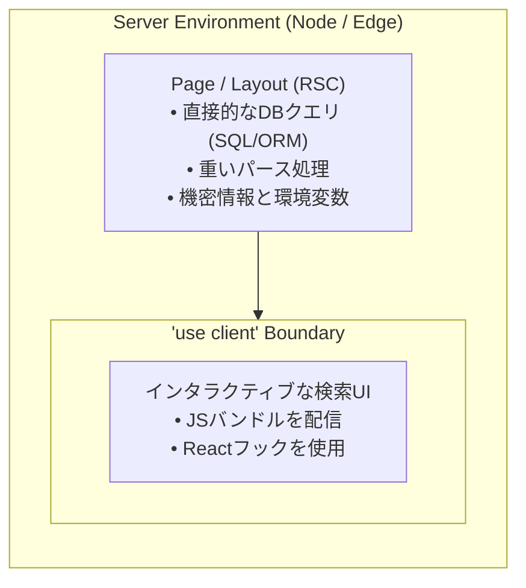

Pages RouterからApp Routerへの移行は、Hooksの導入以来、Reactアプリケーション開発において最も重要なパラダイムシフトである。しかし、リリースから数年が経過した現在でも、キャッシュ無効化の微妙な挙動、ハイドレーションの不一致、クライアントとサーバーの境界の混同、サーバーレス環境におけるコネクション枯渇といった問題に開発チームは頻繁に直面している。

本ガイドは、2026年のNext.js App Routerを用いてプロダクションアプリケーションを構築、構造化、および運用するためのアーキテクチャ設計図および実践的な運用マニュアルである。

---

## 1. コアメンタルモデル：サーバーコンポーネントファースト

App Routerを扱う際、多くの開発者が犯す根本的な間違いは、React Server Components (RSC) をオプトインの最適化機能として扱うことである。App Routerでは、**すべてがデフォルトでサーバーコンポーネントである**。

サーバーコンポーネントは、リクエスト時またはビルド時にサーバー上でのみ実行される。ランタイムのJavaScriptをクライアントブラウザに送信することはなく、純粋に情報を提供するコンポーネントのバンドルペイロードを0キロバイトに削減する。



### クライアント境界をどこまで押し下げるべきか

一般的なアンチパターンは、ページや上位のレイアウトの先頭に `'use client'` を配置することである。これにより、そのブランチ内のすべての子コンポーネントが即座にクライアントコンポーネントに変換され、RSCのバンドルサイズ縮小やキャッシュの利点が失われる。

代わりに、`'use client'` をコンポーネントツリーの可能な限り下層に押し下げるべきである：

```tsx
// app/[locale]/products/page.tsx - サーバーコンポーネント
import { Suspense } from 'react';
import { db } from '@/lib/db';
import { ProductCard } from '@/components/ProductCard';
import { SearchFilter } from '@/components/SearchFilter'; // クライアントコンポーネント

export default async function ProductsPage({
  searchParams,
}: {
  searchParams: { q?: string; category?: string };
}) {
  // 内部的なHTTPオーバーヘッドなしで、サーバー上で直接安全にデータベースクエリを実行
  const products = await db.product.findMany({
    where: {
      category: searchParams.category,
      title: { contains: searchParams.q, mode: 'insensitive' },
    },
  });

  return (
    <div className="space-y-6">
      {/* 入力とフィルタリングのためのインタラクティブなクライアントコンポーネント */}
      <SearchFilter />
      
      {/* 非インタラクティブなサーバーレンダリングカード */}
      <div className="grid grid-cols-1 md:grid-cols-3 gap-6">
        {products.map((item) => (
          <ProductCard key={item.id} product={item} />
        ))}
      </div>
    </div>
  );
}
```

---

## 2. エンタープライズ向けフォルダ構造とルートグループ

Next.jsのコードベースを数十人の開発者規模に拡張するには、ルートの乱雑さを避けつつ、コードのコロケーション（近接配置）を促進する整理されたディレクトリ構成が必要となる。

```
app/
├── [locale]/                      # 動的ロケールセグメント (i18n)
│   ├── (marketing)/               # ルートグループ: 未認証マーケティングシェル
│   │   ├── about/
│   │   │   └── page.tsx
│   │   ├── layout.tsx             # マーケティング用ナビゲーションとフッター
│   │   └── page.tsx               # ランディングページ
│   ├── (dashboard)/               # ルートグループ: 認証済みダッシュボードシェル
│   │   ├── settings/
│   │   │   └── page.tsx
│   │   ├── layout.tsx             # サイドバーと認証済みセッションのレイアウト
│   │   └── page.tsx               # アナリティクス概要
│   ├── blog/
│   │   ├── [slug]/
│   │   │   ├── opengraph-image.tsx # 動的OG画像ジェネレーター
│   │   │   └── page.tsx
│   │   ├── layout.tsx
│   │   └── page.tsx
│   ├── api/
│   │   └── webhooks/
│   │       └── stripe/
│   │           └── route.ts       # Edge / サーバーレス ルートハンドラー
│   ├── layout.tsx                 # ルートのHTML/Bodyレイアウトとテーマプロバイダー
│   ├── not-found.tsx              # ローカライズされた404ハンドラー
│   └── error.tsx                  # ローカライズされたエラーバウンダリ
```

### ルート構成の原則

1. **ルートグループ `(group)`**: URLパスを変更することなくルートを論理的にグループ化するために括弧付きフォルダを使用する。これにより、アプリの異なるセクション（例：マーケティングとダッシュボード）に個別のレイアウトを適用できる。
2. **プライベートフォルダ `_components`**: アンダースコアを接頭辞としたフォルダはルーティングから完全に除外されるため、それを使用するルートの隣にコンポーネント、フック、ユーティリティをコロケーションできる。
3. **パラレルルート `@modal`**: 同じレイアウト内で複数のページを並行してレンダリングできる。コンテキストに応じたモーダル、サイドバー、マルチビューパネルに最適である。
4. **インターセプティングルート `(.)photo`**: ルートナビゲーションをインターセプトし、直接のURLを共有可能かつリフレッシュ可能な状態に保ちながら、モーダル内にプレビューを表示する。

---

## 3. 4層キャッシュアーキテクチャ

Next.jsのキャッシュを理解することは、古いデータを提供したり、外部APIのレート制限を使い果たしたりする事態を避けるために不可欠である。App Routerは4つの異なるキャッシュレイヤーを実装している：

| キャッシュレイヤー | 保存場所 | 目的 | 有効期間 |
|---|---|---|---|
| **Request Memoization** | サーバーのメモリ | 単一レンダーサイクル内での同一の `fetch` GET呼び出しの重複排除 | リクエスト単位 |
| **Data Cache** | サーバーの永続ストレージ | ユーザーおよびデプロイメントをまたいだクロスリクエストのfetch結果の保存 | 無効化されるまで永続 |
| **Full Route Cache** | サーバー (HTML / RSCペイロード) | ビルド時または再検証時における静的ルートセグメントのプレレンダリング | 無効化されるまで永続 |
| **Router Cache** | ブラウザのメモリ | 訪問済みルートのRSCペイロードのクライアントサイドインメモリキャッシュ | セッション中 / 30秒〜5分 |

### キャッシュタグによるきめ細かいRevalidation

ページ全体を再検証（revalidate）するのではなく、個々のデータフェッチにセマンティックなキャッシュタグを付与する：

```typescript
// lib/data/articles.ts
export async function getFeaturedArticles() {
  const res = await fetch('https://api.example.com/articles?featured=true', {
    next: {
      tags: ['articles', 'articles-featured'],
      revalidate: 3600, // バックグラウンドでの再検証フォールバック (1時間)
    },
  });

  if (!res.ok) throw new Error('Failed to fetch articles');
  return res.json();
}
```

新しいコンテンツが公開された際は、ルートハンドラーまたはサーバーアクションから、影響を受けるタグのみを無効化する：

```typescript
// app/api/revalidate/route.ts
import { revalidateTag } from 'next/cache';
import { NextRequest, NextResponse } from 'next/server';

export async function POST(request: NextRequest) {
  const secret = request.headers.get('x-revalidate-secret');
  if (secret !== process.env.REVALIDATION_SECRET) {
    return NextResponse.json({ message: 'Invalid token' }, { status: 401 });
  }

  const tag = request.nextUrl.searchParams.get('tag');
  if (tag) {
    revalidateTag(tag);
    return NextResponse.json({ revalidated: true, tag, now: Date.now() });
  }

  return NextResponse.json({ message: 'Missing tag parameter' }, { status: 400 });
}
```

---

## 4. サーバーアクションとミューテーション

サーバーアクション（Server Actions）を使用すると、ボイラープレートとなるAPIルートハンドラーを作成することなく、クライアントコンポーネントから非同期のサーバー関数を直接呼び出すことができる。

### `useActionState` によるプログレッシブエンハンスメント

モダンなNext.jsおよびReact 19では、堅牢なフォームバリデーション、ペンディング状態の追跡、およびアクセシブルなステータスメッセージのために `useActionState` フックを使用する：

```tsx
// app/[locale]/newsletter/NewsletterForm.tsx
'use client';

import { useActionState } from 'react';
import { subscribeNewsletter } from '@/actions/newsletter';

interface ActionState {
  success?: boolean;
  message?: string;
  errors?: Record<string, string[]>;
}

const initialState: ActionState = {};

export function NewsletterForm() {
  const [state, formAction, isPending] = useActionState(subscribeNewsletter, initialState);

  return (
    <form action={formAction} className="space-y-4 max-w-md">
      <div>
        <label htmlFor="email" className="block text-sm font-medium mb-1">
          Work Email
        </label>
        <input
          id="email"
          name="email"
          type="email"
          required
          placeholder="engineer@company.com"
          className="w-full px-4 py-2 border rounded-lg dark:bg-gray-900 dark:border-gray-700"
        />
        {state.errors?.email && (
          <p className="text-red-500 text-xs mt-1">{state.errors.email[0]}</p>
        )}
      </div>

      <button
        type="submit"
        disabled={isPending}
        className="px-5 py-2 bg-blue-600 hover:bg-blue-700 text-white rounded-lg disabled:opacity-50"
      >
        {isPending ? 'Subscribing...' : 'Subscribe'}
      </button>

      {state.message && (
        <p className={`text-sm ${state.success ? 'text-green-600' : 'text-red-500'}`}>
          {state.message}
        </p>
      )}
    </form>
  );
}
```

---

## 5. サーバーレス環境におけるデータベースコネクションプーリング

サーバーレスNext.jsデプロイメント（VercelやAWS Lambdaなど）で頻発する落とし穴は、着信リクエストごとに新しいデータベース接続を開き、PostgreSQLやMySQLの接続上限を瞬時に枯渇させてしまうことである。

### 推奨されるプーリングアーキテクチャ

```
[Vercel Lambda 1] -+
[Vercel Lambda 2] -+-> [Pooler: PgBouncer]
[Vercel Lambda N] -+         |
                             v
                    [PostgreSQL Primary]
```

1. **トランザクションプーリングの使用**: サーバーレスLambdaは、常にポート `6543` のトランザクションモードで動作するプーラーを介して接続する。
2. **グローバルクライアントシングルトン**: ウォーム状態のLambda呼び出し間で接続を再利用するために、Nodeの `globalThis` オブジェクト上にORMクライアント（PrismaやDrizzleなど）をインスタンス化する：

```typescript
// lib/db.ts
import { PrismaClient } from '@prisma/client';

const globalForPrisma = globalThis as unknown as {
  prisma: PrismaClient | undefined;
};

export const db =
  globalForPrisma.prisma ??
  new PrismaClient({
    log: process.env.NODE_ENV === 'development' ? ['query', 'error', 'warn'] : ['error'],
  });

if (process.env.NODE_ENV !== 'production') globalForPrisma.prisma = db;
```

---

## 6. Reactハイドレーションエラーの排除

ReactのMinified Error #418および#423は、サーバーでレンダリングされたHTMLが、初期のクライアント側仮想DOM表現と一致しない場合に発生する。

### 主な原因と解決策

1. **動的なタイムスタンプ / ローカル日時**: サーバー上で `new Date().toLocaleDateString()` をレンダリングするとUTCやサーバーのタイムゾーンになるが、クライアントのブラウザはユーザーのローカルタイムゾーンとして解決する。
   - *解決策*: 日時を決定論的にフォーマットするか、クライアントに依存する時刻のフォーマットを、ローカライズされたクライアントコンポーネントを介してマウント後に遅延させる。
2. **ブラウザ拡張機能**: パスワードマネージャーや翻訳拡張機能は、`<input>` や `<body>` に属性を注入する。
   - *解決策*: ルートの `<html>` または `<body>` 要素に `suppressHydrationWarning` を追加する。
3. **無効なHTMLネスト**: `<p>` タグ内に `<div>` を配置すると、Reactがハイドレーションを行う前にブラウザのパーサーがDOM階層を変更してしまう。
   - *解決策*: DOMのネスト規則を厳密に検証する。

---

## 7. パーシャルプレレンダリング (PPR) とストリーミング

パーシャルプレレンダリング（Partial Prerendering）は、静的生成の速度と動的なデータのパーソナライズを組み合わせたものである：

```tsx
// app/[locale]/dashboard/page.tsx
import { Suspense } from 'react';
import { UserGreeting } from './UserGreeting';
import { StaticMarketingBanner } from './StaticMarketingBanner';
import { MetricsSkeleton } from './MetricsSkeleton';

export const experimental_ppr = true;

export default function DashboardPage() {
  return (
    <div className="space-y-6">
      {/* 1. 静的シェル: エッジのCDNキャッシュから即座に配信される */}
      <StaticMarketingBanner />

      {/* 2. 動的ホール: データ解決時にHTTPチャンキングを通じてストリーミングされる */}
      <Suspense fallback={<MetricsSkeleton />}>
        <UserGreeting />
      </Suspense>
    </div>
  );
}
```

ユーザーは最も近いエッジのPoint of Presence (POP) から、TTFB (Time to First Byte) 0ミリ秒でシェルを即座に受け取り、その間、パーソナライズされたデータベースクエリはページ読み込みをブロックすることなくSuspenseバウンダリを通じてストリーミングされる。

---

## 8. プロダクションレディネス・チェックリスト

Next.js App Routerアプリケーションをプロダクション環境にデプロイする前に、以下を確認すること：

- [ ] **セキュリティ**: Content Security Policy (CSP) で許可されたオリジンが明示的に設定されていること。
- [ ] **ヘッダー**: `next.config.js` で `X-Frame-Options: DENY`、`X-Content-Type-Options: nosniff`、および `Referrer-Policy: strict-origin-when-cross-origin` が有効化されていること。
- [ ] **画像**: すべてのヒーロー画像でNext.jsの `<Image priority>` を利用し、明示的な `sizes` が定義されていること。
- [ ] **サブモジュール**: CIビルドコマンドでGitサブモジュールが更新および検証されていること。
- [ ] **動的コンポーネント**: 重いライブラリ（Mermaid、コードハイライター、KBarモーダルなど）が `next/dynamic` で動的にインポートされていること。
- [ ] **データベース**: サーバーレス環境においてコネクションプーラーが利用されていること。

---

## 関連情報

- [Next.js App Router フォルダ構造: ベストプラクティスとエンタープライズアーキテクチャ (2026年)](/ja/blog/nextjs-app-router-folder-structure)
- [Next.js App Router 動的Revalidationガイド](/ja/blog/nextjs-app-router-revalidate-tag-cache)
- [Next.js 14 App Router キャッシングの深掘り: 古いデータのデバッグ](/ja/blog/nextjs-14-app-router-caching-strategies)
- [Prismaを用いたNext.js App Router: セットアップとコネクションプーリング](/ja/blog/nextjs-prisma-app-router)

## よくある質問

### サーバーアクションとルートハンドラーの違いは何ですか？
ルートハンドラー（`route.ts`）は、Webhook、パブリックAPI、サードパーティ統合向けの標準的なRESTful HTTPエンドポイントを提供する。サーバーアクションは、Reactのフォームミューテーション用に特化して設計されたRPCライクな関数であり、自動的なキャッシュ無効化と `useActionState` や `useOptimistic` といったReactフックとのネイティブな統合を提供する。

### 同じプロジェクト内でPages RouterとApp Routerを混在させることは可能ですか？
可能である。Next.jsは、段階的な移行のために両方のルーターを並行して実行することをサポートしている。`pages/` 内のページと `app/` 内のルートは共存するが、App RouterのレイアウトでPages Routerのルートをラップすることはできない。

### サーバーサイドキャッシュはユーザー固有のデータにどのように影響しますか？
`cookies()`、`headers()` の呼び出しや `searchParams` へのアクセスといった動的関数は、そのルートセグメントをFull Route Cacheから自動的にオプトアウトさせる。ユーザー固有のデータを扱う場合は、キャッシュをグローバルに無効化するのではなく、React Suspenseを用いたきめ細かいストリーミングを活用すべきである。