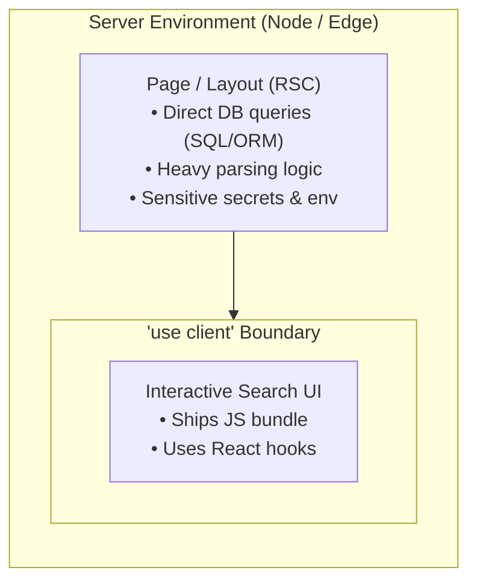

Quá trình chuyển đổi từ Pages Router sang App Router đánh dấu sự thay đổi hệ tư tưởng (paradigm shift) lớn nhất trong phát triển ứng dụng React kể từ khi Hooks ra mắt. Tuy nhiên, nhiều năm sau khi phát hành, các team engineer vẫn thường xuyên chật vật với những tiểu tiết phức tạp của việc invalidate cache, lỗi hydration mismatch, sự nhầm lẫn về ranh giới client-server và tình trạng cạn kiệt connection (connection exhaustion) trong các môi trường runtime serverless.

Tài liệu này đóng vai trò như một bản thiết kế kiến trúc và sổ tay vận hành thực tế để xây dựng, cấu trúc và chạy các ứng dụng production với Next.js App Router trong năm 2026.

---

## 1. Mô hình tư duy cốt lõi: Ưu tiên Server Components

Sai lầm cơ bản nhất mà đa số developer mắc phải khi tiếp cận App Router là xem React Server Components (RSC) như một kỹ thuật tối ưu hóa tùy chọn (opt-in). Trong App Router, **mọi thứ đều là Server Component theo mặc định**.

Server Components chạy hoàn toàn ở request time hoặc build time trên server. Chúng không bao giờ gửi runtime JavaScript xuống trình duyệt client, giúp giảm payload bundle xuống mức 0 kilobyte đối với các component thuần hiển thị thông tin.



### Khi nào cần đẩy ranh giới Client xuống sâu hơn

Một anti-pattern phổ biến là đặt `'use client'` ở đầu trang hoặc tại layout cấp cao. Thao tác này ngay lập tức chuyển đổi toàn bộ các component con trong nhánh đó thành client component, đánh mất lợi ích về kích thước bundle và caching của RSC.

Thay vào đó, hãy đẩy `'use client'` xuống sâu nhất có thể trong component tree:

```tsx
// app/[locale]/products/page.tsx - Server Component
import { Suspense } from 'react';
import { db } from '@/lib/db';
import { ProductCard } from '@/components/ProductCard';
import { SearchFilter } from '@/components/SearchFilter'; // Client component

export default async function ProductsPage({
  searchParams,
}: {
  searchParams: { q?: string; category?: string };
}) {
  // Trực tiếp query database bảo mật trên server mà không gặp overhead của internal HTTP
  const products = await db.product.findMany({
    where: {
      category: searchParams.category,
      title: { contains: searchParams.q, mode: 'insensitive' },
    },
  });

  return (
    <div className="space-y-6">
      {/* Client component tương tác dành cho input và filtering */}
      <SearchFilter />
      
      {/* Các card render trên server, không có tính tương tác */}
      <div className="grid grid-cols-1 md:grid-cols-3 gap-6">
        {products.map((item) => (
          <ProductCard key={item.id} product={item} />
        ))}
      </div>
    </div>
  );
}
```

---

## 2. Cấu trúc thư mục Enterprise & Route Groups

Việc scale một codebase Next.js cho hàng chục developer đòi hỏi một layout thư mục được tổ chức tốt nhằm tránh tình trạng lộn xộn route, đồng thời khuyến khích việc gom nhóm code (code colocation).

```
app/
├── [locale]/                      # Dynamic locale segment (i18n)
│   ├── (marketing)/               # Route Group: Unauthenticated marketing shell
│   │   ├── about/
│   │   │   └── page.tsx
│   │   ├── layout.tsx             # Marketing nav and footer
│   │   └── page.tsx               # Landing page
│   ├── (dashboard)/               # Route Group: Authenticated dashboard shell
│   │   ├── settings/
│   │   │   └── page.tsx
│   │   ├── layout.tsx             # Sidebar and authenticated session layout
│   │   └── page.tsx               # Analytics overview
│   ├── blog/
│   │   ├── [slug]/
│   │   │   ├── opengraph-image.tsx # Dynamic OG image generator
│   │   │   └── page.tsx
│   │   ├── layout.tsx
│   │   └── page.tsx
│   ├── api/
│   │   └── webhooks/
│   │       └── stripe/
│   │           └── route.ts       # Edge / Serverless Route Handler
│   ├── layout.tsx                 # Root HTML/Body layout with theme providers
│   ├── not-found.tsx              # Localized 404 handler
│   └── error.tsx                  # Localized error boundary
```

### Các nguyên tắc tổ chức Route

1. **Route Groups `(group)`**: Sử dụng các thư mục có dấu ngoặc đơn để nhóm các route lại với nhau về mặt logic mà không làm thay đổi đường dẫn URL. Tính năng này cho phép bạn áp dụng các layout khác biệt (ví dụ: Marketing vs Dashboard) cho các phần khác nhau của ứng dụng.
2. **Private Folders `_components`**: Các thư mục có tiền tố là dấu gạch dưới sẽ loại bỏ hoàn toàn khỏi hệ thống routing, cho phép bạn gom các component, hook và utility ngay bên cạnh các route sử dụng chúng.
3. **Parallel Routes `@modal`**: Cho phép render đồng thời một hoặc nhiều trang trong cùng một layout, lý tưởng cho các modal theo ngữ cảnh (contextual modals), sidebar và các panel đa dạng (multi-view panels).
4. **Intercepting Routes `(.)photo`**: Chặn luồng điều hướng route để hiển thị các bản preview bên trong modal trong khi vẫn giữ các URL trực tiếp có thể share và refresh được.

---

## 3. Kiến trúc Caching 4 tầng

Hiểu rõ cơ chế caching của Next.js là yếu tố then chốt để tránh việc phân phối dữ liệu cũ (stale data) hoặc làm cạn kiệt rate limit của external API. App Router triển khai 4 tầng cache riêng biệt:

| Tầng Cache (Cache Layer) | Vị trí lưu trữ | Mục đích | Vòng đời (Lifetime) |
|---|---|---|---|
| **Request Memoization** | Server Memory | Khử trùng lặp (Deduplicates) các lệnh gọi `fetch` GET giống hệt nhau trong một render cycle | Per Request |
| **Data Cache** | Server Persistent Storage | Lưu trữ kết quả fetch qua nhiều request của nhiều user và deployment khác nhau | Persistent cho đến khi bị revalidate |
| **Full Route Cache** | Server (HTML / RSC Payload) | Pre-render các route segment tĩnh tại thời điểm build hoặc revalidation | Persistent cho đến khi bị revalidate |
| **Router Cache** | Browser Memory | Cache in-memory ở phía client của các payload RSC đối với các route đã truy cập | Session / 30s-5m |

### Fine-Grained Revalidation với Cache Tags

Thay vì revalidate toàn bộ trang, hãy gắn các cache tag có ý nghĩa ngữ nghĩa vào từng thao tác fetch dữ liệu cụ thể:

```typescript
// lib/data/articles.ts
export async function getFeaturedArticles() {
  const res = await fetch('https://api.example.com/articles?featured=true', {
    next: {
      tags: ['articles', 'articles-featured'],
      revalidate: 3600, // Background revalidation fallback (1 giờ)
    },
  });

  if (!res.ok) throw new Error('Failed to fetch articles');
  return res.json();
}
```

Khi content mới được publish, chỉ invalidate tag bị ảnh hưởng thông qua Route Handler hoặc Server Action:

```typescript
// app/api/revalidate/route.ts
import { revalidateTag } from 'next/cache';
import { NextRequest, NextResponse } from 'next/server';

export async function POST(request: NextRequest) {
  const secret = request.headers.get('x-revalidate-secret');
  if (secret !== process.env.REVALIDATION_SECRET) {
    return NextResponse.json({ message: 'Invalid token' }, { status: 401 });
  }

  const tag = request.nextUrl.searchParams.get('tag');
  if (tag) {
    revalidateTag(tag);
    return NextResponse.json({ revalidated: true, tag, now: Date.now() });
  }

  return NextResponse.json({ message: 'Missing tag parameter' }, { status: 400 });
}
```

---

## 4. Server Actions & Mutations

Server Actions cho phép client component gọi trực tiếp các hàm bất đồng bộ (asynchronous) trên server mà không cần phải viết boilerplate cho các API Route Handlers.

### Progressive Enhancement với `useActionState`

Trong Next.js hiện đại và React 19, hãy sử dụng hook `useActionState` để validate form mạnh mẽ, theo dõi trạng thái pending và xử lý các thông báo trạng thái có tính accessibility cao:

```tsx
// app/[locale]/newsletter/NewsletterForm.tsx
'use client';

import { useActionState } from 'react';
import { subscribeNewsletter } from '@/actions/newsletter';

interface ActionState {
  success?: boolean;
  message?: string;
  errors?: Record<string, string[]>;
}

const initialState: ActionState = {};

export function NewsletterForm() {
  const [state, formAction, isPending] = useActionState(subscribeNewsletter, initialState);

  return (
    <form action={formAction} className="space-y-4 max-w-md">
      <div>
        <label htmlFor="email" className="block text-sm font-medium mb-1">
          Work Email
        </label>
        <input
          id="email"
          name="email"
          type="email"
          required
          placeholder="engineer@company.com"
          className="w-full px-4 py-2 border rounded-lg dark:bg-gray-900 dark:border-gray-700"
        />
        {state.errors?.email && (
          <p className="text-red-500 text-xs mt-1">{state.errors.email[0]}</p>
        )}
      </div>

      <button
        type="submit"
        disabled={isPending}
        className="px-5 py-2 bg-blue-600 hover:bg-blue-700 text-white rounded-lg disabled:opacity-50"
      >
        {isPending ? 'Subscribing...' : 'Subscribe'}
      </button>

      {state.message && (
        <p className={`text-sm ${state.success ? 'text-green-600' : 'text-red-500'}`}>
          {state.message}
        </p>
      )}
    </form>
  );
}
```

---

## 5. Database Connection Pooling trong môi trường Serverless

Một cạm bẫy thường gặp trong các đợt deploy serverless Next.js (như Vercel hoặc AWS Lambda) là việc mở một kết nối database mới trên mỗi request gửi tới, dẫn đến việc cạn kiệt giới hạn connection của PostgreSQL hoặc MySQL một cách nhanh chóng.

### Kiến trúc Pooling được đề xuất

```
[Vercel Lambda 1] -+
[Vercel Lambda 2] -+-> [Pooler: PgBouncer]
[Vercel Lambda N] -+         |
                             v
                    [PostgreSQL Primary]
```

1. **Sử dụng Transaction Pooling**: Luôn kết nối các serverless lambda qua một pooler hoạt động ở transaction mode trên port `6543`.
2. **Global Client Singleton**: Khởi tạo ORM client (ví dụ: Prisma hoặc Drizzle) trên object `globalThis` của Node để tái sử dụng các kết nối trên các lần gọi lambda (warm invocations):

```typescript
// lib/db.ts
import { PrismaClient } from '@prisma/client';

const globalForPrisma = globalThis as unknown as {
  prisma: PrismaClient | undefined;
};

export const db =
  globalForPrisma.prisma ??
  new PrismaClient({
    log: process.env.NODE_ENV === 'development' ? ['query', 'error', 'warn'] : ['error'],
  });

if (process.env.NODE_ENV !== 'production') globalForPrisma.prisma = db;
```

---

## 6. Loại bỏ lỗi React Hydration

React Minified Error #418 và #423 xảy ra khi HTML được render trên server không khớp với biểu diễn virtual DOM ban đầu trên client.

### Các nguyên nhân chính và Giải pháp xử lý

1. **Dynamic Timestamps / Local Dates**: Render `new Date().toLocaleDateString()` trên server tạo ra time ở chuẩn UTC hoặc timezone của server, nhưng trình duyệt client lại resolve theo múi giờ cục bộ của người dùng.
   - *Fix*: Format date một cách deterministically (tất định) hoặc trì hoãn việc format thời gian phụ thuộc client cho đến khi mount thông qua một client component đã được localize.
2. **Browser Extensions**: Các trình quản lý mật khẩu (password managers) và extension phiên dịch sẽ inject attribute vào thẻ `<input>` hoặc `<body>`.
   - *Fix*: Thêm thuộc tính `suppressHydrationWarning` vào element gốc `<html>` hoặc `<body>`.
3. **Invalid HTML Nesting**: Đặt thẻ `<div>` bên trong thẻ `<p>` khiến trình phân tích cú pháp của trình duyệt (browser parser) thay đổi hệ thống phân cấp DOM trước khi React thực hiện hydrate.
   - *Fix*: Tuân thủ chặt chẽ các quy tắc nesting DOM.

---

## 7. Partial Prerendering (PPR) & Streaming

Partial Prerendering kết hợp tốc độ của static generation với khả năng cá nhân hóa dữ liệu động (dynamic data):

```tsx
// app/[locale]/dashboard/page.tsx
import { Suspense } from 'react';
import { UserGreeting } from './UserGreeting';
import { StaticMarketingBanner } from './StaticMarketingBanner';
import { MetricsSkeleton } from './MetricsSkeleton';

export const experimental_ppr = true;

export default function DashboardPage() {
  return (
    <div className="space-y-6">
      {/* 1. Static Shell: Phục vụ ngay lập tức từ edge CDN cache */}
      <StaticMarketingBanner />

      {/* 2. Dynamic Hole: Stream qua HTTP chunking khi dữ liệu resolve */}
      <Suspense fallback={<MetricsSkeleton />}>
        <UserGreeting />
      </Suspense>
    </div>
  );
}
```

Người dùng nhận được shell ngay lập tức từ point-of-presence (POP) edge gần nhất với chỉ số TTFB ở mức 0ms, trong khi các truy vấn database cá nhân hóa được stream qua các ranh giới Suspense mà không block quá trình load trang.

---

## 8. Checklist kiểm tra độ sẵn sàng cho Production

Trước khi đẩy ứng dụng Next.js App Router lên production, hãy xác minh các điều sau:

- [ ] **Security**: Content Security Policy (CSP) được cấu hình với các domain được cấp phép rõ ràng (allowed origins).
- [ ] **Headers**: Kích hoạt `X-Frame-Options: DENY`, `X-Content-Type-Options: nosniff`, và `Referrer-Policy: strict-origin-when-cross-origin` trong file `next.config.js`.
- [ ] **Images**: Tất cả hero image đều sử dụng component `<Image priority>` của Next.js và định nghĩa thuộc tính `sizes` rõ ràng.
- [ ] **Submodules**: Các Git submodule được update và kiểm chứng trong chuỗi lệnh build CI.
- [ ] **Dynamic Components**: Các thư viện nặng (Mermaid, code highlighters, KBar modals) được import động bằng hàm `next/dynamic`.
- [ ] **Database**: Connection pooler được sử dụng trong các môi trường serverless.

---

## Bài viết liên quan

- [Cấu trúc thư mục Next.js App Router: Best Practice & Kiến trúc Enterprise (2026)](/vi/blog/nextjs-app-router-folder-structure)
- [Hướng dẫn Dynamic Revalidation trong Next.js App Router](/vi/blog/nextjs-app-router-revalidate-tag-cache)
- [Phân tích chuyên sâu Caching Next.js 14 App Router: Debug Stale Data](/vi/blog/nextjs-14-app-router-caching-strategies)
- [Next.js App Router với Prisma: Cài đặt & Connection Pooling](/vi/blog/nextjs-prisma-app-router)

## Các câu hỏi thường gặp

### Sự khác biệt giữa Server Actions và Route Handlers là gì?
Route Handlers (`route.ts`) cung cấp các endpoint HTTP theo chuẩn RESTful dành cho webhooks, public API, và các tích hợp bên thứ ba. Server Actions là các hàm dạng RPC được thiết kế đặc thù cho các thao tác react form mutation, cung cấp tính năng invalidate cache tự động và tích hợp native với các React hook như `useActionState` và `useOptimistic`.

### Tôi có thể dùng chung Pages Router và App Router trong cùng một dự án không?
Có. Next.js hỗ trợ chạy song song cả hai router trong quá trình chuyển đổi dần dần (incremental migration). Các page trong thư mục `pages/` và route trong thư mục `app/` sẽ cùng tồn tại, nhưng layout của App Router không thể wrap các route của Pages Router.

### Caching phía Server (Server-Side Caching) ảnh hưởng đến dữ liệu đặc thù người dùng như thế nào?
Các hàm dynamic như `cookies()`, `headers()`, và việc truy cập `searchParams` sẽ tự động đưa route segment đó thoát khỏi Full Route Cache. Đối với dữ liệu theo người dùng cụ thể, hãy tận dụng React Suspense với fine-grained streaming thay vì vô hiệu hóa hoàn toàn cache trên toàn bộ hệ thống.